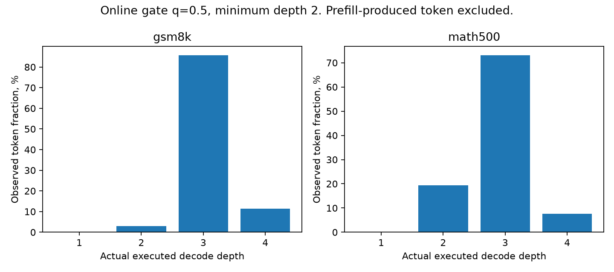
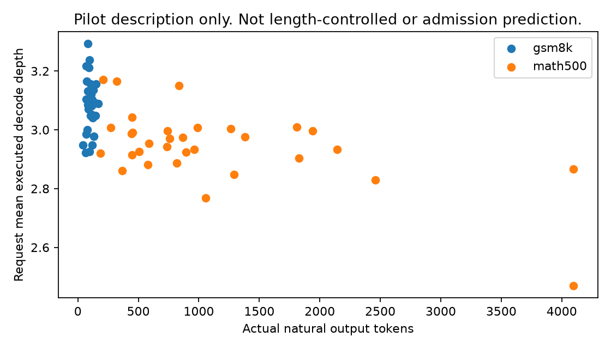

# Online decode-depth traces

Status: **MEASURED Stage-0 quality diagnostics only**.
The requested diverse Stage-1 serving cohort remains `NOT_RUN`.
The study does not relabel this math-only quality pilot as that serving cohort.

## Cohort and information horizon

The final pilot contains 32 GSM8K questions and 32 MATH-500 questions.
Both fixed and adaptive policies generate a separate natural answer for every question.
The primary comparison therefore contains 128 recorded generation runs.
The earlier benchmark manifest supplies public question text and answer keys.
This is not a claim of globally untouched benchmark data.

Metadata-only hashes determine the question order before all model outputs.
The first pilot uses 16 questions per domain.
The bounded continuation uses the next 16 in that same order.
It preserves the first pilot and does not tune q or answer extraction.
The continuation precedes its own inference but follows the first pilot's analysis.
`protocol_v3_addendum.json` explains the inherited timing field in that frozen manifest.

The compact primary trace contains 74,737 actual decode exit events.
Its file is `artifacts/pilot_export_v2/decode_depth_traces.jsonl.gz`.
The first generated token is absent from these events because full-depth prefill produces it.
Actual generated lengths include natural EOS or stop behavior and the predefined cap.
The runner does not force tokens after EOS.

## Actual depth distribution

| Dataset | Executed depth | Observed decode tokens |
|---|---:|---:|
| gsm8k | 2 | 94 |
| gsm8k | 3 | 2785 |
| gsm8k | 4 | 372 |
| math500 | 2 | 6935 |
| math500 | 3 | 26128 |
| math500 | 4 | 2694 |

These token counts describe execution.
They are not independent statistical samples for accuracy or scheduling gain.
The online gate uses the current completed recurrent state, not a recorded future depth schedule.
Request IDs, input/output token IDs, positions, GPU IDs, scheduler ticks, and actual depths remain in the raw trace.

## Descriptive request variation

| Dataset | Adaptive requests | Prompt tokens, range | Actual output tokens, range | Between-request mean-depth variance | Extra latency value beyond length |
|---|---:|---:|---:|---:|---|
| gsm8k | 32 | 293–387 | 40–168 | 0.007828 | UNMEASURED |
| math500 | 32 | 46–318 | 188–4096 | 0.015116 | UNMEASURED |

The variance is descriptive and unconditioned.
It does not establish request heterogeneity beyond prompt length, output length, and domain.
The depth-versus-length scatter is not a causal predictor evaluation.
No length-matched regression or cross-rank idle witness qualifies a Stage-1 result.

## Files and limits

`request_depth_summary.csv` preserves each measured generation's depth, length, host wall time, and finish reason.
`depth_histogram.csv` preserves the plotted counts.
`trace_manifest.json` records the model/runtime identity and evidence category.
The original per-request JSON also preserves the complete generated text and IDs.

The trace does not isolate GPU loop service time, queue waiting, or efficient mixed-depth refill.
The quality workers use B1 and heavy Python exit recording.
Four such workers are not a measured DP4 placement service.
The longer-cap follow-up remains separate from this primary export.

