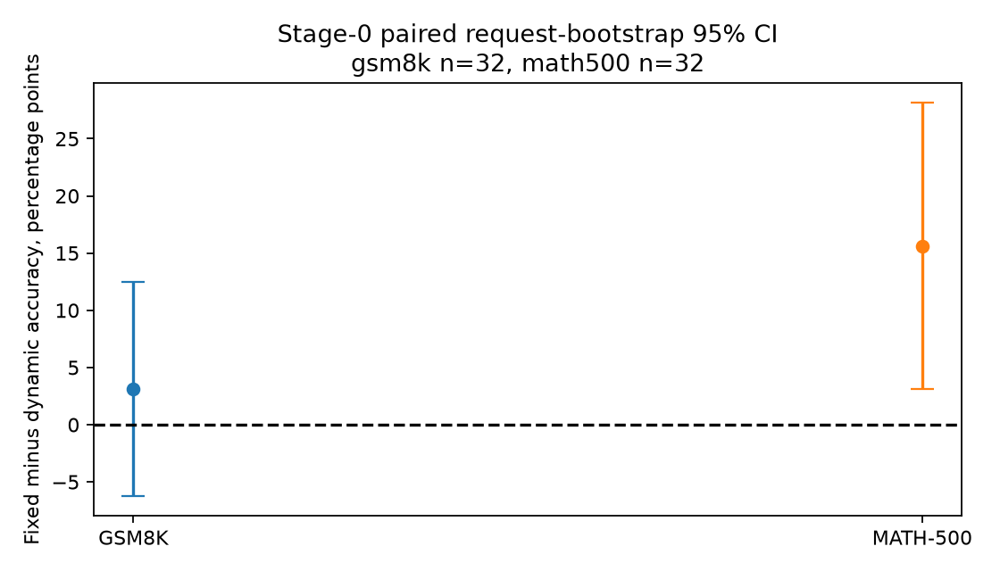

# Decode-first dynamic-depth-aware DP scheduling discovery

## Decision

Verdict: **QUALITY_FAIL**.

The tested adaptive operating point fails the registered severe pilot quality gate.
Actual online early exit physically omits recurrent work.
That fact does not establish additional DP4 scheduling headroom.
The study stops at Stage 0 and does not train a predictor or an RL policy.

The conclusion applies to the tested CDB configuration.
It does not prove that every Ouro gate or cross-GPU depth-balancing policy fails.
The study reports no measured or simulated DP scheduling speedup.

## Model, hardware, and runtime

The adaptive candidate is **ByteDance/Ouro-1.4B**, not Ouro-1.4B-Thinking.
Its immutable revision is `574fa66cb8bf5abdc979642d01cf2b79b16bfab1`.
The spec permits this change because previous Thinking fixed-R4 validation does not establish adaptive support.
No Thinking accuracy result transfers to the base checkpoint.

The model uses BF16, 24 shared layers, maximum depth four, and 96 depth/layer KV slots.
It has hidden size 2,048 and 16 query/KV heads.
The official CDB revision is `abdfae0adbdd12be8c6123ccb34eee98a38afb39`.
The wrapper does not implement a new inference engine.

Only physical GPUs 4, 5, 6, and 7 execute model work.
They are H100 80GB devices with NV18 connectivity between the assigned pairs.
The full mask maps physical 4/5/6/7 to logical 0/1/2/3.
Each quality worker instead uses its one-device subset as logical CUDA 0.
Each worker is TP1/EP1/PP1/CP1.
Their concurrent quality shards do not establish a live DP4 scheduler baseline.

The primary gate remains q=0.5, minimum R2, maximum R4.
It uses the checkpoint's original trained gate, same-step cumulative hazard, and `last_exited` KV propagation.
The policy does not use future token depths or untrained auxiliary gate heads.
Prefill remains full depth and produces the first output token.

## Physical execution and reference qualification

The bounded execution probe has 13 prompt tokens and 15 subsequent decode positions.
Both policies execute 52 prefill recurrent token-steps.
Fixed R4 executes 60 decode token-steps and 1,536 actual decoder-layer calls.
Adaptive execution uses 44 decode token-steps and 1,152 actual decoder-layer calls.
The 384-call difference confirms physical loop omission.

All 360 checked exit-KV copies match their source rows exactly after synchronization.
The cache retains independent depth slots rather than one shared slot.
The diagnostic's repeated completion waits do not support clean latency claims.

| Official HF comparison | Result | Interpretation |
|---|---:|---|
| Maximum logit absolute difference | 0.25, limit 0.5 | Numerical limit PASS |
| Mean logit absolute difference | 0.0236194, limit 0.05 | Numerical limit PASS |
| Full-KV relative L2 difference | 0.00834413, limit 0.02 | Numerical limit PASS |
| Teacher-aligned top-1 agreement | 15/16 | Not free-running agreement |
| Separate natural 16-token prefix | First mismatch at index 3 | Exact output parity PARTIAL |

The official HF comparison uses Torch 2.8/SDPA.
The CDB path uses Torch 2.11/FlashAttention3.
The study does not assign the discrete mismatch exclusively to rounding or one kernel.
The source reference status remains `REFERENCE_PARTIAL`.
The study does not relax a numerical limit or hide failed compatibility attempts.

## Primary free-running quality

The final bounded pilot has 32 paired questions per domain.
The first 16 questions per domain and their continuation remain available separately.
GSM8K uses three canonical CDB CoT examples.
MATH-500 uses the frozen zero-shot boxed-answer prompt.
Both policies use greedy natural generation with a common 4,096-token cap.
They use identical answer extraction and retain all questions in the denominator.

| Dataset | Fixed R4 correct / N, accuracy | Adaptive correct / N, accuracy | Drop, pp | Paired bootstrap 95% CI, pp | Fixed-correct losses / gains |
|---|---|---|---:|---|---:|
| gsm8k | 22/32 (68.750%) | 21/32 (65.625%) | 3.125 | [-6.250, 12.500] | 2 / 1 |
| math500 | 24/32 (75.000%) | 19/32 (59.375%) | 15.625 | [3.125, 28.125] | 5 / 0 |

Positive drop means lower adaptive accuracy.
MATH-500 meets the registered severe-stop condition in the common-cap primary comparison.
The bootstrap uses 20,000 question-level paired resamples with seed 20261018.
The intervals are nominal percentile intervals, not anytime-valid guarantees across sequential looks.

The registered severe pilot stop requires at least 15 pp loss and a positive lower loss bound.
The final quality-loss targets remain 1 pp for GSM8K and 2 pp for MATH-500.
This pilot cannot establish full-benchmark non-inferiority.

| Dataset | Parsing failures, fixed / adaptive | Truncated outputs, fixed / adaptive |
|---|---:|---:|
| gsm8k | 3 / 2 | 0 / 0 |
| math500 | 0 / 2 | 2 / 2 |

Parsing failures and capped outputs remain visible in the denominator.
Primary accuracy uses the registered `answer_matches` metric.
A valid extracted answer can count even if the output later reaches the cap.
One fixed-R4 MATH-500 output, question 304, is correct by extraction but truncated.
The following sensitivity also requires EOS or a registered natural stop.

| Dataset | Completed and correct, fixed | Completed and correct, adaptive | Drop, pp | Paired bootstrap 95% CI, pp |
|---|---:|---:|---:|---|
| gsm8k | 22/32 | 21/32 | 3.125 | [-6.250, 12.500] |
| math500 | 23/32 | 19/32 | 12.500 | [0.000, 28.125] |

This secondary metric does not replace the registered primary decision rule.
`quality_predictions.csv` retains answers, parser version, correctness, lengths, and raw paths.
`baseline_correct_candidate_wrong.json` retains each lost-correct example.
The full 1,319-question GSM8K and 500-question MATH-500 evaluations remain `NOT_RUN`.
The study does not claim a final quality-preserving operating point from this pilot.
The severe primary loss and partial reference block scheduling qualification.
The study therefore does not expand to the full datasets.

## Actual adaptive recurrent work

| Dataset | Mean request decode depth | Request-bootstrap 95% CI | Executed loop-token work reduction |
|---|---:|---|---:|
| gsm8k | 3.084 | [3.054, 3.116] | 22.862% |
| math500 | 2.944 | [2.899, 2.984] | 27.965% |

The reduction denominator is four loops for the adaptive policy's own naturally generated decode positions.
It is not the total work of the separately generated fixed-R4 answer.
It excludes the prefill-produced first output token.
Different policies may generate different lengths and reasoning paths.
These percentages are work-count observations, not measured latency or DP scheduling gains.

Mean request depth gives each question equal weight.
The aggregate work reduction instead weights all actually generated adaptive decode positions.

## Longer-cap sensitivity

The predefined follow-up reruns both policies for every question in the primary truncation union.
Selected IDs and their freeze record appear in `quality_cap_followup_frozen.json`.
The follow-up uses an 8,192-token cap for those paired questions only.
Other questions retain their primary outputs in this secondary sensitivity table.
The common-cap primary analysis remains unchanged.

| Dataset | Fixed correct / N | Adaptive correct / N | Drop, pp | Paired bootstrap 95% CI, pp | Remaining truncations, fixed / adaptive |
|---|---:|---:|---:|---|---:|
| gsm8k | 22/32 | 21/32 | 3.125 | [-6.250, 12.500] | 0 / 0 |
| math500 | 24/32 | 19/32 | 15.625 | [3.125, 28.125] | 2 / 2 |

All checked primary token prefixes match in the follow-up: **True**.
All checked primary executed-depth prefixes match: **True**.
This comparison tests cap sensitivity without changing q, precision, prompts, or KV policy.
It does not convert the pilot into a complete benchmark or resolve the independent reference mismatch.

## Stage and research-question status

| Item | Status | Supported conclusion |
|---|---|---|
| Actual online gate and loop omission | MEASURED | Physical skipped decode execution exists |
| Depth-indexed cache and exit propagation | MEASURED, bounded | Checked copies match after completion |
| Official fixed-R4 reference | PARTIAL | Numerical limits pass, exact natural prefix differs |
| Quality-preserving adaptive operating point | NOT_QUALIFIED | Do not advance the scheduling study |
| Diverse serving depth cohort | NOT_RUN | The quality trace is not the requested Stage-1 cohort |
| Depth effect beyond prompt/output length | UNMEASURED | Descriptive variation does not establish incremental latency value |
| Live RR/queue/length/strong-cost DP4 | NOT_RUN | No residual rank-idle witness |
| CDB cost model and validated simulator | NOT_RUN | No reliable serving oracle |
| Depth-only versus true-length-only oracle | NOT_RUN | Incremental depth headroom is unknown, not 0% |
| Homogeneous grouping and joint optimization | NOT_RUN | No local-batch or admission gain claim |
| Causal predictor and RL | NOT_RUN | No training or policy promotion |
| Prefill secondary | MEASURED audit | PREFILL_FULL_DEPTH in the tested path |

The intended primary action remains pinned initial placement before prefill.
No active request migrates between GPUs.
No oracle receives free KV movement, absent prefill cost, or invented idle intervals.
Four quality-worker finish times are not an eligible-work imbalance witness.

## Measurement limits

The quality runner records actual request wall time and host-visible TTFT/decode spans.
Its per-token Python observer does not qualify clean GPU service time.
The study does not report E2E speedup from those walls.
It does not validate CDB refill efficiency from B1 requests.
It does not build a constant-loop-time simulator from depth sums.

The independent fixed-R4 qualification remains incomplete.
The quality comparison describes the selected CDB gate/cache combination.
It does not isolate every possible cause of quality loss between the gate, cache policy, and backend.
No held-out threshold tuning or alternative predictor rescues the result.

## Prior boundary and next action

Ouro supplies the pretrained recurrent model and gate.
CDB already supplies local loop-level batching and refill.
Their existing loop omission is not a new DP scheduling method.
The proposed incremental question requires stronger evidence than a round-robin improvement.
It must separate true-depth information from true output length and calibrated generic placement costs.

This study supplies no such scheduling claim because Stage 0 does not qualify it.
The smallest next experiment is a separate reference and quality qualification task for one official adaptive configuration.
It must resolve fixed-R4 fidelity before any expensive diverse trace campaign or DP oracle.
Do not start RL, a new serving engine, or post-prefill migration from these results.

## Evidence and reproduction

- [Model, gate, and cache checks](stage0_model_gate_kv.md).
- [Actual online trace and descriptive figures](decode_depth_traces.md).
- [Timing definitions and limits](timing_contract.md).
- [Prior boundary](prior_overlap.md).
- [Reproduction commands](reproduce.md).
- Primary machine-readable quality: `artifacts/quality_pilot_analysis_v2/quality_summary.json`.
- Secondary cap sensitivity: `artifacts/quality_cap_sensitivity.json`.
- Stage status and decision: `artifacts/final_decision.json`.

The separate branch is `flashvep/decode-first-depth-aware-dp-poc`.
The task preserves the original dirty/staged tracked changes.
Only this PoC directory enters the task commit.
The final GPU audit checks permitted burner ancestry after all experiment workers finish.

## Completion checks

All 10 CPU contract tests pass.
The final audit verifies active owned burners on physical GPUs 4, 5, 6, and 7.
No experiment GPU process remains.
The original worktree's tracked staged and unstaged diff hashes remain unchanged.
The publication audit finds no current-environment credential values or files above its 100 MB limit.
The audit scope and records remain in `artifacts/final_audit.json` and `artifacts/publication_audit.json`.

