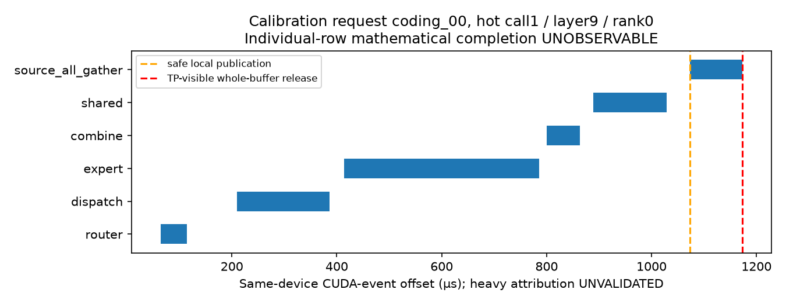
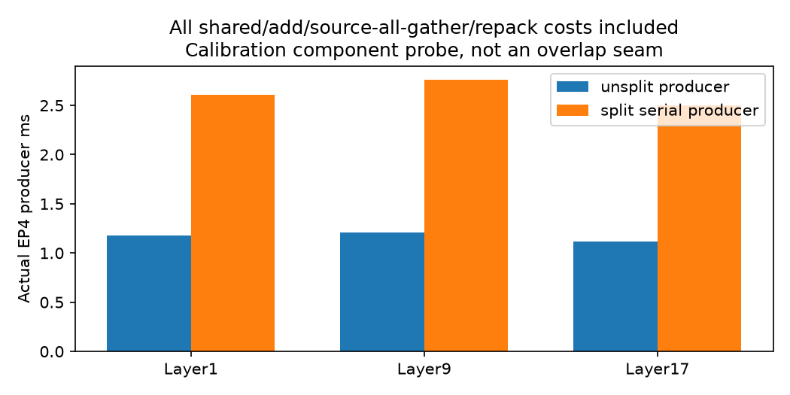
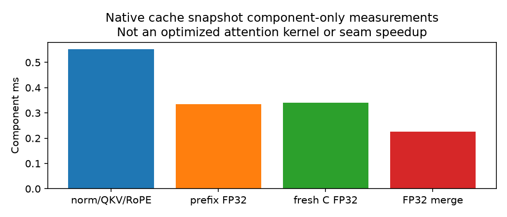
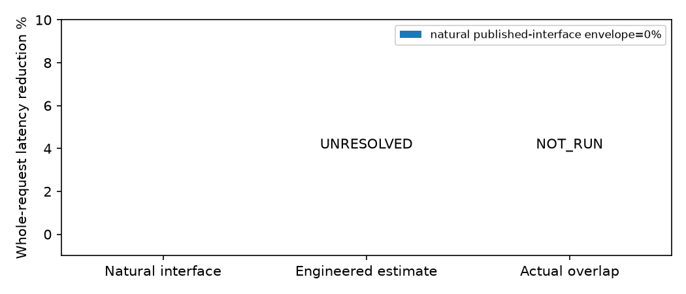

# dLLM intra-refinement Attention–MoE pipeline — Stage-A discovery

## Outcome

**CONDITIONAL_INTERFACE_BLOCKED.** Real four-GPU EP and unchanged native
generation are validated. There is **no naturally exposed early token-group
publication** in this bridge. Its next-layer consumer waits for complete
combine, shared-expert/add, and source-row all-gather. Latent row arithmetic
completion is unknown, not zero. A real2-group producer can expose an earlier
gathered group, but the median producer cost is **2.278×** native.
This bounded experiment does not establish positive net headroom, so no
overlap seam or full scheduling runtime was promoted.

The classification is an interface/measurement feasibility limit, **not** a
claim that all Attention–MoE pipelines are impossible. Engineering a new kernel
publication interface/compiler would exceed this contract's bounded scope.

## 1. Scope, environment, and prior

Model `inclusionAI/LLaDA2.0-mini`, revision `dad945cac317da394b390f82c7b40691d8a881ed`; BF16;20 decoder layers,
19 sparse layers;hidden2048;256 routed experts/layer;top8;one shared expert;
native routed scaling2.5. Actual loaded64 experts/rank with19 independently
sharded layer tensors is checked in `raw/*/ownership.rank*.json`.

Physical GPUs2,3,6,7 map to logical0,1,2,3 in that order. H10080GB HBM3,
all-pair NV18. DenseTP4 / source-SP4 / physicalEP4 / DP1 / PP1, actual DeepEP
normal dispatch/expert/combine and NCCL source gather. Actual runtime versions
are in ownership records; no package or external dirty-source modification.

Authoritative spec: `references/authoritative_spec.md`, exact SHA in environment.
Pinned earlier report/bridge at `dc539d3222193ab0902e0a342679edc3610f54bb` reused;
worker setup is reused by an inspectable AST prefix, not reimplemented.

Prior audit is [prior_overlap.md](prior_overlap.md). TokenWeave already performs
B1 sequence splitting; MPK already schedules cross-operator dependencies;
Epoch restores a full logical shard after fresh sparse work. None was executed
as a baseline. **EPOCH_RUNTIME_NOT_RUN**. Earlier5.773× is not Epoch performance;
earlier18% is not this pipeline's speedup or headroom.

## 2. Frozen workload and actual execution

Metadata-only seed10062026 selected32 fresh public task IDs:8 calibration and
24 held-out, balanced coding/reasoning, excluding previously used amplification
and residency task IDs. Only predeclared4calibration/8held-out early-kill requests
were executed. Remaining20 are untouched; no expansion after weak feasibility.

B1, block32, threshold0.9, temperature0, EOS-enabled native64-token bounded
generation. Prompt lengths vary naturally; no artificial prefix padding was
presented as task gains. No generated code was executed. These truncated
prefixes are **not GSM8K accuracy or HumanEval pass@1 evidence**.
`gen_length=64` is the unchanged native requested budget: dInfer rounds the
total prompt+generation length to block32, so returned suffix lengths can
exceed64. Actual per-request counts are in request_metrics.csv; no output
truncation or decoding-rule change was added to force a strict64-token limit.

Three warmups, two smoke prompts (short/cold and nonempty prefix), two clean
self-repeats plus event/trace lanes.12 native requests agree in output token
IDs and NFE; event/trace acceptance schedules agree across ranks and observers.
Clean repeats do not log acceptance positions, so full clean acceptance parity
is not claimed. Candidate generation/accuracy: **NOT_RUN**.

Append-only run ledger: main_v1 retained all native request captures, then an
unsupported CUDA-graph probe stalled in count coordination and was aborted;
components_v2 exposed an unhandled native `attention_mask=None`, fixed by
preserving the native unmasked semantics rather than introducing a new mask;
components_v3 completed the bounded component probes; route_sanity_v4 adds a
current physical route/owner sanity trace. Failed logs are retained, never reset.
The execution ledger records96 native `generate` calls across the four runs,
including warmups/smokes/retries; component repetitions are listed separately.
`integrity_audit.json` checks all four ranks, the actual per-expert6MiB BF16
weight size, source route IDs/weights, owner-local receive IDs, and lossless raw
archive hashes. `handoff_environment.json` records preservation of the original
dirty/staged worktree and external runtime plus final assigned-GPU state.

## 3. Dependency and readiness findings

[dependency_audit.md](dependency_audit.md) maps each layout, collective, stream,
residual and cache dependency. Source local publication is after routed/shared
sum; head-shard consumer visibility is only after the whole source gather.
No unfinished buffer is read; all diagnostic reads are after same-stream events
and final synchronization outside the measured interval.

| Readiness | Result | Interpretation |
|---|---|---|
| latent per-row producer arithmetic | UNKNOWN | Full grouped kernel is not a token completion trace |
| natural safe group-publication window |0µs at exposed whole-buffer interface | Not a latent-skew/noise-floor assertion |
| natural TP-visible window |0µs at exposed interface | Both groups published together |
| engineered gathered-group gap |median1.305ms; range1.175–1.507ms | Same-device physical2-group producer, one calibration snapshot; not full hidden consumer seam |

GPU absolute timestamps are not subtracted across ranks. Global alignment and
latent rank skew remain unresolved. A component critical rank is selected by
cumulative paired cost and used for all components; unrelated maxima are never
summed. Natural identical release is established by interface ordering, not
fabricated sub-token timestamps. `readiness.csv` leaves unobservable values null.
The original collector recorded model-call ordinal separately from native
acceptance iterations; calls are not assumed1:1 refinements. Per-node native
block/refinement/cache version therefore remain null/unresolved, and are not
invented from per-layer timing. Future reproduction logs direct iteration
context, but does not retrofit that missing field into captured evidence.

## 4. Baseline credibility and split tax

Native fused norms, BF16 Triton grouped experts and all reductions retained.
Installed ServerArgs explicitly disables graph with `deepep_mode=normal`;
direct capture was bounded and failed. Current SGLang TBO/SBO documentation is
not assumed to describe flags supported by this manual0.5.3 runner.

A shared-expert dual-stream functional adaptation was executed separately and
returned identical sampled producer outputs. It is a generic baseline test,
not a new pipeline gain; timing variability/no consistent winner prevent a
strong full-runtime B1 optimization claim. Its raw five-repeat costs are saved.

| Calibration boundary | Unsplit producer ms |2-group serial ms | Ratio |
|---|---:|---:|---:|
|1→2|1.175|2.611|2.222×|
|9→10|1.210|2.764|2.284×|
|17→18|1.117|2.503|2.240×|

All native router/dispatch/expert/combine completion, shared/add, source gather,
group construction and scatter costs are included. Source ownership is
preserved: each original8-row local shard is split4+4, not repartitioned as a
naive contiguous global16-row split. Split MoE sampled outputs are exactly equal
to unsplit. No expert path or precision is changed.

## 5. Legal prefix work and numerical reference

After consumer-visible complete rows, residual/norm, QKV, QK norm, RoPE and
attention over immutable earlier-cache state are token-local. All fresh current
block K/V, **including accepted current positions**, remain a mandatory join.
Cold/refresh or unproved-cache states use serial fallback.

The selected native hot calibration snapshot has64 logical prior tokens,
96 prior physical cache slots, including32 zero-padding slots; native mask is
None. Those padding slots are **not extra real prefix tokens**. They are retained
in the exact native reference; the component probe does not silently remove them
or claim validation of a different mask/cache policy. Source cache behavior and
the explicit compatibility limitation are recorded in cache_mask_audit.json.

Reference implementation uses FP32 max/sum/weighted-sum softmax states and exact
global normalization across prefix/fresh current partitions. Independent FP32
maximum error is 7.6293945e-06. Relative-L2 versus
native BF16 is small, but late-layer17 exceeds the **pre-frozen absolute0.03125
tolerance** on all4 ranks (maximum0.066885). Tolerance was not relaxed, and
closed-loop candidate correctness is not claimed. These are component reference
checks, not a failed candidate-generation/accuracy result.

## 6. Envelope, timing validity, and stage gates

Natural published-interface dependency-only whole-request envelope is0%:
no early TP-visible group exists in that graph. It is **not** an envelope for a
modified fine-grained kernel. A measured native-stream DAG includes each real
operator, shared/layout barrier and intervening gap exactly once, reconstructed
from one cumulative rank; calibration error is in dependency_reconstruction.csv.

Engineered whole-request dependency envelope/schedule estimate remain
**UNRESOLVED**, rather than extrapolating one component case to all layers and
requests or deleting the split/layout cost. A real2-group gap exists, but its
large producer tax supplies no established profitable seam premise.

Held-out event observer overhead: mean25.19%, request-bootstrap95%CI
[15.74,36.44]%, above the3% target. Detailed fine-grained
attribution is **UNVALIDATED**. Clean native E2E remains separately saved;
there is no candidate speedup result. Repeats are aggregated by request, not
layers/iterations. Component repetitions are not held-out sample count.

| Arm | Status |
|---|---|
| native unsplit producer |measured physicalEP4 |
|2-group producer split-serial |measured physicalEP4, not entire seam |
| consumer norm/QKV/partial/merge |component-only |
| fixed-group generic full seam |NOT_RUN |
| readiness-aware prefix full seam |NOT_RUN |
| QKV-only full seam |NOT_RUN |
| full-runtime candidate/E2E/accuracy |NOT_RUN |
| Epoch/MPK/TokenWeave runtime |NOT_RUN |

## 7. Answers and next action

This is **engineered static group completion**, not a measured native token
straggler effect. Consumer early readiness disappears at whole-buffer combine,
then shared/add and source all-gather. Top8 dependencies are never omitted.
Valid prior-cache work exists, but current bidirectional K/V must stay fresh.
Partial normalization is mathematically exact; native BF16 tolerance is not
fully met at the sampled late boundary. Physical contention and full seam
makespan were not executed because interface, observer validity, split tax and
numeric promotion evidence do not justify them. No superiority over fixed-group
overlap or additive improvement beyond actual Epoch was demonstrated.

No global engine, compiler, scheduler, stale-live reuse, expert replication or
next-refinement speculation was implemented. The smallest unresolved experiment
is a supported safe group-publication/source-layout primitive under a strong
generic fixed pipeline, with clean paired timing, **before** testing any extra
prefix-specific value. Do not invest in a full runtime on this evidence.

GPU policy: assigned devices were initiallyOFF, no burner existed. Contract§6
requires restoring only prior state and forbids a new background service, so
the initialOFF state is restored; no other GPU is touched.

## Final handoff

| Field | Value |
|---|---|
|VERDICT|CONDITIONAL_INTERFACE_BLOCKED|
|NATURAL_READY_WINDOW|0µs exposed; latent mathematical readiness UNKNOWN|
|NEXT_LAYER_VISIBLE_WINDOW|0µs native; engineered local gap1.305ms, not a seam|
|LEGAL_PREFIX_WORK|norm/QKV/RoPE + immutable native-cache partial; fresh current-block join preserved|
|DEPENDENCY_ONLY_E2E_ENVELOPE|0% existing publication graph; engineered whole-request UNRESOLVED|
|MEASURED_SEAM_GAIN_VS_UNSPLIT|NOT_RUN|
|MEASURED_SEAM_GAIN_VS_FIXED|NOT_RUN|
|MEASURED_FULL_E2E_GAIN_OR_NOT_RUN|NOT_RUN|
|CORRECTNESS / TASK_QUALITY_SCOPE|native12-request token/NFE parity; event/trace acceptance parity; sampled MoE exact; late BF16 reference tolerance unresolved; task scores NOT_RUN|
|EPOCH_BASELINE_STATUS|EPOCH_RUNTIME_NOT_RUN; old5.773× not measured Epoch|
|PRIOR_OVERLAP_STATUS|substantial generic overlap; no novelty/superiority claim|
|GPU_MASK|2,3,6,7|
|BRANCH|flashvep/dllm-attn-moe-pipeline-poc|
|COMMIT|see immutable Git commit containing this report (no self-referential SHA)|
|REPORT_PATH|poc_dllm_attn_moe_pipeline/report.md|
