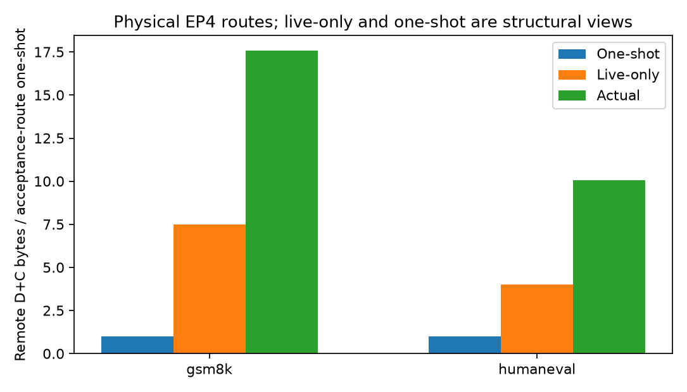
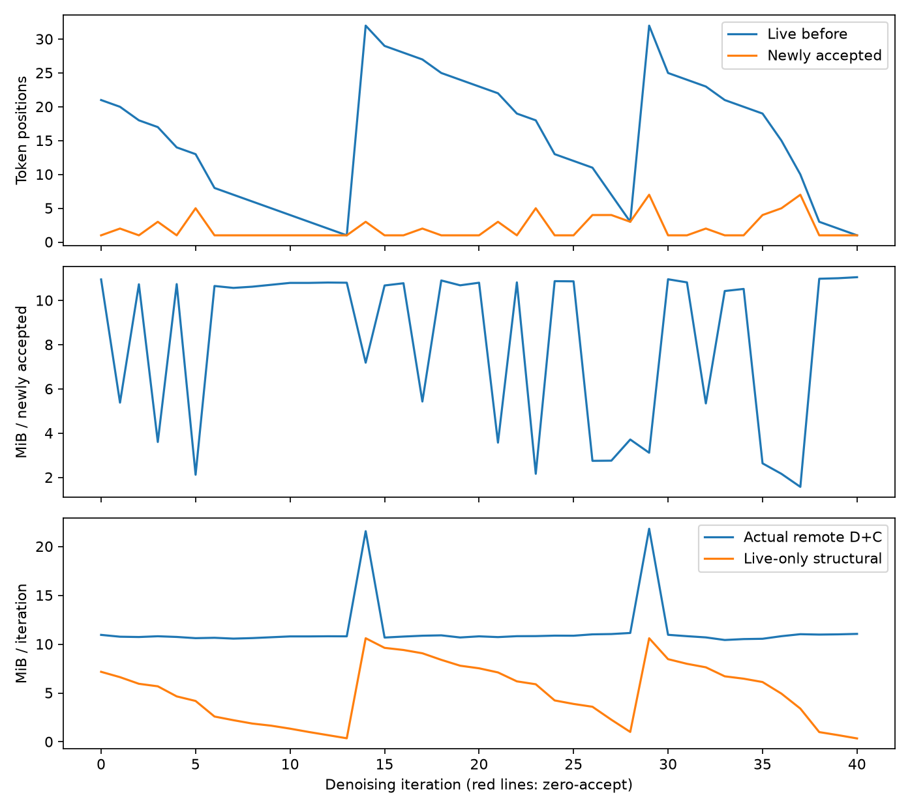
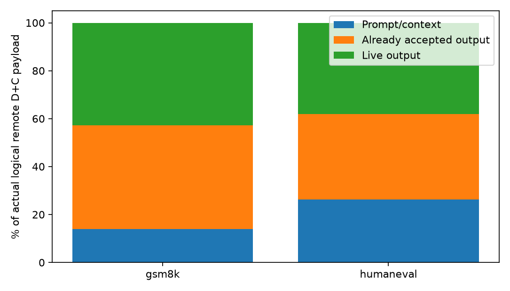
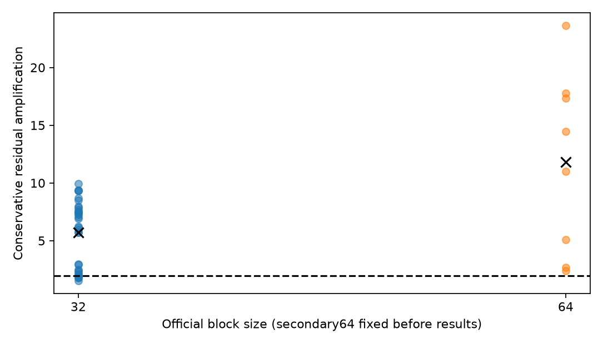

# dLLM MoE EP communication amplification — CONDITIONAL

## Outcome

Physical four-GPU DeepEP execution is validated. The primary frozen pool contains
32 requests: 16 GSM8K reasoning and 16 HumanEval coding, B1.
Secondary block64 uses 8 predeclared requests (four per domain).
No optimization method was implemented; these are characterization/oracle results.

Structural headroom is strong, but the final decision is deliberately
**CONDITIONAL**, not an unconditional communication-method GO. Conservative
communication share has a95% CI of14.77–20.95%, crossing the15% useful-signal
threshold. It is also workload-dependent:11.16% for reasoning versus24.78% for
coding. No acceptance configuration was changed to improve that gate.

- Raw amplification (whole executed request): 13.825× (request-bootstrap95% CI 11.837–15.812×).
- Output-position-only raw amplification: 11.480× (request-bootstrap95% CI 9.615–13.353×).
- Optimistic live-only residual: 5.773× (request-bootstrap95% CI 4.817–6.720×).
- More conservative final-returned-position-only residual: 5.749× (request-bootstrap95% CI 4.814–6.697×).
- All materialized accepted-position reference sensitivity: 5.757× (request-bootstrap95% CI 4.814–6.701×).
- D+C / entire timing request wall: 17.974% (request-bootstrap95% CI 14.774–20.947%).
- D+C / first-to-last denoising-forward span: 19.255% (request-bootstrap95% CI 15.670–22.605%).
- Timing observer vs clean bypass E2E: 8.284% (request-bootstrap95% CI 7.329–9.709%); validation=True.

`B_live_only` and `B_one_shot` are structural accounting/reference, NOT executable
runtime methods and NOT measured speedups. Residual bytes are not proven removable.

## 1. Model, runtime, and prior boundary

Selected the already-cached **inclusionAI/LLaDA2.0-mini**, revision `dad945cac317da394b390f82c7b40691d8a881ed`.
Actual checkpoint geometry: BF16, 20 decoder layers / **19 sparse MoE layers**,
hidden2048, MoE intermediate512, 256 routed experts, top-k8, one shared expert.
This is deliberately not a Qwen3 model or the 100B Flash geometry.
Native sigmoid router / correction bias and normalized selected weights are
unchanged; routed scaling2.5 is applied by the native expert runner.

Existing dInfer upstream `1ffeb961cd258bede74fcf5ca8a416ae6d57b18f` plus the exact pre-existing
bridge patch in `patches/dinfer_existing_bridge.diff`. sglang=0.5.3.post1, deep-ep=1.2.1+73b6ea4, transformers=4.57.0, triton=3.4.0;
PyTorch 2.8.0+cu128, CUDA 12.8, NCCL [2, 27, 3].
Dense TP4 / source-SP4 / physical EP4 / DP1 / PP1, normal high-throughput DeepEP,
eager execution, BF16 Triton FusedMoE. No full-model architecture conversion.

[dInfer](https://github.com/inclusionAI/dInfer) supplies the native mini decoder.
[TEAM](https://arxiv.org/abs/2602.08404) uses temporal/spatial consistency to reduce
expert activation in MoE dLLMs. [Epoch](https://arxiv.org/abs/2609.09748) compiles
block work and routes fresh live/newly-decoded/refresh-required work through EP.
This PoC does not reproduce or benchmark either system. Its optimistic removal
of all prior-accepted output traffic is more favorable than assuming that all
such state can actually be deleted. A large residual does not establish novelty
over TEAM/Epoch; it only motivates a distinct, still-unproven live-work question.

## 2. TRUE physical EP4 validation and GPU mapping

Only mask `2,3,6,7` was used. Physical GPUs2,3,6,7 are H10080GB HBM3;
the saved `nvidia-smi topo -m` has NV18 links among these GPUs. Logical ranks
0,1,2,3 map to physical2,3,6,7 respectively.

| Logical EP rank | Physical GPU | GPU UUID |
| --- | --- | --- |
| 0 | 2 | 24200107-8a7f-de46-1bc8-b81f8d3af13e |
| 1 | 3 | 17488c15-2d4c-5d9e-d503-29b0d959a8a8 |
| 2 | 6 | e3f3998e-0f1a-e94a-b97c-4abb0e8c2c28 |
| 3 | 7 | 4cc26b88-19fc-1988-f9e0-17858aa7a99b |

Each rank owns exactly its contiguous64 experts in all19 sparse layers. Actual
loaded BF16 routed weights are `[64,1024,2048]` and `[64,2048,512]`, totaling
**6,291,456 bytes/expert**. Ownership is not inferred from a synthetic map.
All four ranks call actual DeepEP dispatch and combine, then only their owned
expert weights execute. One B1 request's source rows are partitioned once across
four ranks. Source position uniqueness, actual received row count and received
owner-local path count are asserted for every captured call/layer:
**25,612 physical-buffer validations**.
Output token IDs/NFE match bypass, timing, and trace passes, and all four ranks.
Acceptance-only observer parity additionally passes on the two fixed probes.

Clean-start GPU process audit is retained in `raw/main_v2/clean_start.json`.
Other-GPU workloads are read-only audited and never terminated; shared-fabric
contention from outside the authorized mask remains a timing limitation.

## 3. Acceptance pattern and workload contract

Official mini decoding family: threshold0.9, temperature0, block32, prefix-BD
cache, EOS enabled. Generation budget64 is natively rounded to a block boundary;
actual observed lengths, not the requested64, define final output denominators.
Selection was seeded and frozen before routing or outputs; no answer-based
selection or parameter tuning. Output length summaries: `{'gsm8k': {'min': 64, 'median': 79.0, 'max': 92}, 'humaneval': {'min': 64, 'median': 80.5, 'max': 94}}`.
Block64 is an unchanged-threshold secondary robustness lane, never chosen for
larger amplification. EOS-stop requests: 2;
bounded block-cap requests: 30.
Thus these results characterize bounded accepted output prefixes, not complete
task solutions or final benchmark accuracy. No correctness score is inferred.
Actual zero-accept decode/refresh iterations: 0.
Native threshold decoding can force progress, so absence of zero-accept rows
would not mean traffic is generally acceptance-efficient.

For B1, native dInfer removes EOS IDs rather than trimming strictly at the first
EOS within a block. Full final state/actual acceptance positions are retained.
We report contiguous-before-first-EOS sensitivity and exclude synthetic EOS fill
from acceptance-route accounting. No previously accepted positions are remasked.

Example first12 actual denoising iterations (all rows remain in CSV):

| Iteration | Live | New accepted | Yield | Dispatch MiB | Combine MiB | MiB/new token | Cumulative accepted | Status |
| --- | --- | --- | --- | --- | --- | --- | --- | --- |
| 0 | 21 | 1 | 0.048 | 5.477 | 5.477 | 10.953 | 1 | ACCEPT |
| 1 | 20 | 2 | 0.100 | 5.383 | 5.383 | 5.383 | 3 | ACCEPT |
| 2 | 18 | 1 | 0.056 | 5.367 | 5.367 | 10.734 | 4 | ACCEPT |
| 3 | 17 | 3 | 0.176 | 5.406 | 5.406 | 3.604 | 7 | ACCEPT |
| 4 | 14 | 1 | 0.071 | 5.371 | 5.371 | 10.742 | 8 | ACCEPT |
| 5 | 13 | 5 | 0.385 | 5.309 | 5.309 | 2.123 | 13 | ACCEPT |
| 6 | 8 | 1 | 0.125 | 5.328 | 5.328 | 10.656 | 14 | ACCEPT |
| 7 | 7 | 1 | 0.143 | 5.285 | 5.285 | 10.570 | 15 | ACCEPT |
| 8 | 6 | 1 | 0.167 | 5.312 | 5.312 | 10.625 | 16 | ACCEPT |
| 9 | 5 | 1 | 0.200 | 5.355 | 5.355 | 10.711 | 17 | ACCEPT |
| 10 | 4 | 1 | 0.250 | 5.398 | 5.398 | 10.797 | 18 | ACCEPT |
| 11 | 3 | 1 | 0.333 | 5.398 | 5.398 | 10.797 | 19 | ACCEPT |

## 4. Actual EP bytes per final output token

Actual full-request logical remote D+C payload: 4.679 MiB/token (request-bootstrap95% CI 4.003–5.351 MiB/token).
Output-position-only payload: 3.885 MiB/token (request-bootstrap95% CI 3.254–4.522 MiB/token).
These are **backend-validated logical useful payload bytes**, not NVLink packet
or NIC wire counters. A BF16 hidden/output row is4096bytes. DeepEP normal sends
one row per distinct destination rank even if several selected experts share
that rank. Combine returns one partial-output row per corresponding destination.
Local expert paths are separate and contribute0 remote payload bytes. Router
metadata, protocol bytes, shared-expert compute and dense TP collectives are not
included in this sparse-EP byte numerator. They remain in measured request wall.

## 5–8. Actual vs live-only vs acceptance-route one-shot

For each actual source position/layer call, route owners come from loaded
ownership. `B_actual` counts all executed remote payloads. `B_live_only` retains
only output positions that were masks before that call, even if not accepted
afterwards. `B_one_shot` sums each returned output's first-acceptance routing
exactly once in each19 sparse layers. Prompt/known-context is not called
already-decoded output.

`B_actual = B_context + B_dead_output + B_live_only` is asserted exactly.
Already-accepted output accounts for 49.153% (request-bootstrap95% CI 47.298–50.975%) of actual
output-position traffic, or 56.76% of output repetition above one-shot.
The remaining output excess is repeated live work (plus eventual EOS/tail where
present). 75.093% (request-bootstrap95% CI 69.206–80.756%) of live-only remote bytes belongs
to positions still unaccepted after that iteration. This is acceptance-inefficient
traffic, not demonstrably safe-to-remove waste.

Including prompt/context in the whole-request Raw_Amp excess, the decomposition
is43.22% already-accepted output (CI40.89–45.54%),22.93% prompt/context
(CI18.57–27.54%), and33.86% repeated live excess (CI30.54–37.12%). These fractions
sum to100%; the prompt component must not be relabeled dead output. Pooled byte
totals give Raw13.861x and Residual5.799x; headline values above are request means.

## 9. Workload/block robustness

| Stratum | N requests | Raw × | Residual × | Final-position residual × | D+C / request wall |
| --- | --- | --- | --- | --- | --- |
| b32_all | 32 | 13.825 | 5.773 | 5.749 | 17.97% |
| b32_gsm8k | 16 | 17.575 | 7.517 | 7.484 | 11.16% |
| b32_humaneval | 16 | 10.074 | 4.028 | 4.015 | 24.78% |
| b64_all | 8 | 27.566 | 11.809 | 11.809 | 15.35% |
| b64_gsm8k | 4 | 35.466 | 15.260 | 15.260 | 11.29% |
| b64_humaneval | 4 | 19.665 | 8.359 | 8.359 | 19.40% |

Bootstrap uses2000 request-level resamples. Layers and iterations are never
independent statistical samples. Block32 and64 are summarized separately since
they reuse some problem IDs; no pooled pseudo-independent sample count is used.
All ratios use each request's own acceptance-route bytes, not another model.

## 10. Physical timing and observer validity

Separate independent clean bypass, event-only timing, and heavy routing passes.
Warmup3 denoising requests precede measurement; bypass/timing order is
counterbalanced by frozen request index. No per-layer global host synchronization
or `.item()` was added. Combine's existing native completion-event dependency is
placed before timing-end; its own subsequent native wait is unchanged.
The chosen critical rank is the one with largest cumulative denoising-forward
CUDA time; Dispatch/Expert/Combine all use **that same rank**, not separately
maximized component ranks. Router here means native gate linear time only;
top-k/layout/shared expert/source all-gather are not silently counted as expert.

| Domain | Gate ms | Dispatch ms | Expert ms | Combine ms | Forward sum ms | Denoise span ms | Clean request wall ms | Observer overhead |
| --- | --- | --- | --- | --- | --- | --- | --- | --- |
| gsm8k | 76.92 | 199.67 | 495.77 | 127.53 | 2754.04 | 2791.71 | 2623.89 | 8.65% |
| humaneval | 19.16 | 201.29 | 189.21 | 106.97 | 1370.94 | 1390.36 | 1372.52 | 7.91% |

All stage times are request totals for denoising calls, not per-layer averages.
Forward-only communication share 19.523% (request-bootstrap95% CI 15.884–22.919%) is
diagnostic: it omits acceptance/controller/cache gaps. First-to-last denoising
model span includes inter-iteration gaps, but excludes final acceptance epilogue.
The promotion gate conservatively divides denoising D+C by **whole request wall**,
which also includes initial prompt prefill. This lower bound cannot inflate the
communication share by deleting controller time. No speedup is measured.

Instrumentation threshold was frozen at10% absolute mean paired overhead plus
exact output/NFE parity. Heavy trace overhead: 14.307% (request-bootstrap95% CI 13.361–15.591%);
heavy trace wall is never a headline latency. All requests and failures are
retained, no fastest-run selection. Missing tuned Triton mini expert config,
20 DeepEP SM default, eager manual bridge and disabled TorchDynamo are important
runtime-specific limitations; no claim about every optimized dLLM server.

## 11–12. Rank graph and temporal imbalance

Mean directed rank-edge density: 1.000 (request-bootstrap95% CI 1.000–1.000).
Hottest-rank switch rate: 17.475% (request-bootstrap95% CI 14.417–20.734%).
Per-iteration hottest rank, assignment histogram, max/mean, CV, active experts,
remote fanout and source→destination edges are in `iterations.csv` and raw routes.
These are secondary diagnostics, not substitutes for residual amplification.

## Runtime issue and reproducibility

Initial smoke import/cache wiring errors were recorded and corrected by reusing
the existing native ModelRunner, not by creating a replacement cache algorithm.
`main_v1` stopped at a small-M SGLang TorchInductor compiler failure. The isolated
M0..32 reduction seam passed, so a zero-receive root cause is **not proven**.
One bounded full restart (`main_v2`) disabled TorchDynamo consistently in all arms,
preserving native operations, weights, decoder and DeepEP. The complete frozen
cohort includes the previously failing problem; `main_v1` is diagnostic-only and
is not pooled with final evidence. Exact amendment is in `runtime_amendment.json`.
GPU stop/run/restore is scoped to2,3,6,7 and occurs in `finally`, including failure.

## 13–14. Verdict and smallest next experiment

**VERDICT: CONDITIONAL**.
Residual gate=True; conservative communication
gate=True; timing-valid=True.

NEXT_ACTION: Do not implement a method. Resolve communication timing/optimized-backend robustness with one small paired experiment before any promotion.

No new acceptance predictor, learned predictor, pruning, dynamic migration,
EPLB, CUDA kernel, production scheduler, or full Epoch reproduction was built.

## Evidence index

- `results/frozen_manifest.json`: exact inputs, seed and frozen protocol.
- `results/environment.json`: GPU topology, config, revisions and source hashes.
- `raw/main_v2/`: four-rank actual routing/acceptance/physical timings.
- `results/main_v2/requests.csv`, `iterations.csv`, `route_accounting.csv`.
- `results/main_v2/summary.json`, `timing_ledger.json`.
- `figures/main_v2/`: normalized traffic, request distributions, acceptance,
  block robustness, traffic decomposition, rank/timing diagnostics.
- `scripts/reproduce.sh`, `tests/`: executable reproduction and accounting checks.

BASELINE_STATUS: TRUE_PHYSICAL_EP4_VALIDATED
RESIDUAL_AMPLIFICATION: 5.773x
CONSERVATIVE_FINAL_POSITION_RESIDUAL: 5.749x
TIMING_VALIDITY: True
VERDICT: CONDITIONAL
NEXT_ACTION: Do not implement a method. Resolve communication timing/optimized-backend robustness with one small paired experiment before any promotion.
