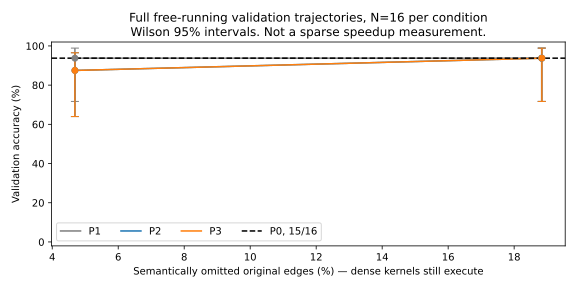

# Refinement edge sensitivity

Status: `VALIDATION_TRAJECTORY_SCREEN_COMPLETE_NO_REFINEMENT_ADVANTAGE_ESTABLISHED`.
Runtime and model identities appear in `00_runtime_audit.md`.
The user-approved 128/32 baseline pilot is complete.
Two independent EP4 replicas collected 16 different non-test validation trajectories.
The observer records prior completed-forward confidence before each current dispatch.
It does not change router results or omit expert work.
Observed-versus-bypass output parity remains a required per-request assertion.
This collection does not establish an approximate policy's quality or speedup.
No approximate policy passed the final quality gate.
The completed dense intervention screen appears below.

## Completed retained-all observations

All 16 requests preserved output tokens and NFE across baseline, no-op, and observer execution.
Each stored confidence feature predates its current dispatch.
The analysis uses the first MoE layer once per forward for commitment labels.
It does not count the same label 19 times across physical layers.

Prior confidence predicts next-iteration commitment with macro AUROC 0.92619.
The question-bootstrap 95% interval is [0.91610, 0.93418], with N=16 requests.
This is `TRACE_ANALYSIS`, not an expert-omission result.
Commit predictability does not establish marginal expert importance.
It also does not establish that expert work can be skipped safely.

The median observer-to-baseline wall ratio is 1.16964 across these 16 requests.
This overhead is approximately 16.96% under this parallel collection setup.
Do not use the instrumented absolute times as clean serving latency.
The rank-local stage shares reside in `pilot/observer_breakdown.csv` under the result directory.
Those shares do not identify the clean global critical path.

## Frozen partitions

| Split | Source | N | Labels available to online policy? |
|---|---|---:|---|
| Calibration | GSM8K training | 256 | No |
| Validation | Different GSM8K training questions | 128 | No |
| Final test | GSM8K test | 1319 | No |
| Final test | HumanEval | 164 | No |

The user reduced the active final-test pilot to GSM8K 128 and HumanEval 32.
The original manifests remain preserved.
The sensitivity screen uses the first 16 frozen validation prompts, not test questions.

The split seed is 20261027.
The preparation script asserts calibration/validation disjointness.
It stores validation answers separately for offline scoring.
It freezes every prompt manifest with SHA-256.

## Intervention contract

Record previous-iteration confidence only after that iteration completes.
Record its availability before the next MoE execution.
Use the fresh current router for every candidate edge.
Preserve at least one routed edge per token.
Leave attention, shared experts, residuals, and original aggregation weights unchanged.

Stratify sensitivity by layer, block iteration, current mask status, and confidence history.
Compare isolated logit perturbations with complete changed generation trajectories.
Report unmask changes, final answer changes, NFE, and EOS status.
Do not infer quality from local hidden similarity alone.

| Method | Validation quality | Edge reduction | Logit change | Unmask change | Full-trajectory quality |
|---|---|---|---|---|---|
| Uniform P1 | 16 requests per budget | Dense semantic omission only | NOT_MEASURED | Changed trajectories recorded | Measured below |
| Router P2 | 16 requests per budget | Dense semantic omission only | NOT_MEASURED | Changed trajectories recorded | Measured below |
| Refinement P3 proxy | 16 requests per budget | Dense semantic omission only | NOT_MEASURED | Changed trajectories recorded | Measured below |
| EP-only P4 | NOT_MEASURED | NOT_MEASURED | NOT_MEASURED | NOT_MEASURED | NOT_MEASURED |
| Joint P5 | NOT_MEASURED | NOT_MEASURED | NOT_MEASURED | NOT_MEASURED | NOT_MEASURED |

Previous route-pruning failures remain contextual evidence only.
They used different data and dense semantic emulation.
They do not establish this campaign's outcome.

## Full free-running intervention results

Evidence: `pilot/sensitivity_summary.csv` and `pilot/sensitivity_samples.jsonl` under the campaign result directory.
All 96 new diagnostic generations use the original generation caps, threshold, EOS behavior, and current router.
They do not force output tokens.
Each condition uses the same 16 held-out training questions.
The separate scorer receives validation labels only after generation.

| Policy | Target omission | Semantic edge omission | Correct/N | Accuracy | Wilson 95% CI | Difference from P0 | Paired bootstrap 95% CI | Exact output agreement | Mean NFE ratio to P0 | Caps |
|---|---:|---:|---:|---:|---|---:|---|---:|---:|---:|
| P0 retained-all | 0% | 0% | 15/16 | 93.75% | [71.6713%, 98.8881%] | 0 pp | Self | 16/16 | 1.00000× | 0/16 |
| P1 uniform | 5% | 4.6875% | 15/16 | 93.75% | [71.6713%, 98.8881%] | 0 pp | [0, 0] pp | 1/16 | 1.04294× | 0/16 |
| P2 router | 5% | 4.6875% | 14/16 | 87.50% | [63.9772%, 96.5023%] | −6.25 pp | [−18.75, 0] pp | 3/16 | 1.02578× | 0/16 |
| P3 refinement proxy | 5% | 4.6875% | 14/16 | 87.50% | [63.9772%, 96.5023%] | −6.25 pp | [−18.75, 0] pp | 3/16 | 1.02097× | 0/16 |
| P1 uniform | 20% | 18.8334% | 15/16 | 93.75% | [71.6713%, 98.8881%] | 0 pp | [−18.75, 18.75] pp | 0/16 | 1.56711× | 1/16 |
| P2 router | 20% | 18.8371% | 15/16 | 93.75% | [71.6713%, 98.8881%] | 0 pp | [0, 0] pp | 2/16 | 1.03036× | 0/16 |
| P3 refinement proxy | 20% | 18.8396% | 15/16 | 93.75% | [71.6713%, 98.8881%] | 0 pp | [0, 0] pp | 3/16 | 1.01751× | 0/16 |

Evidence class: `MEASURED_GPU` generation outcomes with `DENSE_SEMANTIC_EMULATION`.
Actual physical dispatch-edge reduction is 0% in every intervention row.
Actual expert-kernel work reduction is also 0%.
These timings cannot serve as acceleration measurements.
The NFE ratio is the arithmetic mean of per-question candidate/P0 ratios.

Integer rounding explains the difference between target and actual semantic omission.
Changed generation trajectories explain the small high-budget differences between policies.
The fixed-trajectory replay enforces exactly matched counts across P2–P5.
The live diagnostic does not freeze future routes or NFE.

## Interpretation and limitations

P3 does not improve correctness over P2 at either tested budget.
At the lower budget, both change `gsm8k:validation:7176` from correct to wrong.
At the higher budget, both match the baseline correctness vector on these 16 questions.
That result does not prove population non-inferiority.
A degenerate paired interval [0,0] cannot bound errors absent from this small sample.
N=16 cannot establish the requested 0.5 pp quality margin.

Uniform omission at the higher budget raises mean per-question NFE by 56.71%.
Its capped request is `gsm8k:validation:2680`, with 1,217 forwards and 2,065 returned tokens.
That request is wrong under the frozen scorer.
Expert contribution reduction can therefore increase total generation work.

The lower-budget correctness loss does not recur monotonically at the higher budget.
The small sample and changed reasoning paths prevent a monotonic safety claim.
Confidence AUROC predicts commitment, not safe marginal expert removal.
The tested frontier-only refinement proxy does not pass the incremental algorithm gate.
This finding does not exclude better refinement signals or faithful REFLEX under another contract.

Per-edge hidden/logit reconstruction and a marginal-quality oracle remain `NOT_MEASURED`.
P4/P5 live quality remains `NOT_RUN` because their deployment gate did not pass.
The wider 128-question validation partition remains available, but this screen does not claim its results.

