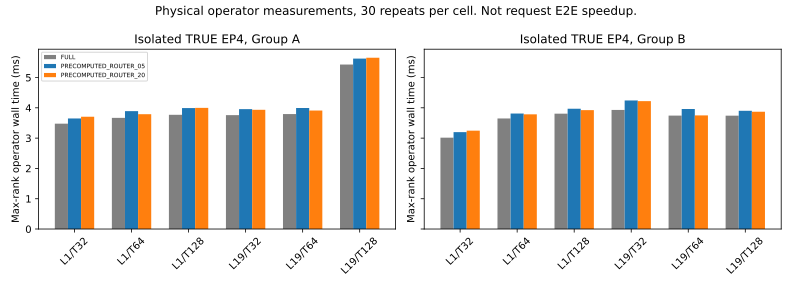

# EP cost model

Status: `PHYSICAL_OPERATOR_MEASURED_REQUEST_COST_MODEL_NOT_VALIDATED`.
Runtime identity: existing BF16 dInfer/SGLang DeepEP normal bridge.
Model revision: `dad945cac317da394b390f82c7b40691d8a881ed`.
Evidence: `../results/refinement_aware_ep_expert_allocation/ep_trace_audit.json`.

The fresh sanity trace measures router, dispatch, routed expert, and combine intervals.
It records these intervals separately for each GPU rank.
It also records model forward spans and request wall time.
Heavy tracing can change those times.
The current trace is not the final clean latency benchmark.

## Sixteen-request observer breakdown

The table pools the selected longest-wall rank from each of 16 validation requests.
The denominator is 112,999.52 ms of observed rank wall time.
The two EP4 replicas ran concurrently.
These are observer-run shares, not clean global critical-path shares.

| Observed region | Share of pooled selected-rank wall time |
|---|---:|
| Router linear operation | 2.19544% |
| DeepEP dispatch region | 8.57484% |
| Routed expert region | 17.09546% |
| DeepEP combine region | 3.70053% |
| Residual other time | 68.43374% |

Residual other time includes attention, shared experts, dense work, LM head, decode, host gaps, and synchronization.
The trace does not separate all these costs yet.
The observer-to-baseline median wall ratio was 1.16964 across N=16 requests.
Do not remove that overhead with a uniform stage-time rescaling.
Do not interpret a fraction of routed edges as the same fraction of E2E savings.
Source: `pilot/observer_breakdown.csv` in the campaign result directory.

## Accounting boundary

Per-rank stage time does not equal the global critical path.
Communication and rank waiting can appear inside an observed stage interval.
The analysis must not add times from four ranks into one request latency.
It must not treat logical payload as physical fabric traffic.

| Cost component | Current evidence | Calibrated deployable estimator |
|---|---|---|
| Router | Per-rank CUDA event intervals | NOT_MEASURED |
| Dispatch | Real DeepEP dispatch and receive buffers | NOT_MEASURED |
| Routed experts | Existing BF16 expert runner intervals | NOT_MEASURED |
| Combine | DeepEP completion dependency and event intervals | NOT_MEASURED |
| Pack/scatter | Included in broader runtime regions | NOT_MEASURED_SEPARATELY |
| Rank waiting | Included in observed regions | NOT_MEASURED_SEPARATELY |
| Attention and LM head | Included in forward span | NOT_MEASURED_SEPARATELY |
| Policy scoring and compaction | No sparse policy executes yet | NOT_MEASURED |
| Physical NVLink bytes | No hardware counter captured | NOT_MEASURED |

## Required withheld validation

Fit expert time across actual received row counts and expert geometry.
Measure startup cost separately from payload-dependent dispatch cost.
Validate timing estimates on different calibration traces.
Include source-row all-gather and any new policy synchronization.
Charge irregular kernel shapes and policy preparation costs.
Do not assume time scales linearly with the number of removed edges.

The measurements below test a physical sparse operator without expanding the generation engine.
They do not establish a conservative 5% request-E2E opportunity.

## Isolated physical operator measurements

Evidence: `../results/refinement_aware_ep_expert_allocation/pilot/operator_cost_summary.csv`.
The probe uses original Mini BF16 weights and captured native activations.
It tests physical MoE layers 1 and 19.
Group A uses GPUs 0–3. Group B uses GPUs 4–7.
The other group remains quiet, including its burners.

Each table cell contains 30 repetitions after three operator warm-ups.
Variant order changes with a fixed seed within each repetition.
The estimator is full mean operator wall time divided by candidate mean operator wall time.
The wall interval uses the maximum of the four aligned rank observations.
It includes native router, dispatch, expert execution, combine, shared expert, and source-row all-gather.
It excludes attention, model head, and full generation.

The primary operator pass has no stage-event probes.
A separate observer pass records CUDA stage intervals.
Those intervals can include host submission gaps and rank waiting.
They are not pure kernel busy time.

| Group | Physical layer | Global token rows | Full mean ms | Low-budget mean ms | Full/low | High-budget mean ms | Full/high |
|---|---:|---:|---:|---:|---:|---:|---:|
| A | 1 | 32 | 3.4769 | 3.6489 | 0.9529× | 3.7051 | 0.9384× |
| A | 1 | 64 | 3.6675 | 3.8908 | 0.9426× | 3.7898 | 0.9677× |
| A | 1 | 128 | 3.7683 | 3.9903 | 0.9444× | 3.9985 | 0.9424× |
| A | 19 | 32 | 3.7585 | 3.9567 | 0.9499× | 3.9352 | 0.9551× |
| A | 19 | 64 | 3.7923 | 3.9926 | 0.9499× | 3.9095 | 0.9700× |
| A | 19 | 128 | 5.4267 | 5.6226 | 0.9652× | 5.6512 | 0.9603× |
| B | 1 | 32 | 3.0146 | 3.1974 | 0.9428× | 3.2456 | 0.9288× |
| B | 1 | 64 | 3.6489 | 3.8118 | 0.9573× | 3.7843 | 0.9642× |
| B | 1 | 128 | 3.8075 | 3.9685 | 0.9594× | 3.9236 | 0.9704× |
| B | 19 | 32 | 3.9293 | 4.2429 | 0.9261× | 4.2210 | 0.9309× |
| B | 19 | 64 | 3.7422 | 3.9600 | 0.9450× | 3.7496 | 0.9980× |
| B | 19 | 128 | 3.7412 | 3.9001 | 0.9593× | 3.8712 | 0.9664× |

Evidence class: `MEASURED_WALL` physical TRUE EP4 operator, not request speedup.
The low budget removes 4.6875% of actual routed edges.
The high budget removes 18.7500%, 19.53125%, and 19.921875% for global row counts 32, 64, and 128.
Source-rank row counts are one quarter of global rows.

All 24 candidate point estimates are below 1.0000×.
The range is 0.9261×–0.9980×.
Five paired repeat-bootstrap 95% intervals include 1.0000×.
The remaining intervals are below 1.0000×.
Every exact interval appears in the source CSV.
For example, Group A layer 1/rows32 high-budget ratio is 0.9384×, with interval [0.9071×, 0.9646×].
Group B layer 19/rows64 high-budget ratio is 0.9980×, with interval [0.9679×, 1.0388×].
These intervals describe repeated operators, not workload-population uncertainty.

## Physical work evidence

Selected expert IDs become −1 before DeepEP.
The probe preserves original retained weights and does not renormalize them.
Actual receive buffers contain fewer assignments and token rows.
For layer 1/rows32, total received rows decrease from 102 to 92 at the high budget.
Source-derived padded rows decrease from 2,096 to 1,792.
For layer 19/rows32, received rows decrease from 100 to 95.
Padded rows decrease from 1,520 to 1,216.
Both physical groups record these same count changes.

Padded rows describe the audited kernel geometry, not measured instruction counts.
The probe measures actual dispatch and expert execution, but does not capture hardware fabric-byte counters.
The same input shape, original weights, and native backend remain in place.

## Why this does not pass the deployment gate

The removal mask is precomputed during warm-up from the current router.
The protected-slot calculation uses fixed forward index 1 in this operator probe.
The probe does not replay each quality run's exact intervention mask.
The comparison excludes online selection, global rank-count exchange, and confidence-softmax cost.
It still includes materialization of sparse IDs and weights.
Despite those optimistic preparation assumptions, no tested cell has a faster mean operator result.
Launch, metadata, materialization, padding, and synchronization can outweigh reduced assignments at B1.
The measurements do not isolate the exact contribution of each cost.

No full request cost predictor passed withheld validation.
Fit error, held-out request MAE, and conservative bound coverage remain `NOT_MEASURED`.
The small operator grid cannot justify a universal latency model.
Conditional observer-share projections reside in `pilot/conditional_cost_projections.csv`.
They assume transferable observer shares, unchanged trajectories, additive component envelopes, and free online selection.
Those assumptions are unvalidated.
The projections are not measured E2E improvements or conservative guarantees.

The present implementation does not justify sparse-generation engine work.
This result does not rule out a fused implementation, larger batches, or a stronger production EP runtime.

