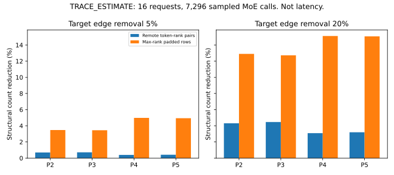

# Oracle versus deployable allocation

Status: `FIXED_TRAJECTORY_ACCOUNTING_COMPLETE_REQUEST_ORACLE_UNVALIDATED`.
Model and runtime identities appear in `00_runtime_audit.md`.
No oracle speedup is a measured acceleration.

## Fresh structural observation

Two completed native EP4 sanity traces expose the actual token–expert assignments.
The analysis removes the smallest current routing weights retrospectively.
It preserves at least one edge per token.
It then recounts unique remote token–destination pairs.

At a nominal 10% edge reduction, remote-pair reductions were 2.8873% and 2.0966%.
At a nominal 20% edge reduction, they were 5.9551% and 5.6240%.
Per-layer integer rounding changes the actual edge fraction slightly.
The raw artifact retains the exact removed-edge counts.

These are `TRACE_ESTIMATE` results from two sanity prompts.
They do not predict benchmark quality.
They do not measure communication latency reduction.
They show why expert-edge savings need not equal dispatch savings.
Multiple selected experts can share one destination message.

## Deployment constraints

A policy can avoid an activation message only after removing every selected edge for that destination.
Collective startup remains even when payload becomes smaller.
The fixed shared expert and dense paths also remain.
Global critical-rank selection may require additional synchronization.
That synchronization must enter the deployable cost estimate.

| Comparison | Oracle ceiling | Realistic estimate | Measured isolated E2E gain |
|---|---|---|---|
| P3 versus P0 | NOT_MEASURED | NOT_MEASURED | NOT_MEASURED |
| P4 versus P0 | NOT_MEASURED | NOT_MEASURED | NOT_MEASURED |
| P5 versus P3 at equal edges | NOT_MEASURED | NOT_MEASURED | NOT_MEASURED |
| P6 hindsight oracle | NOT_MEASURED | NOT_APPLICABLE | NOT_APPLICABLE |

Do not promote an oracle-only result to a runtime implementation.
The specification requires conservative E2E headroom of at least 5%.
It also requires a credible additional EP-aware opportunity of at least 2% over P3.
Neither gate passes from structural counts alone.

## Sixteen-request matched replay

Evidence: `../results/refinement_aware_ep_expert_allocation/pilot/allocation_replay.csv`.
The replay samples 24 evenly spaced forwards per request.
It includes all 19 MoE layers and four EP ranks.
Each policy and budget covers 7,296 sampled calls across 16 requests.
All policies receive the same routes and per-source edge budget.

| Target removal | Policy | Actual edge reduction | Remote token-rank pair reduction | Maximum-rank padded-row reduction | Mean owner CV after selection |
|---|---|---:|---:|---:|---:|
| 5% | P2 router | 4.6875% | 0.6974% | 3.4739% | 0.40001 |
| 5% | P3 refinement proxy | 4.6875% | 0.7159% | 3.4513% | 0.39999 |
| 5% | P4 EP proxy | 4.6875% | 0.3953% | 4.9777% | 0.35641 |
| 5% | P5 joint proxy | 4.6875% | 0.4150% | 4.9360% | 0.35657 |
| 20% | P2 router | 18.9581% | 4.3116% | 12.9026% | 0.41299 |
| 20% | P3 refinement proxy | 18.9581% | 4.4650% | 12.7180% | 0.41298 |
| 20% | P4 EP proxy | 18.9581% | 3.0895% | 15.1128% | 0.26699 |
| 20% | P5 joint proxy | 18.9581% | 3.2002% | 15.0720% | 0.26617 |

Evidence class: `TRACE_ESTIMATE`.
The mean owner CV before selection is 0.39690.
The table fixes baseline trajectories.
It cannot predict changed candidate routes, NFE, or accuracy.
NumPy arithmetic and stable sorting form a trace proxy, not a bit-exact live selector.

EP-aware scores reduce load imbalance, but preserve more remote messages than P3.
P5 improves maximum-rank padded-row reduction over P3 by 1.4847 percentage points at the lower budget.
The difference is 2.3540 percentage points at the higher budget.
These differences concern structural compute counts, not E2E latency.

The native fallback tile size is 16 for at most 64 received rows.
It is 64 above that threshold.
Padding and destination deduplication prevent a linear expert-edge cost model.
Global count exchange, policy scoring, collective startup, and rank waiting remain additional costs.

The P6 marginal-quality oracle remains `NOT_RUN`.
The campaign does not fabricate expert-output importance labels.
Physical operator measurements appear separately in `04_ep_cost_model.md`.
Observer-share projections cannot establish conservative request-level headroom.

