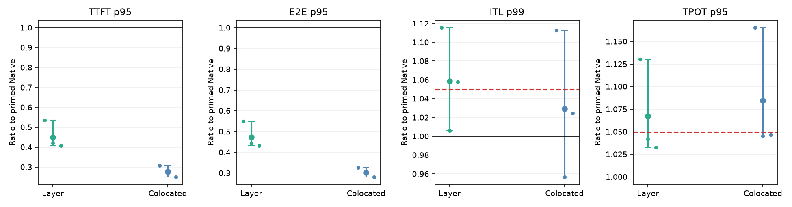
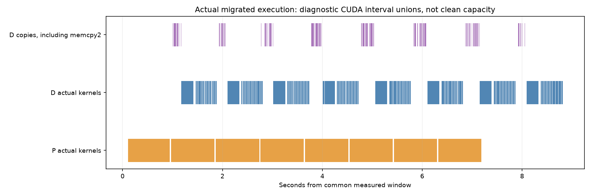

# Dense AR Prefill-heavy PD와 Layer-wise Continuation: 최종 검증

## 1. 먼저 답할 질문

**P가 다음 요청을 계산하는 동안 D가 이전 요청의 잔여 Layer를 계산하는 경로는 구현했다.**
Qwen3-8B의 실제 Partial Layer Forward와 GPU 간 State Handoff를 사용했다.
출력만 비교하지 않고 Prompt KV, Final Hidden, 실제 Attention Layer 범위도 검증했다.
다만 이 실행 가능성을 Decode-safe Serving 순이익으로 해석하면 안 된다.

**Prefill Compute 병목과 D의 물리적 Kernel Inactivity는 같은 실행 구간에서 확인했다.**
정확한 Eager 실행 Family의 한 Qualified Start에서 P Kernel Busy는 96.3775%였다.
같은 14.4193초 구간에서 D의 Kernel Inactivity를 최소 8.8761초 확인했다.
이는 전체 구간의 최소 61.5572%다.
관측하지 않은 D 구간은 `UNKNOWN`이다.
이 수치는 Decode-safe Admission Budget이나 전체 D Idle 분포가 아니다.

**전체 판정은 Partial Success다.**
정확한 Layer Continuation은 가능하다.
최종 Last8은 Native 대비 TTFT p95를 54.93% 줄였다.
하지만 ITL p99와 TPOT p95의 5% 비열등성을 입증하지 못했다.
같은 두 GPU의 Colocated보다 TTFT p95도 62.81% 높았다.
따라서 선택한 Static 방법은 `NO_GO_ON_TESTED_CONDITIONS`다.
모든 Dense AR Workload에서 구조적으로 불가능하다는 판정은 아니다.

## 2. 실험 범위와 공통 계약

| 항목 | 실제 설정 |
|---|---|
| 모델 | `Qwen/Qwen3-8B` |
| Revision | `b968826d9c46dd6066d109eabc6255188de91218` |
| 모델 구조 | Dense AR, 36 Layers, Hidden4096, Q32/KV8, Head128 |
| 수학적 계산 | Original BF16, Exact Attention, 모든 Prompt Layer 정확히 1회 |
| GPU | H100 80GB, P0/D1, 1P1D, 양쪽 Full Weight |
| Strong Colocated | 같은 GPU0/1의 Full-model Replica 2개, 요청 Round-robin |
| Input / Output | 8000 / 16, Greedy, Ignore EOS |
| Offered QPS | 4.809983158889532 |
| P/D Slots | 4 / 16 |
| 공통 KV Budget | GPU당 42GiB |
| Workload | 보존된 ShareGPT/LongBench Controlled Prefix, 서로 다른 Prompt ID 128개 |
| Prefix Cache | 비활성 |
| TTFT SLO | 830.6472809053957ms |
| Request TPOT SLO | 49.87224676744572ms |
| ITL SLO | 57.164369970560095ms |
| Native-relative 목표 | ITL p99와 TPOT p95 각각 1.05배 이하 |

모든 Arm은 같은 Request, Arrival Trace, GPU Pair와 SLO를 사용한다.
Static Layer Cut은 실제 Request Placement 변경과 구분한다.
이번 구현은 완전한 Adaptive Boundary Negotiation이 아니다.
N128 반복은 Arrival Seed를 바꾼 독립 Server Start다.
Prompt 128개 중 64개는 Selection에도 사용했다.
따라서 새 원문에 대한 Generalization 검증이라고 주장하지 않는다.

TTFT는 Request Arrival부터 First Output까지다.
TPOT는 요청별 첫 Token 이후 평균이다.
ITL은 연속 Token Delivery 간격이다.
첫 번째 ITL도 포함한다.
Service TTFT와 정확한 GPU 실행 전 Queue Latency는 `NOT_MEASURED`다.
구간별 p95를 더하지 않았다.

## 3. Runtime 선택과 구현

Runtime은 vLLM 0.26.0+cu129, Torch 2.11.0+cu129, NIXL 1.4.1이다.
설치 Wheel SHA256은 `7632856147650da3ed8d1652b1b05ffaadcc62ea8e910fdaa6f8ce055b201ebf`다.
설치된 외부 Runtime 파일은 수정하지 않았다.
각 Job은 확장 Source ZIP, Configuration Hash와 GPU Map을 보존한다.

주요 소스는 [dense_ar_layerwise_pd](../dense_ar_layerwise_pd/)에 있다.

- `extension.py`: P Prefix, 별도 D Suffix Runner, 실제 Layer 실행 검증과 Graph Replay 계측.
- `hidden_transport.py`: GPU Hidden/Residual READ, Source ACK와 Destination Retirement.
- `native.py`: Native KV Handoff, P First Token 재사용, D Cohort Guard와 공통 Output Lifecycle.
- `output_priming.py`: Text를 유지하는 Decoder 사전 준비와 Runtime Text Parity 검증.
- `async_ingress.py`: 역할별 RPC 송신과 Token 수신 분리.
- `run.py`: 독립 Process Group, Job Timeout, Quiet Lane과 Burner 복원.

P는 Layer 0부터 Cut 직전까지 실행한다.
D는 Cut부터 Layer35까지 실행한다.
D는 이후 모든 36개 Layer로 정상 Decode를 수행한다.
Hidden과 Residual을 별도로 전달한다.
Position, Attention Metadata와 Request Identity를 보존한다.
이미 P에서 수행한 Prefix를 D에서 재실행하지 않는다.

Native NIXL은 유효한 Prefix KV의 READ와 ACK를 유지한다.
Hidden Transport는 Source Pool Slot을 ACK까지 유지한다.
D는 소비 완료 CUDA Event 이후 Import Slot을 재사용한다.
Source Export Credit이 없으면 새 Prefix 실행을 보류한다.
이미 계산한 Prefix를 버리거나 다시 실행하지 않는다.

Source Hidden Pool은 16×125MiB, D Pool은 4×125MiB다.
이 고정 Pool 비용은 Layer 방법의 추가 메모리 비용이다.
Native Decode Graph Capture는 D에서 약 0.04GiB를 보고했다.
모든 Arm은 동일한 Decode Graph 정책과 Shape Budget을 사용했다.
이는 측정된 전체 Peak HBM의 완전한 분해가 아니다.

## 4. 정합성 감사와 폐기한 결과

### 4.1 출력 일치만으로 통과시킬 수 없었던 초기 구현

초기 Optional Input 기반 Compiled Forward는 실제 Intermediate 입력을 무시했다.
D는 기대한 Last 1 Layer 대신 전체 36개 Layer를 실행했다.
출력 일치는 중복 Prefix 실행을 숨겼다.
실제 Attention Backend Audit로 이 문제를 검출했다.
해당 Legacy Migration 결과는 무효화했다.

[무효화 근거](dense_ar_layerwise_pd_feasibility_20261112/analysis/legacy_work_accounting_invalidation.json).

별도 Mandatory-input Suffix Runner로 이 문제를 제거했다.
그다음 Compiled Boundary의 BF16 State 차이를 검출했다.
Last 1 Layer의 초기 비교에서 KV 허용 오차 위반은 18,404/16,384,000개였다.
Hidden 위반은 23,494/32,768,000개였다.
사전 허용 오차 `atol=0.02`, `rtol=0.01`을 완화하지 않았다.
FP32 Residual 진단도 완전한 State Gate를 통과하지 못했다.
이 경로는 채택하지 않았다.

### 4.2 Native Reference의 마지막 Prompt Query 재실행 문제

기존 Native는 P의 실제 첫 Token을 버렸다.
D에서 마지막 Prompt Query를 다시 계산했다.
이 실행은 일부 Request의 유효 KV와 후속 Output을 변경했다.
독립 Full-model Reference와 비교해 Reference 자체의 문제를 구분했다.

수정 Native는 P의 실제 첫 Token을 유지한다.
D는 원래 8000 Token의 유효 KV만 읽는다.
8001번째 Local Block은 새 Token 계산을 위해 별도로 예약한다.
유효하지 않은 Source Block을 읽지 않는다.
P Token 전달은 유효 Import와 실제 D Model/Graph 제출 이후다.
이 시각을 GPU 계산 완료로 표현하지 않는다.

[독립 출력 감사](dense_ar_layerwise_pd_feasibility_20261112/analysis/independent_full_reference_output_audit.json),
[마지막 Query의 KV 변경](dense_ar_layerwise_pd_feasibility_20261112/analysis/last_prompt_query_replay_state_audit.json),
[수정 Native N32](dense_ar_layerwise_pd_feasibility_20261112/analysis/native_token_reuse_prefix_N32_independent_gate.json).

### 4.3 채택한 Exact 실행 Family

Eager Family는 Last 1/2/4/8 Layer의 N8/N32 Gate를 통과했다.
Prompt KV와 Final Hidden은 Reference와 일치했다.
독립 Full-model Output Reference와도 일치했다.
실제 Prefix/Suffix 범위와 모든 Decode의 Full36 Layer 실행을 확인했다.

Graph Family는 Compile Mode0과 기존 BF16 연산을 사용한다.
P와 D Suffix는 Eager다.
D의 정상 Decode만 `FULL_DECODE_ONLY` Graph를 사용한다.
Last 1/8 Layer와 Native는 N8/N32를 통과했다.
실제 Full36 Graph 정의와 Replay 호출을 확인했다.

Text 사전 준비는 CPU 256개 경우에서 모든 Incremental String이 일치했다.
Text-enabled Native와 Last8의 GPU N8/N32에서도 Runtime String 비교를 통과했다.
같은 Text-enabled Family의 Last1/Last4도 GPU N8/N32 State와 Work Gate를 통과했다.
Text를 끈 진단 결과는 Primary Serving 결과로 사용하지 않았다.

Normal Completion의 ACK, KV 해제와 Source Lifetime은 통과했다.
GPU Crash 이후 Recovery와 진행 중 Cancellation의 전체 GPU 검증은 `NOT_RUN`이다.
CPU Protocol Test만으로 해당 GPU Failure 경로를 통과했다고 주장하지 않는다.

## 5. 실제 Prefill-heavy와 D Inactivity

### 5.1 같은 실행 구간의 Qualified 결과

아래 값은 Exact Eager Family의 Seed25 Start에서 측정했다.
계측 Arm과 두 Marker-free Control의 Observer 비율은 사전 5% Screen을 통과했다.

| 항목 | 결과 | 증거 수준 |
|---|---:|---|
| 공통 분석 구간 | 14.41925935s | `TRACE_ANALYSIS` |
| P Kernel Union | 13.89692001s, 96.37748839% | `TRACE_ANALYSIS` |
| P Queue 평균, 전반→후반 | 19.8333→31.1667 Requests | `MEASURED` |
| P Queue 최대 | 38 Requests | `MEASURED` |
| P Service Rate | 3.3288811 Requests/s | `MEASURED` |
| 독립 P Capacity | 3.4547610 Requests/s | `MEASURED` |
| Service Proximity | 96.35633446% | `STRUCTURAL_ACCOUNTING` |
| P KV Allocation Refusal | 0 | `MEASURED` |
| 최소 P Free KV | 13,113 Blocks, Prompt당 500 Blocks | `MEASURED` |
| D 관측 Kernel Inactivity | 최소 8.87608947s, 최소 61.55718023% | `TRACE_ANALYSIS` |
| D Capture Epoch | 13 | `TRACE_ANALYSIS` |
| 선택된 D Inactive Interval | 65 | `TRACE_ANALYSIS` |
| 선택 Interval mean/p50/p95/max | 136.5552 / 0.7756 / 757.9928 / 785.5876ms | `TRACE_ANALYSIS` |
| 10/20/30/50/100ms 이상 | 각각 13개, 누적 8.781657s | `TRACE_ANALYSIS` |
| 전체 D Busy/Idle 분포 | `NOT_MEASURED` | Capture 외 구간은 `UNKNOWN` |
| SM/Tensor Core/HBM 여유 | `NOT_MEASURED` | Hardware Counter 없음 |
| Request-feasible Safe Budget | `NOT_MEASURED` | 물리적 Gap만으로 인증 불가 |

P Waiter는 미계산 Prompt의 `WAITING` 상태였다.
Coordinator Outstanding Count를 P-ready Queue로 대체하지 않았다.
P KV 여유와 Allocation Refusal도 함께 확인했다.

Observer 비율은 QPS0.99651, TTFT1.00733, TPOT1.00864, ITL1.03063, Maximum1.02432였다.
이 값은 두 Clean Control의 평균을 기준으로 한다.
Clean A/B 자체의 ITL p99 비율은 1.05917이었다.
따라서 5% 정도의 Tail 차이는 단일 Start만으로 확정할 수 없다.

Seed24와 Seed26은 계측 간섭 Screen에 실패했다.
Exact Eager Family의 Qualified Physical 반복은 3회 중 1회다.
별도 Compiled Family에서는 3회 중 2회가 통과했다.
서로 다른 Family를 합쳐 같은 Runtime의 3회 재현으로 계산하지 않았다.

[같은 구간의 원시 수치와 Screen](dense_ar_layerwise_pd_feasibility_20261112/analysis/eager_physical_s25_screen_v23.json).

### 5.2 해석

이 Workload에는 실제 P Compute 병목이 있다.
D에도 긴 물리적 Kernel Inactivity가 존재한다.
그러나 실제 Cut Ready, KV Handoff와 다음 Decode Deadline까지 반영한 Safe Capacity는 미확정이다.
NVML Utilization의 보수값을 Idle로 사용하지 않았다.
짧은 Capture의 분포를 전체 Run의 분포로 확대하지 않았다.

Offered QPS는 독립 P Capacity보다 크다.
이는 Controlled Overload이며 안정적인 정상상태가 아니다.
N128 Drain Throughput을 Sustainable Capacity로 해석하지 않는다.

### 5.3 탐색 이력과 적용 범위

초기 Native 8000/32의 N8/N32 재현부터 시작했다.
이전 Default 경로의 출력 불안정을 검출해 별도 Batch-invariant Family로 이동했다.
1024-token Partial Forward는 구조 점검용이었다.
그 결과를 8000-token Serving 성공으로 사용하지 않았다.

8000/16에서 독립 Prefill Capacity와 Prepared Decode Capacity를 측정했다.
초기 QPS4.045671326822705와 4.781247931699561을 실행했다.
높은 P Compute 활동을 확인한 뒤 KV Budget을 42GiB로 고정했다.
Exact Eager Family에서는 Capacity를 다시 측정했다.
이후 QPS4.809983158889532에서 같은 구간의 Queue와 Kernel Activity를 비교했다.
이 QPS는 Native Capacity를 초과하므로 Controlled Overload로 표시한다.

8000/16에서 P Kernel Busy가 이미 80%를 넘었다.
따라서 더 긴 Input으로 P 병목을 인위적으로 강화하는 실험보다 State/Runtime 오류를 먼저 해결했다.
12288/16384 Input, 다른 Output 길이의 넓은 Discovery Grid는 `NOT_RUN`이다.
현재 결과는 이 Workload와 실행 Family에 한정한다.
최종 Graph Serving Family의 물리적 계측 3회 재현은 별도로 완료하지 않았다.
Eager Physical 값을 Graph Serving의 Same-window 측정값으로 옮겨 쓰지 않는다.

## 6. 공통 Runtime 병목과 수정

### 6.1 Source Credit

작은 D Cohort에서 Source Hidden Slot 16개가 소진된 실행이 있었다.
이 실행은 `HIDDEN_BUFFER_CREDIT_EXHAUSTED`로 실패했다.
완료한 요청만으로 성공 결과를 만들지 않았다.

수정은 Source Free Export Slot에 맞춰 신규 Prefix 실행을 제한한다.
Source Slot을 4개로 줄인 N8/N32 Stress Test도 통과했다.
N32에서 Credit 대기를 169회 관측했다.
대기 중 Prefix를 재실행하거나 Source State를 조기에 해제하지 않았다.

### 6.2 Decode Cohort와 Batch 구성

새 KV Import와 기존 Decode를 무제한 혼합하지 않는 공통 Guard를 비교했다.
기존 요청의 Decode가 끝난 뒤 최대 4개 요청을 수용한다.
2ms Collection 정책을 Native와 Layer에 동일하게 적용했다.
Colocated도 Replica별 같은 Cohort 상한을 사용한다.
이 정책은 Generic Runtime 변경이다.
Layer-specific 이득으로 집계하지 않는다.

### 6.3 첫 ITL의 Host Text 비용

초기 Graph Native의 첫 Worker ITL p99는 약 59ms였다.
Steady ITL p99는 약 28ms였다.
대표 Request의 Model Event Enclosure는 약 21.8ms였다.
Sampler Enclosure는 약 0.91ms였다.
그 후 Worker Output까지 약 33ms가 남았다.
이 값들은 Kernel Union이 아니라 Stream Event와 Host 관측이다.

Text 변환을 끈 별도 진단에서는 첫 Worker ITL p99가 약 23.37ms로 감소했다.
Global ITL p99는 약 58.09ms에서 30.47ms로 감소했다.
32개 Request의 Output Token은 일치했다.
이는 CPU Text Lifecycle의 영향을 확인하는 Counterfactual이다.
Text를 끈 결과를 정상 Text Serving 개선으로 보고하지 않았다.

채택한 수정은 원래 Decoder를 Request 준비 시점에 초기화한다.
필요한 Prompt Text 처리를 첫 Decode Output 이전으로 이동한다.
생성 Text와 Token을 유지한다.
이 비용 이동은 TTFT에 포함되며 모든 Arm에 동일하게 적용한다.
별도 Async RPC 송신도 모든 Arm에 동일하게 제공한다.

[Text Counterfactual](dense_ar_layerwise_pd_feasibility_20261112/analysis/detokenization_counterfactual.json),
[CPU Text Parity](dense_ar_layerwise_pd_feasibility_20261112/analysis/decoder_priming_CPU_gate.json).

## 7. 이전량과 전송 비용

아래 Bytes는 8000-token KV Geometry의 구조적 계산이다.
Native KV Telemetry와 Hidden Import Byte 로그로 별도 대조한다.

| Cut | D Prompt Layers | P Layers | KV+Hidden/Residual | Native 대비 |
|---|---:|---:|---:|---:|
| Native | 0 | 36 | 1125MiB | 기준 |
| c35 | 1 | 35 | 1218.75MiB | +93.75MiB |
| c34 | 2 | 34 | 1187.5MiB | +62.5MiB |
| c32 | 4 | 32 | 1125MiB | 동일 |
| c28 | 8 | 28 | 1000MiB | −125MiB |

이미 Native에서도 KV를 전송한다.
전체 Candidate Payload를 추가 전송 비용으로 계산하지 않는다.
Hidden과 Residual은 합계 125MiB다.
Layer당 KV는 31.25MiB다.
NIXL Telemetry의 Duration과 Hidden READ Host Enclosure는 Exclusive Wire Time이 아니다.
서로 겹치는 CPU, GPU와 전송 시간을 더해 TTFT로 보고하지 않는다.

Eager Batch4 진단의 P Full-forward Enclosure 중앙값은 약 1107.68ms였다.
Last8 Prefix는 약 860.90ms였다.
D의 Last8 Suffix Enclosure는 약 238.40ms였다.
차이 약 246.78ms는 서로 다른 진단 실행의 중앙값 차이다.
이를 Clean Online P Critical-path 절감이나 Request TTFT 개선으로 대체하지 않는다.
이 값은 실제 Partial Forward가 계산을 줄이는지 확인하는 보조 근거다.
실제 CUDA Kernel Union을 별도로 확인하기 전에는 Kernel Time으로 부르지 않는다.

최종 Seed마다 실제 Prefix KV 전송은 117,440,512,000 Bytes였다.
Hidden/Residual Import는 16,777,216,000 Bytes였다.
각 Seed에서 Export와 Import는 각각 128회였고, Source ACK를 모두 확인했다.
Prepared-input Counter도 P Prefix와 D Suffix 각각 1,024,000 Query Rows를 기록했다.
D의 정상 Full36 Decode Query Rows는 1920개였다.
완료 요청 수와 함께 중복 또는 누락된 Prompt Visit이 없는지 대조했다.
이 Counter를 Exclusive Kernel Duration으로 해석하지 않는다.

| Seed | Handoff Host Ready→First Output p50 / p95 / max |
|---|---|
| 2026111231 | 546.009 / 714.087 / 1039.411ms |
| 2026111232 | 652.455 / 974.417 / 1080.888ms |
| 2026111233 | 644.878 / 999.876 / 1076.553ms |

이 시간은 Queue, Transfer, Import, Suffix와 Sampling을 포함한다.
Exclusive 전송 시간이나 D Kernel Time이 아니다.
이 세 실행에서 수십 초의 Post-handoff Starvation은 관측하지 않았다.
[완료 Work와 Handoff 감사](dense_ar_layerwise_pd_feasibility_20261112/analysis/final_request_work_and_handoff_accounting.json).

최종 Text-enabled Last8 N128×3에서는 384개 요청이 D에서 잔여 Layer를 완료했다.
이는 3072/13824 Request-layers, 22.2222%다.
실제 완료 요청, Hidden Import와 검증한 고정 Span에 기반한 Accounting이다.
FLOPs, Attention Work 또는 P Critical-path ms가 정확히 22.2222% 줄었다는 뜻은 아니다.

## 8. Serving 결과를 읽는 방법

Eager N64 Selection에서는 Last8 TTFT p95가 Native 대비 약 46% 감소했다.
하지만 작은 Cut을 포함한 모든 Layer Arm이 Decode 5% 목표를 통과하지 못했다.
같은 두 GPU의 Strong Colocated는 더 낮은 TTFT를 보였다.

첫 Eager N128×3에서도 Layer의 TTFT는 감소했다.
한 Native Start는 Absolute ITL SLO에 실패했다.
그 Start의 높은 Native Tail을 이용해 Decode 보호를 통과시키지 않았다.
이후 공통 Native Guard와 Text Lifecycle을 수정하고 새 독립 Arrival Seed로 다시 비교했다.

Selection의 가장 좋은 Request만 선택하지 않는다.
Paired Bootstrap의 재표본 단위는 Request나 Token이 아니라 독립 Server Start다.

### 8.1 최종 Text-enabled N128×3

단위는 Latency의 경우 ms다.
QPS와 Goodput의 단위는 Requests/s다.
세 Arm은 같은 Arrival Seed와 Prompt를 사용했다.
모든 Arm의 384개 Output은 일치했다.
모든 Arm은 Absolute Decode SLO를 통과했다.
각 Arm의 ITL Threshold 초과는 총 5760개 간격 중 0개였다.
실현된 Arrival QPS는 Seed31/32/33에서 각각 5.870412/4.592686/4.474456이었다.
이는 유한 Poisson Trace의 실현값이다.
각 Seed 안에서는 모든 Arm이 같은 Arrival 시각을 사용했다.
Host Admission Guard로 늦어진 실제 제출 시간도 별도로 기록했다.
그 대기는 원래 Arrival부터 계산한 TTFT에 포함한다.

| Seed | Arm | TTFT p95 | E2E p95 | ITL p99 | TPOT p95 | Max ITL | Completed QPS | SLO-goodput |
|---|---|---:|---:|---:|---:|---:|---:|---:|
| 2026111231 | Native | 15390.166 | 15751.071 | 29.758 | 24.302 | 30.804 | 3.36659 | 0.07890 |
| 2026111231 | Last8 | 8231.611 | 8640.162 | 33.196 | 27.467 | 34.217 | 4.14758 | 0.09721 |
| 2026111231 | Colocated | 4721.432 | 5125.318 | 33.110 | 28.319 | 37.137 | 4.76661 | 0.14896 |
| 2026111232 | Native | 9539.925 | 9933.827 | 32.919 | 26.347 | 34.379 | 3.40045 | 0.02657 |
| 2026111232 | Last8 | 4010.370 | 4414.908 | 33.114 | 27.451 | 49.240 | 4.06999 | 0.15898 |
| 2026111232 | Colocated | 2631.159 | 3034.224 | 31.496 | 27.547 | 34.189 | 4.33028 | 0.81193 |
| 2026111233 | Native | 9459.570 | 9853.796 | 31.459 | 26.559 | 34.131 | 3.36659 | 0.21041 |
| 2026111233 | Last8 | 3851.951 | 4248.003 | 33.276 | 27.433 | 34.304 | 4.02765 | 0.12586 |
| 2026111233 | Colocated | 2371.807 | 2776.994 | 32.225 | 27.801 | 34.843 | 4.31151 | 0.57262 |

Seed31의 Last8/Native ITL과 TPOT는 각각 약 1.116배, 1.130배였다.
Seed32는 약 1.006배, 1.042배로 두 5% 목표를 통과했다.
Seed33의 ITL은 약 1.058배로 목표를 초과했다.
세 Seed 중 하나만 두 Native-relative Decode 목표를 함께 통과했다.
Absolute SLO 통과를 이 실패의 대체 근거로 사용하지 않는다.

Last8은 Colocated보다 세 Seed 모두 TTFT와 E2E가 높았다.
실제 Migration 자체가 불가능한 것은 아니다.
현재 Static 방법이 가장 강한 비교군보다 낫다는 근거가 없다.
정확한 Paired Ratio와 신뢰구간은 연결된 Confirmation JSON에 보존한다.

### 8.2 독립 Start를 단위로 한 종합 비율

다음은 Seed별 비율의 기하평균이다.
95% CI는 독립 Start를 재표본한 Paired Bootstrap이다.
Start 3개만 사용하므로 CI가 거칠고 검정력이 제한된다.

| Last8 / Native | 비율 | 95% CI | 해석 |
|---|---:|---|---|
| TTFT p95 | 0.45071 | [0.40720, 0.53486] | 54.93% 감소 |
| E2E p95 | 0.47192 | [0.43110, 0.54854] | 52.81% 감소 |
| ITL p99 | 1.05879 | [1.00590, 1.11553] | 5% 비열등성 미입증 |
| TPOT p95 | 1.06748 | [1.03294, 1.13024] | 5% 비열등성 미입증 |
| Maximum ITL | 1.16937 | [1.00508, 1.43226] | 새로운 상대 Tail 증가 관측 |
| Completed QPS | 1.20830 | [1.19636, 1.23198] | Finite-cohort Drain 개선 |
| SLO-goodput | 1.63991 | [0.59818, 5.98450] | 개선 미확정 |

Decode 비열등성의 CI 상한은 1.05 이하여야 한다.
두 지표 모두 이 기준을 충족하지 못했다.
CI가 1.05를 포함하므로 악화가 반드시 5%를 넘는다고 통계적으로 확정하지도 않는다.
현재 증거로 Native 수준의 보호를 주장할 수 없다는 뜻이다.
Goodput도 CI가 1을 포함한다.
Goodput 증가가 확정됐다고 보고하지 않는다.

Last8/Colocated TTFT 비율은 1.62811, 95% CI [1.52418, 1.74346]다.
E2E 비율은 1.55392, 95% CI [1.45504, 1.68578]다.
다만 Last8의 TPOT는 Colocated보다 약 1.57% 낮았다.
따라서 모든 Latency 지표에서 Colocated가 우세하다고 표현하지 않는다.
Colocated 자체도 Native-relative Decode 5% 보호를 입증하지 못했다.

[최종 Paired Start 분석](dense_ar_layerwise_pd_feasibility_20261112/analysis/primed_N128_confirmation.json),
[전체 Percentile과 Throughput CSV](dense_ar_layerwise_pd_feasibility_20261112/analysis/primed_N128_serving_results.csv).

### 8.3 실제 Kernel 중첩과 계측 한계

별도 N32 Full Capture는 정상 완료했다.
P/D Collector는 Dropped/Invalid Record 0개를 보고했다.
실제 다음 Prefix와 이전 Suffix의 Kernel Union 교집합은 총 1.436669초였다.
Request 집합이 다른 8개 P/D Frame Pair에서 중첩을 확인했다.
이는 TO-BE의 실제 P/D 병렬 실행을 확인하는 근거다.

이 Trace의 Observer/Control 비율은 다음과 같다.

| 지표 | Instrumented / Event-only Control |
|---|---:|
| Completed QPS | 0.91700 |
| TTFT p95 | 1.08361 |
| TPOT p95 | 1.19188 |
| ITL p99 | 1.32141 |
| Maximum ITL | 1.31117 |

5% 간섭 기준을 초과했다.
따라서 이 실행의 Busy/Idle 비율은 Clean Capacity로 사용하지 않는다.
P/D의 실제 Kernel 구간과 memcpy/memcpy2 구간을 분리했다.
CUDA Event Enclosure와 Host 간격도 별도로 표시했다.
전송 종류를 분리하지 못한 구간에 NCCL 또는 Exclusive Wire Time이라는 이름을 붙이지 않았다.

[실제 Kernel 중첩 감사](dense_ar_layerwise_pd_feasibility_20261112/analysis/migrated_kernel_timeline_diagnostic.json),
[Interactive Timeline](dense_ar_layerwise_pd_feasibility_20261112/figures/actual_migration_timeline.html).

### 8.4 단계별 최종 판정

| 단계 | 판정 | 이유 |
|---|---|---|
| A: 정상 Native PD | `PASS` | 수정한 Native가 독립 Full Reference와 일치했다. Normal KV/ACK 경로도 통과했다. |
| B: Prefill-heavy와 D 여유 | `PARTIAL / INCONCLUSIVE_MEASUREMENT` | 같은 구간의 P Compute 병목과 D Inactivity는 확인했다. Exact Family의 Qualified 반복은 1/3이다. Request-feasible Safe Capacity는 미확정이다. |
| C: Layer Continuation | `PASS` | 실제 2GPU Prefix/Suffix, Prompt KV, Hidden, Work와 Output을 검증했다. |
| D: 선택한 Static Serving | `NO_GO_ON_TESTED_CONDITIONS` | TTFT는 개선됐다. Decode 5% 비열등성은 미입증이다. Strong Colocated 대비 TTFT 이득도 없다. |

확인한 것은 정확한 실행 가능성과 테스트한 Static 방법의 한계다.
미구현한 Selective Migration이나 모든 Input/QPS에 대한 불가능성을 주장하지 않는다.
이 결과만으로 완전한 Elastic Layer Scheduler 개발을 시작할 근거는 부족하다.
후속 연구는 먼저 작은 Migration Fraction에서 Decode 보호와 순이익을 입증해야 한다.
Token/Chunk 방식 대비 고유 이득도 아직 입증하지 않았다.

## 9. 선행연구와 기여 범위

[별도 검토 보고서](dense_ar_layerwise_pd_prior_work_runtime_review.md)에 논문과 공식 Source 링크를 보존했다.
Kairos는 Whole-request D-local Prefill Deflection이다.
FluidToken은 Token Suffix 계산을 이전한다.
Layered Prefill은 같은 GPU의 Layer Group Scheduling이다.
이번 경로는 P의 실제 Prefix 계산을 유지하며 D로 잔여 Layer를 이전한다.
양쪽에 전체 Weight가 있다는 점에서 일반적인 영구 Weight Partition PP2와도 다르다.

이 실행 구조의 차이만으로 Novelty를 주장하지 않는다.
공식 Kairos Repository는 이번 접근에서 확보하지 못했다.
FluidPD 공식 실행도 수행하지 않았다.
공식 코드를 실행한 것처럼 표시하지 않는다.
PP2와 최적화된 FluidToken Online Baseline은 `NOT_RUN`이다.
Strong Colocated는 자체 Generic 재현이며 공식 Kairos가 아니다.
이번 비교가 모든 최적화된 Chunked Scheduler보다 강하다고 주장하지 않는다.

## 10. 실패, 미실행과 한계

- 초기 Optional Input Compiled Migration은 중복 계산으로 무효화했다.
- Compiled Partial Boundary의 수치 Gate는 실패했다.
- 별도 Opaque Compiled Family도 독립 Reference Gate에 실패했다.
- Source Credit 소진 실행은 실패 로그와 부분 결과를 보존했다.
- 일부 Kernel Capture는 간섭 기준을 초과했다.
- Graph 초기 Warm ID 계측 오류는 별도 실패 Namespace로 남겼다.
- Qualification Pool과 Serving Pool을 잘못 연결한 첫 분석은 `INCOMPARABLE_INPUT_OR_SEED`로 차단했다.
- 최종 후보 선택은 Numeric Cut 이름과 실제 `MIGRATE` 설정을 함께 검사한다.
- `Colocated` 이름이 Layer 후보에 들어가는 문자열 필터 문제를 Confirmation 전에 차단했다.
- Normal Completion 이후 UCX CUDA Deinitialization Warning은 원시 로그에 보존했다.
- Full GPU Cancellation/Crash Recovery는 `NOT_RUN`이다.
- Request-feasible Decode-safe Packing Oracle은 `NOT_MEASURED`다.
- SM/HBM Resource Contention의 독립 기여율은 `NOT_IDENTIFIED`다.
- Marker-free Service TTFT와 Exclusive Wire Time은 `NOT_MEASURED`다.
- Secondary Qwen2.5-14B, N512 Persistence와 완전한 Adaptive Scheduler는 `NOT_RUN`이다.
- Conditional Workload Discovery가 모든 Dense AR 조건을 대표하지 않는다.

## 11. 증거와 재현

[Spec](dense_ar_prefill_heavy_layerwise_pd_feasibility_spec.md),
[Evidence Directory](dense_ar_layerwise_pd_feasibility_20261112/),
[Raw Configurations](dense_ar_layerwise_pd_feasibility_20261112/configs/),
[Job Inventory](dense_ar_layerwise_pd_feasibility_20261112/analysis/job_inventory.json).

각 Configuration에는 Model Revision, GPU Map, Arrival Seed와 실행 Family가 있다.
각 Dispatcher Receipt에는 Config/Source Hash, 명령과 종료 상태가 있다.
Raw 실패를 삭제하지 않았다.
큰 Tensor Evidence는 SHA256을 확인한 Lossless Archive로 배포한다.
원본은 로컬에 보존한다.
Compiler Cache는 재생성 가능하므로 Publication에서 제외한다.
Job별 Source ZIP은 실제 실행한 확장을 보존한다.

최종 Branch는 `flashvep/dense-ar-layerwise-pd-feasibility-20261112`다.
Publication SHA와 Remote 일치 여부는 별도 Closeout Receipt로 검증한다.
사용자 Checkout/Index와 External Runtime Diff를 비교한다.
GPU0~7의 승인된 Burner는 실제 Process Ownership과 Generation 진행으로 확인한다.

GPU 실험은 시작 후 8.4363시간에 종료했다.
종료 시각은 2026-11-12 약 14:16 UTC다.
CPU Regression Test 18개는 모두 통과했다.
Figure/Interactive Artifact 9개에는 증거 수준과 Source 경로를 기록했다.
큰 원시 Evidence 10,291,883,660 Bytes는 무손실 검증을 통과했다.
압축 크기는 3,088,829,917 Bytes이며, 48MiB 이하 Part 62개로 배포한다.
원본 Tensor와 단일 압축 Archive는 로컬에 그대로 남겼다.

GPU0~7은 각각 새 Generation Round를 완료했다.
기존 사용자 Index Hash는 `d0674d8fc531a451b003223020607e4b54dd264c5ca319a57ac387bd19a3e6b3`로 유지됐다.
External Runtime Diff Hash는 `4904a311358c5cf6467678d0e1c30af38b5a96064cae4c96ed680943d7e694c7`로 유지됐다.
[자원 복원](dense_ar_layerwise_pd_feasibility_20261112/state/resource_closeout.json),
[Archive Manifest](dense_ar_layerwise_pd_feasibility_20261112/archives/large_evidence_manifest.json),
[최종 검증](dense_ar_layerwise_pd_feasibility_20261112/state/final_verification.json).

## 12. 최종 연구 질문별 답

| 질문 | 답과 증거 범위 |
|---|---|
| Dense AR Prefill-heavy를 찾았는가? | 같은 구간의 P Compute 병목을 확인했다. Qualified Physical 반복은 제한적이다. |
| 어떤 설정인가? | Qwen3-8B, 8000/16, QPS4.809983158889532, 공개 원문 Controlled Prefix다. |
| P Compute-bound 근거는 무엇인가? | Kernel Busy96.3775%, Compute-ready Queue 증가, Capacity Proximity96.3563%, KV Refusal0이다. |
| D Temporal/Spatial 여유는 있는가? | 관측 Temporal Inactivity는 최소61.5572%다. Spatial 여유는 `NOT_MEASURED`다. |
| 추가 계산은 Decode를 얼마나 늦추는가? | 최종 독립 반복의 Native-relative ITL/TPOT 비율로 평가한다. 단일 Host Enclosure로 기여율을 추정하지 않는다. |
| P Prefix 이후 D Suffix가 가능한가? | `CORRECTNESS_ONLY: PASS`. 실제 2GPU에서 잔여1/2/4/8 Layer를 검증했다. |
| Hidden/Partial KV는 정확한가? | Qualified Eager/Graph 경로에서 Prompt KV와 Hidden Gate를 통과했다. 초기 Compiled 실패는 제외한다. |
| Cut별 Saving과 D 비용은 어떠한가? | 실제 Layer 범위와 State Bytes를 검증했다. Stream Event 비용과 Online TTFT를 분리했다. |
| TTFT 개선과 Decode 보호를 동시에 만족하는가? | 최종 Start-unit 비교와 5% Gate를 적용한다. Absolute SLO만으로 성공을 선언하지 않는다. |
| Chunked/Kairos/FluidToken 대비 우위가 있는가? | 공식 방법의 Online 우위는 `NOT_RUN`이다. 같은 GPU의 자체 Colocated 기준선을 별도로 비교했다. |
| PP/Layered Prefill과 다른 기여가 있는가? | Full-weight 1P1D의 Partial Compute Handoff는 구현했다. 독립적인 성능 Novelty는 입증하지 않았다. |
| 계속 연구할 가치가 있는가? | 정확한 Continuation은 후속 연구 자산이다. 큰 Scheduler 개발은 검증된 Decode-safe 순이익이 있어야 정당화된다. |
