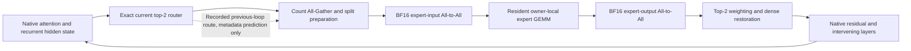

# Exact dependency and communication graph

IN_PROGRESS: this is a preview, not a completed PoC.

The dotted edge is predictive information, not an independent activation operand.
The actual next router still depends on the next hidden state.
Original expert outputs cannot skip the intervening native computation.
All dense states become replicated after restoration.
One fixed resident expert copy gives no alternate rank for a route without changing residency.
The trace placement analysis does not move expert weights at loop boundaries.

`routing_lead_time.csv` measures diagnostic intervals between repeated visits to the same physical site.
That interval can permit metadata preparation in principle.
It does not imply available future activation or an exact future split matrix.
Prediction errors require exact validation and safe correction.
No speculative collective receives incorrect split counts in this study.

## Analytical tied-unrolled control

Replace each recurrent visit with a distinct logical node in the dependency graph.
Keep its expert tensor storage aliased to the original physical expert.
Keep current routes, exact values, resident owners, and operation order unchanged.
The dispatch, compute, combine, and restoration sequence remains the same.
This is a graph accounting control, not an executed fourth model.

Untying those weights would instead increase resident memory and violate the matched storage condition.
The study does not treat that larger-memory counterfactual as a fair live baseline.
Shared weights provide a real storage benefit.
That storage benefit alone is not a measured EP latency speedup.
