# Architecture and source contract

## Checkpoints

| Model | Revision | Learned parameters | Expert topology | Native MoE calls per token |
| --- | --- | ---: | --- | ---: |
| IFM Ouro | `f0e9c8af22c10f34ac716c52495ceb00525f3556` | 8,780,889,600 | 28 physical sites, 25 experts per site, top-2, four recurrent passes | 112 |
| IFM Huginn | `f1321d5272a11348d5093ad7ab1d310eb9de2e11` | 8,783,251,968 | 8 prelude sites, 12 core sites repeated eight times, 8 coda sites, 25 experts per site | 112 |
| Foil-1 | `b3d128b44cbefd54e2c8784224a110186c8931f1` | 553,730,048 | 8-expert prelude, 64-expert core repeated sixteen times, 8-expert coda, top-2 | 18 |

The IFM checkpoints contain 700 physical experts each.
Their 25-expert pool belongs to each physical layer, not the entire model.
Foil contains 80 physical experts across three separate pools.
Its recurrent attention weights differ between passes.
Its recurrent expert and router weights remain shared.

IFM uses sigmoid routing and renormalizes the selected top-2 scores.
Foil uses softmax routing and its original selected-score normalization.
The EP bridge preserves these expressions.

## Parameter and buffer accounting

`quality/foil_parameter_inventory.json` reads actual checkpoint tensor headers.
The native loader confirms the parameter and buffer distinction.

| Foil category | Elements | Registration and dtype |
| --- | ---: | --- |
| Routed experts | 377,487,360 | Learned parameters, BF16 |
| Embedding and LM head | 100,663,296 | Learned parameters, BF16 |
| Attention projections | 75,497,472 | Learned parameters, BF16 |
| Routers | 81,920 | Learned parameters, BF16 |
| RoPE rotations | 9,437,184 | Registered buffers, FP32 |

The learned categories sum to 553,730,048 parameters.
The persistent tensors contain 563,167,232 elements in total.
The rounded 563.2M count includes registered positional buffers.
The model does not gain learned parameters during loading.

Each IFM expert contains 22,413,312 BF16 bytes.
The 700 physical experts therefore contain 15,689,318,400 bytes.
The remaining learned weights contain 1,872,460,800 bytes for Ouro.
They contain 1,877,185,536 bytes for Huginn.
Native metadata records total learned-weight bytes before sharding.

## Runtime versions

The official IFM source revision is `df0ed1ea415b55f0a944a291f90da9d47c98b5d5`.
The official Foil source revision is `0f9cc7351658c2437f75379e492f3920f0a0ec19`.
The reused TRUE EP source commit is `a5b37f72245969782a77c93a1b0f0bb700c3494f`.
The new worker records hashes for its study modules at process start.

The IFM publication evaluator accepts FA2 or FA3, but rejects FA4.
This study builds FA3 from commit `98c1cee0ed59307833841cdbf567fe336ceec13a`.
It installs the binary in a separate import directory.
The original model runtime and existing Python packages remain unchanged.
The binary identity appears in every new IFM metadata file.

Foil uses its checkpoint-bundled model code and SDPA attention.
Its separate evaluation environment retains PyTorch 2.11.0 and Transformers 5.14.1.
These versions differ from the Foil evaluation requirements file.
The quality report records that deviation instead of claiming an identical environment.

## Cache and decoding contract

The audited official paths recompute the full prefix for each generated token.
The IFM adapter passes `cache=None` and requires `cache is None` on return.
The Foil adapter uses `use_cache=False`.
These runs do not establish cached single-token decode performance.
There is no retained KV tensor to compare in this execution path.
KV correctness is therefore N/A, with this reason.

All original attention operations and recurrent state updates remain native.
No loop, expert row, or attention operation is skipped.
The hardware generation workload disables EOS and executes its stated output cap.
Publication-quality multiple-choice and LM evaluations use their own unchanged task protocols.

## TRUE EP data flow

```mermaid
flowchart LR
  A[Replicated dense hidden state] --> B[Original current router]
  B --> C[Source rows and exact counts]
  C --> D[Count All-Gather]
  D --> E[BF16 input All-to-All]
  E --> F[Owner-local expert GEMM]
  F --> G[BF16 output All-to-All]
  G --> H[Original top-2 weighting]
  H --> I[Dense-state restoration All-Reduce]
  I --> J[Native attention, residual and next layer]
```

Each expert has one resident owner, `expert_id % EP_degree`.
EP4 and EP8 have ragged IFM expert counts because 25 is not divisible by either degree.
Dense parameters and dense hidden states remain replicated.
This bridge performs real expert sharding, dispatch, expert GEMMs, and combine.
It is not an optimized production DeepEP serving engine.
Its generic metadata and restoration costs require separate interpretation.

## Boundary conditions

Huginn's official deterministic state initializer includes the batch-row index.
A four-row choice batch need not equal four independent single-row calls.
The publication evaluator uses the original choice-batch geometry.
Native-versus-EP checks compare the same geometry.
The study does not change initialization to obtain better parity or accuracy.

## Authoritative links

- [IFM study and benchmark table](https://huskydoge.github.io/husky-blog/posts/recursive_models/towards-looped-models-done-right/)
- [IFM native code](https://github.com/ifm-ai/xllm-loop)
- [IFM Ouro checkpoint](https://huggingface.co/IFM/LoopedLM-P1-moe-ouro-500b)
- [IFM Huginn checkpoint](https://huggingface.co/IFM/LoopedLM-P1-moe-huginn-500b)
- [Foil paper](https://arxiv.org/abs/2609.35751)
- [Foil checkpoint and code bundle](https://huggingface.co/ShourenWSR/how-to-loop-moe)
- [Foil source](https://github.com/SR-A-W/how-to-loop-moe)
