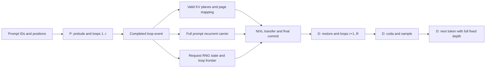
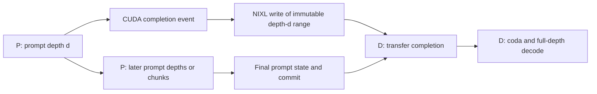
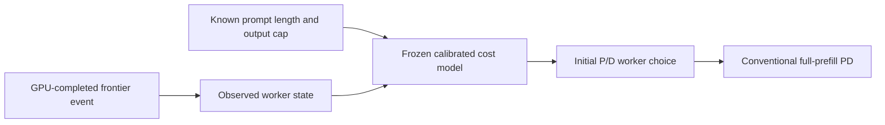

# Exact state and ownership dependencies

The diagrams describe legal execution. They do not claim measured speedup.

## A: one prefill migration

The prompt's next loop depends on the preceding loop's completed hidden state.
Causal attention at depth `d` reads the same depth's valid prefix KV.
The destination cannot replace that prefix with another depth's KV.
Huginn and Dory also require their fixed input-injection carrier.
Huginn additionally requires its request RNG generator state.

The source retains registered buffers and cache leases until transfer completion.
The destination restores valid page frontiers before it schedules remaining work.
The adapter forbids prefix-cache migration and unfinished-token-chunk migration.
These restrictions are explicit implementation limits.

## B: unchanged compute ownership

The transfer and later prompt computation may overlap.
This diagram proves independence, not achieved overlap duration.
The same source bytes must remain immutable until the copy finishes.
The last-loop shared layout does not satisfy that condition for intermediate values.

## C: legal information boundary

The policy does not use future token IDs, EOS positions, or future GPU durations.
Loop progress is a state feature, not a dynamic-depth prediction.
The standalone C comparison does not enable A or B.
