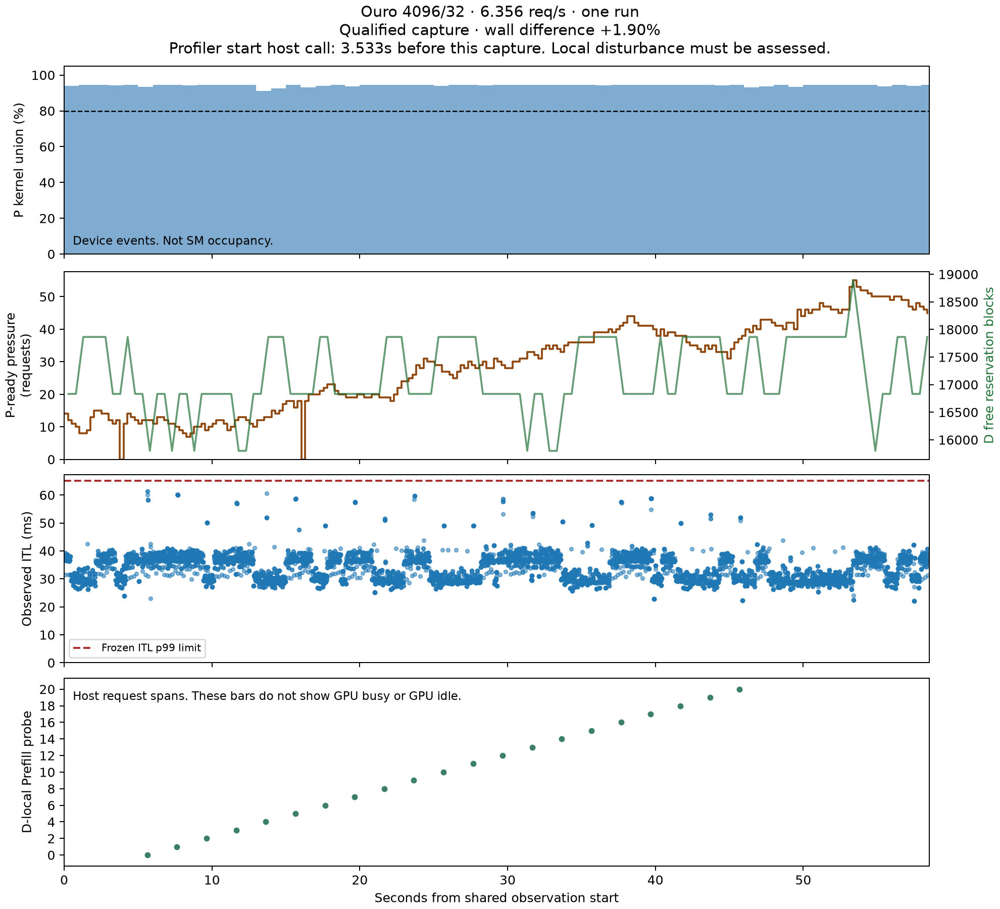
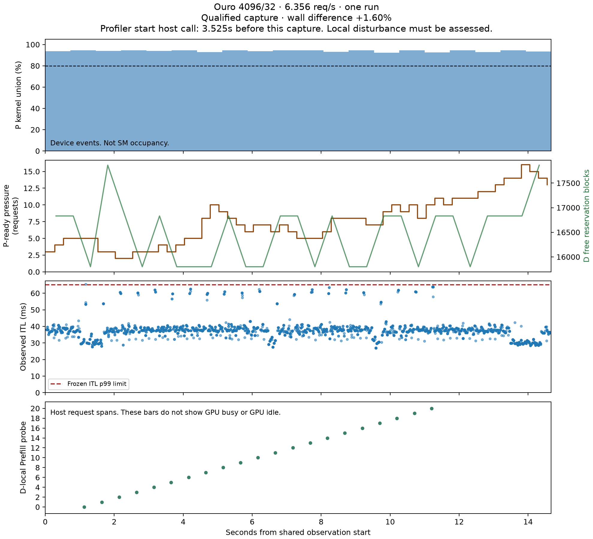
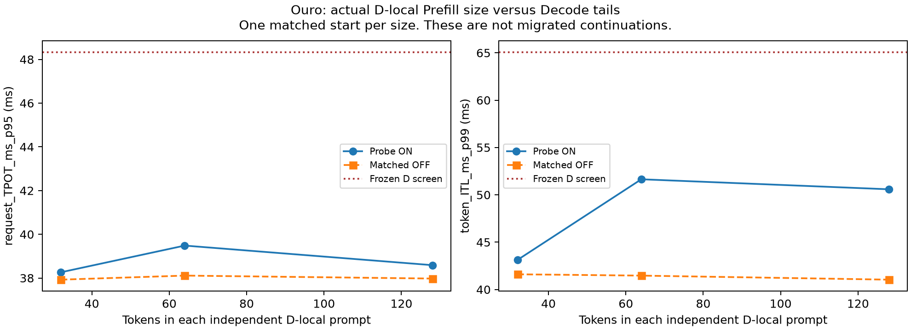
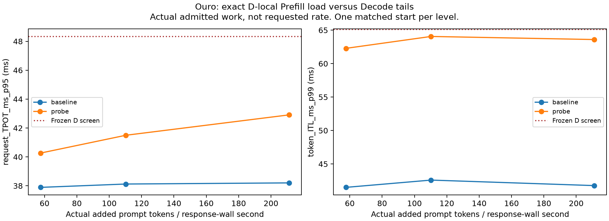
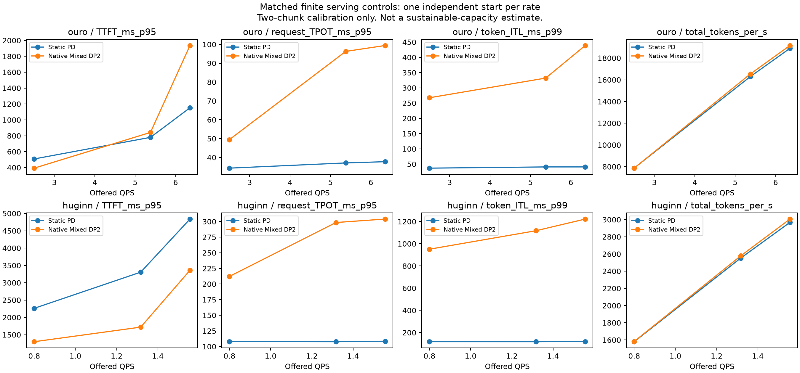
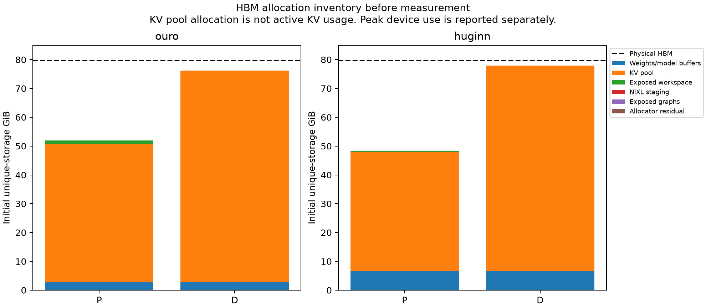
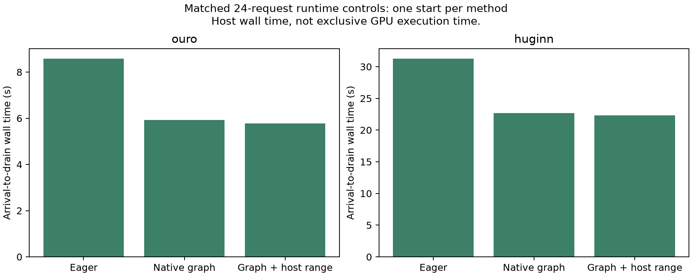
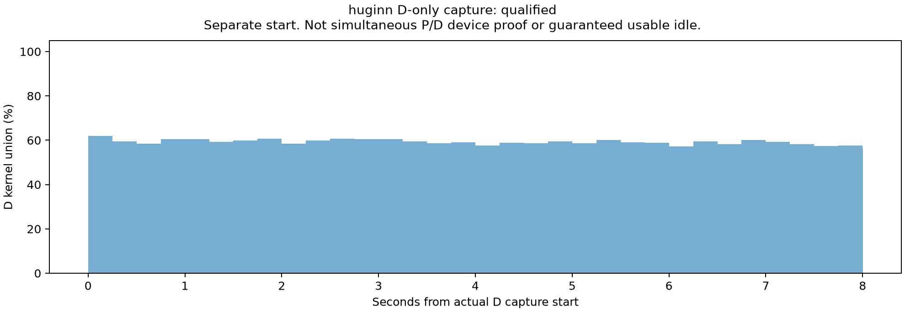

# Autonomous Prefill compute and Decode headroom discovery

Status: final GPU evidence report. GPU experiments ended at 2026-11-03 21:23:37 KST. No further GPU experiment is authorized by this campaign.

## 1. Main result and claim boundary

Ouro has a reproducible finite serving condition that passes the campaign's operational P-pressure and D-headroom screens. Three independent 128-request starts pass. A separate 512-request run also passes over a 58.530093-second shared observation interval.

Huginn does not have equivalent evidence. An eight-second capture fails queue-growth and Decode-tail gates. Shorter-input clean runs preserve Decode SLOs with real additional Prefill. However, P profiling still stops response progress, including the newer-collector and prewarmed-collector controls.

The distinction between an operational screen and a physical hardware ceiling is essential. The campaign measures the union of GPU kernel intervals. It does not measure achieved SM throughput or HBM bandwidth. Hardware performance counters are unavailable with the current permissions. Thus, the result supports sustained GPU-execution pressure under the tested runtime. It does not establish that the GPU reaches its physical FLOP limit.

The added D work consists of independent, exact, full-depth local Prefill requests. It is not a migrated P-side continuation. No Dynamic A speedup is measured.

## 2. Evidence classes

| Label | Meaning |
|---|---|
| MEASURED | Actual CPU/GPU execution or request observation |
| TRACE_ANALYSIS | Analysis of recorded events from a named execution |
| STRUCTURAL_ACCOUNTING | Exact layout or operation counts. Not measured speedup. |
| NOT_MEASURED | No valid measurement for the claim |

Host request spans, kernel intervals, and cumulative transfer observations are different quantities. Overlapping durations are not added to form an exclusive GPU E2E breakdown.

## 3. Runtime, models, and preservation

| Item | Value |
|---|---|
| Source repository | `/home/esjung/MLLM-EP-github` |
| Campaign source | `poc_flashvep/looped_pd_autonomous_headroom/` |
| Private runtime | `/home/esjung/external/looped-pd-abc-rlt` |
| Runtime HEAD | `6b164d3844d35ab8e753df1864f0c87dc180401a` plus the preserved pre-existing patch |
| Prior publication | `2d683cce8ebc926c9d410944b705cbcb6f6031a0` |
| Ouro | `ByteDance/Ouro-1.4B`, BF16, fixed R4 |
| Ouro revision | `574fa66cb8bf5abdc979642d01cf2b79b16bfab1` |
| Huginn | `tomg-group-umd/huginn-0125`, BF16, fixed R32 |
| Huginn revision | `bb6621b65e90b6a4b9b29ef88dc83866d450470c` |
| Huginn context limit | 4096 tokens |
| GPU | Eight physical H100 80GB devices. Each serving experiment uses one isolated pair. |
| Software | PyTorch 2.11.0+cu129, CUDA 12.9, driver 570.211.01 |
| Attention | Native FlashAttention backend. Each run logs its package and version. |
| Publication branch | `flashvep/looped-pd-autonomous-prefill-headroom` |

The external runtime is not edited by this campaign. Hooks are confined to the campaign namespace. Each run saves configuration, GPU mapping, source hashes, and a source archive. `state/environment.json` records GPU UUIDs and topology. `state/preservation.json` records the original staged-index signature and the external runtime patch hash.

The original nine-hour campaign and its later user-authorized extension are separate budget records. `state/budget.json` preserves the original contract. `state/authorized_extension.json` records the extension beginning at 2026-11-03 13:42:56 KST. Its GPU stop is 22:12:56 KST. Its final closeout deadline is 23:42:56 KST. This report does not claim that all extended work occurred within the original nine hours.

## 4. Dataset and execution contract

The campaign reuses pinned public ShareGPT and LongBench prompt material. Prompts are tokenizer-specific prefixes. Generation uses fixed output caps and `ignore_eos`. These are controlled workloads, not natural response-length distributions or original Azure requests.

Calibration, pilot, and confirmation use separate source-pool slices. The confirmation pool contains 128 prompt records. Longer 256-, 384-, and 512-request controls explicitly cycle those records. They increase the observation duration, not the number of independent texts.

| Setting | Ouro joint confirmation | Huginn long-window control |
|---|---:|---:|
| Input / output cap | 4096 / 32 | 2560 / 16 |
| Prompt chunk | 4096, full prompt | 2560, full prompt |
| Nominal offered QPS | 6.356 | 1.556 |
| P / D compute slots | 2 / 8 | 2 / 8 |
| P / D KV pool blocks | 16384 / 25088 | 16384 / 28288 |
| P graph row limit | 8192 | Recorded in each immutable configuration |
| D-local probe | 16 input tokens, one output token, full R4 | 16 input tokens, one output token, full R32 |

The P graph limit is a maximum supported size. The native packed graph uses the actual query count in its cache key. It does not force every P request to execute 8192 useful rows. The existing numerical geometry remains in force.

Open-loop Poisson arrivals continue independently of request completion. Nominal QPS, realized offered QPS, and completed throughput are separate columns in the serving CSV. A finite overloaded run with a growing queue is not a sustainable-capacity measurement.

## 5. Unchanged acceptance gates

The operational P screen requires all four conditions:

- P-ready pressure increases between the two window halves.
- Maximum ready count is at least two.
- P kernel union is at least 80%.
- Service proximity is at least 85% of the finite independent reference.

Profiling must preserve output parity and remain within 5% of the matched unprofiled response wall time.

The D screen requires legal KV credit, the frozen Decode latency limits, and actual completed local Prefill work inside the same observation interval. Exact output and full-depth work checks are mandatory.

| Workload calibration | TPOT limit, ms | 90% TPOT margin, ms | ITL p99 limit, ms |
|---|---:|---:|---:|
| Ouro L4096 | 53.707029 | 48.336326 | 65.082876 |
| Huginn L2560 | 191.515103 | 172.363593 | 198.378139 |
| Huginn L2048 | 186.571506 | 167.914355 | 192.821254 |

An ITL p99 limit does not require every individual token interval to be below that limit. Maximum observed ITL is reported separately.

### Queue ownership correction

The native request phase can advance to transfer before its submitted Prefill GPU ticket retires. A phase-only queue counter therefore reports zero pressure in some executions with pending P work.

The audit retains the original phase-only result. It separately qualifies P-slot backlog with native pending-event or Prefill service-span evidence. The P-ready count excludes D-credit-blocked requests. This changes ownership measurement, not the numerical thresholds.

An additional event-only sensitivity audit removes the host-span fallback. Its raw files are `event_only_queue_audit.json`. The final decision must retain this sensitivity. Synchronous Huginn has less event observability, so an absent pending-event record is not proof of an empty queue.

For Ouro, the event-only half-window increases are +4.426437, +15.976601, and +2.716129 requests for the three independent starts. The 512-request control increases by +18.683761 requests. All four queue sensitivity screens pass without the host-span fallback.

## 6. Ouro: reproduced same-window result

All values below are MEASURED or TRACE_ANALYSIS. Each row uses one execution and one common interval. P metrics are not taken from another start.

| Execution | Requests | P kernel union, % | P / finite reference, % | P-ready half increase | D TPOT p95, ms | D ITL p99, ms | Profile wall difference, % |
|---|---:|---:|---:|---:|---:|---:|---:|
| Independent start 1 | 128 | 91.306542 | 107.379818 | 6.256322 | 38.078751 | 52.581422 | +4.221136 |
| Independent start 2 | 128 | 91.646827 | 105.660078 | 18.189655 | 37.844714 | 49.307696 | +1.816523 |
| Independent start 3 | 128 | 81.453537 | 95.674663 | 3.318280 | 39.192654 | 53.755084 | +0.993940 |
| Persistence control | 512 | 94.206628 | 110.078034 | 23.256410 | 37.861050 | 49.114129 | +1.898525 |

The three starts use arrival seeds 2026110901, 2026110902, and 2026110903. GPU pairs alternate between 0/1 and 2/3. The persistence control uses pair 2/3 and seed 2026111601. No new graph capture occurs during their measured phases.

Across the three starts, mean P kernel union is 88.135635%. Its untruncated Student-t 95% interval is [73.754049%, 102.517222%], with two degrees of freedom. All three observed starts pass 80%, but this small sample does not establish a population lower bound above 80%. The mathematical interval is not clipped to the physical range.

| Three-start statistic | Mean, ms | Start-level 95% interval, ms |
|---|---:|---|
| Central D ITL p99 | 51.881401 | [46.155834, 57.606967] |
| Paired whole-run ITL p99 difference, probe minus baseline | +5.758071 | [-2.942527, 14.458669] |
| Paired whole-run TPOT p95 difference, probe minus baseline | +0.178706 | [-0.730820, 1.088232] |

Each interval uses three independent starts. Token intervals are not independent replications.

### Longer persistence control

`persistence_ouro_nsys512` records a 96.434417-second device trace. Its shared central analysis interval is 58.530093 seconds. In that interval:

- P completes 315 Prefills at 5.381847 requests/s.
- The finite independent P reference is 4.889120 requests/s.
- The maximum audited P-ready pressure is 55 requests.
- D has at least 15800 free reservation blocks.
- Recorded D-credit refusal fraction is zero.
- Twenty-one real D-local Prefill requests complete inside the interval.
- All 21 probe outputs match their native reference.
- Expected and observed recurrent work both equal 8453440 rows.
- Whole-run maximum ITL is 61.241233 ms.

Service proximity above 100% means that the finite independent reference is not an absolute hardware ceiling. It must not be described as GPU efficiency above 100%.

### Stronger independent batch control

The final control tests B1, B2, and B4 with three repetitions per batch. Ouro's fastest valid B4 cohort completes four requests in 0.809973 seconds, or 4.938435 requests/s. This is slightly faster than the earlier 4.889120 reference. All three independent joint starts and the persistence control still pass the unchanged 85% service screen. `final_joint_screens.csv` preserves both reference versions.

Huginn L2048 also completes all nine B1/B2/B4 cohorts with native output parity and exact work accounting. Increasing its batch to four does not improve the fastest finite service rate. `final_stronger_P_batch_capacity.csv` includes every repeat, including slower repeats. These cohorts do not establish sustainable serving capacity.



The bottom-panel bars are host probe-request spans. They are not D GPU busy or idle intervals.

### What this establishes

The result establishes reproducible finite P-side device-execution pressure with legal D credit and successful small extra D work under the frozen Decode screens. It supports a bounded next mechanism experiment for Dynamic A.

It does not establish sustainable capacity, a large continuation budget, or a measured Dynamic A E2E improvement. It also does not identify whether the ultimate GPU resource ceiling is arithmetic throughput, memory bandwidth, or another device resource.

## 7. Huginn: retained failures and unresolved boundary

| Control | Requests | Capture, s | P kernel union, % | Queue half increase | Central D ITL p99, ms | Result |
|---|---:|---:|---:|---:|---:|---|
| Short capture | 256 | 3.000063 | 85.343928 | +0.333333 under filtered audit | 145.220638 | Exploratory screen only |
| Longer capture | 384 | 8.392085 | 91.106920 | -2.992647 | 200.572834 | Joint gate FAIL |
| Duration-only control | 384 offered | 30 requested | NOT_MEASURED as a complete qualified run | NOT_MEASURED | NOT_MEASURED | Progress watchdog after 132 responses |

The short capture has a queue-definition sensitivity. A direct D-clear P-slot series has a half-window change of -4 requests. The positive filtered count does not establish sustained backlog across queue definitions. The short capture also contains only one central probe.

The eight-second control passes the whole-run 5% profiling screen at +4.839569%. It still fails the same-window D ITL limit of 198.378139 ms. Its queue decreases. Central D-credit refusals occur in 42.4242% of sampled observations. Minimum D free credit is 2528 blocks. These failures remain failures even though P kernel union exceeds 90%.

Four probes complete inside that capture. All 24 probes across the run and all 384 background requests complete with exact output and full-depth accounting. Correctness does not make the failed performance gates pass.

The 30-second capture retains its partial trace, logs, and watchdog record. It is not classified as a model correctness failure or proof of a permanent engine deadlock. The available evidence cannot fully separate collector export, synchronization, and native transport interactions.

### Lower-KV-demand control

The L2048/O16 control passes the eight-request state gate and the independent 32-request output comparison. Its C1024 and full-C2048 serial calibration precede held-out serving. New-length frozen limits are TTFT 1963.992012 ms, TPOT 186.571506 ms, and ITL p99 192.821254 ms.

The inherited calibration text label is inaccurate. A clarification sidecar identifies the actual C1024/C2048 runs. Numeric limits and original frozen evidence are unchanged.

The first intended independent-capacity job selected the serving worker by mistake. Its two-request result is excluded from capacity evidence. The replacement uses `capacity_worker` in a new `_v2` namespace and completes successfully.

The clean L2048/O16 confirmation uses nominal 1.971 QPS and 384 requests. Its actual arrival rate is 1.810111 QPS. It completes 12 independent 16-token D-local Prefills with exact outputs and full-depth work. These are not migrated continuations.

| Clean L2048 control | TTFT p95, ms | TPOT p95, ms | ITL p99, ms | Maximum ITL, ms | Response wall, s |
|---|---:|---:|---:|---:|---:|
| No added Prefill | 23768.440189 | 116.576967 | 125.176142 | 174.349850 | 232.118364 |
| Twelve D-local Prefills | 23649.671059 | 121.648421 | 142.012722 | 228.755943 | 232.004770 |

This is one paired start. TPOT p95 increases by 5.071454 ms. ITL p99 increases by 16.836580 ms. Both remain below the frozen D screens. Maximum ITL exceeds the p99 threshold, which is not an all-token maximum constraint. The large TTFT means this run is not a successful joint TTFT/TPOT serving operating point.

### Profiler failure isolation

| P collector control, L2048/O16 | Completed measured responses before watchdog | Result |
|---|---:|---|
| Nsight 2024.6, in-serving start | 133 / 384 | Response-progress timeout |
| Nsight 2025.1.3, same in-serving start | 135 / 384 | Response-progress timeout |
| Nsight 2025.1.3, start before worker readiness | 13 / 384 | Response-progress timeout |

Both new controls retain P stack traces inside `nixl_cu12._api.transfer`, called from native `transport.submit` and `connector.progress`. The collector version and activation timing changes are insufficient. The stack location does not establish the native root cause of the stall. No failed trace is treated as a complete clean measurement.

The newer collector is the version listed in the official [CUDA 12.9 release notes](https://docs.nvidia.com/cuda/archive/12.9.0/cuda-toolkit-release-notes/index.html). Its archive SHA256 matches the [NVIDIA redistribution manifest](https://developer.download.nvidia.com/compute/cuda/redist/redistrib_12.9.0.json). It is installed separately. The system profiler, driver, and runtime remain unchanged.

A separate H2560/O16 D-only capture completes. It records 535582 kernel invocations over 8.002353 seconds, with 59.262546% D kernel union. Its response-wall perturbation is +3.363902%, and output parity passes. This is not the same start as the P capture. It cannot be combined with a different P run to establish simultaneous P saturation and D slack.

## 8. Root cause and safe runtime changes

| Change or finding | Evidence | Interpretation |
|---|---|---|
| Native packed Prefill graph support existed but was not selected by the ordinary path | Code audit and graph replay counts | Reuse of an existing runtime facility, not a new model algorithm |
| Exact host KV-written-range updates | 20000 randomized native-state comparisons and GPU parity gates | Removes repeated host metadata work without removing GPU writes |
| Identical premeasurement D-local warmup | Matched baseline/probe controls | Avoids charging first-use setup to only the probe arm |
| Native graph reuse for D-local Prefill | Exact hidden/KV/output comparisons | Changes execution submission, not recurrent depth or attention math |
| Dynamic activity-toggle collector path loses events | 100 expected kernels become zero recorded events in the self-test | Empty trace is not zero GPU activity |
| Long Huginn profiling can stall response progress | Retained watchdog and partial traces | Profiling is not fully normalized |

The bulk host update preserves exact `_WrittenPositions` semantics, including holes and duplicate writes. For the tested geometries, the structural per-request position updates are 393216 for Ouro 4096/R4 and 655360 for Huginn 2560/R32. These are host bookkeeping counts, not saved model FLOPs.

One matched Huginn control uses 24 requests at L2560/O16. Arrival-to-drain wall time is 31.292 seconds with eager execution. It is 22.6558 seconds with native Prefill graphs. It is 22.2879 seconds with graphs plus bulk host bookkeeping. These are single-start host measurements. They are not exclusive GPU times or a confidence-backed production speedup.

The negative H2560/O32 control is also retained: the graph path takes about 45.42 s versus 41.56 s for eager execution. Graph reuse is not universally faster.

The previous Ouro 66.58% kernel-union result used L8192. The new 94.21% result uses L4096 and different runtime settings. Their difference is not a matched causal estimate of one optimization.

The old Ouro trace contains 12.832995 seconds without a recorded kernel inside a 38.401367-second window. Recorded copies overlap 1.847532 seconds of those gaps. Recorded kernel-submission API calls overlap 0.292582 seconds. These overlaps are not an exclusive causal partition. The remainder cannot be assigned entirely to Python or scheduling from this trace alone. The matched graph and bookkeeping controls provide the intervention evidence. They do not identify every gap individually.

### Reference-engine reuse

`ref_loopserve` remains read-only. Its graph, KV-validity, and scheduling structures informed the audit. The implementation reuses the current vLLM-RLT graph owner and allocator rather than replacing the engine. The existing qualified numerical fixes remain active. Source and license records accompany the campaign code.

### Recorded kernel categories

The following TRACE_ANALYSIS uses kernel-name categories within each stated central interval. Percentages divide summed kernel durations, not request E2E time. Concurrent kernel durations can overlap. These values are not exclusive critical-path shares or achieved hardware throughput.

| Execution | Central interval, s | Summed kernel duration, s | GEMM names, % | Elementwise/reduction names, % | Attention names, % | Copy/index/fill names, % |
|---|---:|---:|---:|---:|---:|---:|
| Ouro 512-request persistence | 58.530093 | 55.141189 | 37.973610 | 34.210834 | 7.646001 | 20.169555 |
| Huginn 2560/16, eight-second control | 8.392085 | 7.651554 | 53.928031 | 25.540781 | 3.787570 | 16.743618 |

The Huginn row remains a failed joint screen. Kernel-category analysis does not change that verdict. Per-run `kernel_name_duration_mix.csv` files preserve category counts and durations.

## 9. D-local Prefill budget and latency cost

The probe-size curve tests 32, 64, 128, and 256 input tokens in order. It stops at the first failed gate. Each probe executes the full model depth and produces one token. Each size uses a fresh matched no-probe baseline with identical warmup.

The 32-, 64-, and 128-token controls each complete five probes. All outputs and work counts match. Whole-run ITL p99 is 43.124749, 51.643756, and 50.586120 ms, respectively.

The 256-token gate fails before the performance comparison. The D token budget is 128. Native scheduling therefore attempts a 128-token first chunk for the 256-token probe. The existing atomic-prompt assertion rejects it with `ATOMIC_PROMPT_WAS_SPLIT`. This is an unsupported configuration under the unchanged D budget, not a measured 256-token SLO failure or evidence of corrupted output. The assertion is not removed. The sweep stops. Testing a D budget of 256 would require a separate matched configuration and correctness gate.

The frequency control therefore uses the largest accepted size, 128 tokens. It tests intervals of 1.0, 0.5, and 0.25 seconds in order. Actual admitted counts and first failure remain part of the result.

| Requested interval, s | Actual completed probes | Added prompt tokens / response-wall second | TPOT p95, ms | ITL p99, ms | Maximum ITL, ms | Clean whole-run screen |
|---|---:|---:|---:|---:|---:|---|
| 1.0 | 11 | 57.636887 | 40.267651 | 62.280103 | 67.050468 | PASS |
| 0.5 | 21 | 110.250840 | 41.497290 | 64.057627 | 68.427496 | PASS |
| 0.25 | 41 | 211.167728 | 42.908075 | 63.597218 | 70.869744 | PASS |

Each row is one matched start. Actual admission occurs only during the permitted middle arrival interval and with legal local credit. The requested interval is not an achieved continuous probe rate. The highest clean load adds 5248 prompt tokens against 524288 background prompt tokens, about 1.001%. This is structural work accounting, not a measured speedup or a maximum borrowing limit.

### Same-window qualification of the larger probes

The 0.25-second configuration fails its subsequent central ITL screen. The 0.5-second follow-up passes. The failed result remains visible despite its small threshold excess.

| Same-window capture | Central interval, s | P kernel union, % | P / final reference, % | P-ready half increase | Central probes | D TPOT p95, ms | D ITL p99, ms | Profile wall change, % | Verdict |
|---|---:|---:|---:|---:|---:|---:|---:|---:|---|
| 128 tokens / 0.25 s | 14.666868 | 90.786689 | 106.307518 | 5.945977 | 42 | 43.176532 | 65.503954 | +3.699344 | FAIL: ITL > 65.082876 ms |
| 128 tokens / 0.5 s | 14.666868 | 93.889921 | 109.068752 | 5.072414 | 21 | 39.919758 | 61.796712 | +1.599745 | PASS: finite operational screen |

Both captures preserve exact background and probe outputs. Both have zero measured graph captures and at least 15800 free D reservation blocks. Recorded D-credit refusals are zero. The passing lower-load capture has a whole-run maximum ITL of 89.229725 ms. Therefore, it does not pass an all-token 65.082876-ms maximum constraint. The frozen contract uses ITL p99, not maximum ITL.

The lower-load result is one adaptive follow-up, not three independent confirmations. Three-start replication remains available only for the smaller 16-token probe configuration.



These size controls are separate starts without a P device capture at each size. They establish only the measured Decode tolerance under that background workload. They do not extend the same-run P proof from the 16-token confirmation to every larger size.





## 10. Aggregated DP2 control

The comparison uses two colocated native Mixed replicas with chunk sizes 512 and 2048 as calibration candidates. Selection uses disjoint 24-request calibration, then an independent 32-request output gate. PD and DP2 use the same held-out prompts and arrival trace at each rate.

Huginn DP2 reserves 22016 KV blocks per replica to support its configured four-request limit. This change was made before any Huginn DP2 job started. It is not applied retroactively to previous measurements.

Rate controls use one independent start per rate. They are a limited tuned comparison, not a globally optimal production baseline or a sustainable-capacity sweep. Completed measurements and missing conditions are recorded separately.

Each Ouro DP2 rate run contains one measured-phase native Prefill graph capture. Their host spans are 0.271352, 0.239272, and 0.238120 seconds. The paired PD runs have no measured-phase graph capture. These finite DP2 results include that setup cost. They are not a fully warmed production comparison. All six Huginn rate arms have zero measured-phase graph captures. The separate Ouro joint-screen confirmations also have zero measured-phase captures in both matched arms.

Ouro uses L4096/O32. Huginn uses L2560/O16 in this comparison. Both select C2048 for DP2 from the two calibration candidates. Each arm offers 128 requests. All six paired output comparisons pass. The table reports nominal QPS and realized arrival QPS separately. Small PD/DP arrival differences disappear at three-decimal rounding.

| Model | Nominal / realized QPS | Arm | TTFT p95, ms | TPOT p95, ms | ITL p99, ms | Joint SLO-goodput, req/s |
|---|---|---|---:|---:|---:|---:|
| Ouro | 2.500 / 1.925 | PD | 508.236 | 34.303 | 36.837 | 1.907293 |
| Ouro | 2.500 / 1.925 | DP2 Mixed | 392.491 | 49.447 | 267.608 | 1.845977 |
| Ouro | 5.378 / 4.141 | PD | 780.028 | 37.070 | 40.818 | 3.949339 |
| Ouro | 5.378 / 4.141 | DP2 Mixed | 842.192 | 96.292 | 332.107 | 0.876798 |
| Ouro | 6.356 / 4.895 | PD | 1152.260 | 37.729 | 40.825 | 4.292373 |
| Ouro | 6.356 / 4.895 | DP2 Mixed | 1936.274 | 99.423 | 438.925 | 0.326328 |
| Huginn | 0.800 / 0.616 | PD | 2261.798 | 107.966 | 118.099 | 0.603663 |
| Huginn | 0.800 / 0.616 | DP2 Mixed | 1299.053 | 212.139 | 950.898 | 0.566213 |
| Huginn | 1.317 / 1.014 | PD | 3306.006 | 107.722 | 117.915 | 0.719989 |
| Huginn | 1.317 / 1.014 | DP2 Mixed | 1719.802 | 298.451 | 1117.324 | 0.531732 |
| Huginn | 1.556 / 1.198 | PD | 4838.128 | 108.487 | 119.472 | 0.441149 |
| Huginn | 1.556 / 1.198 | DP2 Mixed | 3360.168 | 303.985 | 1222.360 | 0.319166 |

Joint goodput here uses frozen TTFT and request-average TPOT limits. ITL tails remain a separate stricter diagnostic. These finite one-start controls do not establish maximum stable serving capacity. DP2 does not uniformly improve TTFT across models and rates. Its implementation is native RLT Mixed, not DuetServe's production vLLM engine.



## 11. Memory, communication, and E2E accounting

`final_memory_inventory_GiB_percent.csv` reports measured initial allocations in GiB and percent of physical HBM. Allocator totals overlap their component tensors and must not be summed with them. Logical free KV blocks are already-reserved pool capacity, not free device HBM.

The measured physical capacity is 79.647461 GiB per device. The following initial inventories precede the measured serving interval. Values in parentheses are percentages of that physical capacity.

| Model / role | Weights and model buffers, GiB (%) | KV pool, GiB (%) | Exposed workspace, GiB (%) | Allocator total, GiB (%) |
|---|---:|---:|---:|---:|
| Ouro P | 2.672249 (3.355096%) | 48.000000 (60.265575%) | 1.252571 (1.572644%) | 51.924821 (65.193317%) |
| Ouro D | 2.672249 (3.355096%) | 73.500000 (92.281661%) | 0.020088 (0.025221%) | 76.192338 (95.661980%) |
| Huginn P, L2560 | 6.641752 (8.338937%) | 41.250000 (51.790728%) | 0.423089 (0.531202%) | 48.325043 (60.673676%) |
| Huginn D, L2560 | 6.641752 (8.338937%) | 71.220703 (89.419929%) | 0.010734 (0.013476%) | 77.885343 (97.787603%) |

Graph-pool and library allocations are not fully attributable through the exposed tensor inventory. Sampled peak device HBM is reported separately. The table must not be interpreted as peak free workspace.



`completed_serving_current.csv` reports sampled peak P/D HBM, actual sent bytes, fragment completions, nominal and realized QPS, completion counts, latency percentiles, and finite SLO-goodput.

`completed_host_e2e_component_shares_current.csv` reports host-observed request-phase shares. It does not turn cumulative transfer observations into exclusive DMA time. Pure GPU dispatch/compute/communication percentages that cannot be measured without overlap are NOT_MEASURED.

The persistence result proves available legal credit for its small actual probes. It does not prove enough KV and workspace for an entire 4096-token migrated continuation at arbitrary concurrency.

## 12. Correctness and exclusions

Background sequence parity, probe sequence parity, and full recurrent work accounting are separate checks. Native warm-reference comparisons include exact hidden state and KV planes: 192 planes for Ouro and 264 for Huginn in the recorded control.

Weights, BF16, fixed R4/R32, attention semantics, and native NIXL transfer remain unchanged. Measured work excludes warmup and records actual completed probe counts. No early exit, work skipping, quantization, or output approximation is used.

Original-HF equivalence and downstream benchmark accuracy are NOT_MEASURED in this campaign. Internal runtime parity does not establish those claims.

Invalid profiler runs, cold-start artifacts, the erroneous capacity-worker dispatch, and failed performance gates remain in the execution manifest. No failed capture is relabeled as clean evidence.

## 13. Artifacts and reproduction

All relative paths below start at `looped_pd_autonomous_prefill_compute_decode_headroom/`.

| Artifact | Purpose |
|---|---|
| `final_joint_screens.csv` | Same-run gate values, original and audited queue results |
| `final_independent_start_uncertainty.csv` | Three-start uncertainty. Tokens are not independent starts. |
| `final_paired_probe_effect.csv` | Matched baseline/probe latency differences |
| `final_paired_probe_uncertainty.csv` | Start-level paired uncertainty |
| `final_probe_size_curve.csv` | Actual size controls and rejected sizes |
| `final_probe_load_curve.csv` | Actual additional Prefill load and matched Decode costs |
| `final_stronger_P_batch_capacity.csv` | B1/B2/B4 finite P-service controls |
| `final_aggregated_controls.csv` | PD versus native Mixed DP2 |
| `final_execution_manifest.csv` | Completed, failed, and unexecuted configurations |
| `final_figure_manifest.json` | Figure paths and measurement scope |
| `configs/`, `data/`, `raw/`, `logs/` | Immutable inputs, source snapshots, raw events, and failure logs |
| `archives/manifest.json` | Lossless chunked archives and original SHA256 checks |

Use the qualified environment from the repository root:

```bash
/home/esjung/.venvs/looped-pd-abc/bin/python -m poc_flashvep.looped_pd_autonomous_headroom.test_bulk_written
/home/esjung/.venvs/looped-pd-abc/bin/python -m poc_flashvep.looped_pd_autonomous_headroom.test_timed_capture
/home/esjung/.venvs/looped-pd-abc/bin/python -m poc_flashvep.looped_pd_autonomous_headroom.independent_joint_repeats
/home/esjung/.venvs/looped-pd-abc/bin/python -m poc_flashvep.looped_pd_autonomous_headroom.long_ouro_confirmation
/home/esjung/.venvs/looped-pd-abc/bin/python -m poc_flashvep.looped_pd_autonomous_headroom.huginn_shorter_control
/home/esjung/.venvs/looped-pd-abc/bin/python -m poc_flashvep.looped_pd_autonomous_headroom.qualified_probe_curve
/home/esjung/.venvs/looped-pd-abc/bin/python -m poc_flashvep.looped_pd_autonomous_headroom.matched_aggregated_control
/home/esjung/.venvs/looped-pd-abc/bin/python -m poc_flashvep.looped_pd_autonomous_headroom.final_analysis
```

GPU controllers enforce the recorded deadline and reuse completed immutable namespaces. A new reproduction requires a new namespace, a newly authorized resource window, and the same frozen evaluation contract. Do not overwrite old raw results or silently change archived configuration files.

## 14. Final decision and publication

| Model | Condition A | Condition B | Same-run combined verdict | Dynamic A decision |
|---|---|---|---|---|
| Ouro R4 | Operational P-pressure gates PASS in three starts and the longer persistence run | Exact small D-local work preserves frozen Decode screens | `TRUE_PREFILL_COMPUTE_HEAVY_WITH_D_SLACK`, restricted to the stated finite operational definition | CONDITIONAL: a bounded continuation mechanism test is justified |
| Huginn R32 | Sustained same-window P saturation NOT_CONFIRMED | Clean L2048/O16 runs demonstrate limited exact D-local Prefill tolerance | `D_HEADROOM_ONLY`. Combined P/D proof remains incomplete. | NO_GO for expansion into a Dynamic A serving campaign under the current evidence |

The Ouro label is not a claim about the physical FLOP ceiling. SM throughput, achieved HBM bandwidth, and original-HF fidelity remain NOT_MEASURED. Neither model has a measured Dynamic A speedup in this campaign.

The execution manifest contains 256 configurations: 226 complete, 26 failed or partial, three not run, and one invalid capacity dispatch. There are 253 actual dispatch starts. Of these, 228 occur within the later authorized extension. The serving table contains 202 completed serving records. The profile table contains 30 analyzed records, including perturbed diagnostics. These counts are not counts of successful scientific claims.

The final GPU phase ends 7 hours 40 minutes after the extension starts. The earlier campaign, pauses, and later extension are not compressed into one nine-hour claim. Final analysis, publication, and resource restoration are separate closeout activities within the extended deadline.

All scheduled GPU controllers reach terminal status. CPU closeout tests pass: 20000 native metadata comparisons, ten exact host controls, and bounded collector-control tests. Python compilation also passes. All 344 reused Python files match the prior publication commit byte-for-byte. The original staged index and external runtime patch remain unchanged.

Approved burners are restored on physical GPUs 0 through 7 after GPU experiments finish. `state/final_resource_restore.json` records their verified ownership and device state. No further clean measurement runs with these burners active.

The publication branch is `flashvep/looped-pd-autonomous-prefill-headroom`. Publication uses a temporary Git index and ordinary fast-forward pushes. Large traces use lossless numbered gzip parts with SHA256 checks. Local originals remain intact. The final handoff supplies the verified remote commit SHA. `state/publication_receipt.json` records the local publication result.

The supported next step for Ouro is a bounded exact continuation-cost experiment. It is not a large Dynamic A serving campaign. The experiment must test useful continuation sizes, state transfer, admission rechecks, and Decode interference against strong static and token-split baselines.

Huginn requires an independently repeated same-window result before the equivalent step. A high P kernel-union percentage alone does not remove its queue, KV, Decode-tail, or profiler blockers.

### Figures for the motivation discussion

Use the Ouro persistence figure for the sustained finite-window observation. Use the 128-token probe figure for the larger-work, single-start boundary. Show the failed 0.25-second result beside the passing 0.5-second result. Do not hide that boundary.





The Huginn D figure is explicitly a separate start. It does not complete the missing same-run P proof. No synthetic GPU idle interval is drawn.
