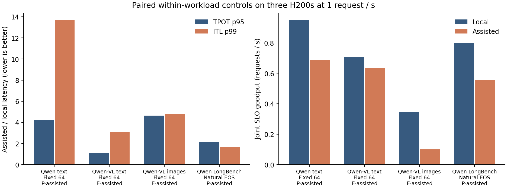

# 일반 LLM PD 대조와 MLLM 특이성

원본 *Qwen2.5-7B-Instruct*와 Qwen2.5-VL-7B를 BF16으로 사용했다. 두 Decoder의 28 layers, Q heads 28, KV heads 4, dimension 128을 맞췄다. LLM은 표준 RoPE, MLLM은 원래 MRoPE를 유지한다. 동일 Attention shape의 비교와 실제 workload의 상대 성능을 서로 다른 결과로 둔다. [Qwen2.5 공개 체크포인트](https://huggingface.co/Qwen/Qwen2.5-7B-Instruct/tree/a09a35458c702b33eeacc393d103063234e8bc28)

QPS1에서 수정 후 실행한 보조 Attention Arm은 모두 각자의 Local 기준보다 Goodput이 낮았다. Native E는 P보다 큰 물리 Arena를 유지할 수 있었으며, 이미지 Natural EOS에서는 P가 초기 전송을 줄이고 E보다 더 높은 Goodput을 냈다. 관측된 E의 메모리 이점은 MLLM-specific Serving 가속으로 이어지지 않았다. [LLM 및 MLLM Paired 집계](../encoder_assisted_decode_attention/results/llm_control/summary.json) · [동일 MLLM E/P 대조](../encoder_assisted_decode_attention/results/llm_control/role_confirmation/summary.json)

## Fixed shape 및 자연 요청

- **Matched text**는 Main100의 각 MLLM LM rows와 동일한 전체 token 수로 텍스트 통제를 만든다. 같은 예정 도착과 64 output으로 각자의 baseline을 측정한다. 같은 VL checkpoint에 text-only 입력을 주는 제어도 별도다. 이미지 질문의 원래 태스크 품질을 이 통제에서 평가하지 않는다.
- **Natural text**는 고정한 공식 LongBench의 Qasper, HotpotQA, NarrativeQA, GovReport 32개씩이다. 원본 prompt template을 사용하고 Qwen 토큰 기준 2K–28K에 맞췄다. 이미지형 serving의 절대 지연과 섞지 않는다. [원본 LongBench](https://huggingface.co/datasets/zai-org/LongBench/tree/5e628be450b7e67fb7ae6e201bd6d8f7056f7672) · [고정 128개 Text roster](../encoder_assisted_decode_attention/results/longbench_manifest_receipt.json)
- L0은 2P/1D, L1은 1P/2D다. L2는 P0에서 준비된 요청의 shard를 실제 생성한 GPU에 유지하며 P1 경로는 그대로 로컬 decode를 사용한다. P0 소유 KV는 초기 peer transfer 없이 P의 다른 buffer에 쓰고, 가중치 용량과 새 Prefill의 연산 점유는 측정에 남는다. E/P 역할 동형 대조에서는 MLLM도 P-assisted를 실행한다.
- Stock GQA DCP는 이 Hq/Hkv에서 기존 3GPU와 호환되지 않는다. 설치 버전의 `model.py`는 KV heads 관련 TP/DCP 배치와 Query groups의 나눗셈을 동시에 제한한다. Hkv 4, ratio 7 때문에 DCP2가 지원되지 않으며 DCP3도 나눠지지 않는다. 같은 물리 GPU 예산의 1P/2D와 co-located DP3를 실제 비교군으로 확보한다. [기존 DCP 검증](https://github.com/jyssys/MLLM-EP/blob/b4947a556134afc5214bdb1dd0412c7e961f989d/poc_flashvep/reports/mllm_visual_memory_generation_exact_attention.md)

## 첫 실행 기록

QPS1과 고정 64 Output의 L0에서 100/100을 완료했다. TTFT p95 **1,294.12ms**, TPOT p95 **12.33ms**, ITL p99 **17.54ms**, Joint SLO **91/100**, Goodput **0.948 req/s**, 실제 Decode Batch 최대 **8**이었다. P-assisted L2는 Warmup 후 측정 중 Helper Ingress 완료를 기다리던 시점에 ATen CUDA IndexKernel의 out-of-bounds 오류가 나타났다. 최초 Lease의 나머지 Arm은 `NOT_RUN`이다. 이 표본은 단독 L0 실측이고 비교에는 수정 후 동일하게 재시작한 Arm을 사용한다. [첫 실행 및 실패 지문](../encoder_assisted_decode_attention/results/llm_control/initial_attempt.json)

같은 P GPU에 유지되는 KV의 인덱스를 해당 Arena Ingress Stream 안에서 할당하도록 수정했다. 기존 경로는 기본 Stream에서 임시 GPU 인덱스를 만들었고 다른 Stream의 읽기가 끝나기 전에 해당 텐서가 해제될 수 있었다. 수정 뒤 Full28 검증에서 D와 P로 가져온 K/V는 **672/672** 비트 단위 일치였고 Teacher-forced Greedy는 **90/90**이었다. Natural Greedy의 전체 출력은 **1/2** 일치했고 두 요청 모두 EOS로 종료했다. [수정 경로](../encoder_assisted_decode_attention/cache.py) · [P-assisted 정합성 원시 기록](../encoder_assisted_decode_attention/results/model_witness_prefill_fixed.json)

## 수정 후 동일 MLLM에서 E와 P 대조

동일한 3GPU, QPS1 Main100 Arrival, Natural EOS와 **25% Generic Prefix**로 Local/E/P를 다시 실행했다. 세 Arm이 각각 **100/100**을 완료했고 E/P는 각각 100건에서 실제 보조 Attention을 수행했다. 수정 후 RQ5의 주 대조다. [Raw 집계](../encoder_assisted_decode_attention/results/llm_control/role_confirmation/summary.json) · [KV 및 역할 시간 경계](../encoder_assisted_decode_attention/results/llm_control/role_confirmation/residency.json)

| Arm | TTFT p95 ms | TPOT p95 ms | ITL p99 ms | Joint SLO | Goodput req/s | 최대 D Batch |
|---|---:|---:|---:|---:|---:|---:|
| M0 Local 1E/1P/1D | 14,714.51 | 24.34 | 37.84 | 39/100 | 0.3440 | 4 |
| M1 P-assisted | 15,009.64 | 30.91 | 172.86 | 32/100 | 0.2805 | 5 |
| M2 E-assisted | 19,872.22 | 94.81 | 145.39 | 12/100 | 0.0997 | 7 |

두 보조 경로의 D로 옮긴 Prompt KV는 **44.180 GiB**, Helper에 유지한 Prompt KV는 **14.724 GiB**였다. E는 P→E로 14.724 GiB를 더 보냈고 P는 생성 장치 내부에서 복사했다. 총 초기 Peer Payload는 Local/E가 **58.904 GiB**, P는 **44.180 GiB**였다. 반복 논리 Traffic은 E **1.994 GiB**, P **1.997 GiB**였다. 실제 D Step이 Helper 본래 역할의 Host 시간 경계와 겹친 비율은 E **78.72%**, P **5.63%**였다. P가 초기 전송량을 절약했고 이 Trace에서 E보다 더 높은 Goodput을 냈다. 양쪽 모두 Local의 Goodput보다 낮았다. [KV Payload 및 교차 시간](../encoder_assisted_decode_attention/results/llm_control/role_confirmation/residency.json)

Local과 동일한 전체 Natural 출력은 E **77/100**, P **77/100**이었다. 세 Arm의 고정 로컬 채점 평균은 Mantis **0.44**, DocVQA **0.00**, MP-DocVQA **0.0429**로 각각 같았다. DocVQA는 점수 Floor에 걸렸고 MMLongBench-Doc의 공식 외부 추출은 `NOT_RUN`이다. 출력 Fidelity와 이 표본의 채점으로 전체 Task Quality 비열등성까지 확정하지 않는다. [Paired 결과](../encoder_assisted_decode_attention/results/llm_control/role_confirmation/summary.json) · [채점 원시 집계](../encoder_assisted_decode_attention/results/llm_control/role_confirmation/quality.json)

## 같은 MLLM에서 E와 P를 비교한 최초 자연 요청

같은 QPS1 Main100, 동일한 3개 H200 및 실제 BF16 모델을 사용했다. E-assisted와 P-assisted 모두 동일한 25% Generic Prefix Shard를 사용했고 100/100 요청에서 실제 보조 Attention을 실행했다. 세 Arm이 모두 100/100을 완료했다. 이 비교는 같은 장치 Helper Ingress의 CUDA Index 오류를 Text L2에서 발견하기 전의 실행이다. RQ5의 주 비교에는 수정과 Full28 확인을 거친 새 Arm을 사용한다. [Online 원시 집계](../encoder_assisted_decode_attention/results/online/summary.json)

| Arm | TTFT p95 ms | TPOT p95 ms | ITL p99 ms | Joint SLO Goodput req/s | 초기 P→D GiB | 초기 P→Helper GiB |
|---|---:|---:|---:|---:|---:|---:|
| M0 Local 1E/1P/1D | 15,312.13 | 23.81 | 34.59 | 0.3284 | 58.904 | 0 |
| M1 P-assisted | 14,380.38 | 34.85 | 143.94 | 0.2652 | 44.180 | 0 |
| M2 E-assisted | 20,488.67 | 103.93 | 148.20 | 0.1323 | 44.180 | 14.724 |

두 보조 경로 모두 14.724 GiB의 Prompt KV를 Helper에 유지했다. P는 원래 생성한 GPU에서 페이지로 쓰므로 이 분량의 장치 간 이동을 피했다. E는 P에서 전체 KV를 각각 D와 E로 보냈다. 반복 통신의 논리 Payload는 P **1.951 GiB**, E **1.955 GiB**였다. E는 Vision Weight **1.260 GiB**, P는 Language Weight **14.186 GiB**를 소유했다. 둘 다 같은 약 8 GiB의 실제 Helper Arena를 예약했다. Weight 차이 12.926 GiB의 동시성 효과는 이 대조에서 확정되지 않았다. [Online 실행 기록](../encoder_assisted_decode_attention/results/online/summary.json) · [E 동시 상주 측정](mllm_encoder_assisted_decode_attention_motivation.md)

보조 Attention이 포함된 D Step의 시간 중 Helper의 원래 Stage 기록과 겹친 비율은 E **79.38%**, P **4.59%**였다. E는 GPU 작업의 Host 시간 경계, P는 Prefill Service의 Host 시간 경계를 사용했다. 안쪽 Gap 중앙값은 E **0.053ms**, P **569.94ms**였다. 이 결과는 해당 Trace에서 E가 더 자주 본래 역할을 수행했음을 보인다. GPU Kernel 단독 시간과 미래의 Deadline-safe Idle은 따로 검증해야 한다. [계산 방법](../encoder_assisted_decode_attention/llm_control_receipt.py)

## Native E와 P의 물리 메모리 대조

NativeStrong QPS2.5의 Main100을 사용하고 각각 별도 시작에서 4 GiB의 물리 여유를 공통으로 요구했다. E에 **80 GiB**를 추가로 할당해 모두 쓰고 원래 Encoder를 실행했을 때 요청 100/100을 완료했다. 같은 P 구성은 **64 GiB**에서 100/100을 완료했다. P의 **80 GiB**는 Warmup 뒤 해당 여유가 부족해 할당 검사에서 거절됐다. P의 42 GiB Native KV 예약이 포함된 비교다. 이 구성이 실제 E의 더 큰 상주 여유를 보이지만, 대형 Arena를 쓰며 보조 Kernel을 실행했을 때의 SLO와 최대 동시성은 검증하지 못했다. [E80 물리 기록](../encoder_assisted_decode_attention/results/native_encoder_capacity80.json) · [P64/P80 물리 기록](../encoder_assisted_decode_attention/results/native_prefill_capacity.json)

## 수정 후 LLM과 MLLM의 고정 길이 및 자연 요청 대조

수정 후 각 Arm에서 Open-loop Serving Process를 한 번씩 독립 시작했다. 7개 고정 길이 Arm은 각각 Main100의 순서, QPS1의 예정 도착, 요청별 실제 LM Input Token 수, 64개 Output Token을 동일하게 유지했다. 100건마다 실제 6,400개 토큰을 생성했다. LongBench 두 Arm은 동일한 별도 QPS1 Trace와 128건을 사용했고 모두 EOS로 종료했다. 합계 **956/956** 완료다. [동일 형상 검증](../encoder_assisted_decode_attention/results/llm_control/residency_and_match.json) · [전체 TTFT·TPOT·ITL·E2E·Throughput](../encoder_assisted_decode_attention/results/llm_control/summary.json)

| Workload | Arm | TTFT p95 ms | TPOT p95 ms | ITL p99 ms | Joint SLO | Goodput req/s | 실제 보조 요청 |
|---|---|---:|---:|---:|---:|---:|---:|
| Qwen Text · 고정 64 | L0 Local 2P/1D | 1,295.99 | 12.32 | 18.01 | 91/100 | 0.9482 | 0 |
| Qwen Text · 고정 64 | L2 P-assisted 2P/1D | 1,707.47 | 52.16 | 246.12 | 66/100 | 0.6875 | 47/100 |
| Qwen Text · 고정 64 | L1 Local 1P/2D | 2,549.38 | 26.87 | 28.31 | 79/100 | 0.8201 | 0 |
| Qwen-VL Text-only · 고정 64 | Local | 3,004.78 | 39.15 | 102.14 | 68/100 | 0.7058 | 0 |
| Qwen-VL Text-only · 고정 64 | E-assisted | 2,960.20 | 42.50 | 311.50 | 61/100 | 0.6326 | 100/100 |
| Qwen-VL Main100 이미지 · 고정 64 | Local | 15,126.90 | 19.29 | 32.21 | 39/100 | 0.3472 | 0 |
| Qwen-VL Main100 이미지 · 고정 64 | E-assisted | 21,342.62 | 89.43 | 154.86 | 12/100 | 0.0998 | 100/100 |
| Qwen Text LongBench · Natural | L0 Local 2P/1D | 731.13 | 11.90 | 16.27 | 127/128 | 0.7980 | 0 |
| Qwen Text LongBench · Natural | L2 P-assisted 2P/1D | 951.90 | 25.14 | 27.79 | 90/128 | 0.5569 | 64/128 |

고정 길이 Qwen에서 L2는 Prefill을 만든 P0의 요청 47건에만 **50%** 분할을 사용했다. P0이 **15.050 GiB**를 유지해 초기 Peer 전송을 **58.904→43.855 GiB**로 줄였으며, 반복 Peer Payload가 **1.763 GiB** 추가됐다. LongBench에서도 64건의 P0이 **18.223 GiB**를 유지했고 초기 Peer 전송은 **72.598→54.374 GiB**, 반복 추가 Payload는 **4.881 GiB**였다. 두 실행 모두 P0의 Language Weight는 **14.186 GiB**였다. P0 장치의 Torch Peak Allocation은 고정 Qwen **20.674→28.673 GiB**, LongBench **19.129→27.128 GiB**였다. Cohort 누적 전송량과 한 시점의 Resident Memory는 다른 지표다. [메모리 및 통신 집계](../encoder_assisted_decode_attention/results/llm_control/residency_and_match.json)

Qwen-VL의 고정 길이 두 보조 Arm은 동일한 50% 분할로 각각 **29.451 GiB**를 P→E로 보냈고, 반복 Peer Payload는 같은 **2.374 GiB**였다. 원래 Encode가 없는 Text-only에서는 E 역할 GPU의 Weight가 0이었다. 이 Arm도 Local 대비 Goodput이 **10.4% 감소**, TPOT p95가 **8.5% 증가**했다. 이미지 입력에서는 E에 Vision Weight가 상주했고 보조 D Step의 **83.71%**가 Vision의 Host 실행 경계와 겹쳤다. Goodput은 **71.3% 감소**, TPOT p95는 **363.6% 증가**했다. 각 효과는 해당 Workload의 Local 대비 변화다. 같게 맞춘 실제 LM 행과 Output 부하에서, Encode와 보조 Attention이 같은 장치를 쓰는 조건에서 더 큰 손실을 관측했다. [메모리 및 역할 교차 시간](../encoder_assisted_decode_attention/results/llm_control/residency_and_match.json)

이 QPS1에서 Qwen Text의 2P/1D Local이 같은 예산의 L2 및 1P/2D Local보다 높은 SLO Goodput을 냈다. 실제 Text P-assisted는 배치 최대 8(고정)과 7(LongBench)로 실행됐고, 단일 배치 강제 회귀 없이도 손실이 발생했다. 일반 PD의 P 보조도 초기 전송과 KV Residency에는 이점이 있지만, 테스트한 두 Text Trace에서 Serving 순이익은 없었다. [Actual Batch 및 Paired 결과](../encoder_assisted_decode_attention/results/llm_control/summary.json)

## LongBench 품질과 출력 범위

원본 자연 출력 전체를 공식 LongBench 채점기와 고정 Reference로 평가했다. 각 Task는 32건이다. 실제 전체 Output Token은 Local **16,051**, L2 **16,929**였다. Natural E2E와 Decode 차이에는 이 출력 길이 차이도 포함된다. 고정 길이 Arm에서 L2의 Decode 손실도 확인됐다. [출력 길이 및 Timing](../encoder_assisted_decode_attention/results/llm_control/summary.json) · [공식 Eval 소스](https://github.com/THUDM/LongBench/blob/2e00731f8d0bff23dc4325161044d0ed8af94c1e/LongBench/eval.py)

| Task | Metric | L0 Local | L2 P-assisted |
|---|---|---:|---:|
| Qasper | QA F1 | 55.29 | 54.24 |
| HotpotQA | QA F1 | 45.95 | 45.83 |
| NarrativeQA | QA F1 | 27.10 | 27.14 |
| GovReport | ROUGE-L | 33.61 | 33.07 |

전체 토큰열은 **94/128**에서 동일했다. 요청별 공식 점수는 개선 13건, 동일 96건, 하락 19건이었다. 동결 부분집합의 점수이며, 전체 공식 Benchmark 결과나 품질 비열등성 판정으로 사용하지 않는다. 형상을 맞추기 위해 합성한 Text Prompt와 고정 Output Arm은 Task Quality 채점에서 제외했다. [점수·분모·Scorer 지문](../encoder_assisted_decode_attention/results/llm_control/longbench_quality.json)

## 재현 자료

Lease는 물리 GPU 4/5/6에서 `run_study.sh`의 `text`를 `_retry` suffix로 실행했다. `analyze_online`에 해당 9개 Run 디렉터리를 넘기면 `summary.json`과 `metrics.csv`가 생성된다. `llm_control_receipt`는 그 안의 `cohort_1.json`과 `img_{local,encoder,prefill}_q1_r2`의 Cohort를 받아 Shape·Memory·Overlap 검증과 그림을 재생성한다. [실험 드라이버](../encoder_assisted_decode_attention/run_study.sh) · [Online 분석 코드](../encoder_assisted_decode_attention/analyze_online.py) · [대조 및 그림 코드](../encoder_assisted_decode_attention/llm_control_receipt.py)

`score_longbench`는 첫 Score 실행 전 확인한 Git Revision의 `LongBench/eval.py`와 `LongBench/metrics.py`를 `--scorer` 아래 `official/`에 두고, 전역 Runtime을 변경하지 않도록 `deps/`에 `rouge==1.0.1`, `jieba==0.42.1`, `fuzzywuzzy==0.18.0`, `six==1.17.0`을 설치한 상태로 사용했다. 두 LongBench Cohort, 원본 동결 Manifest, Qwen Tokenizer 및 Evaluator 파일의 SHA는 결과에 남겼다. [Scorer 래퍼](../encoder_assisted_decode_attention/score_longbench.py) · [공식 Metric 소스](https://github.com/THUDM/LongBench/blob/2e00731f8d0bff23dc4325161044d0ed8af94c1e/LongBench/metrics.py) · [Scorer 기록](../encoder_assisted_decode_attention/results/llm_control/longbench_quality.json)
