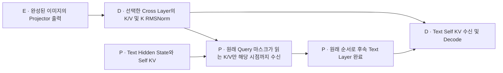

# Direction C · Architecture-specific parallelism

**Direction C 판정 `INCONCLUSIVE_RUNTIME`.** Mllama의 이미지 전용 cross-attention K/V는 Text Query 전에 독립적으로 준비할 수 있다. 공개 모델 구현을 사용한 CPU 검증에서 이 분할과 원래 이미지 접근 마스크 아래의 순차 Prefill이 정합했다. 원본 가중치 H200 실행과 Online 평가는 `NOT_RUN`이다. 동일 프로젝트의 IDEFICS 실측에서 정적 K/V 전달은 이미 강한 D-local projection cache 대비 추가 지연 이득을 얻지 못했다. [CPU 결과](../mllm_epd_joint_encode_prefill_discovery/results/architecture_cross_kv_cpu.json) · [기존 IDEFICS H200 평가](https://github.com/jyssys/MLLM-EP/blob/d6f1becf93ba843e98d289d247aae77d08b81d23/poc_flashvep/reports/mllm_modality_phase_execution_graph.md)

| 모델 | 독립적으로 실행 가능한 작업 | 원래 의존성과 이식 범위 | 이번 증거 |
|---|---|---|---|
| Qwen3-VL-8B | DeepStack 중간 ViT feature의 개별 merger | 최초 LM Layer에는 마지막 ViT block에서 나온 Base Embedding이 필요하다. 이후 탭별 소비 시점과 원본 row 순서를 지켜야 한다. 현재 3,584-wide IPC와 호환되지 않는다. | `TRACE_ANALYSIS` 소스 조사, GPU `NOT_RUN` |
| CogVLM / CogVLM2 | modality에 따라 선택된 행별 QKV·O·MLP projection | 매 Layer에서 공통 causal attention과 Residual이 양쪽 행을 다시 결합한다. 다음 token type까지 있어야 Expert가 확정된다. 공식 대화 Builder는 이미지 한 장을 받는다. | `TRACE_ANALYSIS` 소스 조사, GPU `NOT_RUN` |
| Llama 3.2 Vision / Mllama | 이미지/tile 행 묶음 × cross-attention layer별 정적 K/V projection | P는 해당 Query가 접근할 수 있는 모든 Vision K/V를 받아야 한다. D도 같은 상태를 Decode에서 다시 읽는다. 원본 모델과 Native EPD backend가 현재 환경에 없다. | `CORRECTNESS_ONLY` CPU, GPU `NOT_RUN` |
| Florence-2 | 원본 이미지 feature 및 전체 Encoder 완료 뒤의 정적 Decoder cross K/V | Vision과 Text가 혼합된 Bidirectional Encoder가 전체 입력을 함께 읽는다. 기존 Encoder–Decoder의 정적 cross cache와 같은 경계다. | `TRACE_ANALYSIS` 소스 조사, GPU `NOT_RUN` |

## Qwen3-VL · DeepStack

고정 BF16 체크포인트 `0c351dd01ed87e9c1b53cbc748cba10e6187ff3b`의 Vision Tower는 27개 block과 2×2 Spatial Merge를 사용한다. 설치된 vLLM `0.26.0+cu129`는 block index 8, 16, 24의 별도 merger 결과를 저장한 뒤 block 26을 거친 Base Embedding과 결합한다. Decoder는 같은 Dense Qwen block에 Image와 Text를 넣고 첫 세 Language Layer 각각의 출력에 대응하는 visual residual을 더한다. Native PP는 탭을 쓰는 첫 세 Layer를 첫 stage에 배치한다. 새로 생성하는 Text에는 이 residual을 주입하지 않지만, causal self-attention은 Prompt의 visual KV를 유지한다. [Qwen3-VL 기술 보고서](https://arxiv.org/abs/2511.21631) · [고정 모델 Config](https://huggingface.co/Qwen/Qwen3-VL-8B-Instruct/blob/0c351dd01ed87e9c1b53cbc748cba10e6187ff3b/config.json) · [Vision Forward](https://github.com/vllm-project/vllm/blob/v0.26.0/vllm/model_executor/models/qwen3_vl.py#L800-L842) · [Language Forward](https://github.com/vllm-project/vllm/blob/v0.26.0/vllm/model_executor/models/qwen3_vl.py#L1587-L1633) · [PP 제약](https://github.com/vllm-project/vllm/blob/v0.26.0/vllm/model_executor/models/qwen3_vl.py#L1775-L1782)

Tap의 중간 feature는 후속 ViT block과 별개로 projection할 수 있으나, 일찍 만들어진 Tap만으로 해당 이미지의 LM Layer 0를 시작할 수 없다. BF16에서 Base와 세 Tap의 Native Egress는 merged visual row당 `4 × 4096 × 2 = 32 KiB`다. D에서 Tap merger를 수행하면 해당 Tap의 입력은 `4 × 1152 × 2 = 9 KiB`, 결과는 `4096 × 2 = 8 KiB`다. D가 Tap을 계산하고 다시 P가 소비하면 전송한 입력이 해당 Tap의 기존 출력보다 12.5% 크며 새 복사도 생긴다. P에서 D로 소비자까지 옮기는 경우에는 기존 합법적인 causal KV handoff를 같이 비교해야 한다. Qwen2.5-VL 전용 transport는 각 row를 3,584 BF16 원소로 확인한다. 새로운 실험에는 Model revision, Tap별 row order, 삽입 위치와 준비 Event를 검증하는 connector가 필요하다. [DeepStack 입력 경로](https://github.com/vllm-project/vllm/blob/v0.26.0/vllm/model_executor/models/qwen3_vl.py#L2790-L2915) · [현재 IPC 계약](../mllm_epd_prefill_heavy_token_split/cuda_ipc_codec.py)

## CogVLM / CogVLM2 · 분리된 Expert와 공통 Causal Attention

두 원작 구현은 Decoder Layer마다 Vision/Language용 QKV, Output Dense와 MLP를 선택한다. Vision Expert mask는 현재 위치와 다음 위치가 모두 `VISION_TOKEN_TYPE`인 경우만 선택한다. 따라서 단순한 image span 절단은 기존 마지막 행의 Expert 판정을 바꿀 수 있다. 동일 Layer 입력에서 Expert별 projection은 행 단위 독립이지만 Q/K/V가 공통 causal attention에 합쳐지므로, 다음 Layer의 Visual 행을 텍스트와 앞선 KV 없이 진행할 수 없다. 생성 시 token type에 Language가 추가된다. 새 Text Decode는 이미 계산된 visual history KV를 계속 읽는다. [CogVLM 논문](https://arxiv.org/abs/2311.03079) · [CogVLM 고정 소스](https://huggingface.co/zai-org/cogvlm-chat-hf/resolve/e29dc3ba206d524bf8efbfc60d80fc4556ab0e3c/modeling_cogvlm.py) · [CogVLM2 고정 소스](https://huggingface.co/zai-org/cogvlm2-llama3-chat-19B/blob/f592f291cf528389b2e4776b1e84ecdf6d71fbe3/modeling_cogvlm.py)

가능한 작은 단위는 한 Layer의 Visual projection이다. P에 merge하는 경우 hidden 및 output을 전송하고 해당 Layer의 attention 또는 residual 앞에서 동기화한다. 모델 공식 Prompt Builder는 Request당 한 장을 받기 때문에 기존 중앙값 42.5장 Cohort에 그대로 적용할 수 없다. 별도 branch의 BF16 CogVLM2-19B P→D에서는 Decode에서 도달하지 않는 Visual Expert Weight 13.0 GiB를 실제 배제했으며, 동일한 정적 Reachability 대조가 같은 제거를 달성했다. 현재 D-idle 실험에서 먼저 살릴 TTFT 후보는 아니다. [CogVLM2 고정 Config](https://huggingface.co/zai-org/cogvlm2-llama3-chat-19B/blob/f592f291cf528389b2e4776b1e84ecdf6d71fbe3/config.json) · [기존 CogVLM2 실행과 강한 대조](https://github.com/jyssys/MLLM-EP/blob/d6f1becf93ba843e98d289d247aae77d08b81d23/poc_flashvep/reports/mllm_architecture_first_disaggregation_final_summary.md)

## Mllama · Query 없이 준비하는 Visual K/V

Mllama는 Vision 입력을 `batch × media`로 분리해 각 이미지의 타일을 묶어 처리한다. 같은 이미지의 타일을 서로 독립이라고 가정하지 않는다. Vision과 Multimodal Projector의 출력은 각 Cross Layer의 K/V 입력이다. K RMSNorm까지의 계산은 Text Hidden State나 앞선 LM Layer의 완료를 기다리지 않는다. Cross-attention의 Q, Attention, Gating과 후속 Residual은 원래 Text Hidden State에 의존한다. Native 생성도 먼저 투영한 Cross K/V를 다시 읽으므로, D에서 차례로 projection해서 먼저 보존할 수 있다. [Vision Forward](https://github.com/huggingface/transformers/blob/v5.16.1/src/transformers/models/mllama/modeling_mllama.py#L869-L1006) · [Cross-attention](https://github.com/huggingface/transformers/blob/v5.16.1/src/transformers/models/mllama/modeling_mllama.py#L384-L461) · [Generation Cache](https://github.com/huggingface/transformers/blob/v5.16.1/src/transformers/models/mllama/modeling_mllama.py#L1520-L1564)



합법적인 완료 경계는 `모든 실행한 Query가 볼 수 있는 원래 image/tile slot ⊆ 준비된 slot`이다. 원래 Processor에서 이미지 marker의 유효 구간은 통상 뒤의 marker 전까지이고, 연속 marker 그룹은 공통 종료 위치를 사용한다. 여러 page를 연달아 넣은 뒤 한 번만 질문하는 입력에서는 그 질문이 미완료 page를 읽을 수 있으므로 먼저 완료할 수 없다. 이미지 사이에 Text가 있는 입력은 다른 frontier를 가질 수 있다. Text가 최초 Cross Layer에 닿기 전의 Self Layer도 먼저 계산할 수 있다. [프로젝터와 Mask 소비](https://github.com/huggingface/transformers/blob/v5.16.1/src/transformers/models/mllama/modeling_mllama.py#L1337-L1381) · [공식 Marker Mask](https://github.com/huggingface/transformers/blob/v5.16.1/src/transformers/models/mllama/processing_mllama.py#L34-L127)

Transformers 기본 11B 계열 구성은 Hidden Width 4,096, KV heads 8, head dimension 128, cross layer 8개다. 이 설정의 분석상 BF16 payload는 visual row당 Projector 출력 8 KiB, 한 Cross Layer의 K/V 4 KiB, 전체 Cross Layers의 K/V 32 KiB다. P와 D가 모두 전체 Cross KV를 소비하는 경우 E→P raw 8 KiB + P→D projection 32 KiB와 E→D raw 8 KiB + D→P projection 32 KiB가 각각 40 KiB/row다. 논리 payload로 계산했고 ACK, 패딩과 Text Self KV를 제외했다. P와 D가 작은 Raw를 각각 받아 자체 projection하는 대조는 16 KiB/row와 추가 계산을 비교한다. 실제 후보의 이점은 D가 다음 Decode 전에 완료한 projection이 P의 임계경로에서 빠지는지에 달려 있다. [Transformers 기본 Config](https://github.com/huggingface/transformers/blob/v5.16.1/src/transformers/models/mllama/configuration_mllama.py#L94-L152)

한 실행 단위는 `(request, image/tile row 구간, cross layer)`다. Producer는 마스크의 원래 slot 번호와 Layer identity, dtype, CUDA 완료 Event를 기록한다. P의 해당 Query는 자신의 마스크와 일치하는 모든 K/V가 준비된 경우 다음 Layer로 넘어간다. D는 같은 상태를 안전하게 보유하며 native KV의 수신 및 Decode-ready를 우선한다. 실제 전송 완료 ACK, 연결별 순서, queueing과 메모리 수명은 GPU integration에서 측정할 항목이다. `CORRECTNESS_ONLY` 결과로 100–250ms deadline 적합성이나 자원 효과를 판정할 수 없다.

## CPU 검증과 H200 원본 대조

설치된 Transformers `5.16.1`의 Mllama 구현과 원래 mask helper를 사용했다. 초기화한 작은 4층 모델에 서로 다른 세 synthetic visual feature 연속 구간을 넣었다. Cross Layer는 1과 3이고, Cross-attention과 MLP의 Gate는 0이 아닌 값으로 설정했다. 비교 기준은 전체 원본 Mask와 세 image feature를 한 번에 준 native Prefill이다. 후보는 image K/V를 구간별로 투영해 cache에 합치고, 원래 Mask가 허용하는 Text 행만 단계적으로 소비했다. 그 뒤 같은 teacher prefix로 네 Text Decode step을 비교했다. 행 수는 실행마다 Prefill 9, Decode 4이며 FP32·BF16 각각 4개 seed다. [프로브](../mllm_epd_joint_encode_prefill_discovery/architecture_cross_kv_probe.py) · [Raw JSON](../mllm_epd_joint_encode_prefill_discovery/results/architecture_cross_kv_cpu.json)

| 비교 | FP32 4 seed | BF16 4 seed |
|---|---:|---:|
| Prefill 최대 Logit 절대차 | 1.79e-7 | 0, bitwise |
| Teacher-forced Decode 최대 Logit 절대차 | 8.94e-8 | 0, bitwise |
| Greedy 일치: Prefill / Decode | 36/36 · 16/16 | 36/36 · 16/16 |
| Prefill 후 모든 Cross K/V | 8/8 layer bitwise | 8/8 layer bitwise |
| 인접한 이미지 marker: 보이는 KV를 일부 빼고 일찍 실행한 음성 대조 | 최대차 0.104–0.187 | 최대차 0.073–0.154 |

이전 IDEFICS-9B paired H200 실험은 원본 BF16 가중치와 실제 이미지 24건을 사용했다. 동일한 visibility와 D shape에서 Raw + D-local cached projection을 기준으로 P-projected handoff의 P+D wall 비율은 요청별 중앙값 `0.9988`이었다(차이 −0.12%, 95% CI −0.58%~+0.43%). 실제 projection tensor는 192/192 layer에서 원본과 일치했다. 이 결과는 정적 cross-cache 생성·전달만 분리하는 접근의 강한 대조다. IDEFICS 원본 구현은 D cache memoization을 별도로 추가해야 했고 Mllama Native가 이미 정적 Cross KV를 재사용한다. 현재 후보에 남는 판별 실험은 **실제 image-ready 시점과 원본 visibility가 허용하는 P-side 지연 감소**의 측정이다. 별도의 IDEFICS D projection만 다시 측정하는 실험은 이 가설을 판별하기 어렵다. [IDEFICS 재현 코드와 실측](https://github.com/jyssys/MLLM-EP/blob/d6f1becf93ba843e98d289d247aae77d08b81d23/poc_flashvep/reports/mllm_modality_phase_execution_graph.md) · [Generic 대조](https://github.com/jyssys/MLLM-EP/blob/d6f1becf93ba843e98d289d247aae77d08b81d23/poc_flashvep/reports/mllm_architecture_disaggregation_strong_baseline_ablation.md)

## Florence-2와 환경 확인

Florence-2-large `21a599d414c4d928c9032694c424fb94458e3594`는 12층 Encoder와 12층 Decoder를 사용한다. 공식 고정 소스는 Vision feature와 task-prefix embeddings를 결합하고 BART 계열 Language Encoder에 전달한다. 설치된 Transformers wrapper는 placeholder를 치환한 뒤 같은 Bidirectional Encoding 경계를 거친다. Decoder는 동결된 전체 Encoder 출력의 Cross K/V를 이미 재사용할 수 있다. 이 경계는 일반 Encoder–Decoder 대조에 해당한다. Publisher의 첫 safetensors 헤더에서 918개 텐서의 dtype `F16`을 확인했으며 Main BF16 protocol에 포함하지 않았다. vLLM registry는 해당 Architecture에 별도 BART Plugin을 지정한다. [고정 Config](https://huggingface.co/microsoft/Florence-2-large/blob/21a599d414c4d928c9032694c424fb94458e3594/config.json) · [원작 Modeling Source](https://huggingface.co/microsoft/Florence-2-large/resolve/21a599d414c4d928c9032694c424fb94458e3594/modeling_florence2.py) · [설치된 Florence wrapper](https://github.com/huggingface/transformers/blob/v5.16.1/src/transformers/models/florence2/modeling_florence2.py#L714-L785) · [BART cache](https://github.com/huggingface/transformers/blob/v5.16.1/src/transformers/models/bart/modeling_bart.py#L180-L240) · [vLLM Registry](https://github.com/vllm-project/vllm/blob/v0.26.0/vllm/model_executor/models/registry.py#L729-L771)

공유 H200 프로젝트 경로와 사용자 Hugging Face cache를 확인했다. `h200_architecture_runs/models`에는 pinned CogVLM2 8개와 IDEFICS-9B 두 개의 safetensors shard가 있다. Qwen3-VL checkpoint는 확인되지 않았고 Mllama `3f2e93603aaa5dd142f27d34b06dfa2b6e97b8be`의 공개 무인증 Config 요청은 HTTP 401이었다. vLLM `0.26.0+cu129`에서는 Mllama가 과거 지원 모델로 분류된다. 원본 Mllama weight가 확인되면 Transformers에서 해당 vision과 cross-projection만 남겨 기존 GPU 격리 안에서 single-operator CUDA probe를 구성할 수 있다. 현재는 체크포인트 접근이 물리 검증의 선행 조건이다. 기존 IDEFICS checkpoint로 같은 계열 operator probe를 실행할 수 있으나 그 결과는 Mllama 수치와 별개다. [Meta 고정 모델](https://huggingface.co/meta-llama/Llama-3.2-11B-Vision/tree/3f2e93603aaa5dd142f27d34b06dfa2b6e97b8be) · [vLLM 모델 지원](https://github.com/vllm-project/vllm/blob/v0.26.0/vllm/model_executor/models/registry.py#L729-L771)

## Novelty와 승격 조건

원래 ICML EPD와 vLLM 구현은 Encoder에서 visual embedding을 만들어 Language stage로 보내고 P에서 D로 KV를 보낸다. Vision 작업을 분할·양보하는 vLLM RFC도 공개돼 있다. [ICML EPD](https://proceedings.mlr.press/v267/singh25d.html) · [vLLM Native Encoder Disaggregation](https://vllm-project.github.io/2026/11/11/encoder-disaggregation-epd.html) · [Vision Scheduling RFC](https://github.com/vllm-project/vllm/issues/69844)

ModServe `c7a3e9ac116b735b14bfaeaf575ee048b4c02c23`의 공개 Image Worker는 Mllama에서 이미지 하나를 Vision Tower와 Projector에 통과시키고 CUDA 완료 후 응답한다. Text Backend Patch는 전달받은 visual tensor를 Prefill Forward에서 받아 각 Cross Layer의 K/V를 투영한다. 동일 Forward는 Prefill과 Decode 토큰의 혼합을 거절한다. 이 공개 경로에는 Query visibility별 부분 Cross KV의 D-side Idle 선행 준비가 구현되어 있지 않다. 고정 visual state와 기존 Encoder disaggregation을 각각 강한 대조로 사용해야 한다. [ModServe E Worker](https://github.com/Azure/ModServe/blob/c7a3e9ac116b735b14bfaeaf575ee048b4c02c23/src/lmm_serving/modserve/components/image_node_manager.py#L276-L344) · [공개 K/V projection patch](https://github.com/Azure/ModServe/blob/c7a3e9ac116b735b14bfaeaf575ee048b4c02c23/llm-backend/vllm-lmm-serving.patch#L2695-L2760) · [공개 Prefill patch](https://github.com/Azure/ModServe/blob/c7a3e9ac116b735b14bfaeaf575ee048b4c02c23/llm-backend/vllm-lmm-serving.patch#L2888-L3036)

가장 빠른 물리 판별은 원본 이미지에서 동일한 slot과 K/V row 형상을 유지한 채 Native P projection, D-local raw projection, D에서 부분 projection하고 P에서 기다리는 경로의 CUDA completion과 전체 wall을 비교하는 것이다. 입력은 image–text interleaved와 연속 page 둘 다 사용한다. 50–500ms sweep에서 실제 가능 작업량을 재고, P가 접촉하기 전에 준비된 row와 실제로 P의 critical path에서 제거된 실행을 함께 확인해야 한다. 가장 강한 fixed-source K/V cache 대조가 동일한 효과를 제공하거나 Native Decode의 TTFT·TPOT·ITL이 악화하면 C를 Online 후보로 승격할 근거가 없다.

## 재현

```bash
CUDA_VISIBLE_DEVICES='' ../mllm_epd_runtime_env/bin/python -m \
  poc_flashvep.mllm_epd_joint_encode_prefill_discovery.architecture_cross_kv_probe \
  --out poc_flashvep/mllm_epd_joint_encode_prefill_discovery/results/architecture_cross_kv_cpu.json
```

실행 위치는 실험 Git worktree의 루트다. Runtime은 Torch `2.11.0+cu129`, Transformers `5.16.1`, vLLM `0.26.0+cu129`였다. Mllama Modeling 및 Processor SHA-256, dtype, seed, layer별 cache 검사와 음성 대조가 Raw JSON에 포함된다. Original-weight Correctness, 실제 GPU execution quantum, P/D transfer 및 Online Generality는 모두 `NOT_RUN`이다.
