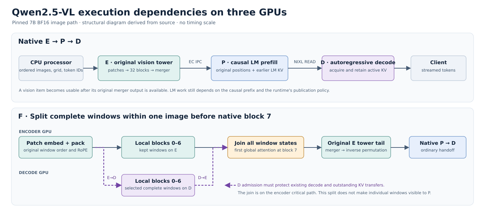

# Qwen2.5-VL execution DAG and resource analysis

The fixed H200 1E/1P/1D route uses the original Qwen2.5-VL-7B BF16 checkpoint at `cc594898137f460bfe9f0759e9844b3ce807cfb5`. This DAG is the source-derived execution contract. Historical trace and geometry results at the end establish the scope of known numbers.



## Native dependency graph

| Stage | Required predecessors | Produces and releases |
| --- | --- | --- |
| Host media and prompt processing | Ordered original media and prompt | Normalized image patch rows, image grids, the token sequence with placeholders and position metadata. |
| E · patch embedding and window packing | Original processor rows for an image | Disjoint initial patch states plus window offsets and image/frame-relative rotary coordinates. Vision Conv3d kernel and stride match, so a patch entry has no neighboring-patch dependency at this step. |
| E · local vision blocks 0–6 | Original states and rotary coordinates for each whole window | One window can finish these seven blocks without the other windows. Attention is window-local and RMSNorm, MLP and residual operations are row-local. |
| E · global vision block 7 and tower tail | Every affected image/frame window in its original packed order | Blocks 7/15/23/31 contain full-image/frame attention. The merger and inverse permutation yield LM-ready visual rows in the original image order. The vision tower computes separate images even when batched together. |
| E→P · encoder export, ownership and load | Completed merger output and its exact identity | The P worker can acquire the right device tensor and place it into the correct placeholder range. The current runner batches scheduled vision work before publishing individual results. |
| P · causal language prefill | Required ready embeddings, text, original positions and the relevant earlier KV at each layer | Paged prompt KV in each of the 28 decoder layers. A later image belongs to the same causal prefix as earlier text and image rows. |
| P→D · KV handoff | P's usable reservation/export and D's local destination pages | The physical read fills D KV. The scheduler must observe completion before starting dependent generation. |
| D · decode | D owns the full needed context, and the next position/token is available | Output tokens, new local KV and the client stream. |

Pinned sources for the actual cuts and metadata. [Vision model and native block ordering](https://github.com/vllm-project/vllm/blob/v0.26.0/vllm/model_executor/models/qwen2_5_vl.py#L1075-L1125) · [Patch embedding and stride](https://github.com/vllm-project/vllm/blob/v0.26.0/vllm/model_executor/models/qwen2_5_vl.py#L532-L558) · [Window layout](https://github.com/vllm-project/vllm/blob/v0.26.0/vllm/model_executor/models/qwen2_5_vl.py#L761-L796) · [GPU worker publication](https://github.com/vllm-project/vllm/blob/v0.26.0/vllm/v1/worker/gpu_model_runner.py#L3084-L3168) · [Checkpoint config](https://huggingface.co/Qwen/Qwen2.5-VL-7B-Instruct/raw/cc594898137f460bfe9f0759e9844b3ce807cfb5/config.json)

The Qwen2.5 language backbone uses the same dense projections, attention and MLP for both visual and text rows once embeddings are assembled. Modality-specific legal work therefore comes from the visual tower, the availability of embeddings and their layout boundaries. A later visual span becomes executable only after its causal dependencies become available. Qwen3-VL adds layer-specific DeepStack injections from the encoder. Its downstream consumer lifetimes would require a separate DAG and correctness check. [Qwen language backbone](https://github.com/vllm-project/vllm/blob/v0.26.0/vllm/model_executor/models/qwen2.py) · [Qwen3-VL DeepStack injection](https://github.com/vllm-project/vllm/blob/v0.26.0/vllm/model_executor/models/qwen3_vl.py#L1612-L1625)

## F · exact fixed-role pre-global window split

1. E embeds and packs patches once, then assigns complete original windows to the local and assistance portions. There is no position coordinate reset. Edge-window lengths exclude synthetic padding.
2. E retains its local states and grants a physical CUDA IPC tensor to D. D uses the same original model revision, original window RoPE coordinates, window offsets and source dtype.
3. E and D each execute native blocks 0–6 for their respective windows. The egress event binds result, request, image/frame and window span. The input allocation remains live until D consumes it.
4. E waits for both owners, restores the native packed order and executes block 7, the unchanged tower tail and merger. The ownership acknowledgement prevents reuse while another GPU reads. E can publish only after the complete LM embedding becomes ready.
5. The native P and D route then runs. Any outstanding D native generation and posted KV READs remain in the scheduling and interference contract. An adaptive deployment must bound or discard late auxiliary results against their owner generation, and account separately for any local fallback recomputation.

The available physical harness runs fixture tensors using the resident vision modules and CUDA IPC. It compares stock fused E, a local frontier through the same boundary, two local partitions at the same cut, whole-image D and two-GPU window execution. The current `prepare` path sends **post-patch** hidden states. It opens and clones cross-device CUDA IPC tensors, uses host RPCs and CUDA-event waits, then joins on E. These are measurable intervention costs. The harness allocates the full D vision tower for the whole-image comparator and reports its actual parameter bytes. A minimal F-only deployment would use just the needed prefix, so its weight estimate below remains analytical. A successful isolated run would establish only encoder-level equivalence and physical latency for the tested fixtures. Native open-loop online generation and protected scheduling are additional gates. [Worker computation and CUDA IPC](../mllm_epd_modality_aware_idle_execution_discovery/vision_worker.py) · [Physical reference arms](../mllm_epd_modality_aware_idle_execution_discovery/physical.py)

## Representation sizes and bottleneck bounds

| Representation | BF16 bytes | Real boundary |
| --- | ---: | --- |
| Processed patch row, model dtype | 2,352 / patch | 3 channels × 2 temporal positions × 14 × 14 × 2 bytes. Host processor storage can use FP32. |
| Packed layer-0 or layer-7 vision state | 2,560 / patch | 1,280 channels × 2 bytes. A full window has 64 rows, so sending and returning post-patch states totals 320 KiB per full window. |
| Vision merger input | 10,240 / merged row | Four complete patch states. Merger-only offload must transport about 1.43× the final embedding bytes in the forward direction and account for the destination. |
| LM-ready embedding | 7,168 / visual row | 3,584 channels × 2. Whole-image assistance can send this output through the original EC path after complete encoding. |
| LM layer-0 Q, K and V | 9,216 / LM row | (28 query heads + 8 total key/value heads) × 128 × 2. K and V alone are 2,048 bytes. The residual input and causal attention still have their own consumers. |
| Full prompt KV in all LM layers | 57,344 / LM row | 28 × 2 × 4 KV heads × 128 × 2 bytes. Eight times the size of one BF16 embedding row at matched row counts, before page padding, ownership and transport overhead. |

The processor audit checked native offsets on all 35 distinct grids. Its largest primary image contains 20,412 patch rows and 336 windows. A geometry-only half-window placement at the actual post-patch cut would send and return 26,132,480 B per direction for that image. The held-out largest image contains 42,840 rows and 704 windows, with 54,886,400 B per direction at the corresponding cut. Exact row subsets drive the number. Packet-layout cost, HBM load, bandwidth and launch/ownership delays require GPU measurements. Supporting measurements of processor geometry are CPU-only. [Audited window counts and payloads](mllm_epd_idle_execution_workloads_and_vision_geometry.md)

The F-only additional D matrices are estimated at about 263 MiB in BF16 for seven blocks, excluding patch projection, biases, normalization, runtime reservations and activation buffers. This estimate does not establish net KV admission at the same reserved capacity.

```text
local baseline = E fused source graph on the same images and runtime
F path = E patch/pack
       + max(E retained windows, E→D input + D windows + D→E return)
       + ordered join + original E tail
```

This bound gives no benefit for accelerating a branch if the native fused E implementation already completes earlier. It also omits no stages from the unaffected P→D path. E/P independent historical throughput was 1.716/1.221 req/s for the selected natural family. At fixed P work, improving E alone need not increase P's capacity. Its useful effects would have to appear in critical-path service, placement backpressure or arrival cadence under a real online load. [Prior measured capacities](https://github.com/jyssys/MLLM-EP/blob/f5d6d70d750ea7b0a2c9f0599e874c07d4a5409b/poc_flashvep/reports/mllm_epd_independent_stage_capacity.md)

## D resource evidence relevant to the DAG

The previous natural Very-long N64 GPU capture gave E/P/D busy 90.04/89.91/9.55% and a 72.61% E-busy ∩ P-busy ∩ D-idle intersection under a failed observer guard. These are diagnostic trace values. Six prior clean held-out arms found 81.6–83.0% quiet time in the proxy, which still leaves obligations outside the observed proxy state. At a 250 ms modeled work quantum plus 25 ms reserve, the held-out natural cadence policy had 30/33 dispatches fit that reserve and three crossings of the recorded next native readiness. No 1,150 ms dispatch fits that held-out replay. These are replay results using future labels exclusively to score a causal policy and do not certify deadlines after the policy changes handoff order. [Held-out causal policy and evidence scope](mllm_epd_idle_motivation_qualification.md)

The decision requires visible Decode-ready state, actual NIXL receive bounds, a path-specific cost estimate and a fallback that accounts for work already dispatched. Time between GPU kernels, no request on the HTTP proxy and time to the next P-ready event measure different properties. The notes and figure above establish legal independent tasks. Only a measured execution with paired Decode continuations can establish which tasks D can accept.
