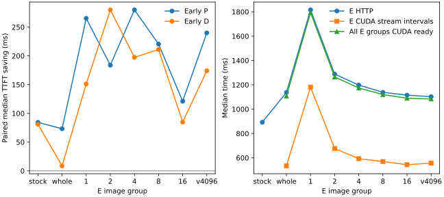
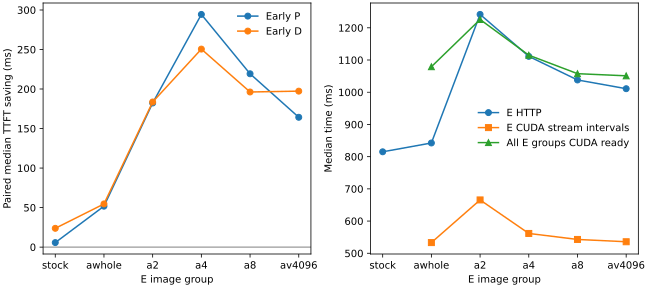

# Direction A · Early P와 Early D 비교

동기·비동기 Group-wise Encoder에서 실제 조기 실행을 확인했다. 비동기 8장 그룹의 Early P/D는 같은 모드의 Late P/D보다 TTFT를 중앙 219.30/196.25ms 줄였다. 원래 descriptor를 쓰는 Stock Late P와 맞추면 101.14/186.92ms 절약이었다. P/D 각각의 Late→Early 절약량을 보정한 D 추가 효과는 −18.83ms였다. Token-budget 조건에서는 +53.23ms의 탐색 신호가 있었으나, 네 쌍의 직렬 관측 범위를 넘는 D-side 이득은 확인되지 않았다. [128개 동기 결과](../mllm_epd_joint_encode_prefill_discovery/results/group_sync/group_summary.json) · [96개 비동기 결과](../mllm_epd_joint_encode_prefill_discovery/results/group_async/group_summary.json)

## 변경한 경계

같은 Source 문서, 그룹 모드, 반복의 네 Arm을 한 quartet으로 비교했다. Late P/D는 E의 전체 CUDA marker와 E HTTP 완료를 기다린다. Early P/D는 원래 legal prefix에 필요한 실제 CUDA-confirmed embedding만 기다린다. 원래 전체 Prompt Token IDs 및 MRoPE를 사용하며, 같은 recipient에서 이어서 실행한다. P Arm은 실제 Paged KV 전체를 생성하고 native NIXL로 D에 넘긴다. D Arm은 D에서 LM Prefill과 Decode를 완료한다. Late P/D도 동일한 causal chunk 경계를 사용한다. 초기 Client submission부터 D의 첫 SSE 토큰까지 TTFT에 포함했다. [원래 Handoff 및 Event 계약](../mllm_epd_modality_aware_idle_execution_discovery/readiness_followup_runner.py) · [그룹 및 정확한 계측 경계](mllm_epd_groupwise_encoder_cuda_readiness.md)

`D 추가 효과 = (Late D − Early D) − (Late P − Early P)`를 quartet별로 계산한 뒤 중앙값을 사용했다. 양수이면 해당 E 그룹에서 동일 recipient를 일찍 시작하는 절약이 D에서 더 크다. 직접 P→D 경로에는 KV Handoff가 들어가므로 `Early P − Early D`에는 기존 D local routing 효과도 포함된다. 예를 들어 Stock에서도 Early D가 Early P보다 quartet 중앙 85.84ms 빨랐다.

| 그룹 | Late P − Early P ms | Late D − Early D ms | D 추가 효과 ms | Stock Late P − Early P ms | Stock Late P − Early D ms |
|---|---:|---:|---:|---:|---:|
| Stock descriptor | 84.35 | 81.01 | −33.53 | 84.35 | 170.19 |
| Whole + CUDA 확인 | 73.22 | 8.59 | −72.57 | −23.14 | 68.83 |
| 1장 | 265.24 | 151.12 | −63.55 | −502.20 | −543.33 |
| 2장 | 183.84 | 280.01 | **+92.19** | 7.25 | 182.21 |
| 4장 | 279.97 | 197.47 | −75.10 | 149.43 | 198.56 |
| 8장 | 220.53 | 211.01 | −27.78 | 151.59 | 233.09 |
| 16장 | 121.11 | 84.79 | −79.90 | −64.73 | 93.68 |
| v4096 | 239.92 | 174.04 | −19.65 | 186.39 | 202.08 |

각 셀은 두 원본 문서 × 두 반복으로 구성한 네 paired difference의 중앙값이다. 2장 그룹의 D 추가 효과는 네 쌍 중 3개가 양수였고, 범위는 −35.95~+132.09ms였다. 그 탐색 조건에서도 같은 Stock Early D 대비 TTFT 중앙 개선율은 −0.30%였다. 8장 및 v4096의 Early D는 Stock Late P 대비 각각 paired median 11.53%, 9.95% 빨랐다. 같은 recipient의 Stock Early D를 기준으로 사용하면 각각 1.25%, 6.13%였다. 1장 그룹은 준비 선행이 가장 길었고, 전체 Encoding 비용을 합한 뒤 두 Early 경로에서 500ms 이상 느렸다. [그룹별 E 비용](mllm_epd_groupwise_encoder_cuda_readiness.md) · [Quartet 결과](../mllm_epd_joint_encode_prefill_discovery/results/group_sync/group_summary.json)



## 보호 및 정합성 범위

128/128 요청이 고정 16 Output을 완료하고 각각 절대 TPOT 33ms 및 관측 ITL 34ms 조건을 통과했다. 전체 최대 관측 ITL은 10.17ms였다. 이 실험에는 동시에 진행하는 다른 Decode 요청이 없다. 따라서 Inline Handoff 충돌이나 p95/p99 Strict Decode Isolation 통과로 해석할 수 없다. 동시 Prefill Queue가 있는 조건에서의 Early P 대 Early D, Task Quality, Natural EOS와 Heldout Online은 `NOT_RUN`이다.

Early↔Late의 전체 16-token 출력은 동일 P에서 32/32, 동일 D에서 32/32 quartet이 일치했다. P와 D 간에는 16/32 quartet이 일치했다. 문서 725는 8개 모드 × 두 반복의 16개 원본 quartet 모두 첫 차이가 9번째 출력 토큰에 발생했고, 문서 178은 16/16이 전부 일치했다. Stock에도 같은 recipient 차이가 있으므로 변화의 정합성을 평가할 때 Early 시점과 recipient 경로를 함께 분리해야 한다. 원인 귀속에는 Native A/A logit, Teacher-forced Logit Margin 및 대칭 BI1 대조가 필요하며 이 sweep에서는 실행하지 않았다. [원시 Token 항목과 SHA](../mllm_epd_joint_encode_prefill_discovery/results/group_sync/raw_evidence_manifest.json)

**동기 A 판정은 `CONDITIONAL_PHYSICAL_SIGNAL`이다.** Stage 간 실제 진행은 있었고 작은 Batch의 비용과 recipient별 차이도 확인했다. D 전용 이득 및 경쟁 Decode 보호가 증명되지 않아 동기 A를 Online 후보로 승격하지 않았다. Markers가 입증한 Stage 진행과 시간 정렬된 독립 GPU Kernel 중첩은 다른 결과다. [기존 E→D Online 비교](mllm_epd_joint_execution_online_serving.md)

## 비동기 비교

다음 표는 별도 비동기 서버 시작에서 같은 두 문서 × 두 반복으로 측정한 모드별 네 quartet이다. `a2/a4/a8`은 그룹당 최대 이미지 수, `av4096`은 접두 이미지를 자르지 않는 목표 Visual Token 예산이다. `awhole`은 CUDA completion을 확인하는 전체 Batch다. 각 arm은 해당 프로파일이 OFF인 실제 요청에서 측정했다. [비동기 원시 분석](../mllm_epd_joint_encode_prefill_discovery/results/group_async/group_summary.json) · [전체 E 비용](mllm_epd_groupwise_encoder_cuda_readiness.md)

| 그룹 | Late P − Early P ms | Late D − Early D ms | D 추가 효과 ms | Stock Late P − Early P ms | Stock Late P − Early D ms | Stock Early D − Early D ms |
|---|---:|---:|---:|---:|---:|---:|
| Stock descriptor | 5.71 | 23.77 | −5.69 | 5.71 | 123.95 | 0.00 |
| awhole | 51.78 | 54.64 | +0.91 | −104.81 | −61.88 | −134.88 |
| a2 | 182.32 | 183.62 | +37.96 | −28.12 | 36.50 | −61.85 |
| a4 | 294.41 | 250.53 | −43.87 | −143.39 | 101.25 | 35.80 |
| a8 | 219.30 | 196.25 | −18.83 | 101.14 | 186.92 | 50.04 |
| av4096 | 164.26 | 197.33 | +53.23 | 84.71 | 202.87 | 107.75 |

`a8`의 Early D는 Stock Late P보다 9.74% 빨랐고 `av4096`은 10.49% 빨랐다. D 추가 효과의 원시 범위는 각각 −194.3~+90.1ms와 −33.6~+81.5ms였고, 양수는 각각 1/4와 3/4였다. `a2`도 양수 3/4였으나 같은 초기 D 경로 대비 61.85ms 느렸고 E CUDA 비용은 Whole 대비 24.8% 증가했다. `a8`은 순차 비동기 split의 작은 Encoder 비용과 8/8 실제 조기 retirement를 근거로 Open-loop pilot에 고정했다. `av4096`의 우세는 네 쌍에 한정된 탐색 결과로 남겼다. 경쟁 Decode 조건과 Online 기준선 대비 효과는 별도 보고서에 기록한다. [Online 실험](mllm_epd_joint_execution_online_serving.md)



비동기에서도 같은 recipient에 Early↔Late 출력은 P와 D 각각 24/24 quartet에서 일치했다. P와 D 간 12/24 quartet이 일치했다. 차이가 난 12쌍은 모두 문서 725의 9번째 토큰에서 시작했다. 96/96 요청이 절대 Decode SLO를 충족했고 최대 ITL은 7.10ms였다. 직렬 실험이므로 이 값은 Concurrent Decode Protection의 검증 범위에 포함되지 않는다. [비동기 원시 자료](../mllm_epd_joint_encode_prefill_discovery/results/group_async/raw_groupwise.tar.gz) · [CUPTI Observer 판정](mllm_epd_groupwise_encoder_cuda_readiness.md)

## 재현

```bash
python -m pip install --target /tmp/mllm-epd-joint-plotting matplotlib==3.11.2
study=poc_flashvep/mllm_epd_joint_encode_prefill_discovery
run=/path/to/group-sweep
cases=/path/to/original/readiness/cases.json
PYTHONPATH=/tmp/mllm-epd-joint-plotting python -m \
  poc_flashvep.mllm_epd_joint_encode_prefill_discovery.group_reduce \
  --run "$run" --cases "$cases" --out "$study/results/group_sync" --figure
```

원시 Archive 안의 `raw/`를 run 경로로 압축 해제하면 동일하게 reduce할 수 있다. Fixture의 원래 Token Metadata와 Source 이미지 자산은 기존 `cases.json`을 따라간다. [원시 Archive](../mllm_epd_joint_encode_prefill_discovery/results/group_sync/raw_groupwise.tar.gz) · [경로·파일 해시](../mllm_epd_joint_encode_prefill_discovery/results/group_sync/raw_evidence_manifest.json)

비동기는 `run=/path/to/group-async`와 `--out "$study/results/group_async" --figure --archive`를 사용한다. CUPTI의 공통 시간축 감소는 다음 명령으로 재현한다. [비동기 파일 해시 및 환경](../mllm_epd_joint_encode_prefill_discovery/results/group_async/raw_evidence_manifest.json)

```bash
PYTHONPATH=/tmp/mllm-epd-joint-plotting python -m \
  poc_flashvep.mllm_epd_joint_encode_prefill_discovery.group_kernel_overlap \
  --run "$run" --out "$study/results/group_async/kernel_overlap.json" \
  --figure "$study/results/group_async/figures/group_kernel_overlap.svg"
```
