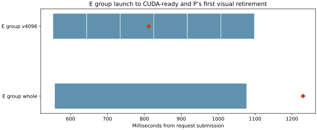
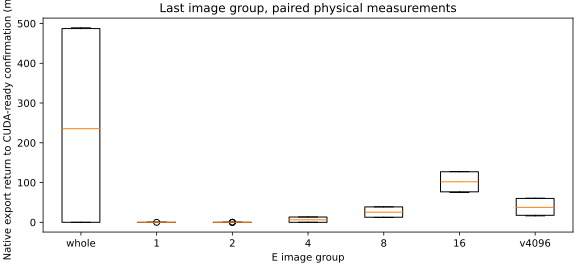
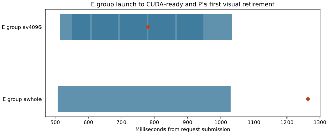
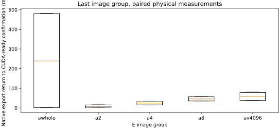
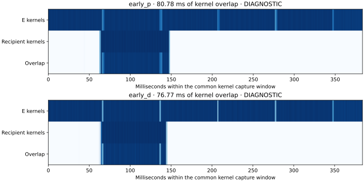

# Direction A · Group-wise Vision Encoding과 실제 CUDA 준비

원본 Qwen2.5-VL Vision forward를 여러 그룹으로 실행하자, Early P/D 합계에서 E의 마지막 CUDA 완료 Event 하한 전 Visual LM retirement가 동기 46/48, 비동기 32/32였다. 비동기 8장 그룹은 전체 CUDA 구간 합이 542.89ms로 같은 비동기 Whole 대비 1.8% 증가했고, legal prefix는 전체 마지막 E Event보다 보수적으로 중앙 369.82ms 먼저 준비됐다. 두 실제 Kernel overlap trace는 동시 GPU 실행을 관측했으며 Observer 5% 기준 결과는 `DIAGNOSTIC`이다. [동기 원시 분석](../mllm_epd_joint_encode_prefill_discovery/results/group_sync/group_summary.json) · [비동기 원시 분석](../mllm_epd_joint_encode_prefill_discovery/results/group_async/group_summary.json) · [이전 0/54 실험](mllm_epd_ready_prefix_recipient_followup.md)

## 모델과 계측 경계

H200 GPU4/5/6에 Qwen2.5-VL-7B-Instruct `cc594898137f460bfe9f0759e9844b3ce807cfb5`의 E/P/D를 배치했다. 원본 BF16, FA3, CUDA Graph, B8192/S128, P/D 각 KV42 GiB, CUDA IPC, NIXL을 유지했다. APC와 요청 간 Embedding 재사용은 껐다. MMLongBench-Doc `725`는 60장과 24,459개 LM 입력 토큰, `178`은 45장과 25,641개였다. 각각 원래 앞쪽 10장과 12장을 포함한 4,084와 6,842-token causal prefix를 사용했다. 워밍업 뒤 실행당 하나의 원본 요청을 제출하고 시작부터 Fixed16 결과까지 측정했다. 각 그룹 모드에서 두 문서 × 두 반복 × 네 Arm으로 총 128 측정, 별도 32 shape primes와 5개 Encoder signature 대조를 실행했다. Arm 순서는 quartet마다 순환했고 Encoder mode 순서는 고정했다. [실험 계약](mllm_epd_joint_encode_prefill_poc_spec.md) · [Runner](../mllm_epd_joint_encode_prefill_discovery/group_runner.py)

그룹 Wrapper는 현재 scheduler가 준 원래 이미지 목록을 연속 구간으로 나누고, 각 구간에서 원래 `_execute_mm_encoder()`를 실행한다. 원래 CUDA IPC descriptor와 소유권을 유지한다. `stock`은 원래 publication을 사용한다. `whole`은 같은 CUDA 검증과 marker를 사용하면서 모든 이미지를 한 그룹에서 실행한다. `1/2/4/8/16`은 한 그룹의 최대 이미지 수, `v4096`은 이미지를 자르지 않는 목표 Visual Token 예산이다. 원래 요청의 Image Order, Placeholder, MRoPE, causal KV를 보존한다. [Encoder 구현](../mllm_epd_joint_encode_prefill_discovery/group_encoder.py) · [원래 Worker](../mllm_epd_prefill_heavy_token_split/cuda_ipc_ec.py)

CUDA readiness는 E가 각 그룹의 현재 Stream에서 원래 Vision 실행을 끝낸 뒤 Event를 기록하고, Event의 완료를 관측한 후 `cuda_group_ready.json`을 발행하는 방식으로 보장했다. Consumer는 기존 IPC descriptor와 검증된 그룹 marker를 함께 기다린다. 완료 Event의 Host 하한은 E의 발행 또는 마지막 미완료 관측에 근거한다. 상한은 Process가 완료를 확인한 시점이다. 그룹이 모든 이미지의 파일을 발행한 시각 및 HTTP 응답은 별도 기록이다. P/D의 `update_from_output`에서 행이 실제 model result로 반영된 시각을 retirement로 사용했다. 이 순서는 CUDA 완료가 확인된 Tensor의 소비와 이후 E 그룹이 남아 있는 동안의 Stage 진행을 보여준다. 양쪽 GPU에서 개별 Kernel이 동시에 실행된 정확한 시간은 `NOT_RUN`이다. [Recipient Scheduler](../mllm_epd_modality_aware_idle_execution_discovery/readiness_scheduler.py) · [Reducer](../mllm_epd_joint_encode_prefill_discovery/group_reduce.py)

| 처리 방식 | E HTTP p50 ms | E CUDA 구간 합 p50 ms | 첫 그룹 CUDA-ready p50 ms | Legal Prefix의 보수적 준비 선행 ms | Early 8건 중 전체 E Event 하한 전 | 마지막 그룹 발행 전 | E HTTP 응답 전 |
|---|---:|---:|---:|---:|---:|---:|---:|
| Stock descriptor | 892.71 | — | — | — | — | — | 0/8 |
| Whole + CUDA 확인 | 1,137.63 | 533.28 | 1,107.17 | −487.59 | 0/8 | 0/8 | 0/8 |
| 1장 | 1,816.23 | 1,181.48 | 596.18 | 955.04 | 8/8 | 8/8 | 8/8 |
| 2장 | 1,288.19 | 676.35 | 602.78 | 545.42 | 8/8 | 8/8 | 8/8 |
| 4장 | 1,197.72 | 592.74 | 615.59 | 455.51 | 8/8 | 8/8 | 8/8 |
| 8장 | 1,138.59 | 569.64 | 635.15 | 369.31 | 8/8 | 8/8 | 8/8 |
| 16장 | 1,115.06 | 543.26 | 709.97 | 276.51 | 6/8 | 4/8 | 7/8 |
| v4096 | 1,102.52 | 556.71 | 624.25 | 391.15 | 8/8 | 8/8 | 8/8 |

준비 선행은 마지막 E Event의 Host 하한에서 legal prefix의 마지막 필수 그룹 CUDA-ready 상한을 뺀 값의 중앙값이다. Whole의 음수는 같은 완료 Event의 관측 구간 폭을 반영한다. Stock에서는 IPC 파일의 가시성 기준으로 prefix와 전체 간 중앙 219.30ms 차이가 있었으며, Visual LM은 E HTTP 완료 전에 한 번도 retire하지 않았다. Whole에서는 Encoder 원본 export 호출 반환부터 E CUDA 확인까지 마지막 그룹에 중앙 235.36ms가 남았다. 2장에서는 0.02ms, 8장에서는 25.59ms, v4096에서는 37.68ms였다. 이 수치는 파일의 개별 생성 시각과 전송 시간 대신 마지막 그룹의 Native export 호출 반환을 기준으로 한다. [행별 CSV](../mllm_epd_joint_encode_prefill_discovery/results/group_sync/group_trials.csv)

## Batching 손실과 정합성

같은 Event 경계의 Whole 대비 CUDA 구간 합은 1장 +121.5%, 2장 +26.8%, 4장 +11.2%, 8장 +6.8%, 16장 +1.9%, v4096 +4.4%였다. 이 구간은 Event 사이의 Vision 실행과 Stream 작업을 포함한다. 전체 E HTTP에는 요청 처리, 원래 IPC export와 synchronous CUDA 확인이 포함된다. 작은 그룹은 legal prefix를 일찍 제공하지만 전체 E 처리 시간 증가로 상쇄될 수 있다. One-image 모드는 실제 queue가 없는 동일 입력의 Stock Late P 대비 Early P/D 중앙 TTFT가 각각 502.20/543.33ms 느렸다. [Early/Late 수신자 비교](mllm_epd_groupwise_early_recipient_comparison.md)

Stock, Whole, 2장, 8장, v4096의 별도 Encoder signature에서 문서 `725`의 원래 이미지 60개는 각 arm에서 모두 동일한 BF16 Embedding 바이트 해시를 보였다. 나머지 그룹과 두 번째 문서의 모든 이미지에 대한 Bitwise Encoder Signature는 `NOT_RUN`이다. 128개 결과에서 원래 Prompt Token ID 해시, Img Span 순서, 연속 retirement와 전체 Prompt 행 완료를 확인했다. All-layer KV/Logits와 Task Quality는 이 sweep에서 측정하지 않았다. [원시 증거와 해시](../mllm_epd_joint_encode_prefill_discovery/results/group_sync/raw_evidence_manifest.json) · [Raw Archive](../mllm_epd_joint_encode_prefill_discovery/results/group_sync/raw_groupwise.tar.gz)

동기 Timing 자체는 `MEASURED_PHYSICAL`이다. 진짜 Decode load와 경쟁하는 실험 및 Next-Handoff deadline 보호는 이 직렬 sweep에서 `NOT_RUN`이다.

## 비동기 CUDA readiness

비동기 구현은 동일 E Stream에 그룹별 완료 Event를 기록한 뒤 다음 그룹을 발행한다. 별도 CPU Publisher가 앞선 CUDA Event의 완료를 확인한 순서로 원래 이미지별 marker를 쓴다. P/D가 marker를 기다리는 규칙은 동기 실험과 같다. 같은 두 원본 문서에서 여섯 모드 각각 16건으로 96개 비교, 별도 shape prime 24건과 signature 4건을 완료했다. 기준 `awhole`도 같은 비동기 확인을 사용한다. Stock은 원래 descriptor 대조로 반복했다. [비동기 분석](../mllm_epd_joint_encode_prefill_discovery/results/group_async/group_summary.json) · [구현](../mllm_epd_joint_encode_prefill_discovery/group_encoder.py)

| 처리 방식 | E HTTP p50 ms | E CUDA 구간 합 p50 ms | 최초 CUDA-ready p50 ms | 전체 CUDA-ready 상한 p50 ms | Legal prefix 보수적 선행 ms | Early 8건 중 전체 E Event 하한 전 | 마지막 그룹 발행 전 |
|---|---:|---:|---:|---:|---:|---:|---:|
| Stock descriptor | 815.06 | — | — | — | — | — | — |
| awhole | 842.46 | 533.14 | 1,079.19 | 1,079.19 | −1.34 | 0/8 | 0/8 |
| a2 | 1,241.66 | 665.60 | 596.19 | 1,225.83 | 505.97 | 8/8 | 8/8 |
| a4 | 1,111.33 | 561.51 | 597.38 | 1,115.01 | 425.90 | 8/8 | 7/8 |
| a8 | 1,038.11 | 542.89 | 603.15 | 1,057.63 | 369.82 | 8/8 | 4/8 |
| av4096 | 1,011.00 | 535.76 | 613.41 | 1,051.02 | 403.23 | 8/8 | 6/8 |

비동기 그룹 25/32는 마지막 E 그룹을 발행하기 전에 원래 Prefix의 4,050 또는 6,804 Visual 행 전체를 완료했다. `a8`의 해당 4건은 모두 더 짧은 725 문서였다. 178 문서의 4건은 모두 전체 E Event의 하한 전에는 Visual 행을 완료했다. `awhole`에서는 Encoder HTTP 응답 후에도 CUDA Event 확인까지 요청별 차이 중앙 217.74ms가 남았다. 마지막 Native export 반환부터 CUDA 확인까지 중앙 지연은 `awhole` 238.96ms, `a8` 46.13ms, `av4096` 57.99ms였다. 비동기 E HTTP는 Encoder 계산 완료로 사용할 수 없다. 전체 CUDA-ready 상한과 실제 LM retirement를 기준으로 비교했다. [행별 CSV](../mllm_epd_joint_encode_prefill_discovery/results/group_async/group_trials.csv)

`awhole` 대비 Stream CUDA 구간 합은 `a2` +24.8%, `a4` +5.3%, `a8` +1.8%, `av4096` +0.5%였다. 비동기 분할의 비용은 이 두 문서에 한정해 8장 또는 Token-budget 방식에서 작았다. 별도 Encoder signature에서는 문서 725의 60개 Embedding이 `a4`, `a8`, `av4096` 각각 Stock과 모두 bitwise 일치했다. 원본 MRoPE와 Token order는 유지했으며 두 recipient 간 logits·Task Quality는 계속 미검증이다. [원시 Archive](../mllm_epd_joint_encode_prefill_discovery/results/group_async/raw_groupwise.tar.gz) · [환경·계측·SHA](../mllm_epd_joint_encode_prefill_discovery/results/group_async/raw_evidence_manifest.json)

## 독립 GPU의 Kernel overlap

`a8`의 문서 725에서 Early P/D 각각 하나를 CUPTI로 측정했다. 같은 모드·문서·recipient의 clean-before/profile/clean-after를 매칭했다. Recipient HTTP 제출부터 마지막 E Event 하한까지를 세 Collector의 공통 clock coverage로 잘랐다. CUDA kernel interval의 device별 합집합을 만들고 E와 해당 Recipient의 실제 교집합을 계산했다. 세 역할의 Collector와 Clock 검증 및 원래 16-token 출력 일치를 각각 확인했다. 이 실험은 직렬 단일 요청/arm이고 DMA는 기록하지 않았다. [CUPTI 분석 및 결과](../mllm_epd_joint_encode_prefill_discovery/results/group_async/kernel_overlap.json) · [분석 코드](../mllm_epd_joint_encode_prefill_discovery/group_kernel_overlap.py)

| Arm | 공통 구간 ms | E Kernel union ms | Recipient Kernel union ms | 교집합 ms (%) | Observer 5% |
|---|---:|---:|---:|---:|---|
| Early P | 383.28 | 370.75 | 84.07 | 80.78 (21.08%) | FAIL |
| Early D | 384.07 | 371.08 | 80.04 | 76.77 (19.99%) | FAIL |

Profile의 clean center 대비 상대차는 Early P TPOT 16.88%, ITL p99 24.03%였고 Early D는 각각 21.08%, 20.49%였다. Early P의 Clean TTFT spread는 5.79%였다. 그래서 두 교집합의 수치는 `DIAGNOSTIC`으로 유지한다. GPU에서 실제 정렬된 활동을 보여주며 기확인된 Stage 진행과 일치한다. Native 부하 상태의 D headroom이나 검증된 Online 일정 예산은 여전히 별도 판정이 필요하다.

