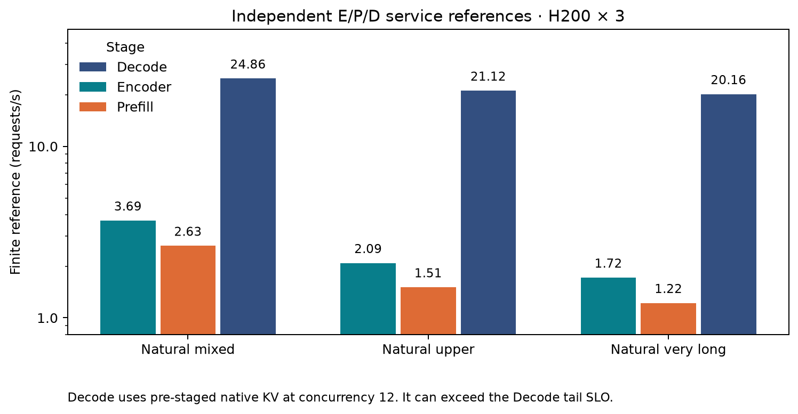
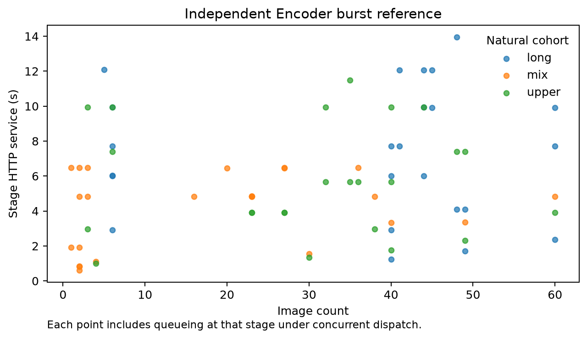
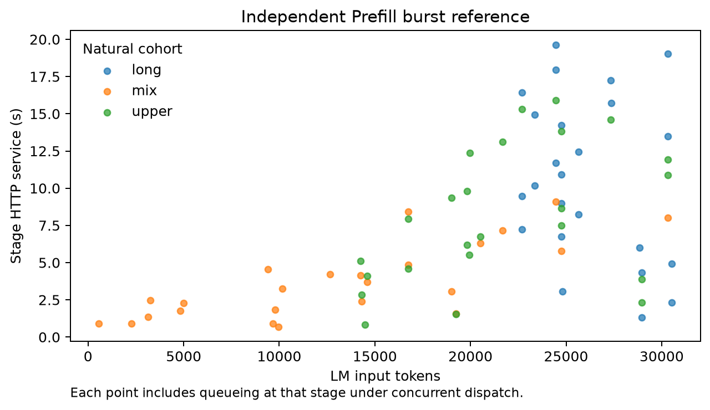

# 독립 E/P/D 처리량 보정

H200 GPU 4/5/6에서 Qwen2.5-VL-7B-Instruct BF16, revision `cc594898137f460bfe9f0759e9844b3ce807cfb5`를 사용했다. P/D는 FA3, 128-token page, CUDA Graph, APC off, B8192/S128, KV 42 GiB 설정이다. 표의 모든 처리율은 원본 모델과 실제 GPU 입력에 대한 **MEASURED_PHYSICAL** 유한 코호트 측정이다.

| 자연 코호트, 각 24개 | E req/s | E visual tok/s | P req/s | P LM tok/s | D req/s | D output tok/s |
|---|---:|---:|---:|---:|---:|---:|
| Mixed | 3.692 | 48,509 | 2.630 | 34,774 | 24.861 | 397.8 |
| Upper | 2.087 | 44,870 | 1.507 | 32,551 | 21.125 | 338.0 |
| Very long | 1.716 | 44,605 | 1.221 | 31,865 | 20.160 | 322.6 |

## 측정 계약

- **E**는 원본 파일 읽기, 전처리, 실제 Vision Encoder의 BF16 LM-ready 출력과 네이티브 CUDA IPC 게시를 포함한다. P 소비자의 복제와 종결 release는 측정 구간 이후 수행한다. Very-long 24개에서 worker observer가 센 Embedding 623,892행이 manifest와 일치했고, 관측된 최대 Vision 배치는 155개 이미지였다.
- **P**는 같은 코호트의 실제 임베딩이 사전 준비된 상태에서 LM prefill을 실행한다. CUDA IPC 입력 clone, 본래 Chunked Prefill, KV 생성 및 내부 one-token 결과까지 포함한다. E 사전 실행과 D 방향 KV 전송은 이 기준의 경계 밖이다. 온라인 요청은 Fixed16 이상 또는 Natural EOS를 사용한다.
- **D**는 실제 P의 prompt KV를 미리 만들고 12개씩 두 묶음으로 Native NIXL import와 실제 Fixed16 Decode를 실행한다. Very-long의 최대 실제 Decode query 12개를 확인했다. 사전 스테이징을 제외한 burst 서비스율이며, 전체 D Decode SLO를 만족하는 지속 처리율은 이 값으로 산출할 수 없다. Very-long 묶음의 ITL p99는 각각 18.46ms와 68.20ms였다.
- Geometry hook의 overhead는 이 단계에서 독립적으로 적격 판정을 받지 않았다. 최대 이미지 배치 및 실제 Decode 배치는 실행 구조 진단에 사용하며, 동시 E/P/D Motivation의 Observer 판정은 온라인 CPC에서 별도로 수행한다.

별도 Very-long 독립 D 실험에서 실제 prepared 및 scheduled decode batch 1을 검증했다. 24/24가 절대 Decode SLO를 통과했고, 6.841 req/s 및 109.46 output tok/s였다. TPOT p95 4.089ms와 ITL p99 6.618ms로, 처리율이 낮은 직렬 참조도 동일 Very-long의 가장 빠른 독립 P 1.256 req/s보다 컸다. 이 D 측정에는 실제 NIXL import와 client dispatch가 포함되며, 독립 참조가 보증하는 범위는 두 개의 사전 준비된 12-request 묶음이다.

자연 Very-long 24개에 대해서는 같은 요청 단위로 E가 P보다 1.41배 많은 일을 완료했다. Mixed의 차이도 1.40배다. 자연 Very-long은 E의 visual 처리율과 P의 prefill 처리율이 둘 다 긴 입력에서 제한되는 후보로 선정했다. 첫 네이티브 offered-rate 탐색은 같은 B8192 P 기준의 0.72×, 0.96×, 1.20×, 1.48×였다.

## 같은 LM context에서 본 Encoder 비용

| 24개 요청 | E req/s | E visual tok/s | P req/s | P LM tok/s | E 최대 관측 이미지 배치 |
|---|---:|---:|---:|---:|---:|
| Controlled 16K/V≈50%, 이미지 중앙값 3 | 5.099 | 41,767 | 2.210 | 36,217 | 21 |
| Controlled 16K/V≈50%, 이미지 중앙값 13 | 5.401 | 43,783 | 2.198 | 36,005 | 92 |
| 원본 자연 long, 이미지 중앙값 5 | 1.701 | 39,994 | 1.400 | 32,973 | 21 |
| 원본 자연 long, 이미지 중앙값 40 | 1.930 | 45,305 | 1.384 | 32,658 | 185 |

두 자연 코호트의 쌍별 LM 길이 차이는 중앙값 205 token, 최대 437 token이다. 자연 few와 many의 P 처리율은 1.2% 차이였고, E 처리율은 many에서 13.5% 높았다. 두 코호트는 이미지 크기, 원문, 전처리 및 Vision batch geometry도 달랐다. 해당 차이는 이미지 수 하나로 운영 구간을 예측하기 어렵다는 근거다.

## P token budget 감도

| 같은 N24 입력 | B4096 LM tok/s | B8192 LM tok/s | B16384 LM tok/s | 최고 실행 옵션 |
|---|---:|---:|---:|---|
| 자연 Very-long | 30,220 | 31,865 | 32,795 | B16384 |
| Controlled 16K/V≈25% | 34,994 | 36,479 | 36,539 | B16384 |
| 자연 long/few | 30,922 | 32,973 | 32,386 | B8192 |

각 B4096/B16384 옵션은 독립적으로 시작한 Runtime에서 측정했다. 온라인 P proximity에는 같은 cohort의 더 강한 유효 독립 기준을 적용한다. 1.465 QPS Very-long의 R3 후보는 B16384를 분모로 사용해도 P 처리율 85% 조건을 넘겼다. 초기 offered rate 자체는 최초 B8192 보정값을 기반으로 예정됐다.

## Controlled LM input length

| V≈50%, 각 N24 | E req/s | E visual tok/s | P req/s | P LM tok/s |
|---|---:|---:|---:|---:|
| 4,096 | 22.227 | 44,552 | 8.151 | 33,386 |
| 8,192 | 10.752 | 44,214 | 4.624 | 37,877 |
| 16,384 | 6.200 | 50,260 | 2.191 | 35,901 |
| 24,576 | 3.827 | 47,452 | 1.339 | 32,916 |
| 32,512 | 2.954 | 46,894 | 0.936 | 30,437 |

모든 입력은 원본 이미지 전처리를 수행하고 실제 LM 입력 길이를 검증했다. 실험 간 문서와 텍스트 입력이 달라 service time의 길이 독립 인과효과로 보기는 어렵다. 각 4K/8K/24K/32K의 온라인 Fixed16은 측정한 P 참조 기준 0.85× 및 1.15×를 제시했다. 32,512는 32,768 model context의 생성 여유를 보존했다.

두 산점도에서 서비스 시간은 동시 제시된 요청의 stage HTTP 구간이며 stage 내부 queue와 동시 실행을 포함한다. 한 요청을 단독으로 실행한 GPU kernel 시간의 모델로는 사용할 수 없다.

[전체 단계별 CSV](../mllm_epd_prefill_heavy_modality_discovery/results/independent_stage_capacity.csv) · [요청 단위 관측](../mllm_epd_prefill_heavy_modality_discovery/results/stage_request_observations.json) · [동일 창 온라인 판정](mllm_epd_prefill_heavy_operating_region.md)
