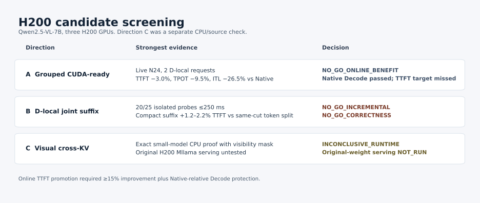

# H200 Joint Encode–Prefill 실험 결과

**결론.** Qwen2.5-VL-7B-Instruct BF16에서 실제 CUDA-ready 그룹으로 먼저 Visual LM 행을 완료할 수 있었다. 일치하는 H200 온라인 N24에서 Guarded D는 Native Decode 보호를 통과했다. TTFT p95 개선은 **3.0%**로 15% 승격 목표에 미달했다. D에서 이미지 Encode와 causal Prefill을 합친 별도 후보는 100–250 ms 실행 단위를 확인했다. 실제 joint suffix는 강한 Generic Token Split보다 느렸고 일부 토큰이 달랐다. 두 후보의 최종 온라인 승격은 이 모델과 실험 범위에서 보류했다.

## 측정 범위

H200 GPU4/5/6에서 E/P/D를 분리했다. P/D는 B8192/S128, 각 KV 42 GiB, BF16, FA3, CUDA Graph, CUDA IPC 및 NIXL에 고정했다. APC와 요청 간 Embedding 재사용을 껐다. 온라인 주 코호트는 입력 중앙값 24,789.5 LM 토큰, 이미지 중앙값 42.5장인 원본 문서 24개를 Fixed16과 open-loop Poisson 1.465 req/s로 제출했다. 기존 E/P/D 부하 및 100–250 ms Idle 탐색 근거에는 기존 5% Observer Guard에 따른 `DIAGNOSTIC` 범위를 유지한다. [실험과 모델 계약](mllm_epd_joint_encode_prefill_poc_spec.md) · [기존 Idle 분석](mllm_epd_decode_idle_fragmentation.md)

## A. CUDA-ready 그룹

동기 실행의 grouped Early P/D 48건에서 **46건**은 마지막 E CUDA event 완료 하한보다 먼저 Visual LM 행을 완료했고, **44건**은 E가 마지막 그룹을 발행하기 전에도 완료했다. 동일한 원본 이미지 60장을 검사한 네 개의 그룹 모드에서 Embedding이 stock과 bitwise 일치했다. 반면 이미지 한 장씩 처리하면 E의 장치 실행 및 파이프라인 비용이 크게 증가했다. 같은 문서와 cut의 직렬 2×2 비교에서 8장 그룹의 조기 실행은 stock Late P보다 Early P 151.6 ms, Early D 233.1 ms 빠른 중앙값을 보였다. 동일 recipient의 Late 대비 Early 개선량끼리 대조했을 때 D의 추가 개선 중앙값은 **−27.8 ms**였다. [CUDA event 및 batching 원자료](mllm_epd_groupwise_encoder_cuda_readiness.md) · [동일 cut 2×2 비교](mllm_epd_groupwise_early_recipient_comparison.md)

완료 이벤트를 비동기 확인하는 8장 그룹은 두 문서에서 직렬 조기 전환 8/8을 재현했다. 원래 prefix를 사용할 수 있는 시점은 E의 마지막 CUDA event 완료 하한보다 중앙값 **369.8 ms** 앞섰다. E CUDA 합산 중앙값은 한 그룹의 533.1 ms에서 542.9 ms로 **1.8%** 늘었다. 같은 문서의 Stock Late P 대비 Early P와 Early D는 각각 **101.1 / 186.9 ms** 빨랐다. 각 recipient의 Late 대비 Early 개선량 차이에서는 D 추가 개선 중앙값이 **−18.8 ms**였다. 고정 4,096 visual-token budget은 D 추가 개선이 +53.2 ms였으며 짝 4개에서 관측된 탐색 결과다. 실제 부하 대조에는 미리 선택한 8장 모드를 사용했다. [비동기 물리 및 paired 비교](mllm_epd_groupwise_early_recipient_comparison.md)

8장 그룹의 clock-aligned CUPTI 구간에서 E와 LM 커널의 교집합은 P **80.8 ms**, D **76.8 ms**였다. 두 arm 모두 TPOT 또는 ITL이 계측 전후 대조의 5% 기준을 넘겨 교집합은 `DIAGNOSTIC`이다. 그룹 완료 순서와 먼저 끝난 Visual LM 행에는 별도의 미계측 CUDA event 영수증을 사용했다. [CUPTI 시간축과 Observer Guard](mllm_epd_groupwise_encoder_cuda_readiness.md)

### 실제 같은 도착열의 온라인 N24

| 방법 | TTFT p95 | TPOT p95 | ITL p99 | 절대 Decode | Joint req/s | D-local Prefill |
| --- | ---: | ---: | ---: | ---: | ---: | ---: |
| Native EPD | 10.626 s | 4.331 ms | 11.093 ms | 24/24 | 0.333 | 0/24 |
| Whole-request Isolation | 9.370 s | 4.568 ms | 10.637 ms | 24/24 | 0.295 | 3/24 |
| Grouped Late P | 10.838 s | 4.408 ms | 13.935 ms | 24/24 | 0.236 | 0/24 |
| Grouped Early P | 10.956 s | 3.564 ms | 10.895 ms | 24/24 | 0.338 | 0/24 |
| Grouped Guarded D | 10.307 s | 3.920 ms | 8.153 ms | 24/24 | 0.398 | 2/24 |

동일 서버 시작에서 다섯 arm 모두 24개 shape prime 뒤 **120/120**을 완료했다. Guarded D는 Native 대비 TPOT p95 **−9.5%**, ITL p99 **−26.5%**, Joint Goodput **+19.8%**였다. Joint SLO를 통과한 원본 요청은 7개에서 8개로 늘었다. 같은 grouped E를 쓰는 Early P와 비교하면 Guarded D의 TTFT p95는 **−5.9%**, TPOT p95는 **+10.0%**였다. Whole-request Isolation은 TTFT를 11.8% 줄였으며 Native 상대 TPOT 제한을 +5.46%로 넘겼다. 모든 arm에서 원래 Prompt ID와 Fixed16 출력 ID가 Native와 24/24 일치했다. [온라인 대조와 Pareto Figure](mllm_epd_joint_execution_online_serving.md)

Early P가 E의 마지막 CUDA 완료 하한보다 먼저 Visual LM 행을 retire한 경우는 **1/18**이었다. Guarded D로 선택된 요청은 **2/24**였으며, 둘 다 마지막 E event 하한보다 **239–318 ms** 먼저 Visual LM 행을 retire했다. 이 두 요청의 개별 TTFT는 Native의 3.073 s와 5.086 s에서 5.103 s와 5.398 s로 늘었다. 나머지 22개는 P를 사용했다. Guarded D는 P가 받은 논리 prompt 행을 **626,486→579,342**로 줄였다. P의 대기와 보수적인 D admission으로 물리 실행 기회가 소수 요청에 그쳤다. **A는 이 설정에서 `NO_GO_ONLINE_BENEFIT`**이며, CUDA-ready pipeline을 실제 GPU에서 검증했다. [요청별 일정, retirement와 분모](../mllm_epd_joint_encode_prefill_discovery/results/group_online/group_online_pilot.json)

## B. D-local Encode–Prefill

D에서 원본 이미지 1장과 421 LM 행을 처리한 중앙값은 **101.1 ms**, 이미지 2장과 828 LM 행은 **136.4 ms**였다. 각 다섯 번 모두 250 ms 내에 끝났다. E→D Embedding을 사용하는 LM-only 대조에서 같은 행 수의 중앙값은 각각 33.4 ms와 52.4 ms였다. 두 개 prefix 정확성 사례에서 E 생성 Embedding을 쓰는 대조와 D가 직접 생성하는 후보의 28개 KV layer 전체, MRoPE 및 top-32 logit이 일치했다. 이 짧은 실행 시간은 직렬 원본 입력의 D 구간 실측이다. 이어서 실제 P→D NIXL KV를 사용한 완전한 suffix 경로와 Native Decode 도착 개입을 측정했다. [D-side 원자료 및 실행 DAG](mllm_epd_joint_encode_prefill_quantum.md)

처음 만든 suffix 경로에서는 1–2개 이미지의 Encode를 E에서 뺐고, 432–839 LM 행을 P에서 D로 옮겼다. 같은 cut의 Generic Token Split이 옮기는 LM 행은 동일했다. D의 CUDA IPC를 **2.90–5.81 MB** 줄였고 **1.36–1.44 GB**의 causal prefix NIXL 전송은 남았다. D에서 전체 문서의 raw 전처리를 중복한 첫 구현의 TTFT는 같은-cut generic 대비 **23.1–27.3%** 늘었다. 또한 D에서 이미지 두 장을 처리하는 도중 Native KV를 넣으면 첫 Token까지 **93.1 ms** 더 기다렸고, 그 이후 TPOT는 4.823→4.833 ms였다. 이미 Decode가 진행 중인 시도 3건은 모두 추가 Vision 실행을 거절했다. [표와 intervention 기록](mllm_epd_joint_encode_prefill_quantum.md)

D는 E의 앞부분 grid 메타데이터와 직접 전처리한 suffix 이미지만 결합하도록 수정했다. 이 변경은 실제 3개 cut의 median TTFT를 중복 전처리 경로보다 **21.1–21.8%** 줄였다. 같은 epoch의 Generic Token Split보다 **1.2–2.2%**, Native보다 **2.3–4.4%** 느렸다. Compact suffix의 Fixed16 전체 토큰 일치는 Native 대비 5/15였고, 같은-cut generic은 10/15였다. 전체 vocabulary teacher-forced 검사에서 Native A/A logits는 16/16 bitwise 일치했다. 두 joint 경로는 서로 logits와 최종 hidden state가 16/16 bitwise 일치했고, Native와의 greedy 일치는 각각 15/16이었다. 9번째 token에서 Native top-1/top-2 logit margin이 0.25인 반면 joint는 동률이었다. **B는 `NO_GO_INCREMENTAL` 및 `NO_GO_CORRECTNESS`**로 판정했다. [최적화 후 original-weight 물리 실측](mllm_epd_joint_encode_prefill_quantum.md)

## C. 다른 모델과 기존 연구

Qwen3-VL의 DeepStack은 초기 LM 블록에 추가 Visual Feature를 주입하고, CogVLM2의 Visual Expert는 별도 연산 가중치를 쓰면서 앞선 KV에 대한 causal dependency를 유지한다. 두 구조 모두 Qwen2.5-VL 수치를 그대로 적용하기 어렵다. 별도로 Mllama의 Vision cross-KV를 Decode Query와 분리해 준비할 수 있음을 공식 모델 구현을 이용한 CPU 테스트에서 확인했다. 마스크가 참조하는 이미지의 누락을 포함한 음성 대조도 확인했다. 원본 체크포인트 및 native H200 serving 경로가 없어 물리·온라인 일반화는 `NOT_RUN`이다. [아키텍처와 실제 테스트](mllm_epd_architecture_specific_parallelism_discovery.md)

RServe와 gLLM은 이미지 그룹으로 Encode를 진행하면서 실제로 사용 가능한 causal LM prefix를 만들거나 실행한다. FluidPD에는 일반 causal token suffix placement가 있고, UnifiedServe는 Encode와 Prefill을 Decode가 있는 GPU에서 함께 스케줄링한다. 여기서 추가로 시험한 차이는 **같은 P→D cut과 동일한 causal LM suffix를 두고 E의 원본 이미지 연산을 D에 옮겨 Embedding을 그 자리에서 소비하는 효과**다. 이 범위에서만 기존 기준선 대비 추가 이득을 검토했다. [고정 공개 코드와 논문 대조](mllm_epd_joint_execution_prior_work.md)

## 연구 질문과 증거 수준

| 질문 | 답변 | 증거 |
| --- | --- | --- |
| 1. 실제 CUDA-ready 선행 시간 | 8장 비동기 그룹에서 마지막 E 완료 하한보다 중앙 369.8 ms 앞섰다. | `MEASURED_PHYSICAL` |
| 2. E 종료 전 Visual LM 완료 | 동기 grouped Early 46/48, 비동기 grouped Early 32/32. N24 Guarded D의 실제 선택 2/2도 완료했다. | `MEASURED_PHYSICAL`, `TRACE_ANALYSIS` |
| 3. Encoder grouping 비용 포함 | 8장 비동기 그룹의 E CUDA 비용은 +1.8%였다. 직렬 Early P/D의 TTFT 중앙값은 Stock Late P보다 빨랐다. N24 Early P TTFT p95는 Native보다 3.1% 늘었다. | `MEASURED_PHYSICAL`, `MEASURED_ONLINE` |
| 4. 부하 중 Early D와 Early P | Guarded D TTFT p95 −5.9%, TPOT p95 +10.0%. 실제 D 선택은 두 건이었다. | `MEASURED_ONLINE` |
| 5. 100–250 ms Joint quantum | 1–3장 원본 이미지로 421–1,721 LM 행을 처리했고 25회 중 20회가 250 ms 이내였다. | `MEASURED_PHYSICAL` |
| 6. E/P 동시 작업량 감소 | Native 대비 E 1–2장, P 432–839행을 생략했다. 같은-cut Generic 대비 P 감소량은 동일했다. | `MEASURED_PHYSICAL` |
| 7. 여러 Idle Window에 걸친 재개 | 합법적인 상태 의존성을 확인했다. 보존·재개를 실제 여러 Idle Window에 걸쳐 수행한 실험은 없다. | `NOT_RUN` |
| 8. Generic Token/Layer 대비 | 동일 cut의 Generic Token Split보다 compact B가 1.2–2.2% 느렸다. 새 후보와의 현대화한 Generic Layer Split 대조는 수행하지 않았다. | `MEASURED_PHYSICAL`, `NOT_RUN` |
| 9. 통신 포함 순이득 | B는 2.90–5.81 MB의 D IPC를 없앴고 1.36–1.44 GB의 causal NIXL은 유지했다. 원본 문서 중복 전처리를 제거하고도 generic을 넘지 못했다. | `MEASURED_PHYSICAL` |
| 10. 다른 모델 | Mllama의 Query 독립 Visual Cross-KV와 원래 visibility를 CPU에서 검증했다. Qwen3-VL DeepStack과 CogVLM2의 source 의존성을 확인했다. | `CORRECTNESS_ONLY`, `TRACE_ANALYSIS` |
| 11. TTFT와 Decode 보호 | Grouped Guarded D는 Native 대비 TPOT·ITL 보호를 통과했으며 TTFT p95를 3.0% 줄였다. TTFT 15% 승격 기준에 미달했다. | `MEASURED_ONLINE` |
| 12. 독립 Contribution | 그룹 기반 조기 Prefill과 기존 joint 스케줄링에 직접 선행연구가 있었다. 여기서 검증한 같은-request suffix의 추가 이득은 확인하지 못했다. | `TRACE_ANALYSIS`, `MEASURED_PHYSICAL` |
| 13. Natural EOS와 heldout | 후보가 승격 기준에 미달하여 이 캠페인의 후보 Natural EOS, heldout, 정식 Task Score, N64/N128, 세 번의 독립 재시작은 수행하지 않았다. | `NOT_RUN` |
| 14. 가장 유망한 후속 방향 | 모델이 실제로 독립적으로 생성·전달할 수 있는 Cross-KV부터 검증한다. Qwen2.5-VL에서 재시도한다면, 같은-cut generic에 대해 KV 도착 전 Vision만 완료·보존하는 작은 개입이 필요한 추가 성능을 만들어내는지 먼저 판별한다. | 구조 가설 |

최초 grouped 온라인 시작은 proxy health identity 문제로 요청을 제출하기 전에 종료했다. identity를 바로잡고 별도 epoch에서 다섯 arm을 완료했다. 최초 B 시작의 이전 H100 경로 참조도 수정 후 독립 실행했다. 각 실험에서 동결한 모델·실행 코드와 설정의 SHA-256을 함께 보존했다. [코드·설정 원본 지문](../mllm_epd_joint_encode_prefill_discovery/results/frozen_source_sha256.json) · [실패 및 재시작 영수증](../mllm_epd_joint_encode_prefill_discovery/results/group_online/launch_attempts.json) · [재현 명령](mllm_epd_joint_encode_prefill_poc_spec.md)

모든 GPU 실험 종료 뒤 승인된 `train_lm.py`가 GPU0–7에서 실행되는 것을 PID, 원본 스크립트 SHA-256과 GPU 사용률로 확인했다. [Burner 복원 영수증](../mllm_epd_joint_encode_prefill_discovery/results/burner_restore.json)
