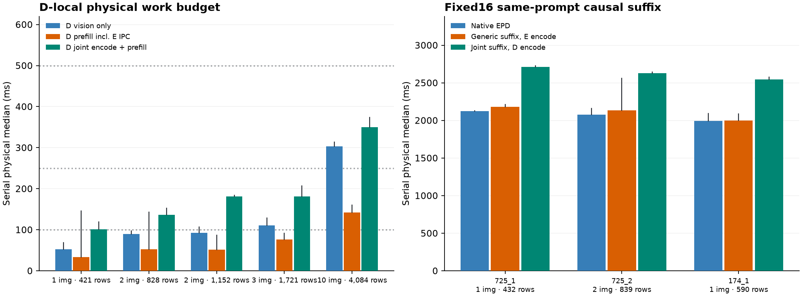
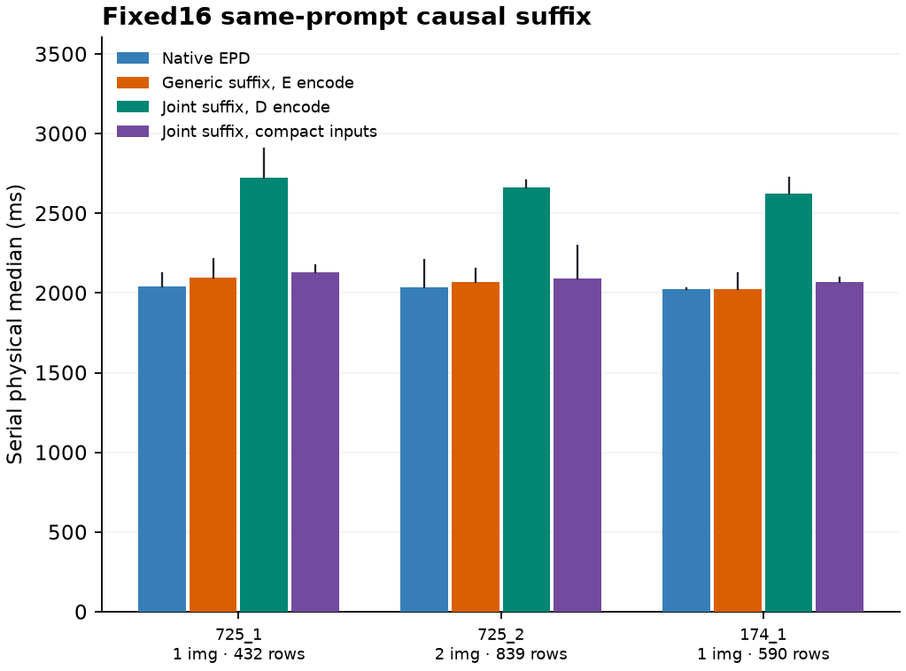

# Direction B — Joint Encode–Prefill on the decode GPU

## Physical question

Can D take ownership of raw images and their causal LM suffix, finish within a useful idle window, and remove actual work from E and P beyond what an otherwise identical token suffix split provides?

Qwen2.5-VL-7B has ordinary causal LM dependencies after image embeddings are spliced into the prompt. A D-owned image can run its Vision forward without the preceding images, but its LM rows require the earlier tokens' KV in all 28 layers. The experiment uses real H200 1E/1P/1D, native BF16 weights, FA3, CUDA Graph, B8192/S128, 42 GiB KV on P and D, original MRoPE, CUDA IPC for embeddings, and NIXL READ for P→D KV. APC and cross-request embedding reuse are disabled. The H200 lease follows the shared campaign resource guard.

## Execution DAG and controls

An image-complete cut includes the original image's closing delimiter. The input processor validates the exact frozen token fingerprint, the placeholder offset and length, and the expected cut. The D consumer requires a NIXL export from P with the exact cut. It accepts local vision only for explicitly D-owned images with raw pixels and the original grid. P exports its normal paged KV, its internal completion sample is discarded, and D generates the real output with full original prompt order. When D consumes the same raw source after cropping E/P to the first images, it repeats CPU-side rendering and pixel preprocessing of the full prompt. This is included in the physical cost. Only the D-owned suffix images enter D's Vision forward.

~~~mermaid
flowchart LR
    A[Original image and text request] --> B[First image groups]
    A --> C[Last image groups and trailing question]
    B --> D[E encodes first groups]
    D -->|CUDA IPC| F[P prefills exact original prefix]
    C --> H[D encodes owned image groups]
    F -->|NIXL prefix KV| I[D prefills remaining original rows]
    H -->|GPU-local embeddings| I
    I --> J[D generates all 16 output tokens]
~~~

The DAG shows where the calculations are legal. The serial physical candidate starts D after the P export. It therefore measures the combined consumer path without taking credit for overlapping D Vision with E/P. An asynchronous retained embedding could advance D Vision before NIXL arrives, at the cost of maintaining bounded GPU ownership until the matching suffix is safe to admit.

| Control or candidate | E stage | P stage | D stage | Question |
|---|---|---|---|---|
| Vision-only floor | None | None | Original raw image processor, H2D, resident Vision | Minimum useful encoder work on D before return IPC or LM work |
| Prefill-only prefix | Original first images | None | Original E→D CUDA IPC and exact initial LM rows | Idle time to spend on the same first LM rows |
| Joint isolated prefix | None | None | Original first images, Vision, exact initial LM rows | Whether a short joint quantum can physically finish |
| Native EPD | Encode all | Prefill all | Full imported KV and Fixed16 | Native cost and output comparison |
| Same-cut generic suffix | Encode all | Prefill exact prefix | Imported prefix KV, suffix embeddings over CUDA IPC, LM suffix and Fixed16 | Incremental value of local Vision |
| Joint suffix | Encode first groups only | Prefill exact prefix | Imported prefix KV, locally encoded suffix images, LM suffix and Fixed16 | Actual work and transfer removed from E/P |

The isolated prefix probes stop after confirming retirement of the original prefix with one internal, discarded sample. All completed request comparisons generate 16 output tokens. The isolated prefix test does not claim a usable D→P→D handoff. The same-cut generic baseline already avoids the round trip, as generic causal token suffix handoff can do. A real D-first design that retains D's original prefix pages could avoid retransmitting those pages to D, but P still needs a valid D→P prefix receipt and D later needs the P-computed suffix. An approach that transfers the whole prompt back to D duplicates the prefix transfer. Neither D-first case is needed for the tested return-free placement question.

## Measurement and correctness contract

- Serial measurements include host request submission, model preprocessing, physical GPU work, import or absence of import, and client completion. The time-budget table uses the entire D HTTP/RPC elapsed time. Native decode TPOT and ITL are measured from raw explicit SSE token IDs. Tokens received in the same client event share a timestamp.
- The IPC byte count comes from acknowledged physical clone receipts inside the measured phase. Logical BF16 embeddings are 7 KiB per visual row and BF16 prompt KV is 56 KiB per token across all 28 layers. Page padding and cumulative D NIXL counters are reported individually when available.
- Prefix correctness probes compare processed embeddings, all 28 paged-KV layers, frozen 3-axis MRoPE, and first-token top-32 values and indices. These probes copy tensors to CPU and are outside the latency samples. Full requests compare exact original prompt IDs and Fixed16 output IDs to paired native. Task quality and Natural EOS require separate evidence.
- Controlled decode protection uses a physically exported Native Fixed128 KV. The idle mode waits for the joint prefix to finish. The upcoming mode submits the known Native KV 20 ms after the start request and checks the actual timestamps. The active mode records the explicit first-output event and rejects the joint work, so it tests a conservative admission decision and does not force overlap during active decode.
- A fit within 100–250 ms is a physical duration on the observed fixtures. Online safe headroom and starvation across different windows require an independent open-loop evaluation.

## B1 physical results

The isolated joint prefix fit inside a 250 ms D budget on 20/25 trials. Those 20 trials covered four separate 1–3-image cuts with 421–1,721 original prompt rows. The 10-image cut took 349 ms at the median. All cases had five measured repetitions plus one excluded warmup per arm.

| Original prompt rows | Images | D Vision-only median, ms | D prefill-only median, ms | D joint median / p95, ms | D joint fit at 50 / 100 / 150 / 250 / 500 ms |
|---:|---:|---:|---:|---:|---|
| 421 | 1 | 52.87 | 33.37 | 101.08 / 119.01 | 0 / 2 / 5 / 5 / 5 |
| 828 | 2 | 89.31 | 52.37 | 136.40 / 152.71 | 0 / 0 / 4 / 5 / 5 |
| 1,152 | 2 | 92.70 | 51.29 | 181.55 / 183.82 | 0 / 0 / 0 / 5 / 5 |
| 1,721 | 3 | 110.46 | 75.82 | 181.21 / 207.00 | 0 / 0 / 0 / 5 / 5 |
| 4,084 | 10 | 302.73 | 142.38 | 349.43 / 373.75 | 0 / 0 / 0 / 0 / 5 |

Separate D stream CUDA timings gave 22.04 ms Vision and 10.50 ms LM for the one-image joint prefix. The ten-image diagnostic gave 90.54 ms Vision and 82.27 ms LM. The corresponding prefill-only LM timings were 10.80 and 82.71 ms. The shorter CUDA enclosures leave image preprocessing, request admission and response costs in the full time-budget measurement.

### Actual causal suffix

All 45 Native, same-cut generic and joint suffix requests completed on H200 with the exact original input and 16 generated tokens. D received the exact P-prefix KV physically over NIXL. Joint removed E Vision and D CUDA IPC for the owned suffix images. P and D split the same LM rows as the generic arm, so the incremental effect specifically compares E Vision with D-local Vision. NIXL bytes matched exactly for both suffix arms on each document.

| Document, owned suffix | Native TTFT median | Generic same-cut | Joint B1 | Joint B1 increase vs generic | Physical D IPC eliminated | Physical NIXL bytes, generic and joint |
|---|---:|---:|---:|---:|---:|---:|
| 725, 1 image and 432 LM rows | 2,122.09 ms | 2,180.77 ms | 2,711.32 ms | 24.3% | 2,903,040 B | 1,379,926,016 B |
| 725, 2 images and 839 LM rows | 2,077.51 ms | 2,135.63 ms | 2,629.83 ms | 23.1% | 5,806,080 B | 1,357,905,920 B |
| 174, 1 image and 590 LM rows | 1,991.18 ms | 1,999.34 ms | 2,546.09 ms | 27.3% | 4,064,256 B | 1,438,646,272 B |

The additional D-stage completion time relative to the generic suffix was 516–600 ms at these three medians. The B1 D API receives all document images through the raw path, so it repeats the earlier images' CPU preprocessing before selecting the actual D-owned GPU Vision rows. The measured IPC elimination is orders of magnitude smaller than the retained inbound prefix KV. The IPC reduction alone could neither remove the P→D dependency nor rescue B1 serial TTFT.

### Correctness and intervention

Both separate prefix correctness fixtures passed bitwise input-embedding, all 28 KV layers and top-32 value/index comparison. Both reproduced the frozen three-axis MRoPE. For completed Fixed16 suffix requests, the full output matched Native in 5/15 joint trials and 10/15 same-cut generic trials. On document 725, the one-image generic split matched Native 5/5 while the joint split matched 0/5. On its two-image cut both suffix arms matched each other 5/5 and matched Native 0/5. All disagreements started at output token 9. B1 isolated prefix correctness does not resolve this full-continuation divergence.

| D state and intervention | Native D-only first token median | Native D TPOT p95 | Native D ITL p99 |
|---|---:|---:|---:|
| Control, no joint work | 98.11 ms | 4.823 ms | 5.369 ms |
| Joint prefix retired before Native admission | 77.20 ms | 4.833 ms | 5.470 ms |
| Native submitted during pending joint prefix | 191.18 ms | 4.833 ms | 5.291 ms |
| Joint admission rejected during active Native decode | 81.87 ms | 4.830 ms | 5.359 ms |

The upcoming test overlapped the two D request enclosures in 3/3 trials. Its Native D-only first token arrived 93.07 ms later than the control median, while its subsequent token intervals were similar. All three active decode admissions were declined. The idle and active variations are three-run controls, so the lower first-token time in either condition does not establish a benefit.

### B1 decision

B1 earned **CONDITIONAL_PHYSICAL_SIGNAL** for the exact isolated prefix and **NO_GO_CRITICAL_PATH / NO_GO_CORRECTNESS** for the full raw-media suffix as a candidate for online promotion. The primary blocking costs were the repeated raw host-media path, the short time to a possible Native KV arrival, and the unqualified full-generation numerical difference. The exact 100–250 ms prefix measurements show that a physically short execution unit exists. Physical retirement alone gives no evidence that moving it out of P improves serving. Split-window retention, D-first return handoff, Natural EOS, task-quality noninferiority and open-loop B1 serving are **NOT_RUN**.

[B1 compact summary](../mllm_epd_joint_encode_prefill_discovery/results/b1_physical/summary.json) · [Raw provenance and source SHA256](../mllm_epd_joint_encode_prefill_discovery/results/b1_physical/provenance.json)

## B2 compact-input follow-up

B2 replaces D's duplicate full-document raw rendering with a request-scoped splice. E renders only the original first groups and writes its normal grid-only metadata. P consumes that metadata and the actual E embeddings to produce the same NIXL prefix. D runs the original raw processor only on its owned suffix images. It prepends the current E token prefix and its image grids and remaps the suffix placeholder offsets. It verifies the complete token sequence against the original document before EngineCore admission. E-prefix image data on D contains grids only, and actual D-owned suffix image data contains pixels and grids. The worker also checks that the advertised KV import exactly reaches the splice.

A CPU-only check used B1's actual recorded E metadata and freshly processed the final real image of document 725. It reproduced all 24,459 original prompt tokens, every original placeholder span and every grid. This check establishes the typed reconstruction contract before the independent physical comparison. GPU performance and generated output need their own receipts.

### Independent B2 epoch

All 60 measured requests completed with exact original prompt IDs and Fixed16 output. Each arm and case had five sampled repetitions after one excluded warmup. E rendered 44–59 images into grid-only prefix metadata. D rendered the remaining one or two images in 19.30–47.08 ms at the median and reconstructed the prefix representation in 7.91–8.93 ms. B2 preserved the same physical NIXL bytes as the B1 and generic suffix arms. It eliminated the same D embedding IPC as B1.

| Document, D-encoded images | Native TTFT median | Generic same-cut | Full-raw joint B1 control | Compact joint B2 | Compact B2 vs same-cut generic |
|---|---:|---:|---:|---:|---:|
| 725, 1 | 2,042.46 ms | 2,096.39 ms | 2,726.11 ms | 2,132.12 ms | +1.70% |
| 725, 2 | 2,038.55 ms | 2,068.80 ms | 2,660.61 ms | 2,093.33 ms | +1.19% |
| 174, 1 | 2,024.02 ms | 2,025.83 ms | 2,624.93 ms | 2,070.68 ms | +2.21% |

Compaction improved serial TTFT by **21.1–21.8%** relative to the full-raw B1 arm measured in the same epoch. It reduced D submit-to-completion by 535–546 ms at the median. Compact D submit-to-completion still took 272–291 ms, versus 190–208 ms for the same-cut generic arm. End-to-end medians were **1.2–2.2% slower than same-cut generic** and **2.3–4.4% slower than Native**. Compact TTFT p95 was also slower than Native on all three fixtures. The 2.90–5.81 MB embedding move it eliminates does not offset the local consumer cost at the tested causal cuts.

### Full-vocabulary check

The compact joint arm matched all 16 native greedy tokens on 5/15 measured requests, the same fraction as its full-raw counterpart. The same-cut generic control matched Native on 10/15. The separate document 725, one-image teacher-forced run fixed the actual prior output tokens and validated original input tokens and MRoPE at each step. Native A/A logits agreed bitwise at all 16 steps. The same-cut generic arm agreed on 16/16 greedy choices, while both joint variants agreed on 15/16. At step 9, Native's top-two margin was 0.25 logit units and both joint arms reached a tie. The compact and full-raw arms had bitwise-equal full-vocabulary logits and final hidden states at all 16 teacher-forced steps. Compaction removes the host rendering penalty while preserving the joint runtime's model computation. The responsible kernel and task-quality noninferiority remain unverified.

### B2 decision

**NO_GO_INCREMENTAL / NO_GO_CORRECTNESS** on the tested Qwen2.5-VL cuts. A short, exact local prefix is physically feasible. Replacing the duplicate rendering with compact inputs removes most of B1's added latency, but the resulting complete suffix still lacks a physical gain against the same-cut generic control and fails general output agreement. The independent encode-then-resume method across multiple idle windows and any open-loop B2 tests are **NOT_RUN**. The measurements leave the behavior of an asynchronous retained-embedding design and other architectures open.

[B2 compact summary](../mllm_epd_joint_encode_prefill_discovery/results/b2_compact/summary.json) · [Full-vocabulary comparison](../mllm_epd_joint_encode_prefill_discovery/results/b2_compact/analysis/joint_teacher_suffix_725_1.json) · [Raw provenance and source SHA256](../mllm_epd_joint_encode_prefill_discovery/results/b2_compact/provenance.json)

## Reproduction

Regenerate the fixture plans from the original frozen Very-long workload and prior ready-prefix study in the retained H200 run directory. Launch each experiment separately under the native campaign lease and use the reducer on the resulting raw trial and ownership receipts. The first B1 startup stopped before model launch because a legacy package import resolved the old run root. The deferred import and archived retry form the executable B1 path.

~~~bash
python -m poc_flashvep.mllm_epd_joint_encode_prefill_discovery.joint_cases \
  --matched ../h200_readiness_followup_runs/cases.json \
  --shaped ../h200_readiness_followup_runs/cases_shaped.json \
  --manifest ../h200_idle_execution_runs/dataset/primary_very_long_n24.json \
  --out ../h200_joint_encode_prefill_runs/joint_cases.json \
  --plan ../h200_joint_encode_prefill_runs/joint_physical_plan.json \
  --compact-plan ../h200_joint_encode_prefill_runs/joint_compact_plan.json
PYTHONUNBUFFERED=1 ../mllm_epd_runtime_env/bin/python \
  -m poc_flashvep.mllm_epd_joint_encode_prefill_discovery.joint_runner \
  --plan ../h200_joint_encode_prefill_runs/joint_physical_plan.json \
  --run-dir ../h200_joint_encode_prefill_runs/b_physical_reproduction \
  --wall-seconds 2400 --inline-reroute
PYTHONUNBUFFERED=1 ../mllm_epd_runtime_env/bin/python \
  -m poc_flashvep.mllm_epd_joint_encode_prefill_discovery.joint_runner \
  --plan ../h200_joint_encode_prefill_runs/joint_compact_plan.json \
  --run-dir ../h200_joint_encode_prefill_runs/b_compact_reproduction \
  --wall-seconds 1500 --inline-reroute --logit-check
python -m poc_flashvep.mllm_epd_joint_encode_prefill_discovery.joint_reduce \
  ../h200_joint_encode_prefill_runs/b_physical_reproduction \
  --json /tmp/joint_quantum_summary.json --plot /tmp/joint_quantum.png
~~~
