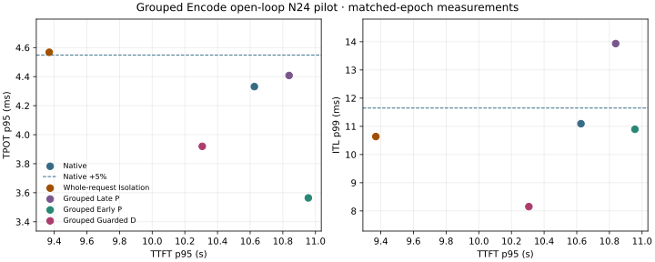
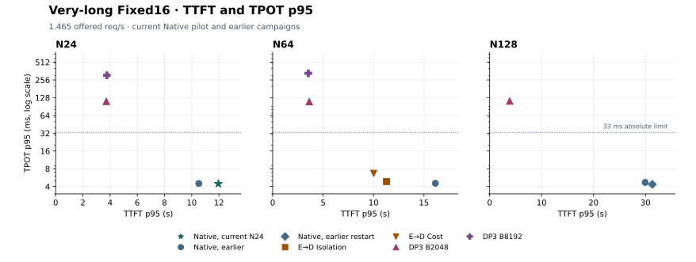
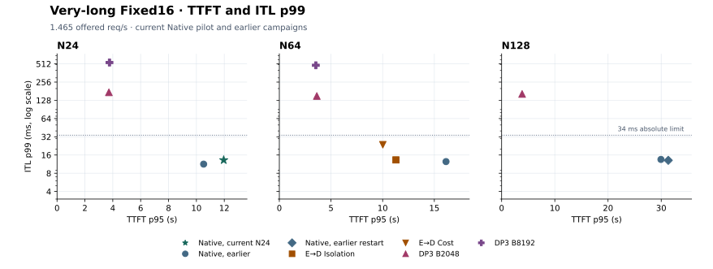

# Joint Encode–Prefill 온라인 대조

## 이번 실험의 Native N24

초기 group-sweep의 H200 GPU4/5/6 Native 1E/1P/1D에서 Very-long Fixed16을 **24/24 완료**했다. **TTFT p95 11.958 s, TPOT p95 4.460 ms, ITL p99 13.213 ms**였다. 절대 Decode SLO는 24/24, Joint SLO는 5/24였다. 첫 예정 Arrival부터 마지막 완료까지 21.757 s였고 Joint Goodput은 **0.230 req/s**였다. 이 실행은 `MEASURED_ONLINE`인 Native 대조다. 후보 비교에는 아래의 별도 retry epoch에서 같은 도착열로 다시 실행한 Native를 사용했다. [현재 실측 영수증](../mllm_epd_joint_encode_prefill_discovery/results/online_comparison.json)

Qwen2.5-VL-7B-Instruct `cc594898137f460bfe9f0759e9844b3ce807cfb5`, BF16, P/D B8192/S128, P/D 각 KV42 GiB, FA3, CUDA Graph, E→P CUDA IPC와 P→D NIXL을 사용했다. APC 및 요청 간 Embedding 재사용은 껐다. 원본 문서 24개, 입력 중앙값 24,789.5 LM 토큰과 이미지 42.5장, Fixed16, open-loop Poisson 1.465 req/s였다. Seed 2026112809와 전체 스케줄이 동결 N24 및 이전 Native N24의 도착열과 일치했다. 현재 실행의 Native 경로는 Proxy 영수증과 24/24 연결됐고 D-local Prefill은 0건이었다. [이전 실행 계약](mllm_epd_modality_aware_idle_execution_poc_spec.md) · [현재 기록](../mllm_epd_joint_encode_prefill_discovery/results/online_comparison.json)

| Native N24 관측 | p50 | p95 | p99 | 최대 |
| --- | ---: | ---: | ---: | ---: |
| TTFT (s) | 7.004 | 11.958 | 12.643 | 12.835 |
| TPOT (ms) | 3.959 | 4.460 | 4.552 | 4.578 |
| ITL (ms) | 4.872 | 5.888 | 13.213 | 15.276 |
| E2E (s) | 7.653 | 12.038 | 12.744 | 12.941 |

24건의 384 output token과 360 ITL 구간을 관측했다. 완료 및 Decode 적격 처리율은 각각 1.103 req/s였고 출력 처리율은 17.649 tok/s였다. TTFT는 예정 Arrival부터 첫 SSE token까지다. TPOT는 첫 token 이후 간격의 평균이며 ITL은 SSE에 기록된 token 간격을 합쳐 구한다. 하나의 SSE event에서 여러 token을 받으면 같은 event 내부 간격은 0이다. 절대 Decode는 TPOT ≤33 ms 및 모든 ITL ≤34 ms이며 Joint는 TTFT ≤5 s도 요구한다. Joint Goodput은 절대 Joint를 통과한 요청 개수로 계산한다. 원래 epoch 분석의 `SLO_goodput` 필드는 해당 요청들의 output token 처리율이므로 단위가 tok/s다. [동일 계산에 사용한 reducer](../mllm_epd_modality_aware_idle_execution_discovery/online_evidence.py)

## Grouped candidate N24 실행 기록

첫 `group-online` 시도는 프록시의 `/health` 응답 이름과 기존 launcher가 요구한 이름이 달라 warmup 전에 중단됐다. 해당 시도는 `NOT_RUN`이다. 로컬 HTTP에서 세 프록시의 이름을 검증한 뒤 별도 `group-online-retry` epoch에서 다시 실행했다. 실패 원문 로그는 서버에 보관했다. [실행 시도 영수증](../mllm_epd_joint_encode_prefill_discovery/results/group_online/launch_attempts.json)

`group-online-retry`에서는 동일 H200 세 대와 원본 24개, QPS 1.465, Fixed16, seed 2026112809를 사용했다. 한 서버 시작에서 각 arm을 24건으로 예열한 뒤 본 실행을 측정했다. Grouped arm은 모두 같은 a8 Encoder producer를 사용했다. Grouped Guarded D는 최초 8장까지 CUDA-ready인 적법한 prefix에서 현재 P HTTP outstanding ≥2와 D HTTP outstanding 0일 때만 D로 제출했다. D는 512 LM 행을 상한으로 양보하며 Native 요청을 우선했다. 모든 arm에서 24/24가 완료했고 Native와 프롬프트 token 전체 및 생성 token 전체가 모두 24/24 일치했다. 이 결과는 1회 시작의 `MEASURED_ONLINE` N24 pilot이다. Scored Task Quality, 별도 Natural EOS, 장시간 부하 및 독립 반복 결과는 이 후보에 대해 확보하지 않았다. [pilot 수치 및 증거 계약](../mllm_epd_joint_encode_prefill_discovery/results/group_online/group_online_pilot.md) · [쌍별 원자료 영수증](../mllm_epd_joint_encode_prefill_discovery/results/group_online/group_online_pilot.json)

| Pilot arm | TTFT p95 (s) | TPOT p95 (ms) | ITL p99 (ms) | Decode 통과 | Joint 통과 | Joint req/s | D-local | Native-relative strict Decode |
| --- | ---: | ---: | ---: | ---: | ---: | ---: | ---: | --- |
| Native | 10.626 | 4.331 | 11.093 | 24/24 | 7/24 | 0.333 | 0 | 기준 |
| Whole-request Isolation | 9.370 | 4.568 | 10.637 | 24/24 | 6/24 | 0.295 | 3 | FAIL |
| Grouped Late P | 10.838 | 4.408 | 13.935 | 24/24 | 5/24 | 0.236 | 0 | FAIL |
| Grouped Early P | 10.956 | 3.564 | 10.895 | 24/24 | 7/24 | 0.338 | 0 | PASS |
| Grouped Guarded D | 10.307 | 3.920 | 8.153 | 24/24 | 8/24 | 0.398 | 2 | PASS |

Grouped Guarded D는 Native 대비 TPOT −9.50%, ITL −26.51%로 엄격한 Decode 제약을 충족했다. TTFT p95는 **3.00% 감소**해 15% 목표에 미달했다. Joint Goodput **+19.75%**에는 SLO 통과 1건 증가와 첫 Arrival부터 drain까지의 시간 21.036→20.076초가 반영됐다. 동일 grouped Early P 대비 TTFT p95 −5.93%, TPOT p95 +9.97%, ITL p99 −25.17%, Joint Goodput +17.99%였다. Whole-request Isolation은 TTFT p95가 가장 낮았고 Native 대비 TPOT +5.46%로 엄격한 제약을 초과했다. [짝 비교 및 전체 tail](../mllm_epd_joint_encode_prefill_discovery/results/group_online/group_online_pilot.json)

Guarded D의 경로는 D 2건, Early P 16건, 8장 이하 Late P 6건이었다. D 두 요청 모두 **239.0–317.7 ms** 먼저 실제 Visual LM 행을 retire했다. 이 차이는 각 요청의 마지막 E group CUDA 완료에 대한 보수적 하한에서 비교했다. 두 건 모두 자체 TTFT는 Native의 3.073/5.086초에서 5.103/5.398초로 늘었다. E에서 인코딩한 이미지는 그대로였고 P로 제출된 logical prompt rows는 626,486→579,342로 **7.53% 감소**했다. Native 대비 P HTTP submit→ready 중앙값은 3,869→3,514 ms였으며, E submit→ACK 중앙값은 1,962→2,538 ms였다. HTTP 시간은 큐와 동기화를 포함한다. 같은 요청 집합의 NVML GPM 표본에서 E/P/D SM activity는 Native 62.7/85.0/5.5%, Guarded D 66.7/82.2/10.9%였다. 관찰 구간 내부에 들어온 기기 표본으로, 별도 Observer 검증과 실제 활용된 D idle 비율의 계측은 확보하지 않았다. 이 pilot은 D에서의 실제 조기 Visual 실행과 Native 기준 Decode 보호를 확인했으며 독립적인 TTFT 개선 목표는 충족하지 못했다. [CUDA 경계와 작업 배치 영수증](../mllm_epd_joint_encode_prefill_discovery/results/group_online/group_online_pilot.json)



## 이전 연구의 Very-long Fixed16 온라인 대조

아래 행은 고정된 이전 연구의 `MEASURED_ONLINE` 기록이다. 두 공개 Commit의 `online_evidence.json`은 SHA-256까지 동일하다. 같은 요청 수에서도 epoch, 독립 시작과 기본 설정에 차이가 있다. Native 및 E→D는 별도 E/P/D의 P/D B8192와 각 KV42 GiB를 사용했다. DP3는 같은 H200 세 대에 완전한 모델을 각자 상주시킨 topology 대조이며 각 복제본의 batch budget을 행에 표시했다. 큰 N은 원본 24개를 반복한 유한 부하로, 서로 다른 N의 TTFT 차이는 후보 효과의 추정량으로 쓰지 않았다. [고정 archive · d76](https://github.com/jyssys/MLLM-EP/blob/d76e9785e0928811051c9fd8dd32bf5c7497df5b/poc_flashvep/mllm_epd_modality_aware_idle_execution_discovery/results/online_evidence.json) · [고정 archive · f123](https://github.com/jyssys/MLLM-EP/blob/f12303c030130ac348ed3f89d4d21b886de088b6/poc_flashvep/mllm_epd_modality_aware_idle_execution_discovery/results/online_evidence.json)

| N | 당시 방법 | Epoch | 완료 | TTFT p95 (s) | TPOT p95 (ms) | ITL p99 (ms) | Decode 통과 | Joint 통과 | Joint req/s |
| ---: | --- | --- | ---: | ---: | ---: | ---: | ---: | ---: | ---: |
| 24 | Native | deflection-inline | 24/24 | 10.519 | 4.504 | 11.326 | 24/24 | 8/24 | 0.384 |
| 24 | DP3 B2048 | dp3-b2048 | 24/24 | 3.721 | 111.083 | 173.688 | 7/24 | 7/24 | 0.499 |
| 24 | DP3 B8192 | dp3-retry | 24/24 | 3.762 | 306.936 | 538.293 | 4/24 | 4/24 | 0.291 |
| 64 | Native | native-recovery | 64/64 | 16.129 | 4.536 | 12.470 | 64/64 | 8/64 | 0.144 |
| 64 | E→D Full-request Isolation | native-recovery | 64/64 | 11.283 | 4.847 | 13.294 | 64/64 | 18/64 | 0.390 |
| 64 | E→D Cost | matched-controls | 64/64 | 10.016 | 6.674 | 23.658 | 63/64 | 20/64 | 0.449 |
| 64 | DP3 B2048 | dp3-b2048 | 64/64 | 3.628 | 110.005 | 150.751 | 28/64 | 28/64 | 0.680 |
| 64 | DP3 B8192 | dp3-retry | 64/64 | 3.531 | 331.666 | 484.737 | 22/64 | 22/64 | 0.535 |
| 128 | Native | native-recovery | 128/128 | 29.944 | 4.690 | 13.542 | 127/128 | 9/128 | 0.086 |
| 128 | Native 독립 시작 | matched-controls | 128/128 | 31.326 | 4.357 | 13.076 | 125/128 | 8/128 | 0.075 |
| 128 | DP3 B2048 | dp3-b2048 | 128/128 | 3.852 | 112.257 | 163.032 | 43/128 | 43/128 | 0.569 |
| 256 | Native | native-persistence | 256/256 | 61.866 | 4.286 | 12.670 | 254/256 | 6/256 | 0.028 |

이전 N64의 같은 서버 시작에서 E→D Isolation은 Native 대비 TTFT p95를 **30.04%** 줄였고 절대 Decode 통과를 64/64로 유지했다. TPOT p95 **+6.86%**, ITL p99 **+6.61%**가 각각 +5% 기준을 넘겼다. 같은 입력과 도착열의 E→D Cost는 별도 서버 시작에서 TTFT p95를 37.90% 줄였고 TPOT p95 +47.14%, ITL p99 +89.72%였다. 두 generic 결과 모두 Strict Decode Protection을 통과하지 못했다. DP3는 이 대조에서 TTFT가 가장 짧았고 요청별 절대 Decode 통과율은 95% 미만이었다. [이전 짝지은 비교](mllm_epd_decode_protected_online_serving.md) · [현재와 이전 측정의 원자료 식별자](../mllm_epd_joint_encode_prefill_discovery/results/online_comparison.json)

같은 Fixed16과 QPS 안에서 N별로 도표를 읽는다. 왼쪽 아래가 두 지표가 함께 낮은 구간이다. 점선은 해당 Decode 지표의 절대 수치 기준이며 요청별 통과율은 표에 표시했다. 이번 Grouped 후보의 점은 위의 동일 epoch N24 도표에서 볼 수 있다.





## 이전 연구의 별도 Heldout Natural EOS N24

원본 장문 QA의 다른 코호트에서 Fixed16 없이 실행한 이전 기록이다. 세 실행 모두 24/24가 자연 종료했다. 이전 E→D Isolation에서 TTFT p95가 1.45% 증가했고 TPOT p95와 ITL p99는 각각 20.68%, 36.97% 증가했다. 후보의 현재 Natural EOS 및 태스크 품질 검증은 별도 실험에 달려 있다. [Heldout 코호트 및 이전 짝 비교](mllm_epd_decode_protected_online_serving.md)

| 방법 | 실제 출력 min/p50/max | TTFT p95 (s) | TPOT p95 (ms) | ITL p99 (ms) | Decode 통과 | Joint 통과 | Joint req/s |
| --- | ---: | ---: | ---: | ---: | ---: | ---: | ---: |
| Native B8192 | 2/15/24 | 7.207 | 4.285 | 10.953 | 24/24 | 17/24 | 0.967 |
| E→D Full-request Isolation B8192 | 2/15/24 | 7.311 | 5.172 | 15.002 | 24/24 | 16/24 | 0.922 |
| DP3 B2048 | 2/15/187 | 3.820 | 108.507 | 146.341 | 8/24 | 8/24 | 0.583 |

## 재현

Raw SSE trace는 `../h200_joint_encode_prefill_runs/group-sweep/raw/joint_native_n24_requests.jsonl`에 보존했다. SHA-256은 `d0efa4a3059aa2f9dc1623917b0a8512f14b6ad44d44781ce76504063cc2a078`이다. 저장소의 축약 client 기록에는 요청별 원래 지연, 예정 Arrival, 생성 token IDs, 원래 prompt 및 출력 digest가 있다. Matplotlib 3.11.2를 사용했다. 아래에서 `--epoch`와 `--frozen-arrival`을 생략하면 저장소의 집계 영수증으로 두 Figure를 다시 그린다. [CPU 집계 및 Figure 코드](../mllm_epd_joint_encode_prefill_discovery/online_baseline.py)

```bash
python -m poc_flashvep.mllm_epd_joint_encode_prefill_discovery.online_baseline \
  --epoch ../h200_joint_encode_prefill_runs/group-sweep \
  --frozen-arrival ../h200_idle_execution_runs/dataset/primary_very_long_n24_arrival.json \
  --out poc_flashvep/mllm_epd_joint_encode_prefill_discovery/results
```

같은 epoch N24의 집계와 Figure는 아래의 익명화 입력으로 재현할 수 있다. 보존 파일에는 원래 응답의 생성 token IDs, SSE에서 계산한 타임스탬프와 지연, prompt/output digest, 경로 및 scheduler 영수증이 있다. 원본 prompt token IDs, 응답 문구 및 SSE 본문은 실험 서버의 별도 원본 로그에 두었다. JSON에는 원본 클라이언트 로그 해시와 재현용 archive member 해시를 구분했다. [아카이브 영수증](../mllm_epd_joint_encode_prefill_discovery/results/group_online/raw_epoch/group-online-retry/archive_client_members.json)

```bash
out=poc_flashvep/mllm_epd_joint_encode_prefill_discovery/results/group_online
epoch="$out/raw_epoch/group-online-retry"
python -m poc_flashvep.mllm_epd_joint_encode_prefill_discovery.group_online_reduce \
  --epoch "$epoch" --frozen-arrival "$epoch/configs/frozen_primary_n24_arrival.json" \
  --out /tmp/group_online_pilot_replay --figures
```
