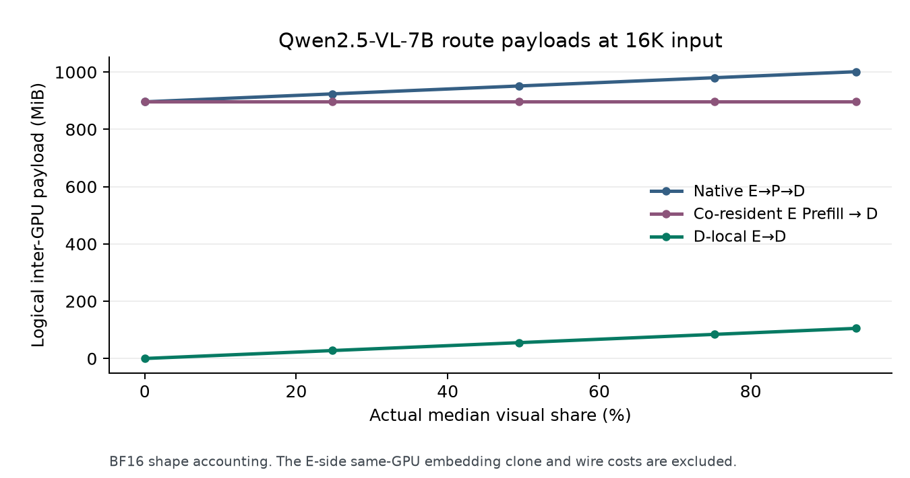

# Modality-specific opportunity in native EPD

The pinned Qwen2.5-VL-7B checkpoint exposes a real E→LM boundary and an ordered set of image embeddings. Its dense language decoder applies the same QKV, attention and MLP modules to visual and text rows. Changing the request recipient at that boundary can avoid moving prompt KV. The evidence below establishes geometry and dependencies. Any additional online gain from image boundaries, image count or partial embedding readiness remains a separate experiment. [Pinned checkpoint](https://huggingface.co/Qwen/Qwen2.5-VL-7B-Instruct/tree/cc594898137f460bfe9f0759e9844b3ce807cfb5) · [Prior mechanisms and negative results](mllm_epd_prefill_heavy_prior_work.md)

## Execution boundaries

| Boundary | Verified behavior | Consequence |
| --- | --- | --- |
| Encoder → visual embeddings | Qwen's vision branch projects to width 3,584 and splits one concatenated result by each image's processed grid and spatial merge factor. | Image items can be identified individually. Separating an encoder batch into independent launches changes batching geometry and must be measured. [Qwen implementation](https://github.com/vllm-project/vllm/blob/v0.26.0/vllm/model_executor/models/qwen2_5_vl.py#L1429-L1450) |
| Scheduled encoder groups → CUDA IPC | The installed V1 runner submits its scheduled vision groups, accumulates encoder outputs, then calls `save_caches` separately for each item. The original EC registry records an event on the producer stream and writes a host marker. Export waits on that event. A consumer imports, clones, synchronizes the clone and acknowledges ownership. | A query of the native per-item event measures transport readiness after encoder groups have already been submitted. Host marker publication, event completion and consumer clone completion are distinct. Intra-group order and earliest usable causal prefix cannot be inferred from marker order or API completion. [vLLM worker](https://github.com/vllm-project/vllm/blob/v0.26.0/vllm/v1/worker/gpu_model_runner.py#L3084-L3168) · [EC implementation](../mllm_epd_prefill_heavy_token_split/cuda_ipc_ec.py) · [Opt-in diagnostic](../mllm_epd_prefill_heavy_modality_discovery/image_ready.py) |
| Original request → ordered image identifiers | The renderer persists the original prompt, grid and ordered image identifiers, keyed by the SHA-256 of the runtime request ID. It checks the request fingerprint when a different LM worker loads the CPU handoff. | Join the observed CUDA Event's image identifier with the actual processed prompt manifest. Joining by image count, source path or client cohort position can misassociate an occurrence, particularly with repeated media or interleaved prompts. [Processor handoff](../mllm_epd_prefill_heavy_token_split/processor_handoff.py) |
| Encoder completion → whole-request decision | The current local-route proxy waits for the entire E HTTP response. It can send the unmodified request and its metadata to P or D. D-local executes original LM prefill and decode. P and the optional co-resident E helper export complete prompt KV for native D. | Whole routing preserves image order, MRoPE, all tokens and the original encoder. This path supports an actual matched comparison of placement after full readiness. The proxy cannot currently act at an earlier per-image readiness frontier. [Whole route](../mllm_epd_prefill_heavy_modality_discovery/local_route.py) · [E helper](../mllm_epd_prefill_heavy_modality_discovery/assist.py) |
| Visual prefix → LM suffix | The decoder retains original input order and needs preceding same-layer KV. A D-side suffix that starts within a visual span requires the correct sliced embedding rows, absolute visual positions and original image grid metadata. | Image cuts require page/row ownership and MRoPE verification. The earlier H200 slice-aware control found 7 KiB median extra E TX for the adjacent interior cut after removing unnecessary full-image clones. [Physical slice result](https://github.com/jyssys/MLLM-EP/blob/e5fdd1260179568da654ca2c83f37cd8f26c880e/poc_flashvep/reports/mllm_epd_h200_dynamic_slice_aware_final_summary.md) |

## Representation cost geometry

The real pinned model config gives width 3,584, 28 decoder layers, 28 query heads, four KV heads and head dimension 128, with sliding-window KV disabled. For `N` total prompt rows and `V` visual rows, BF16 embedding payload is `7,168 × V` bytes. Full-prompt KV payload is `2 × 4 × 128 × 2 × 28 × N = 57,344 × N` bytes. A hidden-state row at an LM layer boundary costs 7,168 bytes, while that single layer's K and V cost 2,048 bytes per row. Hidden state can be smaller than **all-layer** KV and 3.5× larger than **one layer's** KV. Generating missing KV from a hidden boundary still consumes exact layer compute and the preceding causal state. [Actual model config](https://huggingface.co/Qwen/Qwen2.5-VL-7B-Instruct/raw/cc594898137f460bfe9f0759e9844b3ce807cfb5/config.json) · [Current processor witnesses](../mllm_epd_prefill_heavy_modality_discovery/results/processor_witness.json)

| Route | Logical forward payload across GPUs | Execution cost outside geometry |
| --- | --- | --- |
| E→P→D | E→P embedding plus P→D complete prompt KV. | P scheduling, NIXL export and import, decode admission, optional last-query recomputation. |
| E→D-local | E→D embedding. | D scheduling and complete LM Prefill on D. Existing D decode may wait behind deflected chunks. |
| E→co-resident helper→D | Helper→D complete prompt KV. The E→helper embedding clone also reads and writes on the same GPU. | Additional full LM residency plus helper workspace and KV, shared SM/HBM with the original encoder, NIXL export and import. |
| E→P prefix and E→D suffix | Embedding portions to their consumers plus the exact prefix KV imported by D. | Remaining LM work, straddling visual items, source→destination KV ownership and synchronization. Full payload depends on selected rows and pages. |

| Measured CPU prompt cohort | Median LM rows | Median visual rows | Median E embedding MiB | Median complete KV MiB | Median native inter-GPU MiB | Median KV/embedding per request |
| --- | ---: | ---: | ---: | ---: | ---: | ---: |
| Main400, original natural inputs | 9,803.5 | 9,769.5 | 66.784 | 536.129 | 602.913 | 8.049× |
| Natural very-long N24 | 24,789.5 | 24,710 | 168.916 | 1,355.676 | 1,524.592 | 8.039× |
| 16K text-only control | 16,384 | 0 | 0 | 896.000 | 896.000 | undefined |
| 16K 50% visual target | 16,384 | 8,100 | 55.371 | 896.000 | 951.371 | 16.18× at representative shape |
| 16K 95% visual target | 16,384 | 15,390 | 105.205 | 896.000 | 1,001.205 | 8.52× at representative shape |

Natural rows report the median of actual prompt-level byte values. The controlled rows use one shape from each cohort's separately summarized input and visual medians. At fixed 16K length, logical prompt KV stays at 896 MiB as the visual share changes. Switching to D-local removes the full KV term even in the text-only control. The MLLM-specific term is the cost of sending the original visual representation to a different destination and the opportunity to do so at a different ready frontier. Destination-dependent placement needs to account for `E→P EC time + P→D KV time − E→D EC time` alongside the queue and compute differences. The current proxy's `(KV − embedding)/link_bandwidth` is a conservative scoring term when the native E→P embedding move is treated as overlapped or uncharged. At the default 20 GiB/s scoring coefficient, crossing the controlled 16K visual range changes the wire term by 5.14 ms. Compare that score shift with the policy's 25-ms minimum estimated savings. Physical link time and realized byte savings require independent observations. [Reproducible shape data](../mllm_epd_prefill_heavy_modality_discovery/results/representation_geometry.json) · [Current cost policy](../mllm_epd_prefill_heavy_modality_discovery/local_route.py)



At the same original 16K high-visual witness, actual CPU processor output was a 288,054,144-byte FP32 pixel tensor for 15,309 visual rows. Its logical BF16 merged embedding is 109,734,912 B and full KV 939,524,096 B. Original compressed media, preprocessed pixel volume, merged features, LM hidden state and full KV are different representations with different execution preconditions. Both E→LM paths use the already-computed merged embeddings. The intermediate vision states and compressed media can only substitute with additional computation. Paged block backing rounds natural prompts to 128 rows and yields median logical backing estimates of 539 MiB for Main400 and 1,358 MiB for Natural very-long N24. Connector counters are needed for actual wire bytes and arrival-to-clone time. [Processor witnesses](../mllm_epd_prefill_heavy_modality_discovery/results/processor_witness.json)

## Matched decisions and evidence

| Direction | Evidence available | Matched contrast and unresolved question |
| --- | --- | --- |
| A · Image-boundary split | In the 400 original audited prompts, all 357 repeated 8,192-row cuts fall strictly inside a visual span. The nearest preceding boundary moves those cuts back by median 459 rows and maximum 8,177 rows. In Natural very-long N24, all 64 cuts fall inside and the median shift is 437 rows. This is `DIAGNOSTIC` geometry from source spans. | Snap-induced changes to LM row counts and batch completion can account for apparent differences. Compare native mixed-item chunking, the supported `--disable-chunked-mm-input` path, and generic token and random legal boundaries at matched slice transport, realized row count and output. Current counts describe fixed offsets in a single request. Native continuous batching assigns variable per-request token budgets. [Scheduler source](https://github.com/vllm-project/vllm/blob/v0.26.0/vllm/v1/core/sched/scheduler.py) |
| B · Encoder-readiness-aware routing | Whole E-ready routing is available. The optional hook records a host-monotonic interval around actual existing CUDA Event completion and persists the ordered original processor map. Its event is recorded after queued vision group work. | Equalize earlier LM execution by comparing full-ready P/D routing, early causal Prefill with a fixed P, and early causal P/D selection. An item should change a practically usable decision before the whole request is ready after accounting for E batch efficiency and original KV/position state. RServe's implemented item-level causal gate is already a strong early-release comparator. [Proof of existing readiness protocol](https://github.com/gty111/gllm/blob/b1af757c6c9fb50443fe37460cd5066ae4c53f63/python/disagg/lm_manager.py#L992-L1049) |
| C · Representation-aware placement | Actual 16K geometry holds full KV at 896 MiB while E-side embedding payload ranges from 0 to 105.205 MiB. Main400 embedding size correlates with total KV because most input tokens are visual. | Use same E output, same cohort and selection, log actual destination bytes and NIXL activity. Preserving the original E while moving LM work may be valuable in absolute systems terms. The avoided P→D KV also exists for text PD. |
| D · Modality-aware selection | The current cost policy sees exact input length and visual count from the original E response. It makes the decision with existing HTTP queue state and predicts a native P-ready horizon. Separate 16K controls pair three larger images with many images at approximately the same visual and LM counts. Original natural long controls have 24 pairs, with median 5 vs 40 images and median paired LM length gap of 205 rows. | Use actual cost, queue and total LM geometry for the strong Generic policy. Add image count, resolution or observed ready intervals in a paired ablation only after calibrating their remaining predictive value and keeping decode protection and routing opportunity comparable. Whole request deflection from full E readiness has a direct project predecessor. [Workload pairs](mllm_epd_workload_modality_audit.md) · [Prior H100 whole routing](https://github.com/jyssys/MLLM-EP/blob/449c3e1873c65206435a6bb9411a889a62e55be7/poc_flashvep/reports/mllm_epd_whole_deflection_online_serving_v1.md) |
| E · Modality-aware axis selection | Prior split paths retain useful dependency and correctness lessons. A sound online comparison still requires an actual request-level, token-level or layer-level crossover. | A scheduling policy would add state and possible handoffs. An implementation becomes relevant after a measured crossover with real deadline-safe execution. |

The available text replay helper replays the observed **full** E-ready arrival times on the identical model in text mode. For a 16K MLLM control the text cohort can match length, output length, KV bytes, and offered P/D arrival spacing. Text replay has no image transfers and excludes E from the measured service boundary. In that control, the metric is arrival to P/D output. The corresponding MLLM metric must use E-complete to output on the same requests to avoid treating encoder time as a routing effect. This control alone leaves any difference between modalities in D-local routing unmeasured. [E-ready trace replay implementation](../mllm_epd_prefill_heavy_modality_discovery/replay.py)

The narrow surviving hypothesis is that an actual causal-ready item frontier gives a better P/D routing decision than realized LM geometry, measured stage state and full E-ready time. Geometry, existing execution paths and a timing diagnostic support how to test this hypothesis. N0 still requires a physically executed matched improvement. [Research gate](mllm_epd_prefill_heavy_modality_discovery_poc_spec.md) · [Source overlap and novelty audit](mllm_epd_prefill_heavy_prior_work.md)

## Reproduce geometry

Run the following in the worktree with Python and Matplotlib. Omit `--figure` for the standard-library JSON-only calculation.

```bash
ns=poc_flashvep/mllm_epd_prefill_heavy_modality_discovery
model=../mllm_epd_autosetup/hf_cache/models--Qwen--Qwen2.5-VL-7B-Instruct/snapshots/cc594898137f460bfe9f0759e9844b3ce807cfb5
python -m poc_flashvep.mllm_epd_prefill_heavy_modality_discovery.representation_geometry \
  --audit "$ns/results/workload_modality_rows.json" \
  --receipts "$ns/results/workload_receipts.json" \
  --config "$model/config.json" \
  --output "$ns/results/representation_geometry.json" \
  --figure "$ns/results/figures/d_side_representation_payloads.png"
```
