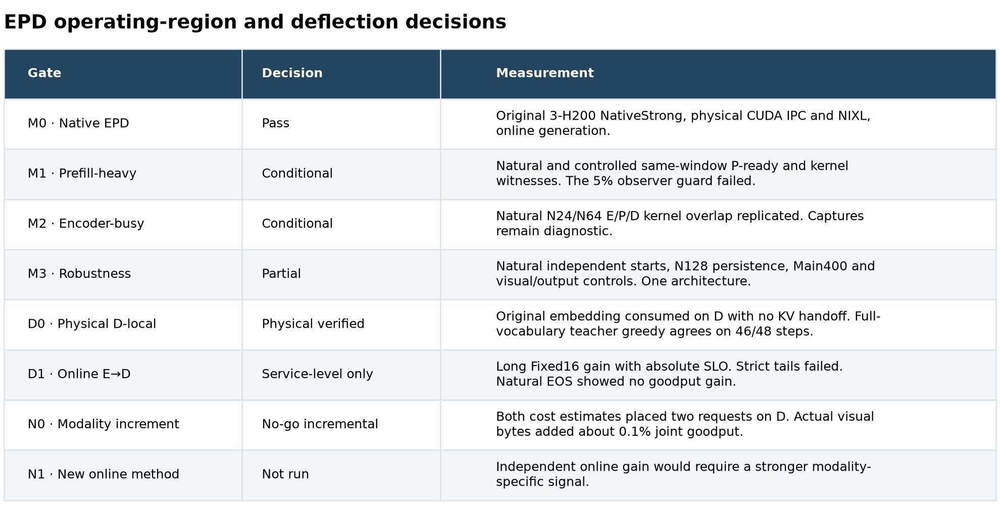

# MLLM EPD Prefill-heavy operating region

## 가장 강한 자연 워크로드에서 확인된 현상

Qwen2.5-VL-7B-Instruct BF16의 네이티브 1E/1P/1D를 H200 GPU 4/5/6에서 실행했다. 원본 문서 질문 24개가 포함된 Very-long 코호트의 LM 입력은 중앙값 24,790 token, 이미지 수는 중앙값 42.5장이다. Visual token 비중은 약 99.8%였다. Fixed16, offered QPS 1.465, B8192/S128, APC off, 42 GiB P/D KV에서 E와 P가 동시에 바쁘고 D가 한동안 비는 패턴이 나타났다.

| 실제 CUDA kernel 관측 | E busy | P busy | D busy | E busy ∩ P busy ∩ D idle | Observer |
|---|---:|---:|---:|---:|---|
| 원본 N24, 첫 시작 | 98.32% | 95.50% | 9.46% | 84.85% | DIAGNOSTIC |
| 동일 N24, 동일 shape priming 후 독립 재시작 | 97.20% | 95.06% | 9.17% | 83.64% | DIAGNOSTIC |
| 반복 N64, P만 scheduler 계측한 독립 재시작 | 90.04% | 89.91% | 9.55% | 72.61% | DIAGNOSTIC |
| 별도 원본 Upper N64, QPS 1.894, 48 GiB KV | 92.27% | 93.30% | 12.99% | 74.60% | DIAGNOSTIC |

각 실험은 하나의 동일한 clock-aligned 중앙 구간을 사용했다. 모두 Observer 5% 기준을 통과하지 못했다. 두 번째 시도는 clean TTFT p95 차이를 0.6%로 줄였고, TPOT p95 관측 편차 17.1%와 clean ITL p99 분산 26.6%가 남았다. Very-long N64에서도 TPOT p95 관측 편차는 20.2%였다. P-ready 관측은 중앙 창의 82.8%를 덮고, 그 창에서 Decode SLO 30/30, 전체 64/64를 달성했다. 48 GiB Upper의 관측 내 Decode SLO는 32/32였고, 두 unprofiled 실행의 전체 Decode SLO는 63/64와 62/64였다. 이 trace들의 수치는 재현된 P-heavy/E-busy 후보를 제시한다.

독립 E/P/D의 Very-long 처리율은 각 **1.716/1.221/20.160 req/s**였다. D의 기준은 실제 KV를 사전 생성한 B12 burst를 포함하며 Decode SLO를 보장하는 서비스율은 아니다. 동일 구간의 CUPTI 관측에서 P는 13회 샘플 중 약 76.1%의 시간 비중에서 compute-ready backlog를 보였다. P의 sampled KV allocation 거절은 앞선 trace에서 0/33, 반복에서 0/17이었다. 반복 관측 내 P-token rate는 매칭 B8192 독립 기준의 106.3%였다. 이는 유한 코호트 토큰 속도 비율이며 지속 가능한 처리율을 뜻하지 않는다.

튜닝에서 해당 Very-long의 가장 빠른 P 기준은 B16384의 1.256 req/s, 32,795 input tok/s였다. N64 P proximity는 이 기준에서도 95.8%였다. 실제 batch 1로 제한한 별도 D calibration은 6.841 req/s 및 24/24 절대 Decode SLO를 달성했다. 따라서 해당 입력에서는 SLO를 충족한 직렬 D 참조도 독립 P보다 처리율이 높았다.

Clean N64에서 64/64, N128에서 127/128이 절대 Decode SLO를 충족했다. 중앙 구간 E/P/D **SM activity**는 각각 약 88.9/81.4/5.3%, 86.6/91.8/6.0%였다. P의 최대 용량 대기 요청은 15와 21, D는 두 경우 모두 0이었다. TTFT p95는 17.0초와 30.1초였으며 joint 통과는 둘 다 9건이었다. 이 유한 overload의 queue growth는 P 병목에 부합하며 운영상 안정적인 용량이 아니다. N64/N128은 동일한 자연 요청의 반복과 별도 occurrence UUID를 사용했다.

Clean N128의 P tensor activity는 78.7%, DRAM 대역폭 활동은 16.2%였다. D의 평균은 각각 0.39%, 6.44%였고, D의 NVLink 수신은 1,822 MiB/s였다. 이 수치는 관측 창 평균이다. D가 실제 실행 중일 때 동시에 가져다 쓸 수 있는 공간 분할 자원이나 완료 가능한 prefill quantum은 별도 물리 실행에서 확인해야 한다.

이전 QPS2.5 Main100 Natural EOS의 70.10/83.38/50.58%도 Observer 미통과 진단이었다. 이번에는 이미지 수와 포스트프로세서 길이를 분리하고, 긴 원본 멀티페이지 요청에 실제 Fixed16을 적용했다. 현 캠페인의 별도 Natural EOS Main400 mixed N64에서 D SM activity는 45.2%였고 proxy request-free 비중은 21.4%였다. 따라서 Fixed16에서 보인 D 여유를 원래 응답 길이 분포 전반으로 일반화하기 어렵다. [운영 구간](mllm_epd_prefill_heavy_operating_region.md) · [Joint timeline](mllm_epd_encoder_prefill_joint_saturation.md) · [독립 처리율](mllm_epd_independent_stage_capacity.md)

원본 Main400 전체를 별도의 Native Natural EOS 조건에서 offered QPS 1.6으로 실행했다. 400/400이 joint SLO를 통과했고, TTFT p95 3.030초, TPOT p95 5.098ms, ITL p99 13.718ms였다. 중앙 E/P/D SM은 39.8/45.5/23.8%로 이 부하의 P에는 포화 근거가 없었다. 219초 동안의 유한 drain goodput은 1.826 req/s였다. 생성 종결은 EOS/stop 399건, 길이 제한 1건이었다. [Natural EOS 품질](mllm_epd_natural_eos_task_quality.md)

## 동일 LM 길이에서의 이미지 비중 조절

다섯 16K Fixed16 조건은 각 P 독립 기준의 1.12배를 제시했고, 모든 요청이 절대 Decode SLO를 충족했다. 0% 조건에서 같은 원본 MLLM LM이 텍스트만 실행했으며 E는 사용되지 않았다. 각 수치는 실제 clean NVML 중앙 구간의 장치 SM activity다.

| Visual 비율 목표 | Offered QPS | E SM | P SM | D SM |
|---|---:|---:|---:|---:|
| 0% (text-only) | 2.550 | 0.0% | 97.7% | 10.8% |
| 25% | 2.494 | 27.6% | 92.4% | 10.2% |
| 50% | 2.454 | 48.9% | 95.0% | 10.4% |
| 75% | 2.419 | 71.3% | 93.5% | 9.5% |
| 95% | 2.395 | 91.5% | 92.3% | 10.4% |

같은 16K와 비슷한 P 부하에서도 Visual 비중에 따라 E 부하가 크게 달라졌다. 50% 조건에서 실제 D SM은 Fixed16 10.4%, Fixed32 20.6%, Fixed128 61.3%로 바뀌었다. P-heavy/E-light, P-heavy/E-busy와 D 부하가 증가하는 음성 대조 현상이 장치 카운터에 각각 보였다. 공식 M1/M2는 같은 창에서 적격 kernel trace까지 요구한다.

25%의 실제 커널 진단에서도 E/P/D가 31.54/97.48/18.41%였고, P-ready 표본 비중 97.49%, D kernel-idle 및 proxy request-free 67.48%, 절대 Decode SLO 24/24였다. 이 R2 후보도 Observer 5% 기준을 넘겼다. 원본 이미지 24개와 LongBench text 24개를 섞은 별도 QPS 1.8 Fixed32는 첫 시작에서 P API disconnect 1건을 기록했고, 새 Runtime의 동일 trace에서 48/48 완료 및 joint SLO를 달성했다.

16K/Visual≈95% multimodal 실험의 실제 E 완료 간격은 p50/p95 324/606ms였다. 원래 client arrival의 236/537ms와 달랐다. 같은 checkpoint의 16K text-only 요청으로 정확한 E-ready offsets를 재생하자 P 제출 간격 325/606ms가 측정됐다. 같은 6.20초 준비 시계 창에서 MM/text-replay의 P 완료는 13/14건, D proxy request-free는 73.1/58.6%였다. 별도의 동일 nominal QPS Poisson text에는 실제 spacing 차이가 남는다. 이 비교는 E의 입력 시점 변환과 P/D 타이밍의 차이를 보여주며 modality-specific scheduling 이득의 증거 범위를 지정한다. [Text replay와 큐](mllm_epd_decode_idle_fragmentation.md)

## D-side의 실제 실행

N64 진단 중앙 창은 25.13초였다. D 커널이 없고 D proxy에 있는 요청도 없었던 연속 구간의 p50/p95/최대는 627/935/1,042ms였다. 원래 trace를 재생해 P-ready 표본이 있는 시작점을 찾는 **OFFLINE_ORACLE**에서 500ms는 24개 구간, 750ms는 10개, 1,000ms는 1개, 1,150ms는 0개에 들어갔다. 실제 inline naive D submit→첫 token의 p50은 1,149ms였다. D의 큰 총 유휴율과 긴 whole-prefill의 deadline 충족은 서로 다른 조건이다. [Idle window와 실행 비교](mllm_epd_decode_idle_fragmentation.md)

별도의 Native READ 관측은 각 N24 arm의 prompt KV 24건을 모두 원래 P export와 연결했다. 측정된 NIXL telemetry는 arm당 36,024,877,056 B였다. kernel profile과 함께 본 중앙 창에서 D kernel idle 91.35%, READ 가능 점유 범위 3.17%, 관측된 확정 outstanding 범위 0.88%였다. D kernel이 없고 계측된 READ 범위 밖인 시간은 88.18%였고, D proxy request-free도 포함하면 81.36%였다. 실제 Native transfer p50/p95는 27.66/34.39ms였다. 이 값은 기존 NIXL 호출의 READ 진행 구간이며 별도의 전송 엔진 전체 점유율과 deadline-safe 실행시간은 미확정이다. [NIXL 계측 범위](mllm_epd_decode_idle_fragmentation.md)

D에 이미 상주한 LM weight를 사용했다. 원본 E 임베딩을 D에서 GPU CUDA IPC로 복제한 뒤 D에서 전체 LM prefill과 Decode를 수행했다. Low-load N4에서 같은 prompt와 64/64 출력 token이 일치했다. 실제 E 임베딩 743,780,352 B는 그대로였으며, D 커넥터가 기록한 prompt KV import 5,996,806,144 B가 0 B로 줄었다. 네 요청의 D submit→첫 출력은 1.02–1.23초였다.

동일한 on-demand IPC 라우터 안에서 naive deflection은 자연 N24의 네 요청과 109,581 prefill token을 D에서 완료했다. TTFT p95 19.05→14.92초, joint goodput 0.034→0.119 req/s였고 TPOT p95 3.98→7.26ms, ITL p99 11.19→18.31ms였다. 절대 Decode SLO는 24/24, 엄격한 5% 비열화 기준은 실패했다. 이전 동일 코호트의 실용 NativeStrong 기준은 10.99초 TTFT p95여서 위 on-demand 비교로 NativeStrong 대비 개선을 확정할 수 없다. [네이티브 전체 요청 경로와 실험](mllm_epd_whole_request_deflection.md)

기존 one-shot inline CUDA IPC를 동일하게 적용한 비교에서는 NativeStrong 대비 naive E→D의 **TTFT p95가 10.519→7.486초(−28.8%)**, **joint goodput이 0.384→0.852 req/s(2.22배)**였다. 5/24 요청의 130,754 prefill token을 D에서 완료했고 NIXL prompt KV는 36.02→28.51 GB로 줄었다. 24/24 절대 Decode SLO를 통과했다. TPOT p95 4.50→6.37ms(+41.4%), ITL p99 11.33→22.88ms(+102.0%)로 strict 보호 기준을 통과하지 못했다. 24/24의 prompt ID가 일치했고 Fixed16 output은 22/24가 일치했다. 비용 기반 보수적 조건은 이 길이와 부하에서 0건을 선택했다.

동일한 여섯 요청의 전체 LM prefill을 물리적으로 E 또는 D에 배치하는 개입도 실행했다. 같은 E GPU의 추가 LM helper는 두 실험 모두 상주했다. E-local 대비 D-local은 TTFT p95 12.515→7.898초, joint goodput 0.129→0.711 req/s였다. 동일한 baseline/E-local/D-local의 E HTTP 서비스 p50은 3.694/6.843/1.950초였다. 세 경로 모두 24/24 절대 Decode SLO를 통과했다. D-local의 ITL p99는 16.85ms로 matched no-deflection의 6.33ms보다 높았다. E에 모델을 추가해 실행할 수 있었고, 이 워크로드에서는 E의 기존 Vision 서비스와 더 많이 경쟁했다. [동일 GPU 예산 E/D 개입](mllm_epd_encoder_vs_decode_assistance.md)

D 배치 토큰 예산을 4,096으로 낮춘 재시작에서 자연 Fixed16 N24 naive는 6건을 D로 보냈다. Native 대비 TTFT p95 10.602→7.928초, Goodput 0.431→0.685 req/s였다. TPOT p95 4.33→7.15ms, ITL p99 11.08→22.85ms였으며 절대 Decode도 21/24로 감소했다. D-local 종료까지 새 native decode를 기다리게 한 별도 제어는 23/24 절대 보호와 0.425 req/s를 기록했다. 이 스케줄러는 전체 local prefill이 끝날 때까지 D-local ownership을 유지한다. Batch budget만 줄였을 때 native decode가 작업 중간에 선점하는 동작은 검증 범위 밖이다.

또 다른 B8192 독립 시작의 반복 자연 N64에서도 부하와 입력을 고정했다. Native/naive/full-request isolation의 TTFT p95는 14.717/8.883/11.703초, Goodput은 0.131/0.354/0.210 req/s였다. Naive의 절대 Decode는 63/64였고 격리 제어에서는 64/64였다. 격리 제어의 ITL p99는 12.330→12.391ms로 5% 범위에 들었고, TPOT p95는 4.162→4.689ms(+12.7%)로 남았다. 전체 Fixed16 출력 일치는 61/64와 63/64였다.

Main400 mixed Natural EOS N64, QPS 2.955에서는 Native/naive TTFT p95가 3.557/3.613초, Goodput이 2.870/2.814 req/s였다. 6개를 D에서 수행하고도 전체 Goodput이 낮아졌고 TPOT p95는 5.12→6.74ms였다. 전체 출력 일치는 53/64, D-local 일치는 4/6이었다. [동일 입력·출력 계약의 경로별 비교](mllm_epd_whole_request_deflection.md)

동일 3-GPU의 Colocated DP3를 B8192와 B2048로 실행했다. 자연 Fixed16 N64에서 B2048의 TTFT p95는 3.628초, joint Goodput은 0.680 req/s로 EPD naive의 8.883초와 0.354 req/s보다 유리했다. Decode SLO는 28/64와 63/64, ITL p99는 각각 150.75ms와 21.54ms였다. Natural EOS N64에서는 DP3 B2048의 joint Goodput 1.793 req/s보다 Native EPD 2.870 req/s가 높았다. 각 DP3 복제본은 이미지 preprocessing과 원본 LM을 함께 실행하며, 동일 워크로드의 일정과 tokenizer 결과를 검증했다.

세 원본 요청에서 E 임베딩을 한 번 생성해 공유하고 152,064개 어휘 logits를 동일한 teacher prefix와 관측 MRoPE로 비교했다. Native A/A는 48/48 step bitwise, Native 대 D-local은 46/48 step greedy 일치와 0/48 bitwise였다. Mantis와 Very-long에서 한 step씩 argmax가 달라졌다. Very-long 재현은 실제 온라인 D-local과 같은 요청의 step 14였다. 최대 absolute logit 차이는 0.703125, 최대 relative L2는 0.0604였다. 첫 생성에는 Native D의 1-query graph와 D-local의 마지막 prefill chunk가 실제로 달랐다. 각 Logical Layer의 KV를 전수 비교해 오차 원인을 단리하는 검증은 남았다. [Teacher-forced logits](../mllm_epd_prefill_heavy_modality_discovery/results/teacher_logits/)

## Modality-specific 후보의 조건

Main400의 원래 400개 질문과 총 5,004개 이미지 occurrence를 회수하고 원본 hash와 processor manifest를 확인했다. 같은 16K LM 입력의 full KV는 896 MiB였고, visual ratio에 따라 E 임베딩은 0–105.2 MiB였다. Very-long 중간값은 약 169 MiB 임베딩 대 1,356 MiB 논리 KV다. MLLM 고유의 E 표현과 준비 시점은 관측 가능한 후보 변수다. Full-prompt KV handoff 제거 효과는 일반 PD의 D-local prefill에도 있다.

Main400에서 실제 8,192-token 반복 chunk 경계 357개가 모두 이미지 안에 있었고, 직전 이미지 경계로 이동 시 중앙값 459 token, 최대 8,177 token이 달라진다. 따라서 단순한 Image-boundary 실험은 작업량과 quantum이 달라질 수 있다. 표준 Dense LM 단계에서 Causal 순서 및 MRoPE를 보존하는지 확인하고, 작업량이 같은 강한 Generic 대조가 필요하다. [워크로드 감사](mllm_epd_workload_modality_audit.md) · [이미지 표현과 의존성](mllm_epd_modality_specific_opportunity.md) · [선행연구 및 공개 경로](mllm_epd_prefill_heavy_prior_work.md)

16K 혼합 Visual 비율, QPS 2.600의 실제 온라인 두 비용 기반 정책은 고정 코호트 평균과 실제 per-request Embedding 크기를 대조했다. 각 정책이 2/24을 D로 보냈고 Goodput은 2.319 대 2.322 req/s, TTFT p95는 4.487 대 4.502초였다. 실제 크기를 사용한 쪽의 TPOT p95는 5.98→7.13ms, ITL p99는 16.47→18.27ms였다. 두 정책 모두 NativeStrong과 Fixed16 출력 24/24가 일치했다. 해당 표현 항목의 독립적인 Online 증분 이득은 이 코호트에서 확인되지 않았다.

실제 E CUDA IPC event 873개를 원본 N24의 이미지 순서와 연결했다. 10/24에서 첫 이미지의 전송 준비가 전체보다 앞선다는 양의 하한을 관측했다. 그 하한의 p50/p95/최대는 0/85.7/96.1ms였다. 이것은 이미지 임베딩의 전송 준비에 대한 진단이다. Polling 오차, 실제 legal LM prefix 경계와 해당 시점에 P/D 실행을 시작하는 실험은 별도로 남는다. [실제 이미지 event와 readiness 범위](mllm_epd_decode_idle_fragmentation.md)

같은 H200 EPD의 과거 EADA, Memory Pool 연구와 지금의 E/P 동시 부하 문제는 서로 다른 병목이다. RServe와 gLLM 계열에서 E→P causal overlap이나 단계 준비의 구조가 이미 사용된다. 현재 자체 E→D whole-request는 일반 deflection의 실용 기준이며 이전 자체 H100 EPD 경로도 존재한다. 독립 후보가 될 수 있는 것은 부분 E-ready 시점에 legal causal prefix의 **소비자 위치를 선택**하여 동일한 Generic 기준보다 추가 이득을 실증하는 경우다. [Prior-work matrix](mllm_epd_prefill_heavy_prior_work.md)

## 게이트 판정

| Gate | 판정 | 근거 |
|---|---|---|
| M0 | Pass | 실제 H200 3개, 원본 BF16, CUDA IPC와 NIXL, 온라인 생성. |
| M1 | Conditional | 자연 및 16K 제어 조건에서 P-ready와 P service proximity를 같은 커널 관측 창에서 확인했다. 적격 Observer가 필요하다. |
| M2 | Conditional | 자연 N24 및 N64에서 E/P가 동시에 높고 D가 비는 구간을 반복 관측했다. 정량 교집합은 DIAGNOSTIC이다. |
| M3 | Partial | 독립 재시작, 반복 N128, 새 코호트 Main400, 입력·출력·이미지 비중 대조. 현재 검증 모델은 한 계열이다. |
| D0 | Physical verified, correctness limited | 실제 D-local prefill과 CUDA IPC 및 NIXL KV import 제거. 소수 low-load에서는 일치했고 teacher greedy는 46/48이었다. |
| D1 | Service-level only | Fixed16 장문에서 Native 대비 개선. Strict Decode 보호 및 Natural EOS 성능은 미통과다. |
| N0 | No incremental benefit | 같은 16K에서 실제 임베딩 크기 사용의 추가 Goodput은 약 0.1%였다. |
| N1 | NOT_RUN | 새로운 modality-specific online method의 개발·평가는 독립적인 증분 신호를 선행 조건으로 뒀다. |

- **Motivation** `CONDITIONAL_PREFILL_HEAVY_EPD`, encoder-busy 후보 포함.
- **D-side** `CONDITIONAL_D_LOCAL_PREFILL_OPPORTUNITY`, 장문 Fixed16·절대 SLO 범위.
- **Novelty** `NO_GO_INCREMENTAL`, 실측한 임베딩 바이트 항목의 범위.

## 우선순위와 미실행 범위

다음 검증 후보는 실제로 먼저 준비되는 **짧은 causal prefix**와 recipient 결정을 함께 묶는 것이다. 현재 N64의 원래 trace에서는 1.15초 whole-request quantum에 적합한 관측 창이 없었다. 먼저 동일 LM row 수에서 250–500ms 이하 실행 가능한 quantum, 정합한 dependency, 실제 readiness 선행 시간 및 Decode SLO를 같은 런타임에서 검증할 근거가 있다. Explicit cross-GPU Token/Layer split, 동일 row 수 random-boundary ablation, 다른 Dense MLLM, 4-GPU static allocation은 이번 캠페인의 미실행 범위다. 적격 Observer 및 작은 quantum에서의 독립적인 incremental benefit이 없으면 현재 결과는 serving operating region과 배치 절충에 관한 실증이다.

최종 재생 자료는 온라인 코호트 112개와 그 외 물리·정확도 실험을 포함한다. 실험 종료 후 승인된 `train_lm.py`가 GPU 0–7 모두에서 실행 중임을 확인했다. [GPU 복원 기록](../mllm_epd_prefill_heavy_modality_discovery/results/burner_restore.json)

[재현 명령과 증거 범위](../mllm_epd_prefill_heavy_modality_discovery/README.md) · [재생 가능한 raw captures](../mllm_epd_prefill_heavy_modality_discovery/results/raw_evidence/README.md) · [Figure A: Operating region](../mllm_epd_prefill_heavy_modality_discovery/results/region/figures/figure_a_operating_region.svg) · [Figure B: Joint timeline](../mllm_epd_prefill_heavy_modality_discovery/results/region/figures/figure_b_joint_timeline.svg) · [Figure C: Useful D opportunity](../mllm_epd_prefill_heavy_modality_discovery/results/region/figures/figure_c_decode_opportunity.svg)
