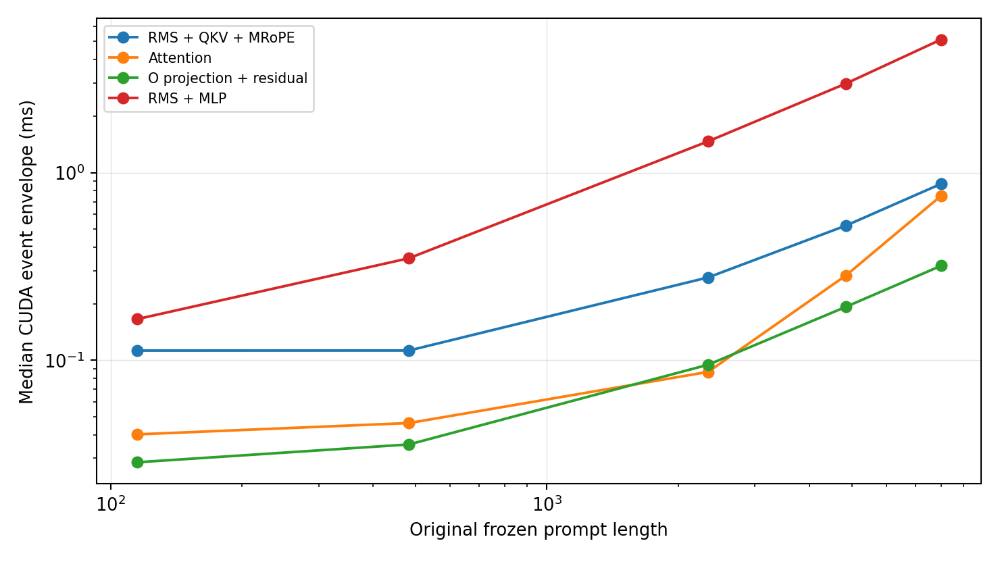
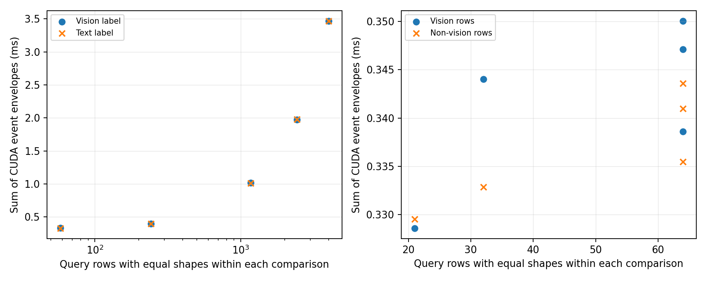

# Modality parallelism and GPU headroom

The measured dense layers show a useful **generic token-shape crossover** and no independent modality advantage at the prespecified 15% screening threshold. With actual Qwen2.5-VL activations, the strongest tested two-H200 generic cut reduced the two-layer communication-inclusive wall time by 35.5–46.6% on the three 2,343–8,007-token prompts. On 115- and 483-token reasoning/QA prompts it was 131.4% and 41.3% slower, respectively. The nearest image boundary changed wall time by −2.0% to +82.7% relative to the strongest generic cut. This comparison used the same two H200s. Positive deltas indicate higher latency.

## Dense operator measurements

Median GPU event envelope on layer 0. The full length is the original image-text prompt length. Hardware was GPU1/GPU2 connected through NV18, torch 2.11.0+cu129 and original model revision on BF16.

| Prompt | Input rows | Visual rows | RMS + QKV + MRoPE | Attention | O + residual | RMS + MLP |
|---|---:|---:|---:|---:|---:|---:|
| MMReason 896 | 115 | 21 | 0.112 ms | 0.040 ms | 0.029 ms | 0.165 ms |
| MathVista 849 | 483 | 340 | 0.113 ms | 0.046 ms | 0.036 ms | 0.350 ms |
| Mantis wc_22 | 2,343 | 2,262 | 0.276 ms | 0.087 ms | 0.095 ms | 1.469 ms |
| DocVQA 56399 | 4,851 | 4,819 | 0.522 ms | 0.283 ms | 0.193 ms | 2.987 ms |
| MMLongBench-Doc 658 | 8,007 | 7,935 | 0.871 ms | 0.752 ms | 0.319 ms | 5.123 ms |

The label-only control changed paired stage medians by at most 3.0% in absolute terms. The same-shape row-content control changed them by at most 6.5%, with vision rows slightly slower in the largest observed contrast. Across all five prompts, neither control produced the 15% stage reduction required to justify a modality-specific exact kernel or placement PoC. Mapping a different number of tokens across the two devices changes compute and causal attention geometry within the same dense operators.

The full-layer implementation is shared across visual and non-visual rows. Attention relevance and layer-wise ablations can still reveal signals for separate quality-controlled approximation work. This timing experiment tests the latency of exact dense execution at fixed shape, and cannot identify computation that is safe to skip.

## Experimental contract

The diagnostic uses two NVIDIA H200s, the frozen Tier1 subset and the first two original Qwen2.5-VL-7B decoder layers from revision `cc594898137f460bfe9f0759e9844b3ce807cfb5`. Each request begins with the original Hugging Face processor, BF16 vision tower and text embedding table. The runner checks the image files, expanded processor token IDs, image grids and MRoPE positions against the frozen input. The vision forward is performed during input preparation and excluded from dense-layer timing.

The full prompt uses its original arranged vision, text and special-token embeddings. The label-only control assigns two names to the same tensor, positions, sequence length and operator path. The content control compares up to 64 actual vision rows and the same number of non-vision rows extracted from the same prompt. Both receive the same compact MRoPE positions and attention geometry. These controls examine dense kernel response to row shapes and values. The compact control changes the model context deliberately and does not represent a semantically valid alternative input.

Each trial uses warmed weights and precomputed per-device input positions. Two-layer wall timing includes CUDA submission, real peer copies, cross-stream dependency events, and a join back onto the first device. Separate CUDA event envelopes on layer 0 measure RMS/QKV/MRoPE, attention, output projection and RMS/SwiGLU MLP. The envelopes can include launch gaps. All memory values are incremental allocator peaks above each arm’s resident baseline. Logical peer bytes count actual tensors passed to the peer-copy path and omit fabric protocol overhead. All timing is isolated GPU evidence.

The numerical comparisons separate causal correctness, same geometry across one/two devices and changes due to shape-dependent BF16 execution. The split uses contiguous global positions, original per-layer weights and exactly one causal computation per query. The prefix is checked independently by changing all suffix inputs. The cross-device result is checked against the same partition on one GPU and against full unpartitioned execution. Final logits, greedy decoding, task quality and server scheduling are outside this layer measurement.

## Reproduction and scope

The successful isolated run used five frozen grouped Tier1 requests, four warmups per arm, and 12 interleaved repetitions within one GPU lease. Tier1 manifest SHA-256 is `0db6489a4bc2108abe8776dc1af11d7f246478bd0efee63ddbaed43f9391f404`. The first launch stopped before timing because the pinned checkpoint stores its text config flat. The corrected run used the existing checkpoint and preserved the failed launch receipt.

The layer selection and single-step metric limit generalization to full-model EPD. Inputs for the real-content control have 21–64 rows and cover the measured values and shapes. They do not establish a bound for all possible inputs or GPU regimes. The `ISOLATED_GPU_MEASUREMENT` includes no quality or online-serving evidence. The independent modality improvement gate was unreached on these measurements.

[Source](../mllm_specific_disaggregation_discovery/dense_parallel.py) · [Raw samples](../mllm_specific_disaggregation_discovery/results/b3/raw_h200_dense_two_gpu.json) · [Kernel CSV](../mllm_specific_disaggregation_discovery/results/b3/segments.csv) · [Control deltas](../mllm_specific_disaggregation_discovery/results/b3/controls.json) · [Placement PoC](mllm_understanding_reasoning_disaggregation_poc.md)
