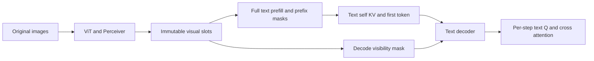
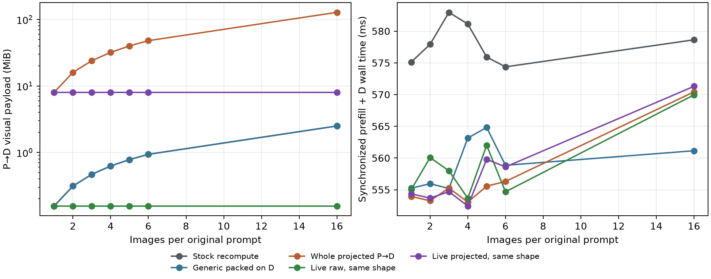
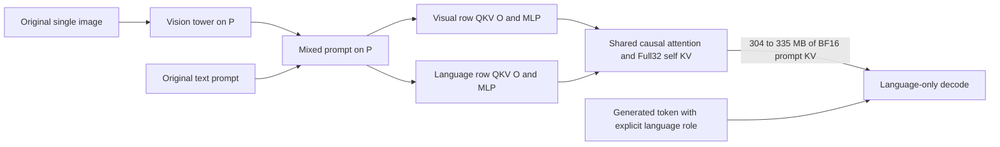

# 모달리티별 상태와 연산의 실행 그래프

IDEFICS에서 시각 K/V의 단계 경계를 실제 두 H200에서 검증했다. 기본 HF 재계산 대비 요청 단위 wall time은 범용 projection cache로 약 3% 감소했다. 시각 K/V를 P에서 직접 넘기거나 활성 슬롯만 보내는 경로는 강한 범용 cache의 실행 시간을 추가로 개선하지 못했다. CogVLM2는 Decode에서 도달하지 않는 expert weight를 제거해 같은 역할 제약을 쓰는 범용 분석과 동일한 메모리 절감을 얻었다.

## IDEFICS 9B의 단계 경계

| 단계 | 원본 실행 경로 | 다음 단계에 필요한 상태 |
|---|---|---|
| E | CLIP ViT-H의 이미지별 encoding과 Perceiver resampling | 이미지당 64×1,280 BF16 latent |
| P | 32개 자기 어텐션 블록과 4개 블록마다 배치된 8개 gated cross-attention 블록 | 전체 text-prefix의 자기 어텐션 KV, 첫 greedy token, visual latent 및 image mask |
| D | 매 text token마다 자기 어텐션 KV를 갱신하고 8개 cross-attention을 실행 | text query와 별도로 유지되는 이미지 source, Decode에서 활성인 image mask |

공개 `HuggingFaceM4/idefics-9b-instruct` revision `7065afb8a5bb03015700b315f6751dc3dd4e16eb`을 고정했다. 두 원본 safetensors의 SHA-256을 publisher LFS metadata와 비교했다. Hub 공개 접근과 이용 조건을 구분한다. 모델 카드는 기반 Llama에 연구용 비상업 라이선스를 안내하며, 별도로 학습한 연결 가중치에 MIT를 명시한다. [고정 모델 카드와 이용 조건](https://huggingface.co/HuggingFaceM4/idefics-9b-instruct/blob/7065afb8a5bb03015700b315f6751dc3dd4e16eb/README.md) [고정 모델 설정](https://huggingface.co/HuggingFaceM4/idefics-9b-instruct/resolve/7065afb8a5bb03015700b315f6751dc3dd4e16eb/config.json)

IDEFICS의 cross-attention Q는 해당 text row에서 다시 계산된다. Key와 value는 불변 image latent에서 투영하므로 request lifetime 동안 재사용할 수 있다. H200에 설치된 HF Transformers 5.16.1의 `IdeficsModel.forward`는 cross-block에 `past_key_values=None`을 전달한다. `IdeficsAttention.forward`는 여기서 K/V와 K RMS normalization을 모든 query forward에서 계산한다. Processor는 마지막으로 등장한 이미지의 슬롯 하나를 row마다 활성화하며, 기본 generation에서도 마지막 prompt row의 마스크를 반복한다. Prefix에서는 앞선 이미지에 접근했던 실제 query가 있으므로 모든 prefix slot과 text KV를 유지했다. Decode의 고정 mask에서 가려진 영상 slot만 전송 전에 줄인다. Mask가 0으로만 구성된 입력에는 원래 dense 경로를 유지한다. [HF IDEFICS 실행 소스](https://github.com/huggingface/transformers/blob/main/src/transformers/models/idefics/modeling_idefics.py) [HF IDEFICS processor](https://github.com/huggingface/transformers/blob/main/src/transformers/models/idefics/processing_idefics.py)

Image slot 하나의 raw payload는 64 × 1,280 × 2 = 163,840 B, projected K+V는 8 × 2 × 64 × 4,096 × 2 = 8,388,608 B다. 이 값은 논리 tensor payload다. Cross-block의 gated FFN과 유효한 text query의 cross-attention은 각 step에서 실행한다. Query별 image mask에서 사용할 수 있는 동일한 슬롯 집합을 받아 일반적인 immutable typed state를 압축하면 image label 없이 같은 실행을 얻는다.

Projection은 슬롯당 P→D payload를 51.2배 늘린다. 전체 raw slot을 보내는 경로와의 byte break-even은 원본 슬롯 수를 활성 슬롯 수로 나눈 값이 51.2보다 클 때다. 활성 raw slot을 보내는 경로에서는 이 비율 조건이 사라진다. P에서 projection을 옮겼을 때의 이득은 실제 K/V를 만든 시간, packing, 전송, masked layout 복원까지 포함한 실행 비용으로 판단한다.

## 비교할 실체와 적용 범위

| 비교군 | P→D visual payload | D의 immutable source 처리 |
|---|---|---|
| Native Recompute | 전체 raw slot | 원래 별개 K/V projection과 K norm을 매 forward 실행 |
| Generic Memoized | 전체 raw slot | 원래 projection과 post-norm K/V를 최초 D 호출에서 한 번 유지 |
| Generic Packed | 전체 raw slot | 고정 weight를 pack한 1회 projection과 최초 D 호출의 K norm |
| P-projected | 전체 post-norm K/V | 원래 P 계산에서 얻은 K/V를 재사용 |
| Generic Visibility | 실제 decode mask가 참인 raw slot | portable mask compaction과 packed projection 후 재사용 |
| P-projected Visibility | 실제 decode mask가 참인 post-norm K/V | P의 실제 계산에서 capture한 K/V의 선택된 부분만 전송 |
| Generic Visibility Same Shape | 실제 decode mask가 참인 raw slot | D에서 projection한 뒤 원래 SDPA 위치의 masked slot을 zero로 복원 |
| P-projected Visibility Same Shape | 실제 decode mask가 참인 post-norm K/V | 적격 K/V를 원래 SDPA 위치에 두고 masked slot을 zero로 복원 |

두 H200에서 동일 체크포인트를 사용한다. E와 P를 첫 번째 GPU에 두고 실제 peer copy 뒤 둘째 GPU에서 frozen baseline의 같은 token prefix를 실행한다. Early image row를 삭제하지 않으므로 P와 전달하는 자기 어텐션 KV는 보존한다. Full logits와 모든 self-KV layer를 비교한다. CUDA event는 enclosing GPU stream 범위이고 peer-copy wall은 할당과 동기화를 포함한다. 구성상 단일 요청 진단이며 open-loop E/P/D online serving은 별도 경계다. [실험 코드](../mllm_architecture_first_disaggregation_discovery/idefics_cross.py)

## 최초 H200 smoke

문서 VQA, Mantis-Eval, MMMU, 장문 문서에서 원본 이미지 1/2/4/16장의 요청을 각 두 번 실행했다. 설치된 백엔드의 전체 pixel 입력과 E를 분리한 경로의 첫 prompt logits가 일치했다. Decode의 8개 고정 native teacher step에서 Native Recompute, Generic Memoized, Generic Packed, 전체 P-projected 경로 모두 각 8/8 trial의 logits와 256/256 layer 검사에서 최종 self-KV가 bitwise 일치했다.

Decode visibility shape를 줄이는 두 경로의 logits는 각각 6/8 trial에서 bitwise 일치했다. 16장 MMLongBench-Doc `984`의 두 반복에서 각각 최종 self-KV 12/32개 층만 bitwise 일치했다. 최대 logit 차이는 0.140625이고 고정 greedy는 8/8 step 일치했다. 16→1 슬롯 전송과 SDPA key shape 축소가 동시에 적용된 결과다. 16→1 전송을 유지하고 원래 key 축을 복원한 실험에서 두 효과를 분리한다. [요청별 실험 재생성](../mllm_architecture_first_disaggregation_discovery/idefics_summary.py)

## IDEFICS 24-request H200 profile

고정 Discovery 24건의 실제 이미지를 사용했다. 이미지 개수는 1장이 14건, 2·3·5·6장이 각 2건, 4·16장이 각 1건이었다. 원래 processor의 마지막 mask는 24건 모두 one-hot이었고 text prompt는 22–271 tokens였다. 8개 경로, 각 3회, 동일 원본 greedy trajectory에서 32 고정 steps를 실행했다. 총 576개 trial 측정에 warm-up을 넣지 않았다. 출발 GPU P가 실제 forward에서 저장한 post-norm K와 V는 목적지 GPU D의 독립 원래 projection과 각각 192/192 층에서 정확히 일치했다. [요청별 이미지 mask와 state 검사](../mllm_architecture_first_disaggregation_discovery/results/idefics/mask_geometry.csv)

| 경로 | 실행한 D K/V GEMM / K norm per trial | P + D wall 중앙값 | 정확한 전체 logits trial | 확정한 greedy step |
|---|---:|---:|---:|---:|
| Native Recompute | 512 / 256 | 577.92 ms | 63/72 | 2,304/2,304 |
| Generic Memoized | 16 / 8 | 558.16 ms | 63/72 | 2,303/2,304 |
| Generic Packed | 1 / 8 | 556.55 ms | 63/72 | 2,304/2,304 |
| 전체 P-projected | 0 / 0 | 554.49 ms | 63/72 | 2,303/2,304 |
| 활성 raw + compact shape | 1 / 8 | 558.61 ms | 51/72 | 2,302/2,304 |
| 활성 projected + compact shape | 0 / 0 | 554.80 ms | 51/72 | 2,304/2,304 |
| 활성 raw + 동일 shape | 1 / 8 | 555.94 ms | 63/72 | 2,304/2,304 |
| 활성 projected + 동일 shape | 0 / 0 | 554.81 ms | 63/72 | 2,304/2,304 |

Native A/A도 24건 중 MathVista `353`, MMMU `Math_19`와 `Public_Health_2`에서 각각 세 반복의 logits가 달랐다. 첫 P의 logits는 모든 경로·반복에서 일치했다. Native의 D 최대 logit 차이는 0.6875였다. Native A/A의 logits·KV가 모두 일치한 21건을 별도 진단하면 두 동일 shape 경로는 각각 63/63 trial logits와 2,016/2,016 최종 self-KV layer에서 일치했다. Compact shape 두 경로는 각각 51/63 trial, 1,692/2,016 layer였다. 이 진단은 수치 원인 분리에 사용했고, 성능 비교에는 전체 24건을 사용했다. [전체 정합성 및 실행 설정](../mllm_architecture_first_disaggregation_discovery/results/idefics/summary.json)

요청별 세 반복의 중앙값으로 계산한 P + D wall 변화는 Generic Memoized −3.27% [−3.71%, −2.63%], Generic Packed −3.17% [−4.01%, −2.67%]였다. 기준은 Native Recompute다. 전체 P-projected와 Generic Packed의 차이는 +0.09% [−0.28%, +0.58%], 동일 shape projected와 동일 shape raw의 차이는 −0.12% [−0.58%, +0.43%]였다. 다중 이미지 10건의 후자 차이는 −0.30% [−0.64%, +0.05%]였다. 구간은 요청 단위 bootstrap 95%다. Packed weights는 D에서 160 MiB를 추가해 초기화 시 한 번 만들었다. 성능 측정은 단일 요청과 고정 step이며 client TTFT·ITL과 별도다. [측정 전체와 bootstrap 요약](../mllm_architecture_first_disaggregation_discovery/results/idefics/summary.json)

## 16장 shape 복원 인과 비교

원본 text prompt 64 rows의 `984`에서 이미지 1–15는 P에서 각 2 rows에 노출되고 마지막 이미지는 30 rows에 노출됐다. Decode에서는 마지막 이미지만 보였다. 32-step 재시험에서 shape를 16→1로 줄인 raw·projected 전송은 첫 반복에 최대 logit 차이 0.250, greedy 32/32 일치 및 최종 self-KV 0/32 층 bitwise 일치를 보였다. Native A/A와 전체 K/V projection 전송은 같은 요청에서 모든 반복 bitwise였다. Raw·projected 동일 shape 경로 두 개 모두에서 같은 16→1 전송량으로 축소한 뒤 원래 attention key 축과 mask를 복원하자 첫 반복의 logits와 32/32 self-KV가 정확히 일치했다. 이 통제에서 compact 경로의 수치 변동은 슬롯 전송량보다 attention 형상과 연결됐다.

| `984` 경로 | 실제 visual logical MiB | Visual peer-copy wall 중앙값 | P + D wall 중앙값 | D의 지속 cross K/V storage |
|---|---:|---:|---:|---:|
| 전체 raw + Generic Packed | 2.500 | 0.042 ms | 561.15 ms | 128 MiB |
| 전체 P-projected | 128.000 | 0.373 ms | 570.44 ms | 128 MiB |
| 활성 raw + compact shape | 0.156 | 0.030 ms | 556.80 ms | 8 MiB |
| 활성 raw + 동일 shape | 0.156 | 0.030 ms | 569.96 ms | 128 MiB |
| 활성 projected + 동일 shape | 8.000 | 0.053 ms | 571.31 ms | 128 MiB |

동일 shape에서 visual raw transfer를 93.75% 줄였고, 확인한 요청에서는 attention의 장치 내 K/V storage가 128 MiB로 유지됐다. 표의 경로 시간은 E를 제외한 두 단계의 합으로 P의 추가 packing 비용도 포함한다. Peer-copy에서 얻은 실제 시간과 물리 link byte를 각각 구분한다. Byte 열은 성공한 원본 GPU tensor 복사의 logical 크기이며 NVLink hardware byte는 별도 계측이 필요하다. [H200 per-trial CSV](../mllm_architecture_first_disaggregation_discovery/results/idefics/trials.csv)

## Deterministic 수치 재확인

Native A/A 차이가 있었던 MathVista `353`과 compact geometry에서 차이가 있었던 16장 MMLongBench-Doc `984`를 다시 실행했다. 같은 BF16 checkpoint, GPU 5/6, 동일 입력과 32 고정 steps를 사용했다. `torch.use_deterministic_algorithms(True)`와 `CUBLAS_WORKSPACE_CONFIG=:4096:8`을 별도 실행에서 적용했다. 8개 경로를 3회씩 실행해 전체 logits 48/48, 최종 self-KV 1,536/1,536 층, 1,536/1,536 greedy step이 bitwise 또는 token 단위로 각각 일치했다. 이 두 요청에서는 compact shape의 차이도 재현되지 않았다. 일반 runtime의 실패는 그대로 기록했다. [별도 실행 및 command log 해시](../mllm_architecture_first_disaggregation_discovery/results/idefics/summary.json)

Native P + D wall 중앙값은 일반 실행 대비 MathVista `353`에서 572→909 ms, MMLongBench-Doc `984`에서 579→906 ms로 증가했다. 두 별도 실행의 비교는 연구용 재현성 통제의 비용을 보여준다. 일반 serving 성능과 자연 EOS의 추가적인 결론은 얻지 않았다.

## 후보 구조와 기본 제공 캐시

| 체크포인트 | 고정 revision | 공개 접근 및 구조 |
|---|---|---|
| [IDEFICS-9B Instruct](https://huggingface.co/HuggingFaceM4/idefics-9b-instruct) | `7065afb8a5bb03015700b315f6751dc3dd4e16eb` | 공개 체크포인트. Full32 causal LM과 8개 분리된 vision cross-attention |
| [OpenFlamingo-3B Instruct](https://huggingface.co/openflamingo/OpenFlamingo-3B-vitl-mpt1b-langinstruct/tree/656bbbcd4508db84ccc83c02361011c6fe92ae93) | `656bbbcd4508db84ccc83c02361011c6fe92ae93` | 공개 체크포인트. 원본 loader는 언어·vision base와 추가 Flamingo weight를 별도로 로드 |
| [Llama 3.2 11B Vision](https://huggingface.co/meta-llama/Llama-3.2-11B-Vision-Instruct) | `9eb2daaa8597bf192a8b0e73f848f3a102794df5` | publisher 승인 필요. Mllama는 cross-state가 있으면 K와 V를 cache에 갱신하고 이후에 재사용 |
| [Florence-2 large-ft](https://huggingface.co/microsoft/Florence-2-large-ft/blob/4a12a2b54b7016a48a22037fbd62da90cd566f2a/config.json) | `4a12a2b54b7016a48a22037fbd62da90cd566f2a` | 공개 encoder–decoder. BART형 decoder의 source는 vision과 text를 함께 encoder한 상태 |
| [Granite Vision 3.2 2B](https://huggingface.co/ibm-granite/granite-vision-3.2-2b/resolve/ec894191f2e9e9be3d90eab9ac6949583c46f03b/config.json) | `ec894191f2e9e9be3d90eab9ac6949583c46f03b` | 공개 LLaVA-NeXT 계열. Projection 결과를 LLM input embedding으로 결합 |

Mllama의 Transformers 구현은 visual state와 해당 cache가 모두 비어 있는 text-only 입력에서 cross-attention block 전체를 건너뛴다. Pix2Struct같은 encoder–decoder 런타임은 이미 정적 cross K/V를 보존한다. 설치된 vLLM에는 IDEFICS3 모델 경로가 있었고, 현재 IDEFICS 1 체크포인트는 동일 인터페이스에서 찾을 수 없었다. ModServe 공개 구현의 지원 모델에는 Mllama와 InternVL이 있다. 비교군은 IDEFICS 1의 원래 재계산 경로와 직접 구현한 강한 cache 경로를 포함한다. [Mllama 실행 소스](https://github.com/huggingface/transformers/blob/main/src/transformers/models/mllama/modeling_mllama.py) [Pix2Struct 실행 소스](https://github.com/huggingface/transformers/blob/main/src/transformers/models/pix2struct/modeling_pix2struct.py) [ModServe 지원 모델](https://github.com/Azure/ModServe#supported-models)

## CogVLM2의 hard expert와 shared KV

CogVLM2 `f592f291cf528389b2e4776b1e84ecdf6d71fbe3`의 `get_expert_mask`는 현재 row와 다음 row의 role이 모두 vision일 때 vision expert를 선택한다. 현재 prompt 끝 row는 language expert다. 원래 QKV·output projection과 MLP는 동일한 row mask를 사용하며, RoPE가 적용된 KV와 causal attention은 두 role에 공통이다. 모델의 generation hook은 생성 token ID와 별도로 `LANGUAGE_TOKEN_TYPE`을 추가한다. `get_expert_mask`와 D contract가 유지되는 동안 Decode에 vision expert weight를 상주시킬 필요가 없다. 이미 P에서 만든 vision origin의 shared self-KV는 D에 그대로 전달한다. [고정 CogVLM2 실행 소스](https://huggingface.co/zai-org/cogvlm2-llama3-chat-19B/blob/f592f291cf528389b2e4776b1e84ecdf6d71fbe3/modeling_cogvlm.py)

H200 smoke의 DocVQA에 prompt 2,322 rows, vision placeholder 2,306 rows, 실행된 vision expert 2,305 rows가 있었다. Full32의 8 heads × 128 head dimension self-KV를 이동한 뒤 K/V 64 tensors가 모두 값 단위로 일치했다. Full resident D 대비 expert를 제거한 D의 weight residency는 약 27.96→14.96 GiB였다. Generic zero-row 구조 분석도 어떤 role 이름을 읽을지에 의존하지 않고 같은 192개 tensor를 제거한다. [CogVLM2 실험 코드](../mllm_architecture_first_disaggregation_discovery/hard_expert_decode.py)

Deterministic H200의 12-request repeat에서 visual pruning과 generic reachability pruning은 동일 계산의 resident fast-D 대비 각각 teacher logits 12/12, Natural의 누적 prefix logits 12/12, 최종 self-KV layer 384/384가 일치했다. 실제 ragged Batch4의 16개 teacher logit도 일치했다. 일반 runtime의 부동소수점 변동은 별도로 기록했다. 원본 text-only prompt 19 rows에서는 vision role 0 rows, 전달한 K/V 64/64 tensor와 모든 비교군의 logits가 일치했다. 동일 메모리 예산의 고립 할당 시험에서 두 pruning 경로는 149개 KV slot을 확보했다. Resident 경로는 110개였다. 실제 ragged Batch4에서는 resident fast-D, visual pruned-D, generic pruned-D가 각각 45.68, 45.92, 45.71 ms/step이었다. 이 시험에서 expert 제거의 효과는 D의 weight residency와 KV 수용량으로 나타났다. [CogVLM2 liveness와 수치 결과](mllm_modality_parameter_state_liveness.md)

## ERNIE의 별도 FFN bank와 공유 Attention

ERNIE-4.5-VL-28B-A3B-Thinking의 installed vLLM은 이미지 embedding으로 대체한 실제 row를 mask로 표시한다. Mixed prompt에서는 각 layer의 두 FusedMoE bank가 Text/Visual subrows를 받아 각자 Top-6를 선택한다. Decoder의 self-attention과 prefix state는 공유 경로다. Vision Encoder와 Resampler는 4개 이미지 요청에서 각각 1회만 호출됐다. 4개 모두 Mixed Prefill에서 Visual FFN 27회, subsequent Decode 11 forward 각각 0회였다. 별도 text-only prompt의 P와 D는 모두 Text FFN bank를 사용했다.

Native의 마지막 실제 DocVQA prompt에서 Prefix를 원래 모델로 계산하고, 다음 D부터 dormant bank의 81개 Parameter binding을 제거했다. 모든 사용 가능한 공유 Weight와 KV를 유지하고 visual bank 재진입 guard를 설치한 채 12/12 Greedy output ID가 일치했다. 이 관측은 별도 D 프로세스 또는 Native PD serving과 독립인 한 장비에서의 Scope diagnostic이다. [고정 체크포인트](https://huggingface.co/baidu/ERNIE-4.5-VL-28B-A3B-Thinking/tree/e7487b6ff5e726e21bb8bcf9af83b34a82fcdaae) · [실제 Native 출력과 CUDA Stream 시간](../mllm_architecture_first_disaggregation_discovery/results/ernie45vl/native.json)
