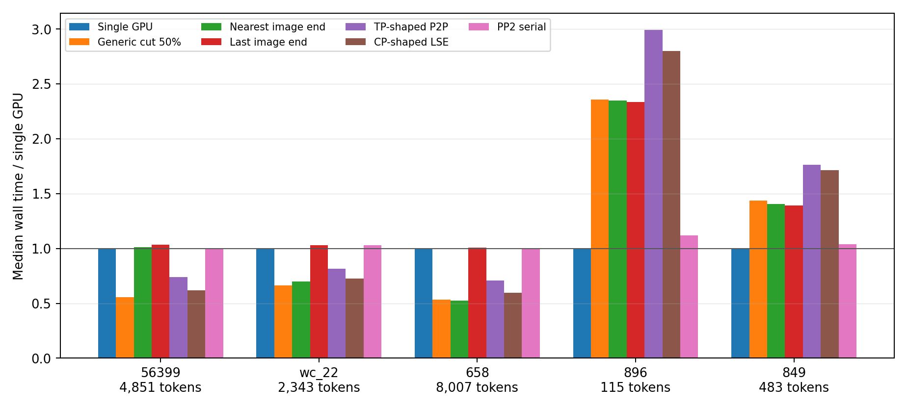

# Understanding and reasoning disaggregation PoC

The real two-GPU causal path works at the layer level. At the same cut, the local and cross-GPU states were elementwise equal on all five prompts. The independently measured nearest image boundary gave no ≥15% incremental wall-time or maximum-rank working-memory improvement over tested generic cuts. Putting the complete visual prefix on one GPU and the remaining prompt tokens on the other was substantially slower on the three longer prompts. The semantic placement hypothesis stays on hold for serving. The results support a generic length-based device decision under the measured geometry.

## Two-layer comparison

Cells show median wall time in milliseconds over 12 randomized, paired repeats within one warmed epoch. The generic result is the fastest median among the tested 46/50/54% cuts. The boundary and generic span all rows, use identical weights and run on the same two GPUs. The single-GPU arm gives a crossover reference. The PP/TP/CP alternatives describe the isolated implementations below.

| Prompt | Rows | Single GPU | Generic | Nearest image end | Last image end | PP2 | TP-shaped | CP-shaped |
|---|---:|---:|---:|---:|---:|---:|---:|---:|
| MMReason 896 | 115 | 0.606 | 1.410 | 1.423 | 1.416 | 0.678 | 1.814 | 1.696 |
| MathVista 849 | 483 | 1.044 | 1.481 | 1.468 | 1.451 | 1.083 | 1.840 | 1.787 |
| Mantis wc_22 | 2,343 | 3.872 | 2.501 | 2.700 | 3.985 | 3.978 | 3.148 | 2.806 |
| DocVQA 56399 | 4,851 | 8.394 | 4.660 | 8.495 | 8.688 | 8.414 | 6.214 | 5.194 |
| MMLongBench-Doc 658 | 8,007 | 14.271 | 7.623 | 7.505 | 14.399 | 14.249 | 10.115 | 8.485 |

For the 8,007-token, 21-image request the selected image end was at row 4,129, near generic row 4,004. It gave 7.505 ms versus 7.623 ms, a 2.0% reduction by median paired ratio. Moving the label off the same 4,129-row cut preserved the computation and output elementwise. The 4,851-token single-image request could use only the image end at row 4,834. That cut lowered logical peer bytes from 26.05 to 19.00 MiB while increasing maximum-rank incremental allocation from 437.94 to 844.77 MiB and paired wall time by 82.7%. Reducing transfer bytes alone did not compensate for loading almost the entire prompt on one rank.

At the near-midpoint 8,007-token geometry, generic KV transfer moved 43.00 MiB across the two measured layers including the final gather, compared with 137.68 MiB for the measured CP-shaped arm and 437.88 MiB for the TP-shaped arm. These are logical copied tensor bytes. Full-model process-resident memory and any request admission or paged KV savings remain unmeasured.

## Correctness evidence

- Cross-GPU and local equal-shape generic cut values matched elementwise on 5/5 prompts. The image-boundary arm and the same-cut label-off arm also matched on 5/5.
- Flipping all suffix input rows left every prefix output element unchanged and changed more than 99.90% of suffix output elements in all five cases. The measured prefix preserves forward causality.
- Against the full one-GPU model slice, maximum Relative L2 was 0.156% for the 50% generic cut, 0.178% for the nearest image boundary, 0.251% for CP-shaped merging and 0.426% for TP-shaped reductions. The PP2 control matched unpartitioned execution elementwise in all cases. Shape changes and reduction order can change BF16 values despite exact causal work.
- The findings cover two real decoder layers. The production strict Full28 KV, greedy and quality gates remain unevaluated by this diagnostic.

## Experimental contract

The PoC isolates the possible hardware mechanism. The “last image end” policy places the full causal prefix through the last visual span on GPU0 and following prompt tokens on GPU1. The near-balanced image-boundary policy chooses one of the three image-span ends nearest the midpoint. Generic placement tests 46%, 50% and 54% contiguous cuts with the same two devices, full weights, BF16 kernels, transport, synchronization and final output location. Retiming the identical boundary position without an image label provides an exact candidate and geometry control.

For all contiguous policies, the prefix GPU exports the layer’s real four-head causal K and V; the suffix GPU concatenates these with its local K and V and uses FlashAttention3 with the bottom-right triangular mask. Prefix queries never access suffix K/V. Both partitions run the original QKV, output projection and MLP for every local row and retain their hidden states on their own device between layers. The timed scope starts with those input embeddings already available and excludes any production E-to-P descriptor, KV ownership and scheduler overhead.

Matched-resource alternatives include serial PP2 layer placement, TP-shaped head/MLP partition with explicit BF16 partial exchanges over peer copies, and CP-shaped context partition with exact causal partitioning and log-sum-exp merging. TP uses peer copies and local sums in one process, so its performance cannot stand in for stock NCCL or vLLM TP. PP has a single request with no inter-request overlap. The CP arm computes suffix attention to the full prefix on the prefix GPU and to the local suffix on the suffix GPU, then merges the two softmax subproblems with FP32 normalization. These controls expose communication and computation choices on the same hardware and by themselves do not establish production scalability or end-to-end serving advantage.

## Decision

Generic placement clears the 15% communication-inclusive screening margin on the longer measured prompts versus one GPU. The shorter reasoning prompts lose time despite available peer bandwidth. The same-resource modality gate requires an additional effect relative to feasible generic cuts. It remains unsupported on this grid, so no larger understanding/reasoning-specific runtime was developed from this result. The measurements do not cover a different architecture with modality-dependent execution or the effect of serving-time KV/transport optimizations.

[GPU headroom report](mllm_modality_parallelism_gpu_headroom.md) · [Raw repetitions](../mllm_specific_disaggregation_discovery/results/b3/raw_h200_dense_two_gpu.json) · [Placement CSV](../mllm_specific_disaggregation_discovery/results/b3/placement.csv) · [Regenerate figures](../mllm_specific_disaggregation_discovery/summarize_dense_parallel.py)
