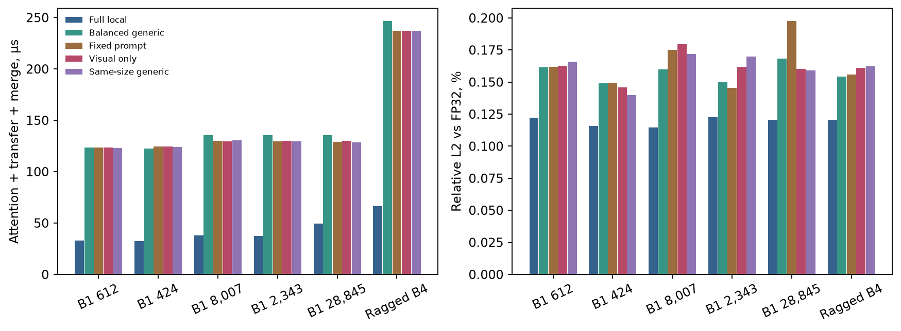

# Track A2 · Visual Memory–Generation Exact Attention

**두 H200에서 원본 Full28 KV를 나누어 Attention을 정확한 수식으로 계산했다.** Visual Residency는 로컬 FA3와 동일 Teacher Prefix에서 Greedy 81/81, 독립 Natural Generation에서 전체 Token ID 5/5가 일치했다. 분산 Reduction 후 생성되는 KV와 Logit에는 BF16 수치 차이가 남았다. Visual Residency는 B1 Full28 Step을 **41.1–42.8%** 느리게 했고, 실제 네 요청의 고정 Ragged Batch에서도 **12.860 → 18.328ms**로 증가했다. 동일 KV 행 수를 보유한 Generic Prefix의 **18.305ms**와 비교해 Modality에 의한 지연 이점도 관측되지 않았다. 이 결과는 원본 모델을 사용한 격리 GPU 실험이다. [실행·Runtime 기록](../mllm_specific_disaggregation_discovery/results/a/attention/experiment.json) · [Native Online 기준선](mllm_discovery200_native_baseline.md)

## 분할과 결합

원본 Qwen2.5-VL-7B-Instruct의 BF16 Vision Encoder, Processor, Full28 Decoder, MRoPE를 사용했다. 원본 이미지와 Token Metadata Hash, Token ID, Grid 및 Position을 검증한 뒤 실제 Prompt Prefill에서 나온 KV를 분할했다. D는 현재 생성 토큰의 Key와 Value를 매 Layer에서 Append한 뒤 해당 위치까지의 전체 허용 KV에 Attention한다. D가 생성한 MRoPE Query를 P로 보내면 P가 보유한 행에 대해 실제 FA3 Attention을 계산한다. D는 자체 행에 대한 Attention과 병행하고, P의 부분 출력과 FP32 Log-sum-exp를 받아 결합한다. 원래 시퀀스에서 현재 Query가 참조 가능한 Prompt 및 생성 KV 행은 모두 한 번씩 포함된다.

| Layout | P에 유지하는 Prompt KV | D의 Prompt KV |
|---|---|---|
| Local | 0행 | 전체 |
| Balanced | 앞 절반의 행 | 나머지 |
| Fixed Prefix | 전체 Prompt | 0행 |
| Visual | 실제 Visual Span의 행 | Text 및 Special 행 |
| Equal-count Prefix | Visual과 같은 행 수의 연속 Prefix | 나머지 |

파티션 \(s\)의 정규화된 Attention 출력 \(o_s\), 로그 분모 \(l_s = \log \sum_{j\in s}\exp(qk_j^T/\sqrt{d})\)를 두면, 두 파티션의 공통 분모는 \(l = \operatorname{logaddexp}(l_D,l_P)\)이고 \(o = e^{l_D-l}o_D + e^{l_P-l}o_P\)다. 이 결합은 원래 전체 Softmax와 수학적으로 동일하다. 실행에서는 각 FA3 부분 출력이 BF16으로 반올림되고 부분 LSE와 결합 가중치를 FP32로 계산한 뒤 결과를 BF16으로 저장한다. 서로 다른 합산 순서와 중간 반올림은 수치 재현성의 별도 문제다. [분산 Attention 구현](../mllm_specific_disaggregation_discovery/remote_attention.py) · [Full28 실행 코드](../mllm_specific_disaggregation_discovery/track_a.py)

## 실제 Full28 KV 이동

물리 GPU6은 D, GPU5는 P로 사용했다. 초기 Copy 시험은 P에 실제 Full28 Prompt KV를 준비하고, 각 Layout이 D로 보내는 56개 K/V Tensor를 실제 CUDA Peer Copy로 전달하고 모두 `torch.equal`로 비교했다. 비어 있지 않은 20개 요청·Layout 조합에서 **1,120/1,120 Tensor**의 값이 일치했다. Fixed Prefix는 D에 보내는 Prompt Payload가 0이었다. CUDA Copy 구간과 Visual Row Packing의 CUDA Event를 분리했다. 아래 표의 Copy 시간은 네 번의 반복 중앙값이고 Packing은 별도로 측정한 구간이다. [초기 Copy Raw](../mllm_specific_disaggregation_discovery/results/a/attention/)

| 요청 | Prompt / Visual 행 | Local / Visual의 초기 이동 | Local / Visual Copy | Visual Packing |
|---|---:|---:|---:|---:|
| MMMU Psychology 27 | 612 / 400 | 33.469 / 11.594 MiB | 0.451 / 0.416ms | 6.436ms |
| MathVista 361 | 424 / 336 | 23.188 / 4.812 MiB | 0.461 / 0.445ms | 0.816ms |
| MMLongBench-Doc 658 | 8,007 / 7,935 | 437.883 / 3.938 MiB | 1.656 / 0.409ms | 0.511ms |
| Mantis wc_22 | 2,343 / 2,262 | 128.133 / 4.430 MiB | 0.817 / 0.480ms | 0.458ms |
| MP-DocVQA 6771 | 28,845 / 28,800 | 1,577.461 / 2.461 MiB | 4.767 / 1.450ms | 1.836ms |

Visual과 Equal-count Prefix의 Peer Payload와 D 논리 KV는 요청별로 같다. 분산 Layout은 매 Step·Layer에 Query 7,168B, 부분 출력 7,168B, LSE 112B를 주고받았다. B1 기준 Full28에서 404,544B다. 실제 NVLink DATA Counter를 128회 연속 호출로 확인했다. B1 Visual에서 D TX/RX는 917,504/933,888B, Ragged B4에서는 3,670,016/3,727,360B였다. 같은 측정의 Local 대조는 TX/RX 모두 0이었다. Counter는 장치 단위이며 작은 전송의 per-link 계수 단위가 포함된다. [B4 Link Counter](../mllm_specific_disaggregation_discovery/results/a/attention/ragged_batch4_attention.json)

초기 Scope는 P에 준비된 Tensor의 유효 Payload와 Visual Pack이다. 실제 EPD의 KV Registration, NIXL Admission, HTTP 및 Page 관리 비용은 이 시험과 별도다. D 할당량은 각 Layout의 Tensor와 2,048행 생성 Reserve를 포함한다. 원본 HF 전체 Prefill Cache는 검증용으로 실행 중 보존했다. [Native KV 및 NIXL 관측](mllm_visual_kv_memory_decode_profile.md)

## 출력과 수치 검증

고정 Layer 1 Query의 FP32 직접 계산 대비 Visual Attention Relative L2는 B1 다섯 요청에서 **0.1457–0.1797%**, Ragged B4에서 **0.1612%**였다. 대조군 Local FA3도 각각 **0.1145–0.1225%**, **0.1205%**의 오차가 있었다. Full28 Visual Logit의 Local FA3 대비 Relative L2는 **0.4445–1.1602%**였다.

| 요청 | Teacher Step | Native 출력 | Local FA3 Natural | Visual Natural | Visual 최대 생성 KV Relative L2 |
|---|---:|---:|---:|---:|---:|
| MMMU Psychology 27 | 1 | 2 | 2 | 2, 동일 | 0.7877%, L27 |
| MathVista 361 | 20 | 104 | 71 | 71, 동일 | 0.9347%, L27 |
| MMLongBench-Doc 658 | 20 | 48 | 48 | 48, 동일 | 1.1702%, L27 |
| Mantis wc_22 | 20 | 205 | 205 | 205, 동일 | 0.9702%, L18 |
| MP-DocVQA 6771 | 20 | 25 | 25 | 25, 동일 | 0.8391%, L27 |

분산 Layout 네 개 모두 동일 Teacher Token을 소비했을 때 Local FA3의 다음 Token Argmax와 81/81 일치했다. 생성 KV 비교에서는 앞 1–2 Teacher Step에서 Layer 1의 K/V는 같고 각 분산 Layout의 Layer 2–28에서 차이가 발생했다. 앞 Layer의 Attention 결과가 다음 Layer의 Q/K/V 입력을 바꾸기 때문에 Prompt KV Copy의 값 동일성과 생성 KV의 수치 변화가 함께 관측된다.

Natural Generation은 동일 HF Prompt에서 First Token을 선택한 후 최대 2,048개 Token까지 독립 실행했다. Visual은 다섯 요청에서 Local FA3와 전체 Token ID가 같았고 모두 EOS로 완료했다. Balanced, Fixed Prefix, Equal-count Prefix는 Mantis wc_22에서 0-based Index 107에 처음 차이가 나면서 108개 Token에서 종료했다. Local FA3와 Visual은 205개 Token에서 종료했다. Native와 비교하면 첫 Token은 5/5가 같았으나 MathVista에서 Native 104 Tokens와 Local FA3 71 Tokens가 관측됐다. 첫 Decode의 HF SDPA 대 Local FA3 Logit에도 Relative L2 **0.4502–3.4579%**가 있었고 그 Step의 Argmax는 모두 같았다. 이 비교는 동일 경로의 Greedy 재현성을 보여주는 표본이며 Native Online 품질이나 Full28 Bitwise 동일성을 확정할 근거는 부족하다. [MathVista Raw](../mllm_specific_disaggregation_discovery/results/a/attention/case_2.json) · [Mantis Raw](../mllm_specific_disaggregation_discovery/results/a/attention/case_4.json)

## Communication-inclusive 시간과 실제 Ragged B4

| Layout | B1 Full28 Wall, 요청별 중앙값 범위 | B4 Layer 1 CUDA | B4 Full28 Wall | B4 다음 Token 일치 |
|---|---:|---:|---:|---:|
| Local | 12.693–13.116ms | 66.54μs | 12.860ms | 4/4 |
| Balanced | 17.997–18.524ms | 246.62μs | 18.429ms | 4/4 |
| Fixed Prefix | 18.111–18.530ms | 237.01μs | 18.351ms | 4/4 |
| Visual | 18.051–18.509ms | 237.31μs | 18.328ms | 4/4 |
| Equal-count Prefix | 18.067–18.504ms | 237.01μs | 18.305ms | 4/4 |

B4는 실제 612/424/8,007/2,343행 Prompt를 함께 고정 배치로 실행했다. Layer 1 시험에는 각각 생성 KV 1행이 추가됐다. Full28 B4는 동일 한 Step의 네 Logit 벡터를 비교했다. Visual의 B4 Logit Relative L2는 Local 대비 **1.6426%**였다. B1에서 Visual과 Equal-count Prefix의 요청별 Wall 중앙값 차이는 절댓값 **0.24% 미만**이었다. B4에서는 Visual이 **0.126%** 느렸다. Single-request의 별도 Event 진단에서 Full28 Attention 구간 합은 Local **1.283–1.682ms**, Visual **6.692–6.936ms**였다. 원격 Q Copy와 P FA3는 D FA3와 일부 겹친다. 이 구간을 중복 합산해 전체 Step Delay로 환산하지 않았다. [Layer 1 B4 Raw](../mllm_specific_disaggregation_discovery/results/a/attention/ragged_batch4_attention.json) · [Full28 B4 Raw](../mllm_specific_disaggregation_discovery/results/a/attention/ragged_batch4_full28.json)

초기 Copy에 가장 유리한 MP-DocVQA에서도 Copy 절감은 Visual Pack까지 포함하면 약 **1.482ms**이고 반복 비용은 생성 Step당 약 **5.452ms** 추가였다. D에 유지하는 Prompt KV를 크게 줄이는 기능은 입증됐다. 이번 구현에서 그 효과가 생성 지연을 상쇄하거나 동일 행 수의 일반 Prefix보다 우위를 제공한다는 증거는 확보되지 않았다. 실측은 고정 Batch와 원본 Model의 격리 재생이며 실제 Scheduler, NIXL, SLO, Quality 및 독립 N3 우위는 범위 밖이다. [Figure PDF](../mllm_specific_disaggregation_discovery/results/a/figures/figure9_distributed_attention.pdf)
