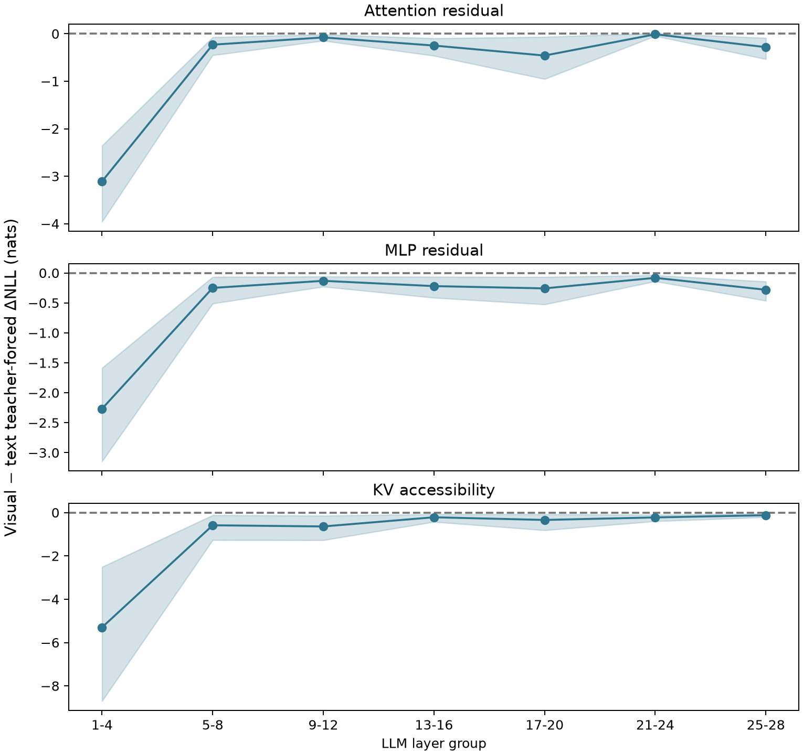

# Visual과 Text의 work-matched 인과 개입

**H200 Tier 1 판정 `NO_APPROXIMATE_CANDIDATE_ADMITTED`.** 24개 요청에서 1,032개 개입과 원래 Natural EOS baseline 24개를 완료했다. 동일한 개수의 Visual/Text row가 초기층에서 서로 다른 기능적 민감도를 보였다. 잠재 작업량이 큰 Visual dose는 후보 승격에 필요한 출력 충실도와 작업 절감 근거를 함께 충족하지 못했다.

## 실험 계약

동결 Tier 1의 Qwen2.5-VL-7B-Instruct BF16 Full28에서 원본 processor, 이미지 임베딩, model weight와 MRoPE를 고정한다. 네 층씩 일곱 그룹에서 attention projection의 residual contribution과 MLP residual contribution을 각각 0으로 만드는 Visual/Text 두 조건을 시행한다. 각 쌍의 원본 prompt row 수를 실제 적은 modality에 맞추고 최대 96개로 제한한다. Text는 위치상 균등하게 선택하고 사용 가능한 Visual row를 가장 가까운 위치에서 하나씩 대응시킨다. Template special controls는 donor 후보에서 제외한다.

KV accessibility 조건은 Question, prompt Text 및 generated query에서 실제 허용된 key 중 이미 대응시킨 Visual/Text pair를 사용한다. 두 key가 모두 해당 query에서 causal하게 접근 가능한 경우에만 한쪽 modality의 key를 가린다. 이렇게 쌍끼리 제거한 query–key edge 수를 정확하게 맞춘다. 남은 key에서 softmax를 다시 계산하고 선택 query의 attention vector만 대체한다. 같은 query의 차단 없는 재계산과 실제 SDPA 사이의 rounding 차이도 측정한다.

Matched contrast에서 적은 Text 예산으로 충분한 Visual 양을 제거하기 어려운 현상은 각 요청의 실제 work 수치로 보고한다. 별도 규모 확인은 층 21–28의 attention과 MLP에서 약 55% Visual row를 동시에 0으로 만든다. 이 변화는 Full28 대비 약 15.7%의 Visual row–layer 위치에 해당한다. 관측용 hook은 해당 dense operator를 실행하며 이 위치 비율을 잠재 work 지표로 사용한다.

모든 조건에 같은 원본 Natural 입력과 greedy EOS cap 2,048을 적용한다. Teacher forcing은 동결 Native C3의 동일 greedy prefix를 최대 32 tokens까지 사용하고, 변경 없는 HF의 같은 위치를 기준으로 step별 ΔNLL, forward KL과 argmax 일치 여부를 측정한다. Natural 출력은 토큰 ID, 길이, cap 여부와 별도 보존하고 source별로 고정된 scorer를 적용한다. Task score와 이전에 정답이던 요청의 새 실패를 함께 기록한다. Tier 1에서 한 건의 변화는 전체 24건에서 4.17pp이므로 1pp 비열등성은 독립적인 확인이 필요하다. [개입 구현](../mllm_specific_disaggregation_discovery/visual_flow.py) [Natural 및 teacher forcing runner](../mllm_specific_disaggregation_discovery/track_b.py)

## H200 개입 결과

개입 후 생성한 전체 token 수는 166,682개였다. EOS 전에 cap에 닿은 arm은 Text 11건, matched Visual 1건, Visual dose 1건이었다. HF baseline 24건은 모두 EOS로 끝났다. Visual/Text의 같은 요청 내 matching 총 1,414쌍에서 대응 위치의 차이는 중앙값 46 tokens, 범위 2–330이었다. 동일 row 수 및 동일 접근 가능 key 수를 강제한 결과에도 Token 위치와 정보 내용의 차이가 남는다. KV 차단 없는 재계산 대조군의 relative L2는 중앙값 0.1732%, 범위 0.1660–0.1800%였다. [요청별 개입 CSV](../mllm_specific_disaggregation_discovery/results/track_b/track_b_request_interventions.csv)

| 개입 | 층 1–4 Visual − Text ΔNLL [95% CI] | 층 13–16 | 층 25–28 |
|---|---:|---:|---:|
| Attention residual | −3.108 [−3.958, −2.355] | −0.249 | −0.282 |
| MLP residual | −2.267 [−3.145, −1.586] | −0.220 | −0.281 |
| KV accessibility | −5.298 [−8.699, −2.508] | −0.217 | −0.122 |

단위는 teacher target step당 nats이고 평균과 bootstrap 구간의 단위는 요청이다. 초반 네 층에서 Text 개입의 영향이 Visual 개입보다 컸다. 이 비교는 요청당 실제 21–96개의 대응 row와 대응된 causal edge에서 이루어졌다. 각 층, 입력 유형, 다른 용량으로의 일반화는 별도로 검증해야 한다. [일곱 층 구간의 paired 대조군 CSV](../mllm_specific_disaggregation_discovery/results/track_b/track_b_matched_contrasts.csv)

### 15% 근처 Visual dose

후반 8층에서 Visual row 약 55%를 제거한 개입은 Visual row–layer 위치의 평균 15.72%를 바꿨다. 전체 prompt row–layer 분모에서는 요청 평균 12.29%, 전체 위치를 합산한 비율 15.39%였고 24건 중 10건이 위치 기준 15%에 도달했다. 원래 GPU dense operators를 전부 실행했다. 실제 커널 FLOPs, HBM traffic 및 Wall latency 절감은 별도의 retained-row 구현과 측정이 필요하다. [실험 영수증 및 SHA-256](../mllm_specific_disaggregation_discovery/results/track_b/track_b_receipt.json)

| Dataset | N | HF baseline 평균 점수 | Dose 평균 점수 | Natural 완전일치 | 품질 근거 |
|---|---:|---:|---:|---:|---|
| DocVQA | 2 | 0.00 | 0.00 | 1 | 변경 없는 raw response의 ANLS |
| Mantis-Eval | 3 | 0.00 | 0.00 | 0 | 고정 공개 파서 |
| MP-DocVQA | 5 | 0.00 | 0.00 | 1 | 변경 없는 raw response의 ANLS |
| MMLongBench-Doc | 2 | 0.00 | 0.00 | 0 | 원문 점수 진단, 필수 answer extraction 미실행 |
| MMMU | 5 | 0.60 | 0.60 | 5 | 고정 공개 파서 및 정확도 |
| MathVista | 4 | 0.50 | 0.50 | 0 | 로컬 answer extraction 후 공개 normalization |
| MMReason | 3 | 0.00 | 0.00 | 0 | 로컬 정규화 비교 |

전체 teacher argmax가 533/554 step에서 같았고 Natural sequence는 7/24에서 완전히 같았다. Dose의 요청 평균 ΔNLL은 +0.056 nats, forward KL은 0.051 nats였다. Prompt 19,242 tokens의 MP-DocVQA `52541`에서 Visual 10,560개를 바꾸자 teacher ΔNLL이 +0.405 nats였고 14개 중 4개의 argmax와 Natural의 두 번째 token이 달라졌다. MMLongBench-Doc `658`에서 +0.380 nats와 32개 중 4개의 argmax 차이, Natural 출력 48→78 tokens를 관측했다. 이 두 요청의 원문 점수는 모두 0→0이었다. [전체 arm 집계](../mllm_specific_disaggregation_discovery/results/track_b/track_b_intervention_summary.csv)

Baseline의 원래 평가 점수가 양수인 요청은 공식 MMMU 3건과 로컬 MathVista 2건이었다. 이 다섯 건은 dose에서도 점수를 유지했다. DocVQA·MP-DocVQA의 장문 응답은 짧은 reference에 대한 원문 ANLS의 낮은 점수 때문에 변화 감지가 제한된다. 관측된 원문 점수 동률, 소수의 양수 baseline, 일부 불완전한 evaluator와 출력 분포 변화에 따라 ≤1pp 품질 조건은 미확정이다. 비용 gate를 통과한 approximate arm은 없었다. Tier 2와 approximate GPU 커널 실험은 이번 결과에서 `NOT_RUN`으로 남겼다.
