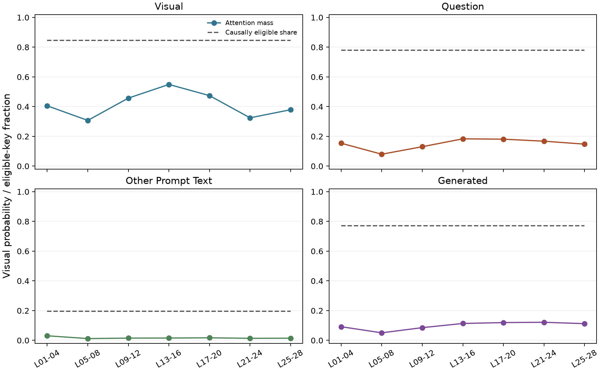
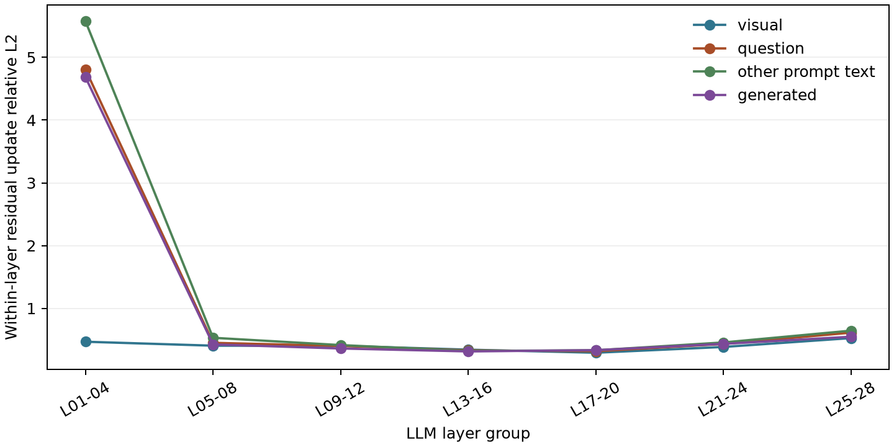

# Qwen2.5-VL의 시각 정보와 생성 위치 사이 Attention

H200의 동결 Tier 1 24개 요청에서 실제 post-MRoPE Q/K와 residual을 측정했다. 전체 층 구간에서 Question과 generated query가 Visual key에 배분한 attention mass는 각각 약 8–18%, 5–12%였다. Visual query는 접근 가능한 다른 이미지보다 같은 이미지 쪽에 집중했다. 관측은 위치와 층별 정보 경로의 차이를 보여준다.

## 실험 계약

Discovery Tier 1의 동결 요청 24건에서 원본 processor가 생성한 image span, 토큰 순서, MRoPE 위치 및 delta를 검증한다. 원본 BF16 Qwen2.5-VL-7B-Instruct Full28의 Hugging Face SDPA 경로를 단일 H200에서 실행한다. 같은 요청의 원본 이미지 임베딩을 각 통제와 개입에 재사용한다. 원본 모델 전체 경로와 분리한 실험 경로의 마지막 prompt logits를 실제 GPU에서 먼저 대조한다.

28개 층을 연속된 네 층씩 일곱 그룹으로 본다. Visual, rendered question, other prompt text, special, generated의 실제 query 위치에서 각 부류별 최대 여덟 개를 순서상 균등하게 고른다. Question 문자열이 chat template에서 그대로 나타나지 않으면 해당 요청의 rendered user turn을 기록한다. 각 Visual query의 원본 image index도 남긴다. Generated는 Native C3에서 보존한 greedy token prefix 중 HF에 실제 입력한 위치를 나타낸다.

각 샘플 query에서 실제 SDPA로 전달된 post-MRoPE Q/K, GQA의 28 query heads와 4 KV heads, 원래 causal mask를 사용한다. 선택한 query만 모든 실제 허용 key에 내적하고 FP32 softmax를 적용한다. 먼저 head별 확률을 정규화하고 전체 head 평균을 낸다. 각 key 종류의 raw mass와 허용 key 수를 저장한다. Enrichment는 실제 mass를 그 종류의 causally eligible key 비중으로 나눈 값이다. 허용 key가 없는 query는 해당 Enrichment 평균에서 제외한다. Visual query의 같은 이미지·다른 이미지 edge도 separate key view로 보존한다.

선택 위치별 동일 층 input→output residual cosine 및 relative L2, 입력층 대비 변화, 실제 attention·MLP branch 크기를 기록한다. 집계는 요청 내부 평균 후 요청 간 평균을 취한다. 이 계산은 HF의 fused SDPA 출력을 그대로 사용하고 실제 Q/K에서 추정한 확률을 별도로 기록한다. 각 요청에서 관측을 켠 teacher logits와 원래 teacher logits가 bitwise 일치해야 한다. [GPU Probe 구현](../mllm_specific_disaggregation_discovery/visual_flow.py) [집계 및 Figure 재생성](../mllm_specific_disaggregation_discovery/track_b_analysis.py)

`track_b.py`에 동결 Tier 1 manifest와 원본 revision의 모델 경로, Native C3의 `discovery200_native_requests.jsonl`을 전달한다. 동일 manifest 및 이 실행 디렉터리를 `track_b_analysis.py`로 집계하면 요청 단위 CSV와 Figure를 다시 만든다. 분석에 사용할 legacy scorer와 source-pinned scorer 디렉터리도 함께 지정한다.

## 계측 검증 및 결과

완료 24건에서 25,536개의 query–layer row를 얻었다. 각 층에서 선택한 위치 수는 Visual 192, Question 192, other prompt text 192, special 179, generated 157을 합산한 912개다. 19건에서 실제 질문 문자열을 식별했고 MMMU 5건에서 rendered user turn을 사용했다. 앞선 smoke 두 번에서 설치된 HF의 `attention_mask`와 `video_grid_thw` 호출 시그니처를 수정한 뒤 실제 GPU preflight를 통과했다. 원래 전체 HF 경로와 실험 경로의 첫 요청 마지막 prompt logits가 bitwise 일치했고 24건의 teacher logits에서 관측을 켜고 끈 결과도 bitwise 일치했다. 최종 H200 실행의 실패 요청은 0건이었다. [실험 실행 설정과 raw SHA-256](../mllm_specific_disaggregation_discovery/results/track_b/track_b_receipt.json)

| 층 | Question → Visual mass / eligible | Generated → Visual mass / eligible | Visual → 같은 이미지 mass | Visual → 다른 이미지 mass |
|---|---:|---:|---:|---:|
| 1–4 | 15.39% / 78.02% | 9.18% / 77.07% | 35.23% | 5.34% |
| 13–16 | 18.36% / 78.02% | 11.36% / 77.07% | 49.18% | 5.75% |
| 25–28 | 14.79% / 78.02% | 11.24% / 77.07% | 34.10% | 3.83% |

Visual → 같은 이미지의 eligible key 비율은 58.60%, 다른 이미지의 비율은 25.91%였다. 다른 이미지에 causal access가 있었던 요청은 11개였다. 개별 query의 causal access 비율을 사용한 요청 평균 enrichment는 층 13–16에서 같은 이미지 2.43×, 다른 이미지 0.21×였다. Generated query의 question·other prompt text·generated key mass는 층 1–4에서 각각 31.06%, 15.31%, 38.48%, 층 25–28에서 9.93%, 50.57%, 23.02%였다. 순서, 이미지 크기, 원래 질문형식이 이 분포와 함께 바뀌므로 개별 역할별 계산을 생략했을 때의 효과는 별도의 개입에서 판단한다. [Attention flow와 causal access CSV](../mllm_specific_disaggregation_discovery/results/track_b/track_b_attention_flow.csv) [Causal 개입 보고서](mllm_visual_text_causal_intervention.md)

층 1–4의 within-layer residual 변화량은 입력 norm 대비 Visual 0.467, Question 4.808, generated 4.684였고 cosine은 각각 0.894, 0.733, 0.737였다. 층 25–28에서 relative L2가 0.525, 0.612, 0.547로 가까워졌다. Relative L2는 각 위치의 원래 norm과 함께 해석한다. 원본 autoregressive prefix의 관측 길이를 최대 32 tokens로 제한해 긴 reasoning 후반 구간은 coverage가 없다. [Hidden alignment CSV](../mllm_specific_disaggregation_discovery/results/track_b/track_b_hidden_alignment.csv)

