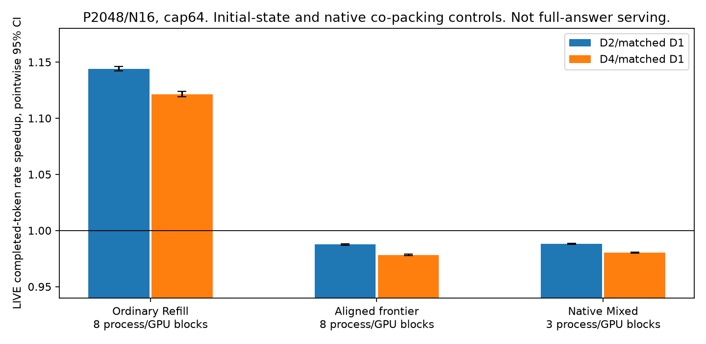
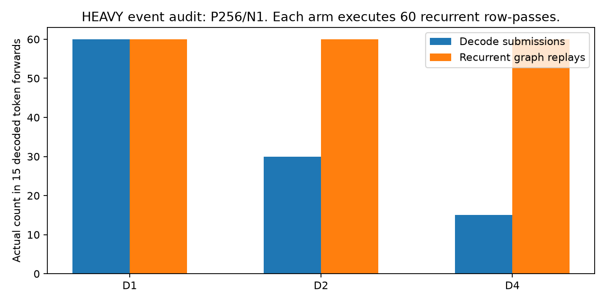

# Elastic Loop Batching discovery

Final performance-promotion verdict: **NO_GO_INCREMENTAL** for the tested RLT grouped-submission path.

Decode grouping is implemented and executes valid Static R4.
It helps exposed synchronous boundaries and one fragmented N16 Refill cohort.
It does not improve low-request latency under native async scheduling and CUDA Graphs.
Native Mixed also removes the N16 advantage in a matched same-engine comparison.
The evidence does not justify a new adaptive ELB scheduler on this path.

This verdict does not prove that every possible multi-loop CUDA Graph or future backend must fail.
The implemented grouping retains native per-loop graph replay.
Quality and sustainable capacity remain independently NOT_RUN.
No unimplemented ELB policy receives a measured speedup.

## Model, runtime, and completed scope

The model is pretrained ByteDance/Ouro-1.4B Base, revision `574fa66cb8bf5abdc979642d01cf2b79b16bfab1`.
The runtime is RLT `4a350344027960a48384626aa646f1765fda6d4f` with a removable three-file decode patch.
BF16, the original weights/gate, attention, RoPE, paged KV, and Static R4 remain unchanged.
The model has24 physical shared layers and96 logical depth/layer KV namespaces.
Eight physical H100 GPUs0–7 run independent single-GPU workers.
No TP/PP engine, dynamic early exit, predictor training, or prefill C/G optimization belongs to this experiment.
The paused native-vLLM Ouro Loop PP project remains paused.

| Evidence | Completed scope | Meaning |
| --- | --- | --- |
| Provenance |128 completed worker attempts,13 preserved failed attempts |Immutable artifacts and physical UUIDs pass validation |
| Clean/component timing |1,602 cohorts across78 process jobs |Includes screen, contention, frontier, native/fair controls, and execution-mode ablations |
| Main numerical grid |128 executions,96 paired comparisons |Output exact96/96. Sampled KV exact84/96. All pass0.03 tolerance |
| Aligned numerical diagnostic |16 executions,12 comparisons |Hidden/logit/sampled-KV/token exact12/12 |
| Lifecycle |Sync/async cancellation, ID reuse, real heterogeneous depths, and12 small natural stops |Not benchmark accuracy |
| Matched bounded outputs |5,188 request pairs |All token IDs, output lengths, and exit-depth traces match |
| Rebatching economics |Eight exact-state recreations, three arms each |Live sync components, not online serving or a population oracle |
| Profiling |Nine event cells plus two Nsight captures |Separate from clean latency |

Repeated prompts come from one frozen mechanism family.
They are not5,188 independent quality samples or a held-out task benchmark.
The main screen covers N1/2/4/8/16 and P256/2048/8192 where the common KV pool fits.
P8192/N16 is omitted for capacity, not filled with an estimate.

## 1. Does grouping improve full-token latency?

Under native async scheduling with graphs, no useful low-N gain appears.
Quiet confirmation uses six process/GPU blocks and three repeats per point.
The ratios below use actual delivered complete-token throughput, not recurrent-step throughput.

| Initial prefix / N | D2 vs D1,95% interval | D4 vs D1,95% interval |
| --- | --- | --- |
|256 /1 |0.9894× [0.9888,0.9899] |0.9862× [0.9849,0.9872] |
|2048 /4 |0.9887× [0.9881,0.9892] |0.9849× [0.9844,0.9853] |
|8192 /1 |0.9921× [0.9916,0.9924] |0.9888× [0.9885,0.9892] |

At P256/N1, mean ITL is17.601ms for D1 and17.848ms for D4.
The prospective3–5% low-request grouping screen fails.
The full14-shape screen preserves the same low-N conclusion.
Intervals resample process blocks. Repeated source families limit population inference.

Synchronous execution provides a real counterexample, not a hidden negative result.
With graphs, D4 improves its serialized D1 control by1.0747× at P256/N1 and1.0863× at P2048/N4.
Their three-block intervals are[1.0710,1.0783] and[1.0716,1.1146].
However, synchronous D4 still takes18.414ms at P256/N1 versus17.732ms for native async D1 in the matched-mode ablation.
Existing asynchronous execution removes the exposed round-trip opportunity more effectively.
Graph-off gains likewise do not justify comparison against an unnecessarily slow native baseline.

## 2. Why did ordinary N16 show a positive signal?

The ordinary Refill P2048/N16 cohort improves from458.202 to525.426 output tokens/s with D2.
The quiet paired ratio is1.1467× [1.1456,1.1477].
This positive measurement remains part of the report.
It is not pure host-loop fusion.

Early requests decode while later requests still prefill.
That history leaves different recurrent phases and batch widths after the last first-output timestamp.
An aligned-frontier intervention holds rows until every member completes first-output readback and host commit.
Frontend delivery remains a separate clock.
Under that aligned state, D2/D1 becomes0.9876× [0.9867,0.9883].

The strong native Mixed control gives the decisive same-engine check:

| Native Mixed P2048/N16 | Output tokens/s | Rate vs matched Mixed D1 |95% interval |
| --- | ---: | ---: | --- |
|D1 |534.611 |1.0000× |[1.0000,1.0000] |
|D2 |528.282 |0.9882× |[0.9876,0.9886] |
|D4 |524.124 |0.9804× |[0.9799,0.9809] |

These64-token cells use three same-GPU process blocks with rotated policy order.
Mixed retains native one-loop prompt/decode co-packing. Only pure decode can group.
Completion-fair controls also complete, but their weaker points cannot replace the stronger native Mixed baseline.
Thus the N16 Refill gain is a batch-state/packing opportunity that existing native behavior already handles.

## 3. What cost disappears, and what remains?

At P256/N1, D1→D4 reduces recurrent submissions60→15 over15 decoded token forwards.
Native recurrent graph replays remain60→60. Row-loop work remains60→60.
Scheduler duration sums fall2.294→1.422ms in the event audit.
Host submission interval sums fall137.353→17.195ms.
Those intervals include waits that overlap GPU execution. They are not exclusive CPU work.

Separate Nsight captures retain60 cudaGraphLaunch calls in both arms.
Their kernel service sums are227.353ms and227.027ms.
cudaEventSynchronize counts fall75→29 without a clean-token speedup.
The actual kernel/copy timeline and the separate clean measurements prevent additive-overhead claims.
Heavy-trace uncovered time is not an achievable clean E2E saving.

## 4. Is rebatching useful in the opposite state?

Yes, in controlled valid states.
Releasing already-preluded new rows at an old cohort's R1 device boundary lets YIELD co-batch their work.
Across eight states, combined completion improves by1.441×–1.500× versus KEEP4.
The old rows finish later, so the result is a real priority/packing trade-off.
All source fingerprints and generated outputs match.
All graph widths are warm, and no new graph capture occurs during the v2 intervention.

The no-reform D1 control preserves the old-row priority without grouping.
KEEP4 improves that control's old-row component latency by1.039×–1.081× in the sync lane.
These one-pair-per-state measurements do not establish an all-workload confidence interval.
They also do not beat the optimized native-async path or establish an adaptive policy.
See `rebatching_economics.md` for every arm and the excluded cold-shape v1.

## 5. Correctness and quality

All108 main-plus-frontier numerical comparisons pass the unchanged0.03 tolerance.
All108 match generated token IDs. Sampled KV matches exactly in96/108 comparisons.
The main maximum relative L2 is0.01825784705579281.
Aligning the N8 decode frontier removes the observed non-exact differences in all twelve diagnostic comparisons.
This supports batch geometry as a contributor. It is not a complete first-operator proof.

The tests retain valid intermediate-depth KV writes and legal group clipping.
They cover cancellation, ID reuse, bounded generation, and genuine `[0,1,3]` frontiers.
Small natural chat probes stop at the existing frontend chat-end token and release cache.
No known state bug emerges in this scope.
Universal long-answer fidelity and GSM8K/MATH-500 accuracy remain NOT_RUN.

## Phase decisions

| Phase | Status | Reason |
| --- | --- | --- |
|P0 |PASS |Pins, ownership, UUIDs, native controls, and1/2/4/8-worker calibration complete |
|P1 |CONDITIONAL |Legal Full-R4 execution and tested lifecycle pass. Sampled numerical and quality limits remain |
|P2 |NO_GO_INCREMENTAL for promotion |Sync and fragmented-cohort signals do not survive optimized native controls |
|P3 |NOT_RUN |No useful incremental region justifies an adaptive ELB selector |
|P4 |NOT_RUN |Static Mixed/group controls run, but no adaptive hybrid receives a method claim |
|P5 |NOT_RUN |No promoted policy. No qualified natural open-loop capacity sweep |
|P6 |NOT_RUN |No new task-accuracy or population quality claim |

Physical grouping has **STRUCTURAL_ONLY** value in the exposed sync or fragmented Refill cases.
Optimized low-request fusion has **NO_GO_STRUCTURAL** evidence for this adapter.
The overall decision is **NO_GO_INCREMENTAL**, not a claim that every possible ELB backend must fail.

## Research implication and preserved artifacts

CDB already reforms recurrent batches. RLT already supplies native Mixed and async execution.
Generic event scheduling and multi-loop execution primitives are not new contributions.
This campaign does not establish an additional loop-specific scheduling method beyond those controls.
Do not build a larger optimizer, RL controller, TP/PP engine, or full capacity campaign from this evidence.

A genuinely combined multi-loop graph remains an untested backend control.
It must not inherit this adapter's result or automatically receive an ELB novelty claim.
Reopening ELB requires a matched optimized state with a useful incremental KEEP/REFORM crossover and real natural-serving evidence.

See `benchmark_summary.md`, `profiling.md`, `correctness.md`, `prior_overlap.md`, and `reproduce.md`.
Raw JSON/CSV, source snapshots, failures, exact inputs/outputs, and GPU timelines remain preserved.
The compressed Nsight bundle preserves both full reports and SQLite exports.
Branch: `flashvep/ouro-elastic-loop-batching-poc`.
The final handoff supplies and verifies the pushed commit SHA.
