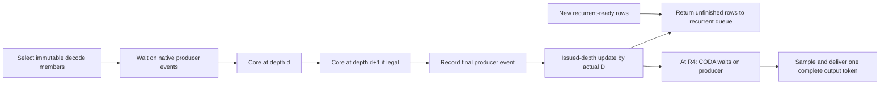

# Grouped decode execution contract

`D` denotes consecutive recurrent passes in one pure-decode submission.
It does not denote a smaller model depth.
Static R4 remains mandatory for every forwarded token.
The prior prefill `G` parameter does not control this patch.

## Legal batch

Every member must occupy RECURRENT phase.
Each immutable span snapshots its request identity, token position, and starting depth.
The common group length is `min(desired_D, min(4-start_depth))`.
A member at depth3 limits the common group to one pass.
The executor rejects an explicitly illegal range instead of dropping that member.
Native Mixed batches remain one-loop batches.

## Device and host progression

1. Native selection reserves capacity and removes the selected rows from their queues.
2. The executor binds immutable spans to the existing ExecutionBatch primitive.
3. CPU preparation builds depth-specific KV metadata for every pass.
4. Native CUDA events order hidden-state and KV consumers.
5. ModelRuntime executes the shared 24-layer core once for each supplied depth.
6. The runner stores final hidden state and records its native producer event.
7. The sync or async scheduler callback advances issued depth by the actual D.
8. A row reaching R4 enters CODA. It does not immediately restart recurrence.
9. Native CODA, sampling, readback, and output delivery produce one token.

Issued depth is not a GPU completion timestamp.
Native event ordering, not the issued counter, protects downstream reads.
The direct executor also checks Static R4 and the depth ceiling.

## Unchanged and changed costs

Grouping reduces scheduler and submission boundaries.
It does not remove any shared-core pass.
It does not fuse four recurrent passes into one new CUDA Graph.
The native runner still selects and replays individual recurrent graphs.
Intermediate metadata, writes, graph inputs, and graph output copies remain real costs.
Any performance claim must include them.

The patch has no multi-GPU activation or KV transport.
Eight workers measure eight independent models, not one distributed forward.

## Diagnostic cache coverage

Numerical probes inspect all 24 layers and all four depth namespaces.
Value comparisons sample position0, the preceding position, and the current CODA position.
The cache reader checks initialized-prefix bookkeeping before these reads.
This is not an elementwise comparison of every KV value in an entire 2K context.
Blocking copies occur only inside the heavy correctness lane.
Clean serving does not contain these copies.
