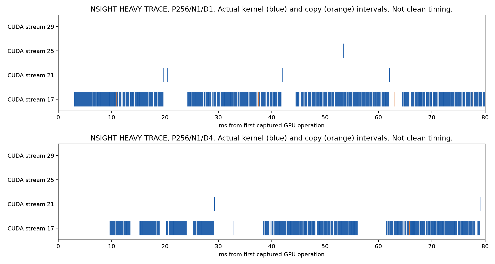

# CPU/GPU mechanism and trace scope

## Measured submission grouping

At P256/N1, the event audit observes15 decoded token forwards after the prompt output.
Each arm executes60 recurrent row-passes.

| D | Recurrent submissions | Recurrent graph replays | Row-loop work | Total scheduler calls | Scheduler duration sum ms |
| ---: | ---: | ---: | ---: | ---: | ---: |
|1 |60 |60 |60 |97 |2.294 |
|2 |30 |60 |60 |67 |1.872 |
|4 |15 |60 |60 |52 |1.422 |

Total scheduler calls include prompt, PRELUDE, and CODA work.
The grouping patch reduces decode submission boundaries but does not reduce recurrent graph replay count.
It does not compile one new four-loop graph.

The recorded host submission interval sum drops from137.353ms to17.195ms for D1→D4.
That difference is not an exposed CPU-compute saving.
Submission intervals can contain waits while earlier GPU work continues.
The observed recurrent service sum remains254.653ms versus256.592ms.
Those service intervals also contain internal launch gaps.
None of these sums is an additive clean E2E attribution.

## Separate Nsight capture

Nsight Systems2024.6.2 records actual CUDA Graph nodes, kernels, copies, and host APIs.
Capture follows the first output readback and host commit.
The raw marker's delivery wording is imprecise. Frontend delivery occurs after the engine step returns.
Each trace retains15 further token outputs at P256/N1.
The initial queued work can precede the capture boundary.

| D | cudaGraphLaunch calls | cudaEventSynchronize calls | Kernel service sum ms | GPU operation extent ms | Kernel/copy interval union ms |
| ---: | ---: | ---: | ---: | ---: | ---: |
|1 |60 |75 |227.353 |302.415 |228.042 |
|4 |60 |29 |227.027 |321.581 |227.879 |

These are HEAVY_TRACE values, not clean latency.
The kernel service sum adds kernel durations.
The interval union avoids double-counting concurrent kernels and copies.
The GPU extent spans the first through last captured GPU operation.
Uncovered extent is74.373ms for D1 and93.702ms for D4 in these traces.
It is not a removable clean-serving cost estimate.
Tracing changes host/device gaps and can enlarge them.

Both traces retain60 graph launches and almost identical kernel service.
Lower event-synchronization counts do not establish an E2E gain.
The separate clean measurement supplies the actual completed-token comparison.

The figure contains actual captured kernel and copy intervals.
The event-observer figure separately shows host submission and ready-stream intervals.
Neither figure converts service sums into clean E2E percentages.

## Observer controls

The event audit brackets each observed cohort with equal-cap ON/OFF controls.
All nine cells retain exact bounded token outputs across those controls.
They contain63 matched requests, not63 independent quality samples.
Observed wall ratios range from0.9362× to1.0072× in one process.
Plan geometry and lazy work can differ despite output equality.
The ratios therefore do not isolate pure instrumentation overhead.
Clean timing excludes both the event observer and CUPTI tracing.

## Remaining attribution limits

The source identifies CPU metadata construction, graph-input copies, event waits, and per-loop graph replay.
This campaign does not isolate every one of them through exclusive critical-path interventions.
It does not measure actual HBM traffic or hardware compute utilization with performance counters.
NVML utilization is telemetry, not a critical-path percentage.

A genuinely combined multi-loop CUDA Graph remains NOT_RUN.
This result does not rule out that separate backend optimization.
RLT already supplies per-loop graphs, and ordinary full-forward graph capture is established prior work.
A future graph change must remain a backend control, not automatically a novel ELB mechanism.

Artifacts: `cpu_gpu_overhead.csv`, `observer_control.csv`, `nsight_summary.csv`, `nsight_API_counts.csv`, and `nsight_kernel_service.csv`.
Full Nsight files and SQLite exports remain in `profiles/` with hashes.
Compressed portable kernel/copy traces retain exact timestamps and names.
