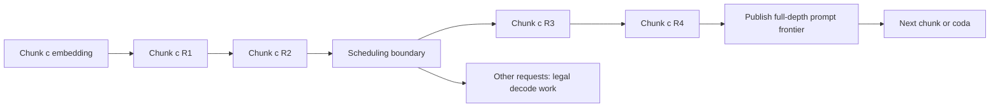

# Implementation scope and prior boundary

## Scope

This is a separate chunk/loop scheduling study.
The paused native-vLLM Loop PP program remains paused.
No PP, TP, model placement, original gate, or model-weight change belongs to this patch.

The primary model is base Ouro-1.4B at revision `574fa66cb8bf5abdc979642d01cf2b79b16bfab1`.
Every prompt token and every generated-token forward executes Static R4 in this study.
BF16, native RLT normalization, RoPE, attention, sampler, and last-exited cache layout remain unchanged.
No Dynamic model early exit or learned scheduler is active.

## Audited upstream

RLT pin: `4a350344027960a48384626aa646f1765fda6d4f`.
CDB pin: `abdfae0adbdd12be8c6123ccb34eee98a38afb39`.

The RLT fork is `/home/esjung/external/ouro-chunk-loop-prefill-rlt`.
The clean source audit remains in `/home/esjung/external/ouro-unified-planning-rlt`.
Neither the installed native vLLM package nor the historical Ouro PP source changed.

| Existing mechanism | Actual source | Interpretation |
| --- | --- | --- |
| Atomic prefill | `ExecutionConfig.atomic_prefill`, executor `build_execution_batch` | One chunk executes four loops before a scheduling boundary |
| Split prefill | `SplitPrefillPolicy`, split phase queues and frontier ranges | One loop per boundary. Token chunk size remains configurable |
| Mixed prefill/decode | `MixedPolicy.schedule`, compatible recurrent spans | Existing decode-prioritized co-batching. Not a new contribution |
| Multi-loop primitive | `ExecutionBatch.loop_count`, `ModelRuntime.forward` | Existing runner capability. It does not provide G2 progression by itself |
| One staged chunk | `_prelude_window_open`, `prefill_depth_ranges` | Existing hidden-state lifetime and causal-frontier contract |
| Full-depth CDB prefill | CDB `continuous_depth_batching/continuous_api.py` | Separate depth-aware engine. It is a source reference, not a measured baseline here |

Source links:

- [RLT policies](https://github.com/InferMatrixLab/vllm-rlt/blob/4a350344027960a48384626aa646f1765fda6d4f/vllm_rlt/core/scheduling_policy.py).
- [RLT executor](https://github.com/InferMatrixLab/vllm-rlt/blob/4a350344027960a48384626aa646f1765fda6d4f/vllm_rlt/worker/executor.py).
- [RLT split tests](https://github.com/InferMatrixLab/vllm-rlt/blob/4a350344027960a48384626aa646f1765fda6d4f/tests/test_split_prefill.py).
- [CDB prefill](https://github.com/kschwethelm/continuous-depth-batching/blob/abdfae0adbdd12be8c6123ccb34eee98a38afb39/src/looped_cdb/continuous_depth_batching/continuous_api.py).

## Removable G2 patch

The patch changes three RLT files. It adds 23 lines and removes nine lines at the first validated revision.
The exact patch is in `poc_flashvep/ouro_chunk_loop_prefill/patches/rlt_grouped_prefill.patch`.

| File | Change | Preserved behavior |
| --- | --- | --- |
| `config.py` | Add `prefill_loop_group_size` with default1. Reject grouped Mixed mode | Existing configurations still select G1 or Atomic G4 |
| `core/scheduler.py` | Snapshot group length and advance every completed depth frontier | Same admission, queues, token budget, page allocation, and refill policy |
| `worker/executor.py` | Pass grouped loop count and correct final hidden retention | Same runner, metadata builder, optimized kernels, and buffer lifecycle |

There is no change to the attention kernel, model math, cache manager, graph implementation, or transport.
The harness and analysis code reside in `poc_flashvep/ouro_chunk_loop_prefill/`.
These files are not a new serving engine.

G2 uses split prelude, then consecutive R1–R2, then consecutive R3–R4.
The scheduler can execute eligible decode work after either grouped submission.
The group width clips to the remaining depth. It does not specify a final model depth.
Mixed batches remain stock G1. A grouped submission cannot advance decode rows through two loops accidentally.

## Exact dependency and publication

Each depth also requires earlier prompt chunks' KV at that depth.
Only one chunk per request remains staged.
The patch updates all group frontiers before another scheduler selection.
Native runner events still order GPU consumers and buffer reuse.
Host-side logical progress does not imply completed device writes.
First-token sampling remains after the full prompt completes R4.

## Baseline and fairness controls

The Atomic C-only baseline sweeps C128/256/512/1024.
Stock Split and Mixed use the same chunk menu.
G2 uses the same menu, total token budget1024, refill mode, resource cap, and model settings.
Log fields use `chunk_tokens` and `concurrency` separately.
The primary decode quantum remains one native recurrent step. Only prefill grouping changes.

Initial Triton calibration used 1536 global physical KV blocks.
The primary grid uses 4096 blocks for every arm, to admit the 8K mixed workload safely.
Those counts include all depth planes. They are not blocks per depth.
Do not compare different reserve sizes as a capacity improvement.

Prefill graph eligibility follows the existing runner.
The initial optimized decoder uses native RLT CUDA Graphs.
No graph feature is disabled in Mixed to favor G2.
Backend-specific qualifications and any fallback remain separate in the result tables.

## Novelty limit

Chunked prefill and prefill/decode interference are established serving topics.
[Sarathi-Serve](https://www.usenix.org/conference/osdi24/presentation/agrawal) is a relevant existing baseline concept.
RLT already exposes the two endpoint quanta and Mixed selection.
A G2 scheduling option alone is not evidence of a new research contribution.
The required evidence is a repeatable client-visible frontier beyond tuned existing policies.
Any Adaptive Joint claim also requires Adaptive C-only and Adaptive G-only controls.
