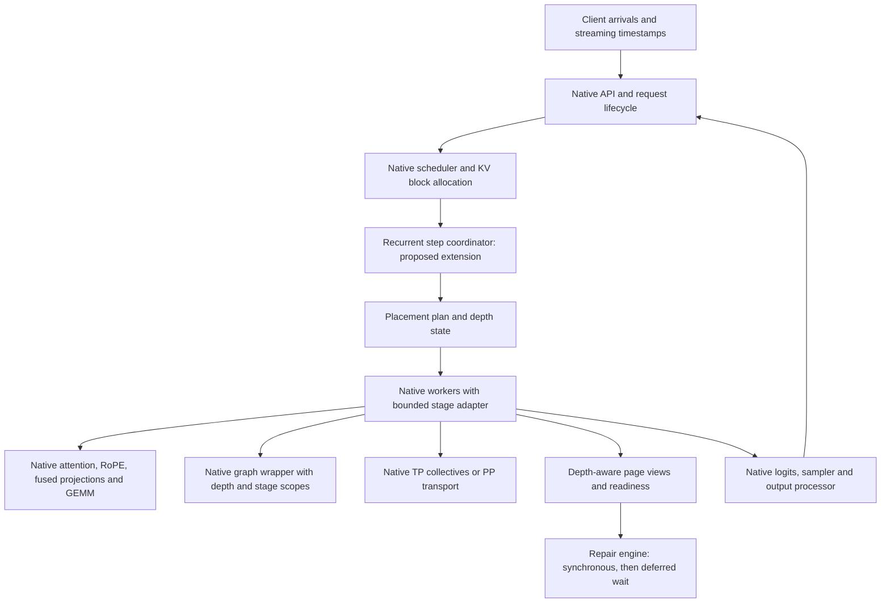
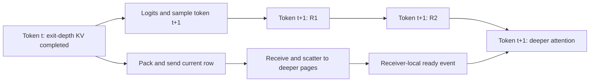

# Architecture and exact execution contracts

## Status and boundary

This document describes a proposed extension. No extension or performance result exists from this planning task.
Keep native vLLM TP1/TP4 untouched as regression controls.
New class names below describe interfaces. They do not claim existing upstream APIs.



The recurrent coordinator must remain inside a logical model-token operation.
Native scheduling and streaming must not observe four completed tokens for four recurrent visits.
If this boundary cannot fit the native executor, stop and revise the scope.

## Model semantics

The base checkpoint has 24 physical layers, hidden size 2048, 16 attention heads, and 16 KV heads.
Head dimension is 128. The recurrent depth is four.
The configured RoPE theta is 1,000,000. The configuration has no sliding window.

Each loop consumes the previous loop's normalized output.
Each loop starts with a fresh residual accumulator.
Within a loop, preserve native fused normalization and residual order.
Apply the model norm at the loop boundary. Do not transport a pre-normalized value as the next loop input.

Every physical layer reuses its projection and MLP parameters across loops.
Every `(depth, physical_layer)` pair uses a separate attention/cache namespace.
The namespace index is `depth_zero_based * 24 + physical_layer_zero_based`.
Keep the original token positions and RoPE for every depth.

## Physical ownership

| Configuration | Weight owner | Attention/KV owner | Request execution |
| --- | --- | --- | --- |
| Single | GPU4, full core | All 96 namespaces | Four local loops |
| TP4 | Native column/row shards on GPUs4–7 | Four local KV heads per namespace on each rank | All ranks execute every loop |
| Physical-layer PP4 | Each rank owns six physical layers | Its six layers at all four depths | Four cyclic traversals of ranks0–3 |
| Loop PP4 | Each rank owns a full 24-layer core | One depth's 24 namespaces per rank | One linear traversal of ranks0–3 |
| Contiguous logical PP4 | Same physical weights as Loop PP4 | Same logical boundaries as Loop PP4 | Equivalent Static execution partition |

Embedding, model norm, gate, and head placement require an explicit plan.
Static embedding belongs at input. Static head belongs at the final output.
Dynamic coda needs access at any exit depth or an explicit hidden transfer to its owner.
Count any coda/head replication and transfer in both memory and performance.

The generic contiguous control must tie physical parameter storage when one rank owns multiple loops.
It must not allocate separate weight tensors for tied logical copies on the same rank.
Across Loop PP4 ranks, full-core replication is real and must enter the memory accounting.

### Why physical-layer PP is not a native PP flag

```text
Physical-layer PP4, Static R4:
R1: rank0 L1–6 -> rank1 L7–12 -> rank2 L13–18 -> rank3 L19–24 -> norm
R2: rank0 L1–6 -> rank1 L7–12 -> rank2 L13–18 -> rank3 L19–24 -> norm
R3: rank0 L1–6 -> rank1 L7–12 -> rank2 L13–18 -> rank3 L19–24 -> norm
R4: rank0 L1–6 -> rank1 L7–12 -> rank2 L13–18 -> rank3 L19–24 -> norm -> head

Loop PP4 / contiguous logical PP4:
rank0 R1 L1–24 -> norm -> rank1 R2 L1–24 -> norm
 -> rank2 R3 L1–24 -> norm -> rank3 R4 L1–24 -> norm -> head
```

Static physical PP needs 16 stage visits and 15 hidden handoffs per model-token forward.
Loop PP needs four stage visits and three hidden handoffs.
These are graph counts, not latency measurements. Token feedback and control messages add separate transfers.
At C1, one request's causal stage work remains sequential.
Request-level PP exposes compute overlap between independent requests, not between dependent future tokens.
Any C1 benefit must come from measured compute or communication costs, not an assumed four-stage parallel speedup.
Mid-loop physical PP must transport the native hidden and residual tensors.
Loop boundaries transport normalized hidden and reset residual state.
Native Ouro's current `make_layers(24)` split does not implement this cyclic graph.

## KV ownership and capacity

Use native attention registration and `KVCacheSpec` to allocate only owner-local namespaces.
Do not register all four depth planes on every Loop PP owner.
Do not alias different depth histories merely because they share weights.

For this model, a full-head layer KV row contains `2 * 16 * 128 * 2 = 8192` bytes.
One full 24-layer depth row contains `196608` bytes.
Four full depth planes contain `786432` logical KV bytes per token.
These are BF16 tensor calculations. They exclude page padding, graph memory, and allocator overhead.

| Configuration | Logical KV bytes per token per rank | Explanation |
| --- | ---: | --- |
| Single | 786432 | 96 full-head layer rows |
| TP4 | 196608 | 96 rows with four local heads |
| Physical PP4 | 196608 | 24 rows from six layers and four depths |
| Loop PP4 | 196608 | 24 rows from one depth |

Equal logical KV size does not imply equal free HBM or capacity.
Loop PP replicates core weights. Embedding/head ownership and page reserve also differ.
Measure actual cache strides, page padding, live allocations, reserved pools, graph workspace, and driver HBM.

Native FlashAttention's logical cache shape is `(blocks, local_heads, block_size, 2*head_dim)` at the audited revision.
Its physical strides can differ through layout selection and layer packing.
Use native slot mapping and inspected strides. Never hard-code a flat full-page copy for a one-row repair.

## Dynamic policy: one canonical arithmetic contract

Use CDB revision `abdfae0adbdd12be8c6123ccb34eee98a38afb39` as the semantic reference.
For each decode token, initialize `cdf=0` and `survival=1`.
At every loop, including R1, compute the trained gate from the normalized loop output.

```text
h = scalar(float32(sigmoid_bf16(gate_bf16)))
cdf = cdf + h * survival
survival = survival * (1 - h)
exit = (depth >= 2 and cdf >= 0.5) or depth == 4
```

The pinned CDB policy converts the BF16 sigmoid result to a Python scalar.
The reference accumulation uses Python floating-point values.
Any GPU implementation must test threshold decisions against that reference.
A faster FP32 probability update is a separate numerical change until qualified.

Current RLT instead casts the gate before sigmoid and checks `1 - remaining_probability`.
These formulas are mathematically related, but finite-precision decisions can differ near the threshold.
Do not claim bitwise policy equivalence without a test.
Do not use RLT's `ouro_delayed`, shared-cache policy, random lookahead, or trace oracle in the primary arm.

TP4 must use one survivor order and one exit mask on all ranks.
The gate consumes the complete hidden vector logically, not four independent local decisions.
Audit the row-parallel input split, reduction, tuple return value, and single application of bias.

## Exact last-exited publication

For exit at depth r and token position p:

1. Finish each source layer's rotated K and V write for `(r,p)`.
2. Copy only position p into the corresponding layer at every skipped depth.
3. Preserve all earlier positions and their original depth histories.
4. Mark destination row readiness only after receiver-side writes complete.
5. Keep source pages and staging buffers alive until all dependent transfers complete.

Allocation, logical valid length, enqueued repair, and completed publication are distinct states.
A host ACK is insufficient unless its contract includes completed destination writes.
Full-depth prefill needs no early-exit repair.

## Legal async repair DAG



The proposed overlap is exact only after sampling determines token t+1.
Earlier-depth KV for t must already be valid before t+1 reads it.
Every deeper read must wait for the corresponding repaired row.
Token t+1 may also exit early. Its unused deeper reads do not justify freeing pending transfers prematurely.

Use a receiver-local event after receive and scatter.
The receiver's compute stream waits on that event before the dependent attention launch.
A Python CUDA event from another process is not automatically a usable dependency handle.
CUDA IPC or native NCCL completion needs an explicit, tested contract.

Key each transfer by request ID, allocation generation, token position, source depth, target depth, and layer range.
Track page leases across preemption, cancellation, EOS, and buffer reuse.
Drain or cancel transfers safely before releasing slots. Never reuse a captured staging address while its transfer remains pending.

### No-refill and overlap are separate decisions

| Scheduling contract | Consequence |
| --- | --- |
| Strict wave with repair-inclusive completion | Successors wait for every repair. Async API alone exposes no successor overlap |
| Wave with deferred deep publication | Coda may complete before unused deep repairs. Successor R1 can start after the wave's token decisions |
| Refill or early-successor admission | Additional request interleavings and survivor packing become possible. Measure their separate cost |

Use a factorial control for copy mode and barrier mode.
Do not attribute admission-policy changes to copy overlap.
Even C1 may permit legal overlap under deferred publication. This remains unmeasured.

### What constitutes a successful overlap test

Record source write completion, send, receive, scatter, destination ready, sample completion, successor R1, and first dependent KV read.
Validate a common GPU timeline or explicitly bound timestamp alignment error.
Measure producer alone, transfer alone, serial execution, and concurrent execution.
Then compare clean client TPOT and E2E with identical admission and graph rules.
Service-time sums and overlapping host ranges cannot establish critical-path savings.

Async copies do not reduce logical bytes by themselves.
Copy consolidation changes call count and packing cost.
Cross-GPU KV aliasing changes ownership and can cause repeated remote reads.
Keep these three mechanisms distinct.
