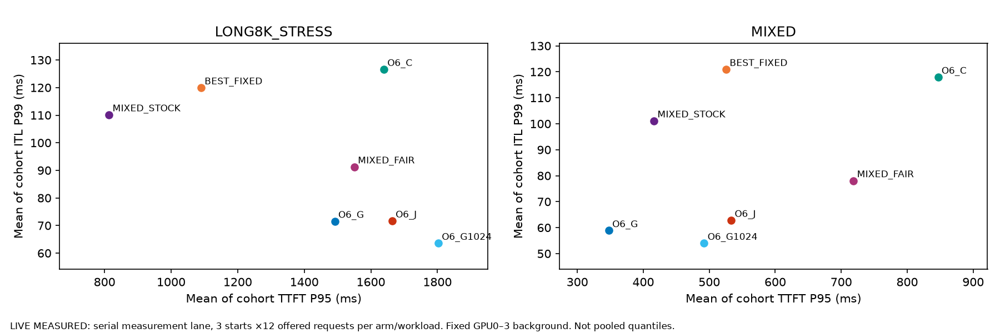

# Dual-Objective Adaptive Chunk–Loop Scheduling

Final verdict: **NO-GO — NO_GO_INCREMENTAL** for the tested dual-exposure-proxy formulation.

Dual objectives produce different legal C/G plans, but not useful incremental clean-serving performance beyond equally informed G-only.
The quality pilot finds no Joint/G-only accuracy drop on the observed questions.
It does not establish universal token parity or population quality equivalence.
The previous `821b11653695d0a470bd88bfcc997ae1bbcf5bc9` NO_GO_INCREMENTAL result remains unchanged.

## Model and completed scope

The model is ByteDance/Ouro-1.4B Base, revision `574fa66cb8bf5abdc979642d01cf2b79b16bfab1`.
The runtime is vLLM-RLT `4a350344027960a48384626aa646f1765fda6d4f`, with the unchanged pinned G2/G3 patch.
Only physical H100 GPUs4–7 run research jobs, as independent single-GPU workers.
BF16, original weights, and Full R4 remain unchanged.
There is no new TP/PP engine, model early exit, training, or hidden-state approximation.
The suspended native-vLLM Ouro Loop PP project remains paused.

| Evidence | Actual completed scope | Interpretation |
| --- | --- | --- |
| Parent replay |144 request pairs,660 selector calls | Consumed historical trace evidence |
| Objective search | O0–O13,112 family/weight settings | Offline score geometry, not 112 independent algorithms |
| Contention / numerics |24 starts /144 cohorts,32 comparisons | Calibration and isolated correctness |
| Main development/serving/audit program |888 cohorts,7,200 requests | Includes development and separate observer audits |
| FINAL natural comparison |312 cohorts,3,744 requests |30 characterization jobs and six serial jobs |
| Secondary budget audit |30 cohorts,180 requests,2,500 matched units | Late observed CALIBRATION, not clean headline serving |
| Quality |1,026 generations on 114 questions, nine arms | Historical public full-answer pilot |
| Evidence audit |99 completed attempts, four preserved failed smoke attempts | All completed hashes and device identities pass |

The failed smoke attempts exposed a measurement-wrapper engine-reference leak.
A failing weak-reference test reproduced it. The correction passes all four reviewed retries and 13 CPU tests.
The failed attempts remain excluded from performance claims.

## 1. Why did the old Joint never select a different C?

Ordered actual plans and output IDs reproduce exactly on 144/144 old request pairs.
Of660 selector calls,480 are continuations and cannot resize C.
Of180 fresh calls,104 collapse to one actual clipped span.
The remaining 76/180, or42.22%, retain multiple budget-feasible C choices.
U2 still selects fixed-C2048 behavior in all 76 cases.

The old utility rewards eventual chunk tokens over estimated remaining Full-R4 service.
It has no direct delivered-token ITL/SLO exposure term and no extra yield penalty in those runs.
Frontiers and clipping explain much, but not all, of the equality.
No fallback or cross-C tie explains those 76 calls.
Exact shape support is missing in 420/660 old selections. Physical optimality is therefore unproved.
Rejected historical admission polls are not exhaustively logged.

Data: [Phase A](phase_a_action_equivalence.md), `decision_opportunity_funnel.csv`, and `prior_plan_reproduction.csv`.

## 2. Do efficiency and risk drive C and G separately?

They show a directional bias in the frozen model, not a physical factorization.
Increasing C improves modeled E in 324/324 matched differences and increases modeled R in 272/324.
Increasing G improves E in 684/768 and increases R in 696/768.
These are OFFLINE_ESTIMATE feature differences on consumed TRAIN states, not GPU speedups.
The 86 four-corner comparisons also show nonzero C×G feature interactions.

The four live families are O2, O4, O6, and O10.
Each uses matched single-axis controls with identical objective, telemetry, cost, budget, fairness, and adaptive packing.
Additional G-only C1024 supplements the TRAIN-tuned C2048 control.
Native Mixed remains a strong separate baseline with different co-packing capability.

Data: [Objective ablation](phase_b_objective_ablation.md), `objective_gradients.csv`, and `objective_interactions.csv`.

## 3. Which variations change real C/G choices?

O2/O10 change C on 23.457% of fresh validation calls, but their worst-stratum goodput ratios are 0.957×/0.932× against stronger G-only.
The frozen validation rule selects O6, weight 2, budget 120ms.
FINAL O6 changes actual C on 61/532 fresh calls, or11.466%.
Serial MIXED changes8/44. Serial8K stress changes5/50.
None of these 61 changes uses the progress fallback.

Of61 changes,49 select C256, ten select C1024, and two select C128.
Remaining prompt is≤512 in 51 cases and 513–2048 in ten cases. No change occurs above 2048.
Nine changes occur without active decode, when the risk term is zero.
Every chosen changed shape has empirical support, while every same-G fixed-C alternative lacks exact support:61/61.
Chosen modeled E is higher in 15 cases. Chosen modeled R is lower in 52 active-decode cases.
Lookup support and enclosing estimates therefore remain plausible contributors, not proof of a physical C benefit.

The eight forced C512/C2048 interventions have exact matched initial KV/hidden state.
Smaller C improves background P99 in 6/8, but target TTFT in only 1/8.
They do not reproduce each online change. The fraction with independently measured benefit is NOT_IDENTIFIED.

Data: `Joint_C_change_summary.json`, `Joint_C_change_decomposition.csv`, and [controlled alternatives](confirmed_alternative_states.md).

## 4. Does Joint beat G-only, C-only, and Mixed?

No useful incremental gain survives the matched serial comparison.
Each workload uses three independent starts and 36 offered requests per arm. No serial response is capped.
The primary SLO requires TTFT≤5s, every ITL≤200ms, and an actual complete stop.
Goodput is successful complete requests divided by drained cohort wall time, not sustainable capacity.

| Serial workload | Joint / G2048 goodput | Paired difference req/s,95% interval | Joint / G2048 TTFT P95 | Joint / G2048 ITL P99 ms |
| --- | ---: | --- | ---: | --- |
| MIXED |0.9921× |-0.006287 [-0.007338,-0.004877] |1.5335× |62.81 /58.86 |
|8K stress |0.9939× |-0.005479 [-0.021866,0.005378] |1.1155× |71.68 /71.56 |

Latency entries are means of cohort quantiles, not pooled-request quantiles.
Intervals resample process starts. Three starts and repeated source families limit population inference.
Joint/G2048 natural token sequences match on 69/72 serial requests.
Postselected whole-cohort equal-output checks also do not show the registered≥5% incremental gain.
Those subsets are descriptive, not a replacement for the all-offered comparison.

Joint can outperform C-only or completion-fair Mixed at some point estimates.
That is not a C-specific contribution because G2048 is still as good or better.
Stock Mixed also has lower TTFT in both serial workloads.
At TTFT5s/TBT100ms, stress attainment is 50% for Joint versus100% for G2048, despite nearly equal pooled P99≈72ms.
No Joint/G2048 point goodput ratio exceeds1.000× across the frozen serial absolute SLO grid.

Data: [All serving tables](phase_c_performance.md), `main_table.csv`, `paired_comparisons.csv`, and [SLO sensitivity](slo_sensitivity.md).

## 5. Does workload change the conclusion?

CHAT, MIXED, LONG, BURSTY, and 8K stress complete their registered FINAL comparisons.
Characterization Joint/G2048 goodput point ratios range from 0.6379× to1.0325×.
The low LONG point has wide uncertainty and capped answers. It is not proof of universal slowdown.
No workload establishes the registered incremental advantage over stronger G controls.

Natural lengths remain actual outputs, not forced targets.
CHAT Joint output median is 109 tokens. LONG median is 181, with two caps across72 requests.
Finite MIXED uses 75%/25%, a disclosed rounding departure from the 70%/30% target.
Stress uses one8K and 11 short requests per cohort, so its overall input median is not 8K.
Arrival parameters and realized offered rates remain distinct fields.

This is pretokenized in-process serving, not HTTP serving.
Warm-up/model construction precede the window. Lazy work after arrival remains inside latency.
Qualified sustainable capacity is NOT_RUN after the incremental gate fails.
The finite36-request cells cannot meet the required1,000-offered-request qualification.

## 6. Is accuracy preserved?

Joint and both G-only controls have identical correctness labels on 114/114 pilot questions.
All score47/64 GSM8K (73.44%) and 32/50 MATH extracted-answer matches (64.00%).
Their completed-and-matching MATH answers total30/50 (60.00%), with six capped answers.
The measured same-objective accuracy difference is 0pp in both domains.
Its paired interval is[0,0]pp on this set, not proof of population equivalence at 1pp/2pp margins.
Joint/G-only token IDs agree on 112/114 question pairs, not every pair.

Against stock Atomic, Joint gains five MATH questions and loses two: net6pp, interval[-4,16]pp.
G-only has the same aggregate gain, so it cannot establish incremental C value.
All 1,026 generated depth traces and 36 prompt ledgers pass Full R4.
All 32 isolated hidden/logit/KV/token comparisons pass without relaxing the 0.03 tolerance.
Observer ON/OFF natural parity remains87/96. Universal batched fidelity remains unresolved.
Full1,819-question quality expansion is NOT_RUN because serving promotion fails.

Data: [All nine quality arms](quality.md), `quality_summary.csv`, `quality_matched_controls.csv`, and [correctness](correctness.md).

## 7. Is there a research contribution beyond RLT Mixed?

The present formulation does not establish one.
Phase A passes the captured-decision diagnosis, with a rejected-poll coverage limitation.
Phase B passes objective/action characterization but fails incremental serving performance.
Phase C completes representative transfer and serial tests, but does not qualify publication-quality capacity.
Quality passes the observed adverse point screen against G-only, with sample-size and token-fidelity limitations.

No larger optimizer, RL policy, new engine, or paused Loop PP implementation follows.
This NO_GO_INCREMENTAL verdict applies to the tested dual-exposure-proxy formulation, not every possible Joint C/G rule.
Reopening requires independently measured alternative-C benefits beyond equally informed G-only and native Mixed.
More scalar weights or forced C variation alone are insufficient evidence.

## Reproduction and preserved artifacts

See [reproduce.md](reproduce.md), [environment.md](environment.md), and [implementation scope](implementation_scope.md).
`evidence_validation.json` checks all 99 completed attempts and unchanged FINAL/selector locks.
`portable_evidence_manifest.json` hashes actual natural outputs, prompt plans, decisions, and event records.
The portable set includes eight reviewed smoke cohorts beyond the 918 analyzed serving/audit cohorts.
The quality export contains exactly1,026 raw generation records.

The local archive retains3,060 files and 824,916,336 uncompressed bytes, including failed attempts and logs.
Its compressed size is 89,612,951 bytes.
SHA256: `683694ed706eee0b07df17481477f624270175bcd0545a86392650cb6671b09d`.
The local path and file hashes appear in `archive_manifest.json` and `raw_evidence_SHA256.json`.
Original files remain in place. The archive contains no model weights.

Branch: `flashvep/ouro-dual-objective-cg-slo-workload-poc`.
The final handoff provides the committed SHA and verifies the matching remote branch.
Only this PoC's code and report scopes enter its commits. Existing staged/dirty work remains preserved.
