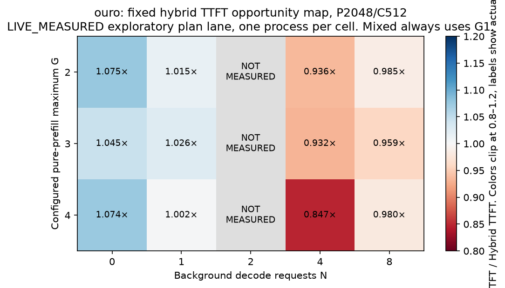
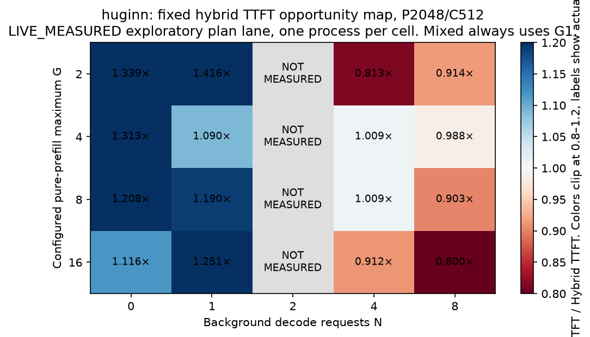

# Fixed group and Mixed opportunity map

The primary chunk is C512. Secondary chunk controls use C256 and C1024.
The primary prompts are P256 and P2048.
Ouro also receives P8192 controls. Huginn P8192 exceeds its 4096-position checkpoint limit.
The decode-width controls include 0/1/2/4/8 background requests.

`fixed_matrix.csv` retains each actual timing cell.
`actual_mode_counts.csv` retains the executed target group and Mixed counts.
`paired_block_summary.csv` separates clean and plan-observer lanes.
The matrix does not silently replace a missing shape with a model estimate.
Raw G is the configured maximum for staged prompt work.
Atomic ignores that knob and executes full R in its prepared-loop submission.
The export labels its actual Atomic G separately.

In P2048/C512 states with ready decode, the fixed event hybrid commonly selects only native Mixed G1.
With no ready decode, it can execute its pure prefill group.
That simple state switch already belongs to the strong fixed-hybrid control.
Configured G and actual G remain different columns.
Remainder clipping is not an adaptive policy contribution.

These exploratory maps use a single process per cell and retain the initial runtime outliers.
Gray cells are unmeasured. They are not interpolated estimates.
The clean three-start confirmation remains the primary performance screen.

Grouped-only execution can improve prefill priority while it delays complete decode tokens.
The TTFT–TBT figures show that trade-off without adding kernel service times to E2E.
The exact-state interventions report whether source fingerprints match.
Their hashing pause disqualifies a clean serving-speedup interpretation.
