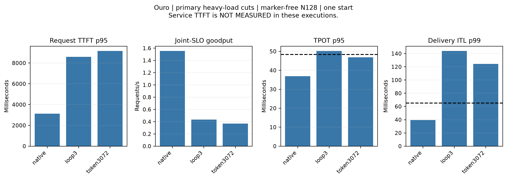
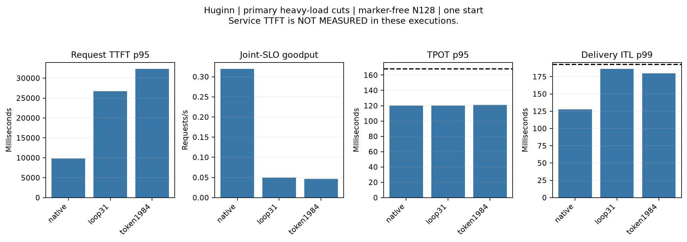
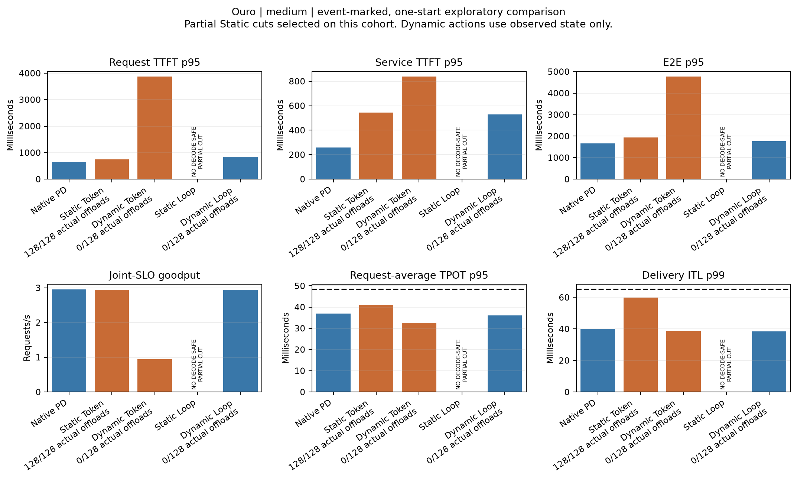
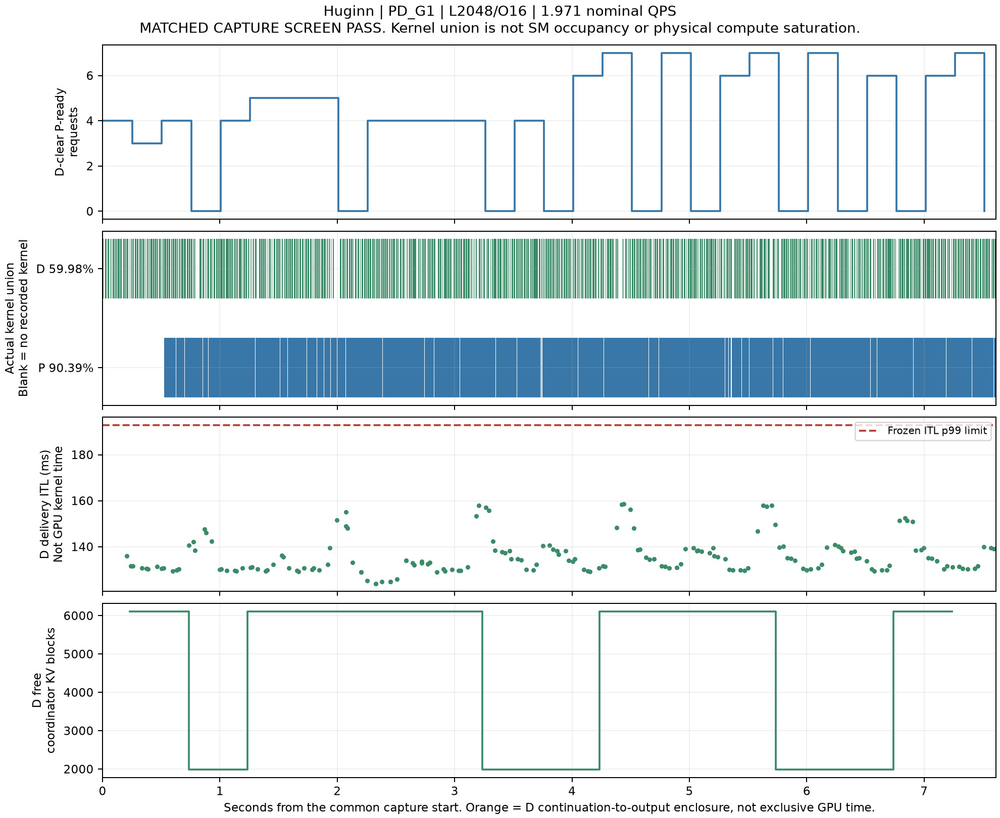

# Full Dynamic Loop-Split Serving Evaluation

Status: GPU experiments and final CPU analysis completed, with the limitations below.
Both models passed Static and Dynamic N32 exactness gates.
The campaign completed 51 main N128 configurations and 6528 main serving requests.
All 51 passed output, full recurrent work, and native lifetime checks.
No measured Dynamic N128 run completed an actual P-to-D compute offload.
The current runtime and online policy do not establish a Loop-Split performance advantage.

## 1. Scope and evidence contract

This campaign compares exact Token and recurrent Loop migration in the qualified vLLM-RLT runtime.
The reference is Native Atomic PD with Native KV handoff.
The split implementations use staged execution and snapshot handoff.
Full-depth transport controls separate these runtime differences from partial-compute migration.
Native Atomic P execution disables the staged Wavefront path.
The split P execution enables that path.
The numerical kernels remain common, but the scheduling paths are not identical.
The same-depth controls quantify this implementation difference.

Both models retain their original checkpoints and BF16 weights and KV.
Ouro executes all four recurrent passes.
Huginn executes all 32 recurrent passes, Prelude, reinjection, and required Coda work.
No method uses early exit, quantization, approximate Attention, or weight changes.
Main experiments use separate Prefill and Decode phases.
They do not combine those phases in one recurrent-core GEMM.

Internal output parity does not establish original-HF equivalence or downstream answer accuracy.
Neither separate fidelity evaluation ran in this campaign.

## 2. Environment, versions, and preservation

| Item | Value |
|---|---|
| Project | `/home/esjung/MLLM-EP-github` |
| Publication branch | `flashvep/full-dynamic-loop-split-serving` |
| Publication parent | `a4c9e4a69386b0cd9b50d8b3e5be3af05aa0b751` |
| Preserved active checkout HEAD | `f4ecea59f36f620c69c4fef09c590bf790802cd9` |
| Preserved active checkout branch | `flashvep/looped-pd-kv-profile-headroom-recovery` |
| External runtime HEAD | `6b164d3844d35ab8e753df1864f0c87dc180401a` |
| External runtime diff SHA256 | `4904a311358c5cf6467678d0e1c30af38b5a96064cae4c96ed680943d7e694c7` |
| Original staged-entry SHA256 | `d0674d8fc531a451b003223020607e4b54dd264c5ca319a57ac387bd19a3e6b3` |
| Model IDs | `ByteDance/Ouro-1.4B`, `tomg-group-umd/huginn-0125` |
| Ouro revision | `574fa66cb8bf5abdc979642d01cf2b79b16bfab1` |
| Huginn revision | `bb6621b65e90b6a4b9b29ef88dc83866d450470c` |
| Hardware | Eight H100 80GB GPUs, isolated two-GPU execution per run |
| Python / PyTorch | 3.14.6 / 2.11.0+cu129 |
| NIXL / Transformers / FlashAttention4 | 1.4.1 / 5.16.1 / 4.0.0b30 |
| NVIDIA driver | 570.211.01 |
| Campaign start | 2026-11-04 14:05:34 KST |
| New long-job cutoff | 2026-11-04 23:35:34 KST |
| GPU stop | 2026-11-05 00:05:34 KST |
| Final deadline | 2026-11-05 01:05:34 KST |

The original index and active checkout remain untouched.
Publication uses a separate branch and temporary Git index.
Per-run source archives and source hashes identify the actual executed code.
The publication commit is not a claim that every run used one unchanged source tree.
The final Git and remote SHAs belong in the publication receipt and final handover.
The GPU phase closed at 2026-11-04 23:37:06 KST, 9.525738 hours after campaign start.
CPU analysis, figures, publication, and final resource checks follow that GPU-phase timestamp.
The final publication receipt records the end-to-end completion timestamp.

The shared quiet-lane lock excludes all approved burners during measurement.
Only one experiment pair runs at a time.
The other six GPUs remain unused to avoid host and fabric interference.
This is a two-GPU method evaluation, not eight-GPU scaling.
Each raw directory records its actual GPU mapping and isolation snapshot.

The next table shows initial unique CUDA storage in the medium Native baseline.
Each physical GPU reports 79.647461 GiB total HBM.
Percentages use that denominator, not an assumed decimal 80 GB.

| Model/role | Weights and model buffers, GiB / HBM% | KV storage, GiB / HBM% | Exposed workspace, GiB / HBM% | Allocator allocated, GiB / HBM% |
|---|---|---|---|---|
| Ouro P | 2.672 / 3.355% | 48.000 / 60.266% | 1.253 / 1.573% | 51.925 / 65.193% |
| Ouro D | 2.672 / 3.355% | 48.000 / 60.266% | 0.627 / 0.787% | 51.299 / 64.408% |
| Huginn P | 6.642 / 8.339% | 41.250 / 51.791% | 0.338 / 0.425% | 48.240 / 60.567% |
| Huginn D | 6.642 / 8.339% | 67.354 / 84.565% | 0.532 / 0.668% | 74.539 / 93.587% |

These snapshots are not peak HBM or complete graph-pool attribution.
Allocator allocated memory is not NVML device-used memory.
Library and opaque graph allocations remain partly unattributed.
The memory CSV retains all recorded initial and final snapshots in GiB and HBM percent.
Raw memory-progress records retain request allocation and release observations.
The window summary reports sampled CUDA-used and allocated-memory maxima during measured requests.
It keeps the lifetime allocator-peak counter separate because that counter can include warm-up.
It identifies the physical-HBM denominator and CUDA-usable total separately.
Sampled maxima can miss short spikes.

## 3. Data, load, and frozen SLOs

| Model | Input/output tokens | Recurrent depth | Prompt chunk | P/D slots | Nominal low/medium/heavy QPS |
|---|---:|---:|---:|---:|---|
| Ouro | 4096/32 | 4 | 4096 | 2/8 | 1.23460875 / 3.4569045 / 6.356 |
| Huginn | 2048/16 | 32 | 2048 | 2/8 | 0.37903355455 / 1.06129395274 / 1.971 |

Slots are configured limits, not measured active batch sizes.
Huginn KV capacity can constrain active concurrency below eight.
The input-plus-output length remains within Huginn's 4096-token context limit.

The primary cohort contains 128 distinct prompt IDs per model.
Its source counts are HotpotQA44, NarrativeQA13, ShareGPT20, 2WikiMQA5, MultiFieldQA-en36, and Qasper10.
The preserved records use explicit model-specific prefix truncation.
Output caps use controlled ignore-EOS generation.
These are not natural response-length distributions or original Azure requests.

Huginn's source file contains 384 cyclic records but only 128 distinct prompt IDs.
The first 128 records contain 128 distinct IDs.
Cost calibration uses eight separate records with no primary-cohort prompt-ID overlap.
Native Decode batch and interval predictors use aggregate primary-baseline observations.
Thus, the policy calibration is not fully separate from the primary cohort.
This limitation does not give the online policy future per-request observations.
Native prefix caching remains disabled.
The final lifetime checks require zero reused prefix tokens.
An N512 control, if executed, repeats the same 128 texts.
It would not establish generalization across 512 independent texts.

All main methods use arrival seed `2026110402` and the same Poisson offsets within each model and load.
For this finite N128 trace, scheduled QPS differs from nominal QPS.
The CSV separates nominal QPS, scheduled-trace QPS, actual submission QPS, and completed throughput.
The generator does not wait for one response before offering the next request.
Incomplete requests and admission failures cannot disappear from the evaluation denominator.

| Model | TTFT limit, ms | Request-average TPOT limit, ms | ITL p99 limit, ms |
|---|---:|---:|---:|
| Ouro | 1112.9925646819174 | 53.70702898374411 | 65.08287642151119 |
| Huginn | 1963.9920117333531 | 186.5715059141318 | 192.8212538175284 |

These limits predate this held-out search.
The additional Decode screen requires TPOT p95 below 90% of its limit and ITL p99 below its limit.
Joint-SLO goodput uses request TTFT and request-average TPOT.
The ITL gate remains separate.
An ITL p99 pass does not guarantee the maximum ITL.
Heavy-load cohorts can accumulate queues and violate TTFT SLOs.
Their finite throughput is not sustainable online capacity.

## 4. Token scheduler recovery and exactness

Both original GPU reproductions produced `wavefront completed prompt chunks out of order`.
The immutable runs are `a_ouro_original_error8` and `a_huginn_original_error8`.
The correction aligns chunk boundaries relative to the imported suffix origin:

```python
chunk_start = origin + (start - origin) // chunk * chunk
```

The origin correction exposed a second startup problem.
A 512-token Decode-geometry warm-up retained the long-prompt absolute Token prefix.
That request failed with `Illegal exact token prefix`.
The scoped startup adapter scales only identified short warm-up requests.
It does not change measured split boundaries or silently truncate prompts.
Unrelated illegal boundaries still fail validation.

Both models passed Native, Static Token, and Static Loop N8 and N32 state qualification.
Aligned and unaligned Token boundaries passed.
The actual Huginn unaligned boundary was 1981, not the prospective example 1983.
Half-size chunk tests used Ouro2048 and Huginn1024.
The primary boundaries were Ouro Token3072/Loop3 and Huginn Token1984/Loop31.
Additional Static cuts also passed their independent N8/N32 gates.
Fine Token controls used Ouro Prefix3840/Suffix256 and Huginn Prefix2016/Suffix32.

The transport fingerprint checks all valid transferred KV bytes and the complete transferred hidden payload.
The prompt-state probe checks all valid prompt-KV planes before the first output.
It also checks the final prompt-token hidden input to Coda.
It does not compare every intermediate hidden row after every operation.
Huginn's canonical suffix initialization states remain part of the required Token payload.

The work gate checks the complete semantic recurrent work.
The lifetime gate checks ACK before source retirement.
Both coordinator credits must retire.
Final native KV allocation must be empty.
No source release bypass or early reuse optimization ran.

N32 means 32 offered overlapping requests.
It does not mean 32 simultaneously active GPU requests.
Clean N128 runs repeat output, full-work, and lifetime checks.
They do not repeat the heavy byte and hidden-state hashing on every request.
Their state evidence comes from the matching N32 qualification.

Dynamic forced acceptance and forced rejection are separate correctness diagnostics.
Serial N8 precedes overlapping N32 tests.
Forced acceptance must produce actual D work on every diagnostic request.
Forced rejection must leave no D prompt work and must finish the remaining work on P.
These forced runs can violate latency SLOs.
They are not online-policy performance evidence.

The Dynamic N128 startup builder initially retained a conflicting startup option.
A CPU regression reproduced all four model/axis signature mismatches.
The correction removed the N128-only option before any Dynamic N128 GPU run.
The controller reload preserved the running GPU worker and its final receipt.
See `dynamic_n128_startup_signature_recovery.md` in the evidence directory.

## 5. Measurement limits

Request TTFT starts at scheduled arrival and ends at first output delivery.
Queue latency ends at the actual first native model-stream entry event.
Service TTFT starts at that event and includes handoff, D continuation, Coda, and first output delivery.
The CUDA event occurs after input preparation.
It is not a CUPTI first-kernel timestamp.

The clock mapping interpolates between startup and shutdown calibration brackets.
Per-request endpoint uncertainty remains in the raw derived records.
Those brackets do not bound nonlinear clock drift.
P/D device enclosures include submission gaps and possibly other requests.
They are not exclusive kernel time.
Host transfer and ACK intervals are not GPU DMA time.
Overlapping intervals and component percentiles are never added to construct E2E or p95 latency.

| Event-marker matched heavy-load pair | Wall change | Frozen absolute 5% screen |
|---|---:|---|
| Ouro Native | -1.346% | PASS |
| Ouro Loop3 | -10.770% | FAIL |
| Ouro Token3072 | +2.073% | PASS |
| Huginn Native | -0.212% | PASS |
| Huginn Loop31 | -0.190% | PASS |
| Huginn Token1984 | +1.163% | PASS |

Each row is one independent matched pair.
It is not a population confidence interval or a per-load instrumentation bound.
A negative wall change can still fail the absolute perturbation screen.
A global wall pass does not bound changes in local tail latency.
Other cuts and Dynamic runs need their own instrumentation qualification before a clean-latency claim.

Four dual P/D short kernel captures completed without lost records.
Only the Huginn Native capture passed its matched wall screen, at +0.784%.
Ouro Native failed at +5.706%.
Ouro Loop3 failed at +16.434%.
Huginn Loop31 failed at +20.524%.
Rejected captures remain available as diagnostic figures.
They cannot represent clean serving GPU activity or certify a method's same-run success.

The qualified Huginn Native common interval has P kernel union 90.394% and D kernel union 59.979%.
Its D ITL p99 is 158.080 milliseconds.
Whole-request TPOT p95 among requests with output in that interval is 144.724 milliseconds.
Minimum free coordinator credit is 1984 blocks.
The credit-clear P-ready trace also contains zero-pressure intervals during D-credit blocking.
The new capture has no actual D Prefill probe and no matched independent service-proximity measurement.
It therefore does not certify the full A+B condition by itself.
Kernel union does not measure physical SM saturation, peak FLOPs, or achieved memory bandwidth.

Earlier motivation results remain in their original namespace and report.
They support the reason to attempt exact split evaluation.
They are not substituted for the current method's latency, probe, or kernel measurements.

## 6. Static serving results

The following tables show the primary event-marked N128 start.
They do not override failed or missing instrumentation screens.
Each cell uses all 128 offered requests.
All completed runs in these tables passed output, semantic work, and lifetime checks.

### Ouro

| Load | Method | TTFT p95, ms | Service TTFT p95, ms | TPOT p95, ms | ITL p99, ms | Joint goodput, requests/s | Decode screen |
|---|---|---:|---:|---:|---:|---:|---|
| Low | Native PD | 451.210 | 295.508 | 32.841 | 36.242 | 1.074 | PASS |
| Low | Loop3 | 499.166 | 443.855 | 37.364 | 77.901 | 1.074 | FAIL |
| Low | Token3072 | 546.962 | 526.381 | 38.632 | 77.840 | 1.074 | FAIL |
| Medium | Native PD | 642.873 | 258.221 | 36.973 | 40.021 | 2.956 | PASS |
| Medium | Loop3 | 624.466 | 502.508 | 47.685 | 122.431 | 2.946 | FAIL |
| Medium | Token3072 | 676.328 | 531.567 | 49.136 | 104.477 | 2.953 | FAIL |
| Heavy | Native PD | 2578.906 | 245.418 | 38.251 | 41.789 | 2.099 | PASS |
| Heavy | Loop3 | 4822.850 | 1527.629 | 53.976 | 95.224 | 1.257 | FAIL |
| Heavy | Token3072 | 5215.452 | 1799.031 | 50.413 | 116.708 | 1.065 | FAIL |

Loop3 reduces some observed Token3072 costs.
It does not beat the strong Native baseline with a passing Decode tail.
The small medium-load TTFT reduction is not sufficient because the Decode screen fails.

Ouro's fine Token3840 passes the observed p99 Decode screen at all three loads.
Its low and medium Service TTFT p95 values are 490.328 ms and 542.710 milliseconds.
The corresponding Native values are 295.508 ms and 258.221 milliseconds.
At heavy load its TTFT p95 reaches 16587.339 ms and goodput falls to 0.173 requests/s.
Its maximum ITL reaches 250.172 ms despite the p99 pass.
This is not a beneficial SLO-safe split result.

### Huginn

| Load | Method | TTFT p95, ms | Service TTFT p95, ms | TPOT p95, ms | ITL p99, ms | Joint goodput, requests/s | Decode screen |
|---|---|---:|---:|---:|---:|---:|---|
| Low | Native PD | 1378.693 | 905.800 | 104.699 | 115.707 | 0.331 | PASS |
| Low | Loop31 | 1577.067 | 1492.786 | 109.866 | 142.899 | 0.331 | PASS |
| Low | Token1984 | 1736.191 | 1651.077 | 115.834 | 177.206 | 0.328 | PASS |
| Medium | Native PD | 1921.742 | 954.098 | 115.647 | 123.410 | 0.887 | PASS |
| Medium | Loop31 | 3608.537 | 1815.007 | 114.217 | 146.688 | 0.508 | PASS |
| Medium | Token1984 | 3138.049 | 1795.523 | 127.049 | 193.960 | 0.585 | FAIL |
| Heavy | Native PD | 9540.667 | 875.471 | 115.747 | 121.172 | 0.358 | PASS |
| Heavy | Loop31 | 27090.714 | 1663.589 | 115.370 | 186.566 | 0.049 | PASS |
| Heavy | Token1984 | 28562.070 | 1772.106 | 117.794 | 197.185 | 0.049 | FAIL |

Huginn Loop31 can protect the p99 Decode screen better than the primary Token1984 candidate.
It still increases Service TTFT and request queueing relative to Native PD.
At heavy load, deeper Loop cuts also fail the Decode tail screen.
Loop28 has ITL p99 231.147 milliseconds.
Loop24 has 493.747 milliseconds.
Loop16 has 927.799 milliseconds.
Moving more work is not automatically safe or beneficial.

The fine Token2016 control passes the medium p99 Decode screen.
Its medium TTFT p95 is 3012.978 ms and Service TTFT p95 is 1761.414 milliseconds.
Its maximum ITL is 206.481 milliseconds.
It does not beat Native PD.

The full per-cut map remains in `serving_results.csv` and the Static ledger.
Additional cuts receive heavy-load timing and N8/N32 qualification.
Some low/medium additional-cut cells were predeclared omissions.
These omissions are not failed executions or measurements.

## 7. Marker-free request-latency control

These are separate heavy-load N128 starts with event markers disabled.
Service TTFT is NOT_MEASURED in these runs.
Event-marked timestamps cannot fill that missing field.

| Model | Method | TTFT p95, ms | TPOT p95, ms | ITL p99, ms | Maximum ITL, ms | Joint goodput, requests/s | Decode screen |
|---|---|---:|---:|---:|---:|---:|---|
| Ouro | Native PD | 3119.213 | 36.869 | 39.567 | 41.800 | 1.553 | PASS |
| Ouro | Loop3 | 8592.462 | 50.152 | 143.805 | 301.048 | 0.433 | FAIL |
| Ouro | Token3072 | 9149.662 | 46.910 | 124.264 | 280.836 | 0.369 | FAIL |
| Huginn | Native PD | 9797.864 | 120.144 | 127.507 | 135.700 | 0.319 | PASS |
| Huginn | Loop31 | 26691.832 | 120.319 | 186.071 | 192.674 | 0.050 | PASS |
| Huginn | Token1984 | 32297.306 | 120.876 | 179.642 | 205.647 | 0.047 | PASS |

Both primary partial methods remain slower than Native PD in this control.
Huginn Token1984 passes p99 here but fails it in the primary event-marked start.
Therefore, a universal claim that this Token boundary always fails would be incorrect.
One control per method is insufficient for a reliable small-effect confidence interval.

## 8. Runtime and transport controls

These are same-depth medium-load N128 controls.
They perform no recurrent compute offload.
The measurements retain the event-marker limitations above.

| Model | Full-depth runtime path | TTFT p95, ms | Service TTFT p95, ms | Joint goodput, requests/s |
|---|---|---:|---:|---:|
| Ouro | Native Atomic PD | 642.873 | 258.221 | 2.956 |
| Ouro | Staged Native PD | 646.434 | 484.750 | 2.957 |
| Ouro | Full Snapshot, Loop connector | 3972.267 | 827.225 | 0.997 |
| Ouro | Full Snapshot, Token connector | 4528.148 | 841.038 | 0.862 |
| Huginn | Native Atomic PD | 1921.742 | 954.098 | 0.887 |
| Huginn | Staged Native PD | 3016.436 | 1740.493 | 0.623 |
| Huginn | Full Snapshot, Loop connector | 5016.808 | 2059.575 | 0.386 |
| Huginn | Full Snapshot, Token connector | 2943.770 | 1615.661 | 0.629 |

Huginn medium-load Native PD has Service TTFT p95 954.098 ms and joint goodput 0.887 requests/s.
Staged Native PD has 1740.493 ms and 0.623 requests/s.
The full-depth Loop snapshot control has 2059.575 ms and 0.386 requests/s.
Those controls migrate no recurrent computation to D.
They demonstrate a runtime/transport bundle regression before partial offloading helps.
They do not isolate every individual scheduling, metadata, ACK, or GPU cost.

Those three controls have identical measured data payload 730812825600 bytes and 11008 completed fragments.
Their P-side outer ModelRunner submission counts are 128,3692, and 3687.
These are not physical GEMM or CUDA-kernel invocation counts.
Atomic Native PD can execute 32 inner recurrent graph replays within one outer submission.
It would be incorrect to infer a32-fold GEMM reduction from the outer counts.

The Huginn Native heavy run records zero native Prefill graph fallbacks.
Its measured Prefill graph-call count is 4096.
The associated host selection, preparation, and execution/bookkeeping counters are 1.139 s,0.991 s, and 1.274 s.
These counters do not identify exclusive GPU execution time.
A separate `BulkWrittenGraphs` metadata-cache warning must not become a native Core graph fallback claim.

The optional grouped recurrent submission pilot failed the native Wavefront progress guard.
The guard remained enabled.
The candidate did not enter N32 or serving expansion.
Its failed log remains in the evidence directory.
No speedup from this candidate is claimed.

Sampled Ouro source-slot observations do not identify transport-only retention as the dominant recorded state.
Most credit-clear slot-pressure samples still contain an unretired model submission.
An unretired submission is not proof of a running GPU kernel.
The samples do not exclude short ACK stalls between observations.
No source-release or draining-slot setting changed after this diagnostic.

## 9. Work redistribution and state cost

Every completed primary Static split request performs actual P-to-D continuation.
This is not the earlier independent D-local 16-token probe.

| Primary N128 split | Completed offloaded requests | D recurrent token rows | KV payload bytes | Hidden payload bytes |
|---|---:|---:|---:|---:|
| Ouro Loop3 | 128/128 | 524288 | 309237645312 | 2147483648 |
| Ouro Token3072 | 128/128 | 524288 | 309237645312 | 524288 |
| Huginn Loop31 | 128/128 | 262144 | 697596641280 | 5536481280 |
| Huginn Token1984 | 128/128 | 262144 | 707977543680 | 89210880 |

Ouro Loop3 executes one remaining full-prompt loop on D per offloaded request.
Ouro Token3072 executes all four loops for the 1024-token suffix.
Huginn Loop31 executes one remaining full-prompt loop.
Huginn Token1984 executes all 32 loops for the 64-token suffix.

Ouro Loop3 moves 25% of recurrent token rows per request.
Huginn Loop31 moves 3.125%.
These percentages exclude Prelude, Coda, padding, and physical kernel overhead.
They are not exact FLOP fractions.
Each primary Ouro split completes4736 transport fragments.
Loop3 records 5632 snapshot descriptors.
Token3072 records 6526.
Huginn Loop31 records 1026304 descriptors.
Backend wire overhead and CPU control-message bytes are NOT_MEASURED.

At equal recurrent rows, Token suffix queries have longer causal prefixes.
Ouro Loop3 versus Token3072 assigns 8390656 versus 14682112 causal pairs per physical Attention layer to D.
Huginn Loop28 versus Token1792 assigns 8392704 versus 15732736.
Those are structural counts, not measured FLOPs or speedup.
Token also removes more Attention work from P.
Equal row counts do not establish equal total work or fairness by themselves.

Huginn creates additional boundary work after the last recurrent pass.
Loop31 assigns 4094 prompt Coda-KV block-token rows to D.
Token1984 assigns 126, plus128 Prelude block-token rows.
The common first-token Coda and other operations remain separate.
This boundary can favor Token, not Loop.
The report does not omit it from D continuation latency.

The smallest full-prompt Loop continuation is much larger than the old local probe.
Ouro's one-loop continuation has 4096 recurrent rows versus 64 for a16-token R4 probe.
Huginn's one-loop continuation has 2048 rows versus 512 for a16-token R32 probe.
These ratios are 64 and 4, respectively.
They are row ratios, not FLOP ratios.
Small-probe success does not certify that a whole-loop continuation fits the same Decode slack.

## 10. Online policy and pending results

The Dynamic policy uses isolated measured finite costs and current coordinator observations.
It uses queue pressure, active Decode load, reserved KV credit, and observed output intervals.
It also checks the accumulated request-average TPOT budget.
It does not use future arrivals or actual future output lengths.
It rechecks the chosen migration at the actual frontier.
Rejection returns the request to full Prefill on P without discarding state or recurrent work.

The PPI queue is the known coordinator queue.
It is not a substitute for the device-qualified, D-credit-clear P-ready queue.
The D predictor uses a conservative acceptance-to-first-output enclosure.
That enclosure includes scheduling, Coda, and delivery.
It is not exclusive GPU blocking time.
Its false-rejection rate is NOT_MEASURED.

The isolated predictor also retains first-use graph costs.
For Ouro fine Token3840, D acceptance-to-output is 222.84 ms on the first calibration request.
The next seven values range from 33.23 ms to 33.84 milliseconds.
That run records one measured graph capture with 186.827 ms cumulative host capture time.
These observations explain why the finite maximum is conservative.
They do not permit subtraction of overlapping capture time or a hypothetical warmed-runtime speedup.

Ouro's baseline interval predictor is 40.357 milliseconds.
Its Loop3 D maximum is 63.225 ms, above the remaining ITL budget under an active Decode stream.
Huginn's corresponding baseline interval is 117.500 milliseconds.
Loop31 has a D maximum of 35.709 milliseconds.
Its P p95 predictor is 840.638 milliseconds.
The full Loop path predicts 752.753 milliseconds on P.
Thus, that calibrated action does not predict P queue relief.
Huginn Loop28 predicts 661.288 ms on P and 88.726 ms on D.
Its D enclosure exceeds the remaining request-average TPOT budget at the baseline interval.
These are finite serial predictors, not physical limits or concurrent-serving guarantees.

Static startup uses its configured split.
Dynamic startup retains the ordinary request budget but uses the Full-PD path.
Partial geometries can therefore incur first-use capture during Dynamic serving.
No fully warmed multi-cut Dynamic control ran.
This difference limits claims about the best achievable Dynamic policy.

The fallback uses the staged snapshot runtime.
It is not the fast Native Atomic PD endpoint.
Any Dynamic slowdown with zero offload can therefore include this runtime difference.
It must not become evidence that recurrent migration intrinsically costs that slowdown.

Both models and both axes passed all four forced N8/N32 branch tests and unforced Online N32 state qualification.
In the heavy state-probe runs, Huginn completed 4/32 actual offloads on each axis.
Ouro completed 2/32 Loop offloads and 1/32 Token offload.
These N32 runs include heavy state hashing.
Their scheduling and latency do not represent clean online serving.

The completed Dynamic N128 matrix contains 11 configurations and 1408 requests.
All 1408 outputs match Native PD.
Every request performs the full recurrent work and passes the native lifetime gate.
Every completed configuration passes the observed Decode p95/p99 screen.
None completes actual D-side Prefill computation.

| Model | Load | Dynamic axis | TTFT p95, ms | Service TTFT p95, ms | TPOT p95, ms | ITL p99, ms | Joint goodput, requests/s | Actual offloads |
|---|---|---|---:|---:|---:|---:|---:|---|
| Ouro | Low | Token | 540.171 | 516.830 | 32.460 | 35.830 | 1.074 | 0/128 |
| Ouro | Low | Loop | 560.350 | 550.074 | 28.226 | 34.822 | 1.074 | 0/128 |
| Ouro | Medium | Token | 3874.118 | 838.864 | 32.647 | 38.772 | 0.942 | 0/128 |
| Ouro | Medium | Loop | 850.141 | 528.369 | 35.981 | 38.370 | 2.947 | 0/128 |
| Ouro | Heavy | Token | 8112.261 | 662.792 | 37.067 | 40.818 | 0.441 | 0/128 |
| Ouro | Heavy | Loop | 9709.196 | 656.566 | 35.800 | 38.400 | 0.330 | 0/128 |
| Huginn | Low | Token | 1852.227 | 1729.859 | 116.822 | 128.751 | 0.315 | 0/128 |
| Huginn | Low | Loop | NOT_RUN_TIME_BUDGET | NOT_MEASURED | NOT_MEASURED | NOT_MEASURED | NOT_MEASURED | NOT_MEASURED |
| Huginn | Medium | Token | 3125.727 | 1805.608 | 124.820 | 138.177 | 0.625 | 0/128 |
| Huginn | Medium | Loop | 3133.867 | 1709.518 | 109.710 | 117.428 | 0.644 | 0/128 |
| Huginn | Heavy | Token | 26974.224 | 1705.077 | 108.863 | 121.350 | 0.049 | 0/128 |
| Huginn | Heavy | Loop | 31385.501 | 1765.947 | 116.341 | 134.205 | 0.047 | 0/128 |

These Dynamic measurements use event markers without a separate Dynamic marker ON/OFF qualification.
They are exploratory observations, not accepted clean-latency speedup claims.
No failed instrumentation gate changes to PASS.

Ouro proposed no partial migration across its 768 Dynamic requests.
Its reason counts are 438 no-later-deficit/pending-work decisions and 330 no-safe-relief decisions.
Huginn proposed25 partial migrations across 640 requests.
All 25 fail the actual frontier safety recheck and complete on P.
The per-run proposal/rejection counts are heavy Loop17/17, heavy Token2/2, medium Loop3/3, and medium Token3/3.
Huginn low Token proposes none.
No accepted migration appears in these N128 executions.

The observed Ouro medium Dynamic Loop result is faster than Dynamic Token.
Both execute zero offloads.
Therefore, that difference is not evidence that recurrent work migration outperforms Token work migration.
Their fallback execution paths and batch behavior remain implementation confounders.
Native PD still has lower TTFT and Service TTFT, with slightly higher observed joint goodput.

The Huginn heavy Dynamic Loop TTFT p95 is 31385.501 milliseconds.
Its Service TTFT p95 is 1765.947 ms and queue p95 is 29813.721 milliseconds.
Queue latency contributes 82.866% of summed request E2E latency.
Service TTFT contributes 8.361%, and post-first-token Decode contributes 8.773%.
Those are disjoint summed-request fractions, not GPU-time fractions or additive p95 values.
This run does not spend 31 seconds computing one prompt.

The deeper Static Huginn Loop16 counterexample has TTFT p95 40147.320 ms and Service TTFT p95 2628.312 milliseconds.
Its queue fraction is 81.037% of summed request E2E latency.
That configuration also fails the Decode tail screen.
Large request TTFT therefore reflects finite overload and admission/scheduling delay, not only model arithmetic.

## 11. Prior work and novelty

FluidToken performs Prefix KV transfer and D-side Suffix Prefill.
It uses PPI/DPI and iteration-level suffix budgeting.
The paper implements its system with SGLang.
This campaign uses discrete admission selection and a migration-frontier recheck in vLLM-RLT.
It is a `FluidToken-style reproduction`, not official FluidPD or complete Algorithm 1.
No verified author implementation was copied or executed.
See [FluidPD, Section IV-B and Algorithm 1](https://arxiv.org/html/2610.06917v1).

Generic Prefill borrowing and load-aware deflection already address P/D imbalance.
They are relevant alternatives, not Loop-specific contributions.
See [DuetServe](https://arxiv.org/html/2511.04791v2) and [Load-Aware Prefill Deflection](https://arxiv.org/html/2607.02043).

A generic logical-layer split can select the same recurrent boundary.
With identical state, placement, and cost, that case is EQUIVALENT_MECHANISM.
Both PD workers already retain the complete model.
This campaign measures no resident-weight saving from the Loop label.
No exact internal-layer implementation or serving oracle ran here.
Token-versus-Loop improvement alone cannot prove exclusive Loop-specific novelty.
The current Static results do not establish a repeatable advantage over Native PD.

## 12. Figures and raw evidence

All paths below are relative to `poc_flashvep/reports/ouro_huginn_fluidtoken_dynamic_loop_split_serving/`.

| Question | Artifact |
|---|---|
| Request TTFT, queue, and Service TTFT | `figures/{model}_{load}_ttft_decomposition.png` |
| Static and Dynamic method comparison | `figures/{model}_{load}_five_method_comparison.png` |
| Static split granularity | `figures/{model}_static_split_granularity.png` |
| Goodput and Decode tails | `figures/{model}_slo_goodput_and_tails.png` |
| Matched-row costs and payload | `figures/{model}_matched_rows_costs_not_a_novelty_claim.png` |
| Marker-free controls | `figures/{model}_marker_free_primary_static_comparison.png` |
| Same-run P/D activity | `figures/k_*_same_run_activity.png` |
| Figure sources and eligibility | `figure_manifest.json`, `activity_figure_manifest.json` |
| All quantiles and arrival rates | `serving_results.csv`, `marker_free_serving_results.csv` |
| Per-request decomposition | `raw/*/service_latency_requests.json` |
| Actual output IDs and timing | `raw/*/requests.jsonl` |
| Original run configuration and hashes | `configs/*.json`, `raw/*/*source_hashes.json`, `raw/*/*source.zip` |
| Actual migration and work | `raw/*/migration_*.jsonl`, `raw/*/split_work_and_payload.json` |
| Frontier decisions | `raw/*/online_decisions.jsonl` |
| Transfer, commit, ACK, and release | `host_transport_lifetime_timings.csv`, `raw/*/lifetime_*.jsonl` |
| HBM in GiB and percent | `gpu_memory_inventory_gib_and_percent.csv` |
| Measured-window sampled memory maxima | `gpu_memory_progress_window_gib_and_percent.csv` |
| All attempted and uncompleted cells | `configuration_inventory.csv`, `uncompleted_configuration_inventory.csv` |

The TTFT panels show separate percentiles, not stacked component p95 values.
Rejected profiles retain visible rejection labels.
The unexecuted Huginn low Dynamic Loop cell remains NOT_MEASURED.
The method-comparison figures annotate actual offloads, including zero-offload Dynamic results.
No curve replaces missing measurements with a model estimate.
No physical SM occupancy, achieved bandwidth, or exclusive Attention/FFN time is inferred.

### Selected measured figures

The marker-free controls show the primary Static cuts against Native PD.
They do not provide Service TTFT or a best-cut oracle.





The next comparison annotates actual completed offloads.
Its two Dynamic bars both execute zero migrations.
Their difference must not become a Token-versus-Loop offload speedup claim.



The qualified Huginn capture uses one shared P/D interval.
It contains no additional D Prefill probe and no matched service-proximity reference.
It does not independently certify the complete same-run A+B contract.



## 13. Failures, limitations, and terminal decision

The original Token scheduler failures and the subsequent short warm-up failure remain preserved.
The grouped submission pilot failed and did not expand.
Three new kernel captures failed the frozen profiling screen.
The Ouro Loop3 marker pair failed the frozen marker screen.
Their failures remain failures.
The namespace race and analysis worker-filter bug affected orchestration or derived summaries, not model outputs.
Their regression tests and preserved diagnostic notes identify the corrected scope.

Current primary Static and Dynamic measurements use one start per cell.
Matched marker controls are separate starts, not three paired performance repetitions.
Three-start method confirmation and N512 persistence did not run.
The confirmation controller records NOT_RUN_TIME_BUDGET at the predeclared launch cutoff.
No paired start-level confidence interval is available.
There is also no measured actual-offload candidate with a passing Decode screen that improves on Native PD under the declared selection rule.
That last statement is a post-campaign CPU check, not an executed held-out confirmation.

The inventory contains 168 configurations.
It records 161 completed configurations, five failed GPU jobs, and two unexecuted configurations.
The completed count includes the collector self-test and non-serving calibration/state tests.
It is not a count of clean method comparisons.
There are 67 completed N128 jobs and 8576 measured N128 requests across main runs, marker controls, and profiles.
The main matrix contains 40 Static and 11 Dynamic N128 configurations.
The derived analysis refresh passes 61/61 completed event-marked runs.
That correctness count includes four profiles whose performance eligibility remains separate.
The six marker-free controls also pass output, work, and lifetime checks.
The final CPU regression run passes 59/59 tests, with no errors or skipped tests, in 3.287 seconds.
Python compilation also passes for the campaign source directory.
These checks do not replace GPU state qualification.

The first publication attempt stopped on a blank line at the end of the earlier checkpoint document.
The publisher preserves that document byte-for-byte.
It waives only the blank-at-EOF rule for that one named checkpoint.
Every other file and whitespace rule retains the strict check.
A real temporary-Git regression verifies the exception and rejects the same format defect in new source.

| Failed or unexecuted configuration | Terminal status and scope |
|---|---|
| `a_ouro_original_error8` | Expected original scheduler failure |
| `a_huginn_original_error8` | Expected original scheduler failure |
| `a_ouro_token_partial_origin_v1_state8` | Subsequent short warm-up prefix failure |
| `a_huginn_token_partial_origin_v1_state8` | Subsequent short warm-up prefix failure |
| `m_huginn_loop_partial_burst_state8` | Grouped submission fails the one-depth-per-Wavefront-step guard |
| `m_huginn_token_partial_burst_state8` | NOT_RUN after the grouped Loop pilot failure |
| `i_huginn_low_loop_dynamic_start1_128` | NOT_RUN_TIME_BUDGET before GPU launch |

The final missing cell waited for the common quiet lane.
The dispatcher rechecked its budget at 23:36:18 KST.
That time exceeds the unchanged 23:35:34 launch cutoff.
The rejection preserves the reserved closeout interval within the total 11-hour budget.
It is not a correctness failure, OOM, or measured performance result.
The GPU stop and final deadline did not move.

The main output traces contain no coalesced non-first-token deliveries.
The maximum reported start-clock bracket uncertainty is 0.048774 ms across the 51 main configurations.
The nonlinear clock-drift limitation still applies.
Original-HF fidelity, downstream accuracy, physical SM saturation, FLOPs, and exclusive Attention/FFN times remain NOT_MEASURED.
Aggregated Mixed DP2 and generic internal-layer migration did not receive new serving measurements here.

### Model decisions

| Model | Correctness | Measured Static mechanism | Current online implementation | Research decision |
|---|---|---|---|---|
| Ouro | PASS on qualified N8/N32 scopes and all completed N128 output/work/lifetime checks | No Decode-safe partial Loop improvement over Native PD | Zero actual offloads in six N128 cells | NO_GO_PERFORMANCE for the current runtime/policy |
| Huginn | PASS on qualified N8/N32 scopes and all completed N128 output/work/lifetime checks | Loop31 can protect Decode tails but loses TTFT and goodput to Native PD | Zero actual offloads in five N128 cells, low Loop unmeasured | NO_GO_PERFORMANCE on measured cells, low Dynamic Loop NOT_MEASURED |

These decisions do not prove that all possible Loop-Split systems are ineffective.
The current implementation does not justify a paper-level online performance claim.
Loop-specific novelty also remains unconfirmed because an identical logical-layer boundary can reproduce the mechanism.

### Answers to the eight research questions

1. Token scheduler recovery passes both models on the tested boundaries and chunk budgets.
   It is not an exhaustive proof for every possible prompt, order, or boundary.
2. Both models pass Static and Dynamic N32 exactness qualification.
   All completed N128 jobs retain the required full recurrent work and output parity.
3. Some Static Loop/Token pairs favor Loop on an observed latency metric.
   They do not establish a repeatable Decode-safe improvement over Native PD.
4. The measured Dynamic policy produces no actual N128 offload.
   It does not demonstrate improved online TTFT or SLO-goodput through recurrent migration.
5. The work and payload table records actual Static continuation.
   The Dynamic N128 offload count and D recurrent prompt-row count are zero.
6. No result excludes an equivalent generic logical-layer implementation.
7. Native low/medium serving provides normal-load controls.
   The split runtime adds Service TTFT, and Huginn low Dynamic Loop remains unexecuted.
8. The current measurements are insufficient to expand Dynamic Loop-Split into a supported performance contribution.

### Safe next step

First reduce the generic staged/snapshot execution gap without changing native progress or KV validity guards.
Provide the Native Atomic path as the exact zero-offload fallback.
Then calibrate warmed and first-use costs separately on independent records and realistic concurrent batches.
Use a small paired Static control before another large Dynamic campaign.
Retain the same safety contract for Token and Loop.
Do not expand solely because a tiny independent D-local probe passed.
Any later Loop-specific claim still needs evidence beyond equivalent logical-layer migration.

The approved burner supervisor restored GPUs 0 through 7.
The ownership check passed for all eight device sessions.
The 23:39:24 KST verification observed 100% utilization on every GPU.
That utilization is a post-experiment resource-policy check, not a serving measurement.
The original staged index and external runtime preservation checks also passed.

## 14. Reproduction and publication

Run the following CPU checks from the project root:

```bash
/home/esjung/.venvs/looped-pd-abc/bin/python -m unittest discover -s poc_flashvep/dynamic_loop_split_serving -t . -p 'test_*.py'
/home/esjung/.venvs/looped-pd-abc/bin/python -m poc_flashvep.dynamic_loop_split_serving.refresh_analysis
/home/esjung/.venvs/looped-pd-abc/bin/python -m poc_flashvep.dynamic_loop_split_serving.transport_timings
/home/esjung/.venvs/looped-pd-abc/bin/python -m poc_flashvep.dynamic_loop_split_serving.online_decision_analysis
/home/esjung/.venvs/looped-pd-abc/bin/python -m poc_flashvep.dynamic_loop_split_serving.dataset_inventory
/home/esjung/.venvs/looped-pd-abc/bin/python -m poc_flashvep.dynamic_loop_split_serving.inventory
/home/esjung/.venvs/looped-pd-abc/bin/python -m poc_flashvep.dynamic_loop_split_serving.activity_figures
/home/esjung/.venvs/looped-pd-abc/bin/python -m poc_flashvep.dynamic_loop_split_serving.figures
```

The run dispatcher accepts an immutable configuration name:

```bash
/home/esjung/.venvs/looped-pd-abc/bin/python -m poc_flashvep.dynamic_loop_split_serving.run f_huginn_medium_loop31_start1_128
```

An existing completed namespace returns its saved receipt.
It does not start a fresh repetition.
A new GPU reproduction requires a new namespace and an explicitly authorized new budget.
It must retain the saved model revision, source archive, seed, SLO, and execution contract.
Do not reset this campaign's fixed start time to bypass its deadline.

Large raw files remain locally intact.
The publication archive stores lossless compressed parts and SHA256 reconstruction metadata when needed.
Ordinary pushes must pass remote-SHA verification.
Force push is forbidden.
