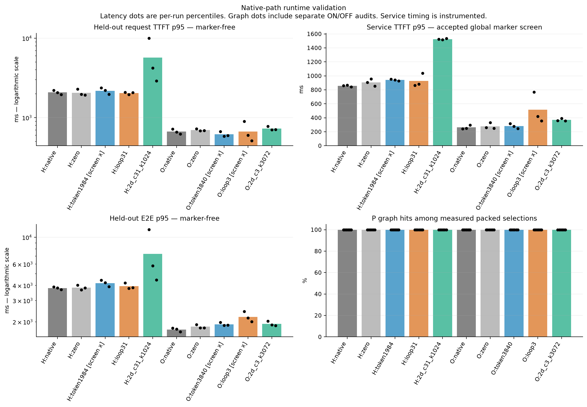
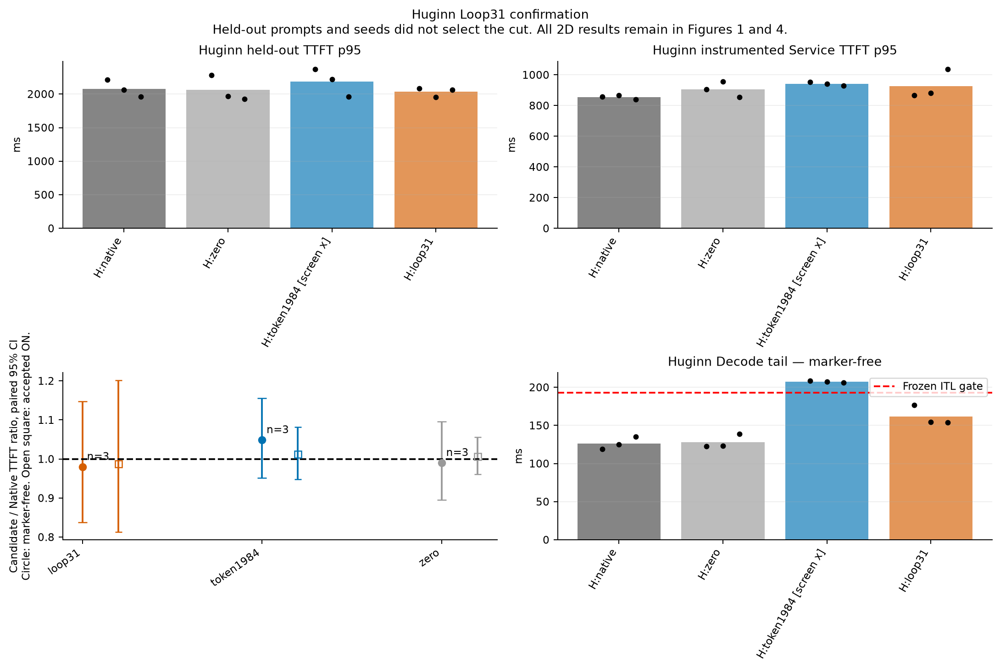
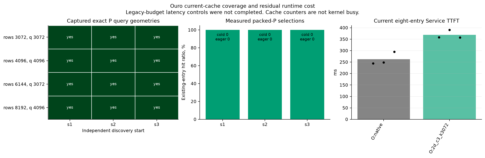
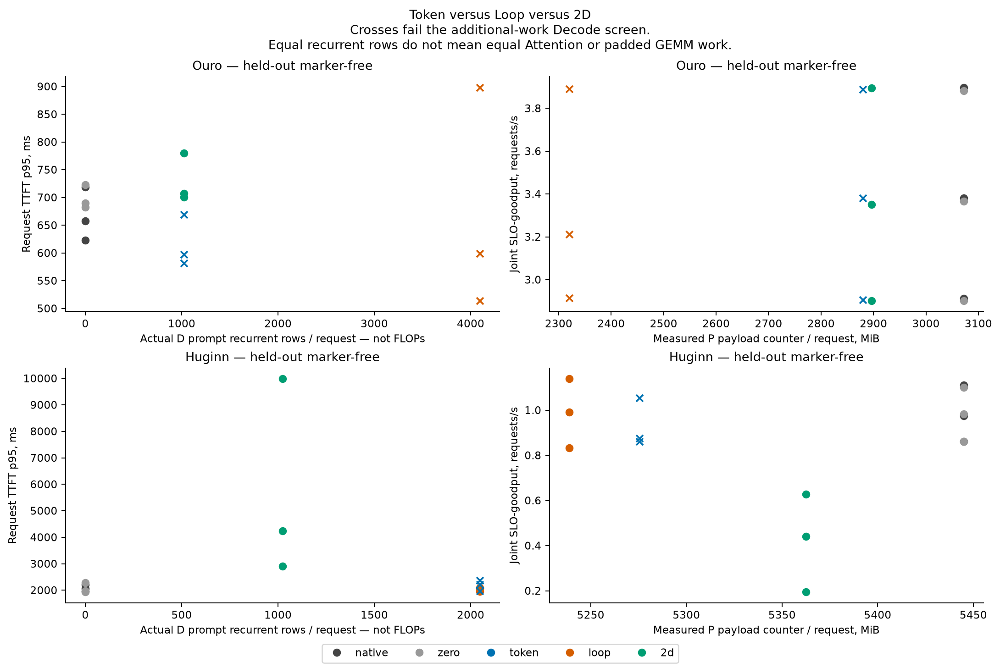
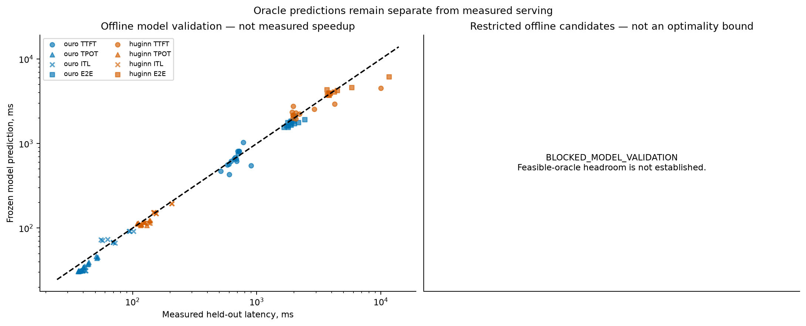

# Deep validation of native Token, Loop, and 2D splits

## 1. Outcome and scope

| Model | Measured static-method verdict | Repeated TTFT candidates | Exclusive Loop-specific verdict |
| --- | --- | --- | --- |
| ouro | NO_GO_ON_MEASURED_STATIC_CANDIDATES | NONE_CONFIRMED | NO_GO_LOOP_SPECIFIC |
| huginn | INCONCLUSIVE | NONE_CONFIRMED | NO_GO_LOOP_SPECIFIC |

Huginn Loop31 / Native, primary marker-free estimates:

| Metric | Paired ratio [95% CI] |
| --- | --- |
| TTFT p95 | 0.9800 [0.8373, 1.1471], n=3 |
| E2E p95 | 1.0357 [0.9351, 1.1472], n=3 |
| Joint SLO-goodput | 1.0024 [0.9268, 1.0841], n=3 |

A confidence interval that contains one does not confirm improvement. A favorable early start cannot replace the full repeated estimate.

Ouro 2D(c3,k3072) / Native TTFT p95 ratio: 1.0947 [1.0104, 1.1861], n=3.

The static-candidate verdict covers tested cuts and finite cohorts only. It does not establish a global impossibility result.

Generic logical-layer execution can reproduce the same Loop boundary, state ownership, and aliased weights. This case is `EQUIVALENT_MECHANISM`.

A wider 2D candidate space does not establish novelty. This campaign does not present a new online dynamic scheduler.

## 2. Environment, preservation, and time

Start: 2026-11-05T12:38:46+09:00.

Report time: 2026-11-05T22:23:55.015696+09:00.

Elapsed wall time: 9.753 hours. The fixed overall budget is 11 hours.

GPU stop: 2026-11-05T22:23:46+09:00.

Actual last scientific dispatch result: 2026-11-05T22:09:19.144293+09:00.

Approved burner workers restored: 8/8. The closeout receipt checks GPU process ownership and burner session IDs.

Source parent: `a1c9845ba4f7a56b4e990b16e4f25f96311311de`. Publication branch: `flashvep/loop-specific-native-split-deep-validation`.

The publication receipt records the evidence commit. The final remote-verification file records the final metadata commit and remote SHA.

The active checkout and real staged index remain separate from the publication branch. The external runtime remains unchanged.

The source archives record every loaded intervention and the qualified private-runtime diff for each run.

Preserved active HEAD: `f4ecea59f36f620c69c4fef09c590bf790802cd9`. Private runtime HEAD: `6b164d3844d35ab8e753df1864f0c87dc180401a`.

Preserved staged-index SHA256: `d0674d8fc531a451b003223020607e4b54dd264c5ca319a57ac387bd19a3e6b3`.

Preserved private-diff SHA256: `4904a311358c5cf6467678d0e1c30af38b5a96064cae4c96ed680943d7e694c7`.

Hardware: eight H100 80GB devices. Each serving job uses one isolated two-GPU 1P1D pair.

Ouro uses GPUs 0/1. Huginn uses GPUs 4/5. Other GPUs remain quiet during clean timing to limit shared-host interference.

The campaign does not reserve exclusive CPU cores. Background host jitter is not fully eliminated.

This campaign does not claim an eight-GPU serving speedup. Approved burners resume only when the experiment does not own the quiet lane.

Preservation details: [preservation.json](ouro_huginn_loop_specific_native_split_deep_validation/state/preservation.json).

## 3. Models, data, loads, and SLOs

| Model | Precision / depth | Input / output tokens | Low / medium / heavy nominal QPS | P/D slots |
| --- | --- | --- | --- | --- |
| ByteDance/Ouro-1.4B | Original BF16 / R4 | 4096 / 32 | 1.23460875 / 3.4569045 / 6.356 | 2 / 8 |
| tomg-group-umd/huginn-0125 | Original BF16 / R32 | 2048 / 16 | 0.37903355455 / 1.06129395274 / 1.971 | 2 / 8 |

All methods retain original weights, qualified numerical fixes, exact Attention, and full recurrent work. Huginn retains Prelude, Coda, and reinjection.

The prompt pool uses pinned ShareGPT and LongBench text. Inputs are length-controlled tokenizer prefixes. Outputs use fixed caps with ignore-EOS.

These lengths are not natural response distributions or Azure traffic. Huginn remains inside its 4096-token context limit.

Discovery uses the previous pool. Confirmation uses 128 new prompt IDs. Separate calibration uses 32 additional IDs.

Model revisions: Ouro `574fa66cb8bf5abdc979642d01cf2b79b16bfab1`. Huginn `bb6621b65e90b6a4b9b29ef88dc83866d450470c`.

ID, source-hash, and model-specific first-128-token-prefix checks exclude overlap between previous, held-out, and calibration pools.

The data manifest retains actual token IDs, source revisions, and dataset counts. Prefix caching remains disabled.

All paired methods share prompt IDs, generation seeds, fixed output caps, and open-loop Poisson arrival offsets.

SLOs remain unchanged from the previous campaign:

| Model | TTFT, ms | Request-average TPOT, ms | Token ITL p99, ms |
| --- | --- | --- | --- |
| Ouro | 1112.9925646819174 | 53.70702898374411 | 65.08287642151119 |
| Huginn | 1963.9920117333531 | 186.5715059141318 | 192.8212538175284 |

The additional-work screen requires TPOT p95 at most 90% of its limit and ITL p99 at most its frozen limit.

Joint goodput counts requests that meet both request TTFT and request-average TPOT. Failed and timed-out offered requests remain in the denominator.

Finite overloaded cohorts are not sustainable serving capacity.

Valid wire KV and reserved pool quota are different quantities. The quota uses full-depth block reservation times measured storage bytes per block. It is accounting inside an existing pool, not a new CUDA allocation per request. The derived credit limit includes receiving requests. It is not measured peak Decode concurrency. HBM percentages use the recorded NVML total of 81559 MiB per GPU.

| Model | D KV pool GiB | Pool / HBM % | Reserved blocks / req | Quota GiB / req | Quota / HBM % | Valid Native KV wire GiB / req | Derived KV credit limit | D compute slots |
| --- | --- | --- | --- | --- | --- | --- | --- | --- |
| ouro | 48.000 | 60.266 | 1032 | 3.023 | 3.796 | 3.000 | 15 | 8 |
| huginn | 67.354 | 84.565 | 4128 | 10.393 | 13.049 | 5.317 | 6 | 8 |

The current last_exited layout reserves complete layer blocks across recurrent depths. Valid nonrecurrent KV does not require every reserved depth plane. This allocation is not the model's theoretical minimum exact KV storage. A compact heterogeneous-layer pool was not implemented or qualified in this campaign.

## 4. Scheduler recovery and exactness

An unused D-local-probe pacing hook changed the effective D scheduler. The new configs disable this unused hook for every method.

The runtime checks requested and effective non-Wavefront settings after stage construction. The native one-depth Wavefront guard remains unchanged.

The isolated Huginn Native and Token1984 N8 tests separate this configuration correction from the later graph intervention.

Final CPU regressions: 34 tests. Failures: 0. Errors: 0. CPU tests do not replace GPU state qualification.

| Model | Method | N8 and N32 gate | Retained checks |
| --- | --- | --- | --- |
| ouro | native | PASS | b_ouro_native_reserved8_state8, b_ouro_native_reserved8_state32 |
| ouro | zero | PASS | b_ouro_zero_reserved8_state8, b_ouro_zero_reserved8_state32 |
| ouro | 2d_c3_k3072 | PASS | b_ouro_2d_c3_k3072_reserved8_state8, b_ouro_2d_c3_k3072_reserved8_state32 |
| ouro | loop3 | PASS | b_ouro_loop3_reserved8_state8, b_ouro_loop3_reserved8_state32 |
| ouro | token3840 | PASS | b_ouro_token3840_reserved8_state8, b_ouro_token3840_reserved8_state32 |
| ouro | token3072 | PASS | b_ouro_token3072_reserved8_state8, b_ouro_token3072_reserved8_state32 |
| ouro | loop2 | PASS | b_ouro_loop2_reserved8_state8, b_ouro_loop2_reserved8_state32 |
| ouro | 2d_c2_k2048 | PASS | b_ouro_2d_c2_k2048_reserved8_state8, b_ouro_2d_c2_k2048_reserved8_state32 |
| huginn | native | PASS | b_huginn_native_reserved8_state8, b_huginn_native_reserved8_state32 |
| huginn | zero | PASS | b_huginn_zero_reserved8_state8, b_huginn_zero_reserved8_state32 |
| huginn | token1984 | PASS | b_huginn_token1984_reserved8_state8, b_huginn_token1984_reserved8_state32 |
| huginn | loop31 | PASS | b_huginn_loop31_reserved8_state8, b_huginn_loop31_reserved8_state32 |
| huginn | 2d_c31_k1024 | PASS | b_huginn_2d_c31_k1024_reserved8_state8, b_huginn_2d_c31_k1024_reserved8_state32 |
| huginn | token1792 | PASS | b_huginn_token1792_reserved8_state8, b_huginn_token1792_reserved8_state32 |
| huginn | loop28 | PASS | b_huginn_loop28_reserved8_state8, b_huginn_loop28_reserved8_state32 |
| huginn | 2d_c28_k1536 | PASS | b_huginn_2d_c28_k1536_reserved8_state8, b_huginn_2d_c28_k1536_reserved8_state32 |

N32 means simultaneous submission of 32 requests. It does not mean 32 active GPU requests.

Exact gates compare output tokens, valid prompt KV hashes, the recorded prompt hidden state, transferred valid bytes, full recurrent rows, and source lifetime.

The hidden-state gate covers the recorded boundary. It does not compare every intermediate tensor after every operation.

Source retirement follows native ACK. Final coordinator credits and native allocations must retire. Forced full-PD branches are not a complete online admission policy.

Original-HF fidelity, downstream accuracy, and every-token hidden-state equivalence remain NOT_MEASURED.

## 5. Graph-cache diagnosis and control

The native packed graph cache uses exact query/context geometry. Startup order can fill four entries before primary single-request shapes appear.

The cache does not evict old entries. A full cache sends unseen shapes to eager execution.

The common intervention reserves primary B1/B2 geometries and performs one serial full-prompt warm-up before ordinary warm-up.

The cache4 qualification exposed a three-request D geometry. The main comparison therefore uses the common eight-entry cap and exact D-geometry warm-up.

All main methods use the same policy. Warm-up requests do not enter measured latency or throughput.

Ouro 2D requires four P geometries: 4096, 8192, 3072, and 6144 query rows. The query length remains part of each key.

The plan includes Legacy4, reserved4, and reserved8 sensitivity controls. Only explicit completed receipts establish their execution.

These control packages change admission and warm-up together. A missing control remains NOT_RUN_TIME_BUDGET, not a measured equivalence result.

A primary-shape hit is not a GPU kernel count. Capture time and host preparation time are not exclusive kernel time.

| Run | P hit ratio | Cold entries | Eager fallbacks | Cache entries |
| --- | --- | --- | --- | --- |
| d_huginn_2d_c31_k1024_heldout_s1_off128 | 1.0000 | 0 | 0 | 4 |
| d_huginn_2d_c31_k1024_heldout_s1_on128 | 1.0000 | 0 | 0 | 4 |
| d_huginn_2d_c31_k1024_heldout_s2_off128 | 1.0000 | 0 | 0 | 4 |
| d_huginn_2d_c31_k1024_heldout_s2_on128 | 1.0000 | 0 | 0 | 4 |
| d_huginn_2d_c31_k1024_heldout_s3_off128 | 1.0000 | 0 | 0 | 4 |
| d_huginn_2d_c31_k1024_heldout_s3_on128 | 1.0000 | 0 | 0 | 4 |
| d_huginn_loop31_heldout_s1_off128 | 1.0000 | 0 | 0 | 2 |
| d_huginn_loop31_heldout_s1_on128 | 1.0000 | 0 | 0 | 2 |
| d_huginn_loop31_heldout_s2_off128 | 1.0000 | 0 | 0 | 2 |
| d_huginn_loop31_heldout_s2_on128 | 1.0000 | 0 | 0 | 2 |
| d_huginn_loop31_heldout_s3_off128 | 1.0000 | 0 | 0 | 2 |
| d_huginn_loop31_heldout_s3_on128 | 1.0000 | 0 | 0 | 2 |
| d_huginn_native_heldout_s1_off128 | 1.0000 | 0 | 0 | 2 |
| d_huginn_native_heldout_s1_on128 | 1.0000 | 0 | 0 | 2 |
| d_huginn_native_heldout_s2_off128 | 1.0000 | 0 | 0 | 2 |
| d_huginn_native_heldout_s2_on128 | 1.0000 | 0 | 0 | 2 |
| d_huginn_native_heldout_s3_off128 | 1.0000 | 0 | 0 | 2 |
| d_huginn_native_heldout_s3_on128 | 1.0000 | 0 | 0 | 2 |
| d_huginn_token1984_heldout_s1_off128 | 1.0000 | 0 | 0 | 2 |
| d_huginn_token1984_heldout_s1_on128 | 1.0000 | 0 | 0 | 2 |
| d_huginn_token1984_heldout_s2_off128 | 1.0000 | 0 | 0 | 2 |
| d_huginn_token1984_heldout_s2_on128 | 1.0000 | 0 | 0 | 2 |
| d_huginn_token1984_heldout_s3_off128 | 1.0000 | 0 | 0 | 2 |
| d_huginn_token1984_heldout_s3_on128 | 1.0000 | 0 | 0 | 2 |
| d_huginn_zero_heldout_s1_off128 | 1.0000 | 0 | 0 | 2 |
| d_huginn_zero_heldout_s1_on128 | 1.0000 | 0 | 0 | 2 |
| d_huginn_zero_heldout_s2_off128 | 1.0000 | 0 | 0 | 2 |
| d_huginn_zero_heldout_s2_on128 | 1.0000 | 0 | 0 | 2 |
| d_huginn_zero_heldout_s3_off128 | 1.0000 | 0 | 0 | 2 |
| d_huginn_zero_heldout_s3_on128 | 1.0000 | 0 | 0 | 2 |
| d_ouro_2d_c3_k3072_heldout_s1_off128 | 1.0000 | 0 | 0 | 4 |
| d_ouro_2d_c3_k3072_heldout_s1_on128 | 1.0000 | 0 | 0 | 4 |
| d_ouro_2d_c3_k3072_heldout_s2_off128 | 1.0000 | 0 | 0 | 4 |
| d_ouro_2d_c3_k3072_heldout_s2_on128 | 1.0000 | 0 | 0 | 4 |
| d_ouro_2d_c3_k3072_heldout_s3_off128 | 1.0000 | 0 | 0 | 4 |
| d_ouro_2d_c3_k3072_heldout_s3_on128 | 1.0000 | 0 | 0 | 4 |
| d_ouro_loop3_heldout_s1_off128 | 1.0000 | 0 | 0 | 2 |
| d_ouro_loop3_heldout_s1_on128 | 1.0000 | 0 | 0 | 2 |
| d_ouro_loop3_heldout_s2_off128 | 1.0000 | 0 | 0 | 2 |
| d_ouro_loop3_heldout_s2_on128 | 1.0000 | 0 | 0 | 2 |
| d_ouro_loop3_heldout_s3_off128 | 1.0000 | 0 | 0 | 2 |
| d_ouro_loop3_heldout_s3_on128 | 1.0000 | 0 | 0 | 2 |
| d_ouro_native_heldout_s1_off128 | 1.0000 | 0 | 0 | 2 |
| d_ouro_native_heldout_s1_on128 | 1.0000 | 0 | 0 | 2 |
| d_ouro_native_heldout_s2_off128 | 1.0000 | 0 | 0 | 2 |
| d_ouro_native_heldout_s2_on128 | 1.0000 | 0 | 0 | 2 |
| d_ouro_native_heldout_s3_off128 | 1.0000 | 0 | 0 | 2 |
| d_ouro_native_heldout_s3_on128 | 1.0000 | 0 | 0 | 2 |
| d_ouro_token3840_heldout_s1_off128 | 1.0000 | 0 | 0 | 2 |
| d_ouro_token3840_heldout_s1_on128 | 1.0000 | 0 | 0 | 2 |
| d_ouro_token3840_heldout_s2_off128 | 1.0000 | 0 | 0 | 2 |
| d_ouro_token3840_heldout_s2_on128 | 1.0000 | 0 | 0 | 2 |
| d_ouro_token3840_heldout_s3_off128 | 1.0000 | 0 | 0 | 2 |
| d_ouro_token3840_heldout_s3_on128 | 1.0000 | 0 | 0 | 2 |
| d_ouro_zero_heldout_s1_off128 | 1.0000 | 0 | 0 | 2 |
| d_ouro_zero_heldout_s1_on128 | 1.0000 | 0 | 0 | 2 |
| d_ouro_zero_heldout_s2_off128 | 1.0000 | 0 | 0 | 2 |
| d_ouro_zero_heldout_s2_on128 | 1.0000 | 0 | 0 | 2 |
| d_ouro_zero_heldout_s3_off128 | 1.0000 | 0 | 0 | 2 |
| d_ouro_zero_heldout_s3_on128 | 1.0000 | 0 | 0 | 2 |

Huginn 2D(c28,k1536) failed during batch-four D geometry warm-up. The allocation requested 84.00 MiB with 78.50 MiB free. This failure occurred before measurement. It is BLOCKED_RESOURCE, not a slow serving result or an output divergence. The unchanged OOM action does not enter later calibration or oracle expansion. Graph retention, transient workspace, and allocator fragmentation are not fully isolated. A smaller common KV pool is an untested control, not an applied repair.

The D geometry hook originally reread its terminal JSON marker during main scheduling. The exact closure replay produced ten reads for ten terminal-state callbacks. Terminal-state caching reduced this to one read while retaining the active-import barrier and native readiness predicate. The warmup_hook_control.json file retains the fixed Huginn Token1984 N8/N32 state receipts.

Historical discovery keeps the original observer. New calibration and held-out configurations explicitly retire the terminal hook. These observer versions do not enter one clean paired estimate. Cut selection used the historical observer. Cuts were not retuned after this correction. The selected Token partial is not a proven best cut under the corrected observer. The following single before/after controls share inputs and arrival traces. They are not randomized repeated causal estimates. The CPU replay proves repeated I/O, not that I/O explains every latency change.

| Model | Method | New / old response span | TTFT p95 ratio | TPOT p95 ratio | ITL p99 ratio |
| --- | --- | --- | --- | --- | --- |
| huginn | native | 0.9981 | 0.9725 | 0.8880 | 0.9614 |
| huginn | loop31 | 0.9988 | 0.9786 | 0.9299 | 0.9600 |
| huginn | token1984 | 0.9995 | 1.0165 | 0.9811 | 0.9865 |
| ouro | token3840 | 1.0000 | 0.9862 | 0.9902 | 1.0012 |

Arrival-dominated response span can change little while request tails change more. A global 5% pass does not prove a negligible TPOT or ITL perturbation.

## 6. Held-out clean serving and load dependence

The following cells average per-run percentiles across independent starts. They are not pooled request percentiles.

Full p50/p95/p99 metrics and offered/realized/completed rates remain in serving_results.csv and raw per-request files.

| Model | Load | Method | Starts | TTFT p95 ms | TPOT p95 ms | ITL p99 ms | E2E p95 ms | Joint goodput req/s | Decode-screen passes |
| --- | --- | --- | --- | --- | --- | --- | --- | --- | --- |
| huginn | heavy | native | 1 | 20856.258 | 116.567 | 123.326 | 22546.294 | 0.0633 | 1/1 |
| huginn | low | native | 1 | 1589.021 | 107.144 | 115.964 | 3204.916 | 0.4410 | 1/1 |
| huginn | low | token1984 | 1 | 1576.891 | 119.673 | 195.557 | 3356.652 | 0.4375 | 0/1 |
| huginn | medium | 2d_c31_k1024 | 3 | 5706.535 | 109.561 | 148.661 | 7295.730 | 0.4206 | 3/3 |
| huginn | medium | loop31 | 3 | 2034.640 | 129.794 | 161.807 | 3942.511 | 0.9871 | 3/3 |
| huginn | medium | native | 3 | 2077.833 | 116.750 | 126.472 | 3803.349 | 0.9821 | 3/3 |
| huginn | medium | token1984 | 3 | 2182.710 | 137.972 | 207.278 | 4179.194 | 0.9294 | 0/3 |
| huginn | medium | zero | 3 | 2060.831 | 120.879 | 128.090 | 3839.077 | 0.9814 | 3/3 |
| ouro | heavy | native | 1 | 5843.403 | 38.866 | 43.488 | 7020.286 | 1.1440 | 1/1 |
| ouro | low | native | 1 | 514.108 | 29.708 | 35.107 | 1401.484 | 1.4291 | 1/1 |
| ouro | medium | 2d_c3_k3072 | 3 | 729.204 | 40.482 | 58.549 | 1925.273 | 3.3820 | 3/3 |
| ouro | medium | loop3 | 3 | 670.439 | 51.567 | 96.940 | 2201.324 | 3.3391 | 0/3 |
| ouro | medium | native | 3 | 666.473 | 36.676 | 39.785 | 1724.859 | 3.3968 | 3/3 |
| ouro | medium | token3840 | 3 | 615.781 | 43.927 | 70.525 | 1910.892 | 3.3915 | 0/3 |
| ouro | medium | zero | 3 | 698.449 | 37.706 | 40.969 | 1824.475 | 3.3835 | 3/3 |

## 7. Huginn Loop31 and paired uncertainty

Marker-free confirmation is the primary latency comparison. The unit of replication is an independent start, not an individual request or token.

Intervals use a paired t interval on log ratios. Three to five starts require the stated small-sample distribution assumption.

These intervals condition on the fixed held-out prompt pool. They describe start and arrival variability, not every possible text distribution.

A TTFT confidence interval below one supports a TTFT reduction. It does not establish an E2E or goodput improvement.

If all tested Token partials fail the Decode screen, Native full-PD remains the safe Token-only endpoint. An unsafe diagnostic partial is not a strong safe baseline.

| Model | Method / Native | TTFT ratio [95% CI] | E2E ratio [95% CI] | Goodput ratio [95% CI] |
| --- | --- | --- | --- | --- |
| ouro | 2d_c3_k3072 | 1.0947 [1.0104, 1.1861], n=3 | 1.1159 [1.0533, 1.1823], n=3 | 0.9955 [0.9859, 1.0052], n=3 |
| ouro | loop3 | 0.9793 [0.5707, 1.6804], n=3 | 1.2727 [1.0837, 1.4948], n=3 | 0.9828 [0.9146, 1.0560], n=3 |
| ouro | token3840 | 0.9238 [0.8338, 1.0235], n=3 | 1.1080 [1.0329, 1.1885], n=3 | 0.9985 [0.9953, 1.0016], n=3 |
| ouro | zero | 1.0495 [0.9294, 1.1850], n=3 | 1.0578 [0.9911, 1.1290], n=3 | 0.9961 [0.9959, 0.9963], n=3 |
| huginn | 2d_c31_k1024 | 2.3941 [0.5762, 9.9473], n=3 | 1.7626 [0.5489, 5.6594], n=3 | 0.3860 [0.0634, 2.3516], n=3 |
| huginn | loop31 | 0.9800 [0.8373, 1.1471], n=3 | 1.0357 [0.9351, 1.1472], n=3 | 1.0024 [0.9268, 1.0841], n=3 |
| huginn | token1984 | 1.0486 [0.9513, 1.1558], n=3 | 1.0976 [1.0036, 1.2005], n=3 | 0.9475 [0.8292, 1.0826], n=3 |
| huginn | zero | 0.9902 [0.8952, 1.0952], n=3 | 1.0090 [0.9166, 1.1106], n=3 | 0.9997 [0.9794, 1.0203], n=3 |

Marker ON/OFF runs remain separate. Service TTFT is NOT_MEASURED in marker-free runs.

The safe Token reference also considers Native and zero-offload full-prefix endpoints. Discovery fixes this choice before held-out results exist.

The absolute global-wall interference screen remains 5%. Separate columns report local TTFT and ITL tail changes.

A global pass does not prove negligible tail perturbation. Rejected traces do not become clean performance evidence.

| Model | Method / selected Token | TTFT ratio [95% CI] | E2E ratio [95% CI] | Goodput ratio [95% CI] |
| --- | --- | --- | --- | --- |
| huginn | 2d_c31_k1024 / zero | 2.4178 [0.6282, 9.3059], n=3 | 1.7469 [0.5571, 5.4783], n=3 | 0.3862 [0.0642, 2.3213], n=3 |
| huginn | loop31 / zero | 0.9898 [0.8103, 1.2090], n=3 | 1.0265 [0.9818, 1.0733], n=3 | 1.0027 [0.9222, 1.0903], n=3 |
| huginn | native / zero | 1.0099 [0.9130, 1.1171], n=3 | 0.9911 [0.9004, 1.0910], n=3 | 1.0003 [0.9801, 1.0210], n=3 |
| huginn | token1984 / zero | 1.0590 [0.9278, 1.2088], n=3 | 1.0879 [0.9455, 1.2517], n=3 | 0.9478 [0.8201, 1.0953], n=3 |
| ouro | 2d_c3_k3072 / native | 1.0947 [1.0104, 1.1861], n=3 | 1.1159 [1.0533, 1.1823], n=3 | 0.9955 [0.9859, 1.0052], n=3 |
| ouro | loop3 / native | 0.9793 [0.5707, 1.6804], n=3 | 1.2727 [1.0837, 1.4948], n=3 | 0.9828 [0.9146, 1.0560], n=3 |
| ouro | token3840 / native | 0.9238 [0.8338, 1.0235], n=3 | 1.1080 [1.0329, 1.1885], n=3 | 0.9985 [0.9953, 1.0016], n=3 |
| ouro | zero / native | 1.0495 [0.9294, 1.1850], n=3 | 1.0578 [0.9911, 1.1290], n=3 | 0.9961 [0.9959, 0.9963], n=3 |

The next table compares every method with the prospectively selected Token partial. The actual held-out Decode screen, not its old discovery label, determines eligibility.

| Model | Method / selected Token partial | Token Decode-screen passes | TTFT ratio [95% CI] | E2E ratio [95% CI] | Goodput ratio [95% CI] |
| --- | --- | --- | --- | --- | --- |
| huginn | 2d_c31_k1024 / token1984 | 0/3 | 2.2831 [0.5881, 8.8641], n=3 | 1.6058 [0.5422, 4.7558], n=3 | 0.4074 [0.0695, 2.3875], n=3 |
| huginn | loop31 / token1984 | 0/3 | 0.9346 [0.7245, 1.2057], n=3 | 0.9436 [0.8421, 1.0573], n=3 | 1.0580 [0.8654, 1.2934], n=3 |
| huginn | native / token1984 | 0/3 | 0.9537 [0.8652, 1.0512], n=3 | 0.9110 [0.8330, 0.9964], n=3 | 1.0555 [0.9237, 1.2060], n=3 |
| huginn | zero / token1984 | 0/3 | 0.9443 [0.8273, 1.0778], n=3 | 0.9192 [0.7989, 1.0576], n=3 | 1.0551 [0.9130, 1.2193], n=3 |
| ouro | 2d_c3_k3072 / token3840 | 0/3 | 1.1850 [1.1359, 1.2362], n=3 | 1.0072 [0.9640, 1.0523], n=3 | 0.9970 [0.9844, 1.0098], n=3 |
| ouro | loop3 / token3840 | 0/3 | 1.0601 [0.6084, 1.8469], n=3 | 1.1487 [0.9620, 1.3716], n=3 | 0.9843 [0.9131, 1.0610], n=3 |
| ouro | native / token3840 | 0/3 | 1.0825 [0.9771, 1.1993], n=3 | 0.9025 [0.8414, 0.9681], n=3 | 1.0015 [0.9984, 1.0047], n=3 |
| ouro | zero / token3840 | 0/3 | 1.1360 [1.0184, 1.2672], n=3 | 0.9547 [0.9435, 0.9661], n=3 | 0.9976 [0.9943, 1.0009], n=3 |

Accepted ON comparisons remain separate from marker-free comparisons. A ratio of ratios below one means markers show a larger apparent relative gain. This finite control also contains scheduling noise. It does not identify a pure marker effect.

| Model | Candidate | Global marker passes / pairs | ON candidate / Native TTFT [95% CI] | (ON ratio) / (OFF ratio) [95% CI] |
| --- | --- | --- | --- | --- |
| ouro | 2d_c3_k3072 | 3/3 | 1.1035 [0.8886, 1.3705], n=3 | 1.0081 [0.7643, 1.3296], n=3 |
| ouro | loop3 | 3/3 | 0.9501 [0.5800, 1.5563], n=3 | 0.9702 [0.8951, 1.0516], n=3 |
| ouro | token3840 | 3/3 | 0.8822 [0.8394, 0.9272], n=3 | 0.9550 [0.8659, 1.0533], n=3 |
| ouro | zero | 3/3 | 1.0160 [0.9432, 1.0944], n=3 | 0.9681 [0.8693, 1.0781], n=3 |
| huginn | 2d_c31_k1024 | 3/3 | 2.5770 [0.7578, 8.7638], n=3 | 1.0764 [0.6922, 1.6739], n=3 |
| huginn | loop31 | 3/3 | 0.9881 [0.8126, 1.2015], n=3 | 1.0082 [0.9540, 1.0655], n=3 |
| huginn | token1984 | 3/3 | 1.0125 [0.9477, 1.0816], n=3 | 0.9655 [0.8217, 1.1346], n=3 |
| huginn | zero | 3/3 | 1.0072 [0.9608, 1.0559], n=3 | 1.0172 [0.8798, 1.1761], n=3 |

## 8. TTFT decomposition and actual migration

Native versus feature-enabled zero-offload is a same-boundary transport/runtime control. Loop versus zero is a separate redistribution comparison.

A Native-to-Loop difference must not automatically become a Loop-compute gain. The control ratios remain in paired_zero_path_reference_ratios.json.

Request TTFT starts at scheduled arrival. Queue/admission ends at the first actual model-stream Prefill entry.

This interval includes scheduling, input preparation, and device queueing. It is not exclusively P-ready queue waiting.

Service TTFT starts at that entry and includes native handoff, D continuation, Coda, and first output delivery.

The per-request timestamp file reports clock-mapping brackets. Nonlinear clock drift is not fully bounded.

Per-request intervals precede percentiles. Component p95 values are not added. Overlapping host/device/transfer durations are not added as speedup.

Work counters report actual serving continuations. They do not count the previous independent D-local probes.

Recurrent token rows are not FLOPs. Token suffix Attention reads the completed prefix, so equal rows do not imply equal Attention work.

Transfer payload counters exclude control messages and transport headers. Commit, ACK, and source-retention intervals remain separate.

HBM snapshots report GiB and percentages of the recorded physical HBM total. Allocator totals overlap component tensors.

The matched reservation policy retains full-depth request KV allocation. Fewer valid transferred rows do not imply released physical HBM.

Exposed graph tensors do not account for every opaque graph-pool or library allocation. Warm-up memory is not claimed as clean peak HBM.

Current kernel union, SM cycles, achieved bandwidth, and achieved GEMM throughput are NOT_MEASURED unless a separately qualified profile is present.

CUDA event enclosures can include launch gaps and waits. They are not exclusive GPU kernel time.

A B2 operation can assign the same device enclosure to both requests. A larger per-request enclosure does not establish doubled FLOPs.

Accepted marker runs provide the following decomposition. Cells average per-run p95 values. Columns are not additive critical-path components.

| Model | Method | Accepted starts | TTFT p95 ms | Queue p95 ms | Service TTFT p95 ms | P device enclosure p95 ms | Observed handoff p95 ms | D prompt enclosure p95 ms |
| --- | --- | --- | --- | --- | --- | --- | --- | --- |
| huginn | 2d_c31_k1024 | 3 | 5968.427 | 4621.952 | 1524.876 | 1150.142 | 303.466 | 27.719 |
| huginn | loop31 | 3 | 2024.087 | 1216.937 | 927.828 | 579.086 | 123.822 | 27.436 |
| huginn | native | 3 | 2052.445 | 1338.947 | 855.266 | 605.195 | 106.228 | NOT_MEASURED |
| huginn | token1984 | 3 | 2077.466 | 1244.380 | 940.462 | 597.377 | 112.628 | 77.841 |
| huginn | zero | 3 | 2065.978 | 1313.135 | 905.873 | 605.141 | 171.897 | NOT_MEASURED |
| ouro | 2d_c3_k3072 | 3 | 758.563 | 408.595 | 368.745 | 309.300 | 37.226 | 13.829 |
| ouro | loop3 | 3 | 666.062 | 280.336 | 513.974 | 137.989 | 41.167 | 46.663 |
| ouro | native | 3 | 686.638 | 460.584 | 262.646 | 183.029 | 26.638 | NOT_MEASURED |
| ouro | token3840 | 3 | 606.246 | 361.439 | 279.752 | 170.107 | 25.592 | 28.985 |
| ouro | zero | 3 | 697.174 | 476.990 | 279.376 | 182.838 | 24.340 | NOT_MEASURED |

Independent instrumented calibration provides these operation costs. B1 means one request in the recorded prompt operation. Each cell is a separate median, not a paired critical-path saving. Device enclosures can include launch gaps or waits. Observed handoff is not pure wire time. The wire column reports actual accepted KV and hidden bytes per request.

| Model | Method | P B1 operation medians, ms | D B1 prompt median, ms | Serial observed handoff median, ms | KV + hidden GiB / request |
| --- | --- | --- | --- | --- | --- |
| ouro | native | prelude=181.317 | NOT_MEASURED | 20.411 | 3.00000 |
| ouro | zero | prelude=181.158 | NOT_MEASURED | 19.548 | 3.00000 |
| ouro | token3840 | prelude=168.508 | 28.924 | 13.621 | 2.81250 |
| ouro | token3072 | prelude=132.625 | 54.022 | 14.178 | 2.25000 |
| ouro | loop3 | prelude=135.887 | 46.337 | 14.272 | 2.26562 |
| ouro | loop2 | prelude=91.988 | 91.836 | 10.777 | 1.51562 |
| ouro | 2d_c3_k3072 | prelude=136.938, recurrent=33.573 | 13.750 | 19.844 | 2.82812 |
| ouro | 2d_c2_k2048 | prelude=90.750, recurrent=44.227 | 47.102 | 15.314 | 2.26562 |
| huginn | native | prelude=594.871 | NOT_MEASURED | 189.302 | 5.31736 |
| huginn | zero | prelude=593.774 | NOT_MEASURED | 90.686 | 5.31736 |
| huginn | token1984 | prelude=584.805 | 77.512 | 134.836 | 5.15186 |
| huginn | token1792 | prelude=527.841 | 97.484 | 59.863 | 4.65525 |
| huginn | loop31 | prelude=567.690 | 27.906 | 119.014 | 5.11597 |
| huginn | loop28 | prelude=502.497 | 79.710 | 112.514 | 4.63257 |
| huginn | 2d_c31_k1024 | prelude=556.642, recurrent=14.170 | 14.401 | 90.417 | 5.23682 |

These counts cover actual held-out serving executions. Repeated starts do not create additional independent prompt texts.

| Model | Method | Offloaded / offered executions | D recurrent rows / req | KV GiB / req | Hidden MiB / req | Submissions / req | Descriptors / req |
| --- | --- | --- | --- | --- | --- | --- | --- |
| huginn | 2d_c31_k1024 | 384/384 | 1024.0 | 5.197 | 41.250 | 84.0 | 8022.7 |
| huginn | loop31 | 384/384 | 2048.0 | 5.076 | 41.250 | 82.0 | 8018.0 |
| huginn | native | 0/384 | 0.0 | 5.317 | 0.020 | 86.0 | 8030.6 |
| huginn | token1984 | 384/384 | 2048.0 | 5.151 | 0.665 | 83.0 | 7779.7 |
| huginn | zero | 0/384 | 0.0 | 5.317 | 0.020 | 86.0 | 8030.9 |
| ouro | 2d_c3_k3072 | 384/384 | 1024.0 | 2.812 | 16.000 | 46.0 | 60.1 |
| ouro | loop3 | 384/384 | 4096.0 | 2.250 | 16.000 | 37.0 | 46.3 |
| ouro | native | 0/384 | 0.0 | 3.000 | 0.004 | 49.0 | 62.5 |
| ouro | token3840 | 384/384 | 1024.0 | 2.812 | 0.004 | 46.0 | 65.2 |
| ouro | zero | 0/384 | 0.0 | 3.000 | 0.004 | 49.0 | 66.3 |

The next intervals use existing native host-message receipts in marker-free runs. Cells average per-run p95 values. They are not exclusive DMA or CPU times. Source credit retirement is not a complete physical-buffer lifetime measurement. Negative observer-order intervals remain in the per-request file. These percentiles are not additive.

| Model | Method | Starts | P-complete to commit ms | Commit to received ms | Received to P ACK ms | P ACK to P forget ms | P-complete to P credit release ms |
| --- | --- | --- | --- | --- | --- | --- | --- |
| huginn | 2d_c31_k1024 | 3 | 257.315 | 23.012 | 0.680 | 0.621 | 266.688 |
| huginn | loop31 | 3 | 165.662 | 8.553 | 0.050 | 0.587 | 175.690 |
| huginn | native | 3 | 168.760 | 9.794 | 0.036 | 0.454 | 177.087 |
| huginn | token1984 | 3 | 138.040 | 9.604 | 0.047 | 0.536 | 165.875 |
| huginn | zero | 3 | 125.461 | 10.955 | 0.049 | 0.536 | 132.691 |
| ouro | 2d_c3_k3072 | 3 | 7.249 | 16.862 | 0.064 | 0.212 | 26.316 |
| ouro | loop3 | 3 | 8.472 | 20.806 | 0.223 | 0.304 | 45.034 |
| ouro | native | 3 | 7.879 | 18.257 | 0.060 | 0.219 | 25.917 |
| ouro | token3840 | 3 | 7.571 | 16.506 | 0.051 | 0.235 | 24.147 |
| ouro | zero | 3 | 9.500 | 19.997 | 0.070 | 0.272 | 31.268 |

Accepted marker runs also expose post-import continuation gaps. The gaps use per-request host receipts and model-stream clock projections before percentile calculation. They include scheduling, input preparation, and device queueing. A large gap does not prove CPU inefficiency or an idle GPU. Decode-priority work can occupy the device during that gap.

| Model | Method | Accepted starts | Received to D prompt entry p95 ms | P stream end to D prompt entry p95 ms | D prompt end to first output p95 ms |
| --- | --- | --- | --- | --- | --- |
| huginn | 2d_c31_k1024 | 3 | 11.112 | 361.824 | 3.112 |
| huginn | loop31 | 3 | 7.704 | 332.375 | 2.575 |
| huginn | token1984 | 3 | 6.481 | 272.625 | 2.554 |
| ouro | 2d_c3_k3072 | 3 | 15.394 | 56.109 | 3.460 |
| ouro | loop3 | 3 | 273.751 | 306.648 | 3.920 |
| ouro | token3840 | 3 | 38.044 | 79.639 | 3.912 |

## 9. Structural attribution and logical-layer equivalence

The qualified numerical fix uses fixed 256-row Down-projection GEMMs. A full prompt does not imply one large Down-projection GEMM.

For B1 Huginn, Loop31 moves 2048 semantic rows through one loop. Token1984 moves 64 rows through 32 loops.

The unchanged Down projection uses eight fixed tiles per core layer in the first case and 32 in the second.

This fourfold tile difference covers that projection only. Batching can change it. It is not a measured fourfold total-runtime difference.

For Ouro, Loop3 and Token3072 have equal semantic D rows and equal fixed Down-tile counts at B1. Their Attention and submission costs differ.

Huginn Loop31 also changes full-prompt Coda placement. Its 3.125% recurrent-row fraction excludes Coda and is not a FLOP fraction.

Small service changes near capacity can amplify queue delay. The observed queue and Service TTFT results must support that explanation.

A generic logical-layer split can reproduce these boundaries with shared recurrent-weight aliases. Both workers already hold the full model.

This equivalence is structural. This campaign did not measure a separate generic-layer serving implementation.

Therefore a favorable native-runtime trade-off does not establish exclusive Loop-specific architecture novelty or a weight-residency saving.

## 10. Validated offline oracle

Validation status: `MODEL_VALIDATION_FAILED_OR_INCOMPLETE`. Headroom status: `BLOCKED_MODEL_VALIDATION`.

Calibration prompts remain disjoint from discovery and confirmation. Version 1 froze before confirmation dispatches.

Version 1 incorrectly included queued GPU work in its preparation enclosure. Its frozen model and predictions remain unchanged as failed evidence.

Version 2 uses the host ModelRunner entry after input preparation. This host enclosure can still include synchronization, not just CPU work.

Version 2 fitted calibration data only. It froze after four Huginn confirmation dispatches began, so those dispatches cannot validate this version.

Every included Version 2 prediction precedes its own GPU dispatch. The protocol receipt records this deviation and all excluded dispatches.

Validation checks frozen hashes and prediction timestamps against the estimated subprocess start.

Neither version uses confirmation outcomes to fit costs. Version 2 does not inherit Version 1 validation coverage.

Validated prediction directory: `predictions_v2`. Cost model: `oracle_cost_model_frozen_v2.json`.

The event model includes P/D serialization, homogeneous batching, native transfer, ACK/source leases, D KV receiving credit, and fixed-depth Decode.

Missing batch costs require explicit interpolation or extrapolation. Event enclosures and residuals are not exclusive GPU/CPU execution times.

The validation screen requires median absolute relative error at most 15% and p95 error at most 25%. It also rejects false Decode-safe predictions.

The report retains start-cluster error intervals. An inaccurate model cannot establish Feasible Oracle headroom.

The restricted offline search knows future arrival times and output caps. It is not an online method or a global optimality certificate.

Mixed-frontier GPU scheduling remains unqualified. Static-model accuracy alone does not prove accuracy for every dynamic plan.

The frozen prediction-error limits are 15% for the median and 25% for p95. The following values are absolute relative errors, not serving speedups.

| Model | Clean median error % | Clean p95 error % | Service median error % | Service p95 error % | Model error screen |
| --- | --- | --- | --- | --- | --- |
| ouro | 12.568 | 28.196 | 18.524 | 46.808 | False |
| huginn | 5.341 | 38.867 | 14.187 | 28.539 | False |

False predicted Decode-safe cases: 0. A zero false-safe count does not repair timing errors or missing family-level validation coverage. Start-cluster error intervals and per-family coverage remain in oracle_static_validation.json.

## 11. Prior work and reusable implementation

The Token baseline is a FluidToken-style reproduction, not the official FluidPD system.

This campaign measures the static prefix/suffix primitive. It does not implement the full PPI/DPI controller or FluidRole.

FluidPD describes pressure-aware Token deflection with PPI/DPI and Decode slack. Our experiment retains native worker roles and exact prefix/suffix handoff.

FluidPD permits stream-average TPOT slack borrowing. This experiment also retains its stricter frozen ITL p99 gate. The SLO contracts are not identical.

The current native runner groups the selected D continuation into one operation. A Token suffix can therefore contain more recurrent iterations per scheduling quantum.

Alternative suffix pacing or a common smaller D recurrence quantum is NOT_MEASURED. A result against these atomic candidates does not dominate every Token scheduler.

Source: [FluidPD](https://arxiv.org/html/2610.06917v1). The inspected paper did not identify reusable official implementation code.

The LoopServe reference uses a different pooled cache and execution ABI. The campaign reuses compatible scheduling lessons, not an unverified runtime transplant.

## 12. Figures and complete evidence

The figure manifest records measured, structural, modeled, and missing evidence separately.

[Figure manifest](ouro_huginn_loop_specific_native_split_deep_validation/figure_manifest.json).

[Serving results](ouro_huginn_loop_specific_native_split_deep_validation/serving_results.csv).

[Paired intervals](ouro_huginn_loop_specific_native_split_deep_validation/paired_confirmation_ratios.json).

[Graph results](ouro_huginn_loop_specific_native_split_deep_validation/graph_cache_results.csv).

[Work and payload](ouro_huginn_loop_specific_native_split_deep_validation/work_and_payload.csv).

[Fixed-tile accounting](ouro_huginn_loop_specific_native_split_deep_validation/fixed_tile_accounting.csv).

[HBM inventory](ouro_huginn_loop_specific_native_split_deep_validation/gpu_memory_gib_percent.csv).

[Oracle validation](ouro_huginn_loop_specific_native_split_deep_validation/oracle_static_validation.json).

### figure_1_native_path_runtime_validation

Evidence status: `MEASURED`.



[Vector PDF](ouro_huginn_loop_specific_native_split_deep_validation/figures/figure_1_native_path_runtime_validation.pdf)

### figure_2_huginn_loop31_heldout_confirmation

Evidence status: `MEASURED`.



[Vector PDF](ouro_huginn_loop_specific_native_split_deep_validation/figures/figure_2_huginn_loop31_heldout_confirmation.pdf)

### figure_3_ouro_graph_cache_sensitivity

Evidence status: `MEASURED_CACHE_COVERAGE_LEGACY_LATENCY_CONTROL_NOT_RUN`.



[Vector PDF](ouro_huginn_loop_specific_native_split_deep_validation/figures/figure_3_ouro_graph_cache_sensitivity.pdf)

### figure_4_token_loop_2d_work_and_payload

Evidence status: `MEASURED`.



[Vector PDF](ouro_huginn_loop_specific_native_split_deep_validation/figures/figure_4_token_loop_2d_work_and_payload.pdf)

### figure_5_validated_oracle_headroom

Evidence status: `BLOCKED_MODEL_VALIDATION`.



[Vector PDF](ouro_huginn_loop_specific_native_split_deep_validation/figures/figure_5_validated_oracle_headroom.pdf)

## 13. Failures, missing conditions, and research decision

Completed dispatches: 187. Failed dispatches: 1.

Completed-dispatch offered requests: 14360. This count includes exactness and calibration, not just clean serving.

The configuration inventory retains every prepared and attempted condition. Failure logs remain intact.

N512 persistence is NOT_RUN unless its explicit state receipt exists. N128 repetition does not become 512 independent texts.

A missing or inaccurate feasible oracle remains INCONCLUSIVE. It cannot establish structural absence of headroom.

Do not begin a full dynamic-scheduler campaign solely because a selected static cut improves TTFT. Require Decode-safe repeated gains and a justified contribution.

The following coverage counts include marker-free N128 starts only. Missing load comparisons do not inherit calibration or previous-campaign results.

| Model | Method | Low starts | Medium starts | Heavy starts |
| --- | --- | --- | --- | --- |
| ouro | native | 1 | 3 | 1 |
| ouro | zero | NOT_RUN_TIME_BUDGET | 3 | NOT_RUN_TIME_BUDGET |
| ouro | token3840 | NOT_RUN_TIME_BUDGET | 3 | NOT_RUN_TIME_BUDGET |
| ouro | loop3 | NOT_RUN_TIME_BUDGET | 3 | NOT_RUN_TIME_BUDGET |
| ouro | 2d_c3_k3072 | NOT_RUN_TIME_BUDGET | 3 | NOT_RUN_TIME_BUDGET |
| huginn | native | 1 | 3 | 1 |
| huginn | zero | NOT_RUN_TIME_BUDGET | 3 | NOT_RUN_TIME_BUDGET |
| huginn | token1984 | 1 | 3 | NOT_RUN_TIME_BUDGET |
| huginn | loop31 | NOT_RUN_TIME_BUDGET | 3 | NOT_RUN_TIME_BUDGET |
| huginn | 2d_c31_k1024 | NOT_RUN_TIME_BUDGET | 3 | NOT_RUN_TIME_BUDGET |

Optional Huginn starts four and five, N512 persistence, and legacy-cache latency controls remain unrun unless their own receipts exist. Prepared oracle-only supplementary configurations are not additional primary serving starts.

## 14. Reproduction and publication

Use the qualified virtual environment and the preserved private runtime. Check the source and configuration hashes before each replay.

Do not rerun immutable configuration names into existing raw directories. Use a fresh evidence namespace for a replay.

```bash
/home/esjung/.venvs/looped-pd-abc/bin/python -m poc_flashvep.native_split_deep_validation.audit
/home/esjung/.venvs/looped-pd-abc/bin/python -m unittest discover -s poc_flashvep/native_split_deep_validation -p "test_*.py" -t .
/home/esjung/.venvs/looped-pd-abc/bin/python -m poc_flashvep.native_split_deep_validation.analyze
/home/esjung/.venvs/looped-pd-abc/bin/python -m poc_flashvep.native_split_deep_validation.prospective_oracle_v2 validate
/home/esjung/.venvs/looped-pd-abc/bin/python -m poc_flashvep.native_split_deep_validation.figures
/home/esjung/.venvs/looped-pd-abc/bin/python -m poc_flashvep.native_split_deep_validation.report
```

The publication uses a temporary Git index and ordinary push. The publisher checks the real staged index and private-runtime diff before and after publication.

The state/ directory retains final resource and remote-SHA receipts.
