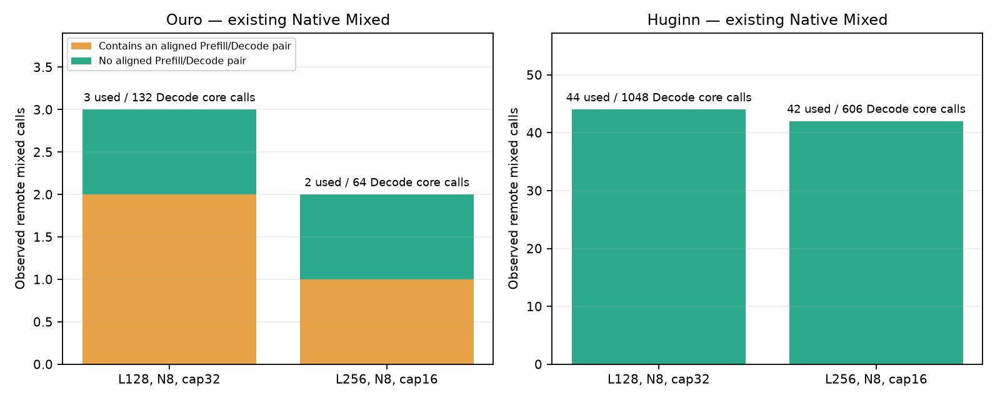
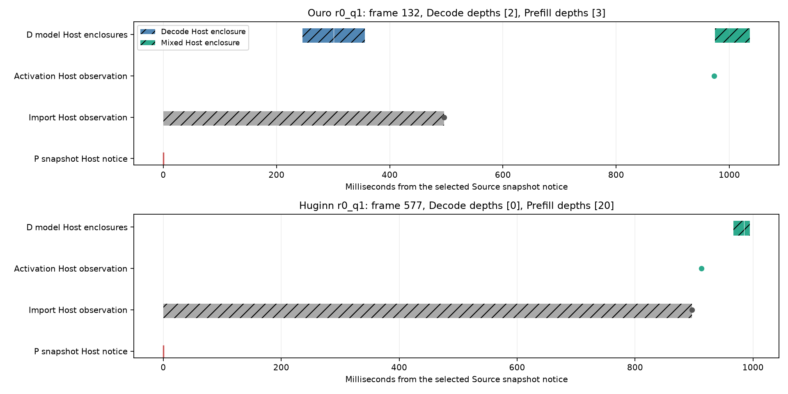

# Remote-ready Cross-depth Prefill–Decode PoC: 최종 요약

## 1. 가장 먼저 내리는 판정

**실제 P→D Continuation을 다른 Depth의 Decode와 합치는 경로는 이미 Native Mixed에 있었다.**
D-local Microbenchmark만 동등했던 것이 아니다.
기존 A Import 경로와 Native Mixed가 Remote-ready 작업을 실제 GPU에서 함께 실행했다.

이번 재분석은 측정 대상 Transfer ID를 Source Cut, D Import와 실행 Descriptor에 연결했다.
기존 진단 4개에서 Ouro Mixed Batch 5회, Huginn Mixed Batch 86회를 확인했다.
이 91개 실행 Descriptor는 현재 Native Policy와 Executor의 CPU 재생도 통과했다.
기존 실행의 핵심 Source Hash도 현재와 일치했다.

따라서 제안한 B4는 **`EQUIVALENT_MECHANISM`: 기존 A + Native Mixed**다.
사용자가 지정한 즉시 중단 조건을 적용했다.
새 GPU Microbenchmark, Online Campaign과 Scheduler 구현은 진행하지 않았다.
Burner는 CPU 분석 내내 유지했다.

| 모델 | 이번 추가 기여 판정 | 새 GPU 실험 | Long-prompt Online 순이익 |
|---|---|---|---|
| Ouro R4 | `NO-GO on tested mechanism` | `NOT_RUN` | `NOT_MEASURED` |
| Huginn R32 | `NO-GO on tested mechanism` | `NOT_RUN` | `NOT_MEASURED` |

이 판정은 Loop 구조의 이점이 없다는 뜻이 아니다.
Cross-depth의 구조적 실행 자유도는 실제로 존재한다.
하지만 그 기능은 CDB와 기존 Native Mixed가 이미 제공한다.
이번 제안에서 그 이상의 새로운 기능이나 Serving 이득을 확인하지 못했다.

**모든 합법적 Ready 기회를 Native Mixed가 이미 사용했다고 증명한 것은 아니다.**
선택되지 않은 Ready Queue와 Deadline 정보는 기존 Trace에 충분히 없다.
전체 미사용 기회 수는 0이 아니라 `NOT_MEASURED`다.

## 2. 조사 범위와 증거 수준

새 분석은 `TRACE_ANALYSIS`, 새 CPU Test는 `CORRECTNESS_ONLY`다.
본문의 기존 GPU 수치는 과거 `MEASURED` 결과다.
이를 이번에 새로 실행한 GPU 결과로 표시하지 않는다.

Publication Branch는 `flashvep/remote-ready-cross-depth-pd-poc-20261113`이다.
Parent는 `367d50336791b4c540404053eadf924544a2ca0f`다.
사용자 Checkout과 실제 Staged Index는 유지했다.
별도 Evidence는 [ouro_huginn_remote_ready_cross_depth_pd_20261113](ouro_huginn_remote_ready_cross_depth_pd_20261113/)에 있다.

원래 3~4시간은 최대 예산이다.
조사는 2026-11-12 15:41:05 UTC, 2026-11-13 00:41:05 KST에 시작했다.
동등성 확인 후 GPU 확장 Gate를 닫았다.
예산을 채우기 위한 반복 실행은 하지 않았다.

## 3. 기존 기법과의 기능 비교

| 방법 | 이미 제공하는 기능 | 이번 제안과의 관계 |
|---|---|---|
| Sarathi-Serve | Decode를 먼저 포함하고, Token Budget 안에서 Prefill Chunk를 같은 Iteration에 배치 | Prefill–Decode Co-batching 자체는 새 기법이 아니다. |
| CDB | Shared Core의 Recurrent Step 사이에 Batch를 다시 구성하고 서로 다른 Depth의 작업을 수용 | Cross-depth Shared-weight Scheduling 자체도 새 기법이 아니다. |
| FluidToken | Prefix KV를 넘겨 D가 Token Suffix를 계산하고, P의 다음 요청을 앞당김 | Remote-ready 작업 공급과 P/D 계산 재분배는 기존 연구 질문이다. |
| 기존 D-local PoC | Separate/Same-depth/Cross-depth의 실제 Core 비용과 정합성 비교 | 이번에 같은 Microbenchmark를 다시 실행하지 않았다. |
| 기존 A + Native Mixed | P의 초기 Loop 계산과 Partial KV/Hidden Import 후 D에서 Prefill–Decode Core 결합 | 이번 B4의 실행 경로와 동등하다. |

[Sarathi-Serve §4.2](https://arxiv.org/html/2403.02310v1#S4.SS2)는 Decode 우선 Token Budget과 Hybrid Batch를 설명한다.
이는 Dense AR의 같은 물리 Layer에서 Prefill과 Decode를 결합하는 기능이다.
서로 다른 Dense Layer의 Weight가 같다는 가정은 하지 않는다.

[CDB §4.1](https://arxiv.org/html/2608.09444)는 단계별 Queue와 Recurrent Batch 재구성을 설명한다.
Recurrent Weight Sharing이 Cross-depth 결합을 가능하게 한다.
논문의 Early-exit 효과나 KV 공유 정책을 이번 고정 R4/R32의 성능 이득으로 옮겨 쓰지 않았다.

[FluidPD §IV-B](https://arxiv.org/html/2610.06917)는 실제 Prefix/Suffix Handoff와 Decode 측의 추가 비용을 설명한다.
TPOT Slack과 KV Headroom에 따른 Stealing은 참고 기능이다.
공식 FluidPD 실행이나 Native-relative ITL 5% 보장을 재현했다고 주장하지 않는다.

## 4. 실제 Runtime 경로

기존 Source Audit의 13개 파일 Hash는 모두 현재와 일치했다.
외부 RLT HEAD는 `6b164d3844d35ab8e753df1864f0c87dc180401a`다.
기존 External Diff Hash도 보존했다.

| 순서 | 실제 경로 | 확인한 의미 |
|---|---|---|
| P Cut | `looped_pd_abc/split.py: prefill_submitted` | Cut 아래의 Prompt 계산 후 Hidden Carrier와 유효 KV를 준비한다. |
| 전송 완료 | `pd/connector.py: progress` | Commit된 모든 Transfer Sequence가 완료돼야 Import를 승인한다. |
| D Resume | `split.py: accept_split` | `import_resume_phase=PREFILLING_RECURRENT`와 Depth Frontier를 복원한다. |
| D Admission | `core/scheduler.py: _admit` | Import된 요청도 일반 Admission Queue에서 Compute Slot을 얻는다. |
| Co-selection | `core/scheduling_policy.py: MixedPolicy.schedule` | `RECURRENT`와 `PREFILLING_RECURRENT`를 함께 선택한다. |
| 실행 Binding | `worker/executor.py: build_execution_batch` | 같은 Operation과 Loop Count를 요구한다. 동일한 Logical Depth는 요구하지 않는다. |
| Hidden Packing | `worker/model_runner.py: _mixed_hidden_sources` | 각 요청의 Hidden을 하나의 연속 Matrix로 수집한다. |
| Shared Core | `worker/executor.py: ModelRuntime.forward` | 합친 Matrix에 기존 `recurrent_prepared` 또는 Graph를 실행한다. |
| Attention | `attention/metadata.py` | Request/Depth별 Sequence와 KV Plane을 구분한다. |

Remote Origin은 Import 단계에서 처리된다.
수락한 State가 같은 Recurrent Queue에 들어간 뒤 별도의 새 Fused Operator는 필요하지 않다.
이 경로는 기존 RCC-PD에서 이미 실제로 실행됐다.

[Source Hash 대조](ouro_huginn_remote_ready_cross_depth_pd_20261113/analysis/source_equivalence_audit.json),
[현재 Policy의 Descriptor 재생](ouro_huginn_remote_ready_cross_depth_pd_20261113/analysis/existing_policy_descriptor_replay.json).

## 5. Phase A: 실제 Remote-ready 기회

### 5.1 집계 규칙

모든 표의 요청 수는 **N8**이다.
이름의 128/256은 Prompt Token 수이며 N128/N256이 아니다.
Output Cap은 32/16이고, 기존 Natural EOS 규칙을 유지했다.
같은 원문 8개를 여러 조건에서 사용했으므로 독립 Prompt 수를 늘려 보고하지 않는다.

Transfer ID로 Source Split, D Import Byte Check와 D 실행 Span을 연결했다.
Warmup은 동일 Seed를 재사용하므로 Seed만으로 제외하지 않았다.
측정 요청의 실제 Transfer ID와 Window를 모두 요구했다.
Source Worker의 Prefill 실행도 Decode 실행 기회에 포함하지 않았다.

다음 두 집계는 다르다.

- **Aligned Pair 포함:** 선택된 Prefill과 Decode 중 같은 Depth의 Pair가 하나라도 있다.
- **Cross-depth-only:** 선택된 Prefill Depth와 Decode Depth의 교집합이 없다.

Aligned Pair가 있다고 전체 Batch를 Same-depth로 실행할 수 있다는 뜻은 아니다.
실제로 아래 Mixed Batch 중 모든 Row가 같은 Depth인 Batch는 0개다.
Strong Aligned Scheduler는 실제 계산과 대기를 통해 이후 Ready Set을 바꿀 수 있다.
그 비용과 효과는 새로 측정하지 않았다.

### 5.2 관측한 실행 수

증거 수준은 `TRACE_ANALYSIS`다.
기존 GPU Diagnostic의 측정 구간만 재분석했다.

| 모델 | Prompt / Cap / N | 실제 Decode Core 실행 | Remote PF+Decode Mixed | Aligned Pair 포함 | Cross-depth-only | Mixed에 참여한 Remote 요청 |
|---|---|---:|---:|---:|---:|---:|
| Ouro R4 | 128 / 32 / 8 | 132 | 3 | 2 | 1 | 7/8 |
| Ouro R4 | 256 / 16 / 8 | 64 | 2 | 1 | 1 | 7/8 |
| Huginn R32 | 128 / 32 / 8 | 1048 | 44 | 0 | 44 | 7/8 |
| Huginn R32 | 256 / 16 / 8 | 606 | 42 | 0 | 42 | 7/8 |

Ouro의 Mixed Prefill Row-visit은 두 조건에서 각각 896/1792개였다.
그중 어떤 선택된 Decode Depth와도 맞지 않는 Row-visit은 각각 128/512개였다.
Huginn은 각각 13,312/26,112개였고, 모두 선택된 Decode와 Depth가 달랐다.
한 Token이 여러 Loop를 거칠 수 있으므로 이 값은 독립 Token 수가 아니다.

이 기회들은 **모두 기존 Native Mixed가 사용한 실제 실행**이다.
후보 B4가 새로 만든 실행이라고 집계하지 않았다.

| 요청한 기회 지표 | 이번에 확인한 상태 |
|---|---|
| 실제 Decode Core 실행 수 | 위 표의 선택된 실행 수를 확인했다. |
| Prefill이 함께 준비돼 선택된 기회 | 위 Mixed 실행 수를 확인했다. |
| 선택된 같은 Depth Pair | 위 Aligned Pair 수를 확인했다. |
| 선택된 Cross-depth-only 기회 | 위 표와 같은 실제 실행이다. |
| Native Mixed가 이미 사용한 기회 | Ouro5회, Huginn86회다. |
| 모든 미선택 Ready-work 기회 | `NOT_MEASURED` |
| KV/Deadline 때문에 거절한 기회 | `NOT_MEASURED` |
| B4가 Native Mixed보다 추가한 Online 기회 | `NOT_RUN`; 기능적 동등성에서 중단했다. |

### 5.3 실제 상태와 시간 연결

32개 측정 Transfer Generation의 유효 KV/Hidden Byte Check가 통과했다.
각 조건은 서로 다른 8개 Transfer Generation을 포함한다.
Warmup 32개는 이 수에 포함하지 않았다.
종료 시 두 Worker의 Request와 Used KV Block은 모두 0이었다.

관측 Mixed Span에서는 D Receive와 Activation의 Host 통지가 실행 전에 있었다.
하지만 해당 통지는 CUDA 실행 시작·종료 시각이 아니다.
정확한 D Compute-ready 시각, ACK 시각과 다음 Decode Deadline은 `NOT_MEASURED`다.
Admission과 Import 통지만으로 미선택 요청을 계속 Ready라고 가정하지 않았다.

예를 들어 Ouro의 측정 Frame132는 Decode Depth2의 1 Row와 Prefill Depth3의 512 Rows를 결합했다.
Projection 입력은 실제 `[513, 2048]`이었다.
Huginn Frame577은 Decode Depth0의 1 Row와 Prefill Depth20의 256 Rows를 결합했다.
주요 Projection 입력은 실제 `[257, 5280]`이었다.
여기서 Depth는 0-based 실행 Descriptor다.
예를 들어 Depth20은 21번째 Recurrent Step을 뜻한다.

Down과 Huginn Adapter의 기존 256-row Numerical Tiling도 유지됐다.
따라서 Core Call 하나가 GEMM 하나라는 뜻은 아니다.
측정 Frame의 Operator Shape와 별도 Warmup Kernel Trace도 구분했다.
새로운 GPU Kernel Count나 HBM Traffic을 측정한 것으로 표시하지 않았다.

[실행별 집계](ouro_huginn_remote_ready_cross_depth_pd_20261113/analysis/observed_opportunities.csv),
[요청별 시간 연결](ouro_huginn_remote_ready_cross_depth_pd_20261113/analysis/remote_request_chronology.csv),
[선택된 D Core Descriptor](ouro_huginn_remote_ready_cross_depth_pd_20261113/raw/selected_D_core_frames.json).

## 6. Phase B: 한계비용과 Same-depth 대조

동등성 중단 조건 때문에 새 Microbenchmark는 `NOT_RUN`이다.
이번에 `T_mixed - T_decode_only`를 새로 측정하지 않았다.
서로 다른 Batch, Context 또는 계측 조건의 중앙값을 빼서 한계비용으로 만들지 않았다.

아래는 기존 D-local 보고서의 GPU 수치다.
이번 실험의 새로운 성과가 아니다.

| 기존 Microbenchmark | Separate | Same-depth | Cross-depth |
|---|---:|---:|---:|
| Ouro | 11.705ms | 6.599ms | 6.594ms |
| Huginn | 4.392ms | 2.348ms | 2.348ms |

Batching 이득은 있었다.
Strong Same-depth 대비 새로운 Cross-depth 연산 이득은 확인되지 않았다.
해당 기존 실험은 실제 한 Step의 정렬 비용을 포함한 대조도 수행했다.
이 수치를 새 Remote-ready Serving의 Marginal Cost로 사용하지 않았다.

| 새 비교군 | 이번 상태 | 이유 |
|---|---|---|
| B0 Decode-only | `NOT_RUN` | 동등성 Gate에서 종료했다. |
| B1 Separate | `NOT_RUN` | 기존 Micro 결과만 보존했다. |
| B2 Strong Same-depth/Aligned | `NOT_RUN` | 실제 정렬 계산·대기의 새 대조가 없다. |
| B3 Existing Native Mixed | `TRACE_ANALYSIS` | 기존 실제 Import와 Mixed 실행을 확인했다. |
| B4 Remote-ready Candidate | `NOT_RUN` | A + Native Mixed와 같은 경로다. |
| B4/B3 측정 Latency 비율 | `NOT_MEASURED` | 같은 구현이라는 사실을 측정된 1.00×로 바꾸지 않았다. |
| 실제 Weight Read / HBM Traffic | `NOT_MEASURED` | Hardware Counter가 없다. |

## 7. Phase C: Online Decode-safe 순이익

Ouro4096/32와 Huginn2048/16의 새 Online 비교는 `NOT_RUN`이다.
새 N8/N32 State Qualification도 수행하지 않았다.
기존 N8 내부 정합성과 이번 CPU 재생을 새 GPU N32 통과로 표시하지 않는다.

기존 RCC의 짧은 128-token N8 결과에서 Ouro Native Mixed는 PD 대비 Makespan1.10× 개선을 보였다.
그 Paired 95% CI는 [1.04×,1.17×]였다.
Huginn은0.99×, 95% CI [0.91×,1.05×]였다.
Ouro의 ITL Tail 악화도 관측됐다.
이 결과는 가장 강한 Mixed를 넘는 새 성능이나 Sustainable Capacity를 입증하지 않는다.

동일 Cross-depth 기능을 허용한 Token Suffix의 새 Online 대조도 `NOT_RUN`이다.
따라서 이번 자료로 엄격한 Loop-specific GO를 내릴 수 없다.
SLO 기준을 바꾸지 않았다.

## 8. 구조적 한계와 미확정 항목의 구분

| 질문 | 답 |
|---|---|
| Cross-depth Ready-work가 실제 존재하는가? | 기존 P→D 실기 실행에서 존재했다. |
| D-local만 가능한 기능이었는가? | 아니다. 기존 A Import도 결합됐다. |
| Native Mixed보다 새로운 실행 경로인가? | 아니다. 동일한 Import, Queue, Core 경로다. |
| 모든 합법적 기회를 Native Mixed가 사용했는가? | `NOT_MEASURED`. 미선택 Ready Queue가 없다. |
| Ready-work 공급량을 더 늘릴 수 있는가? | 장문·Admission·KV 조건을 추가 검증해야 한다. 이번에는 미확정이다. |
| 물리적인 D 여유가 없다고 결론 내릴 수 있는가? | 없다. Temporal/Spatial Capacity를 새로 측정하지 않았다. |
| Strong Aligned Same-depth보다 Online에서 더 나은가? | 새 대조가 없어 입증하지 않았다. |
| 새로운 Loop-specific 연구 기여를 확인했는가? | 기존 CDB/Native Mixed 이상의 기여는 확인하지 못했다. |

기존 Huginn3072/16의 최대 Kernel Gap2.43ms는 긴 Temporal Gap에 대한 결과다.
그 값만으로 Spatial Compute Slack 부재를 주장하지 않는다.
이번 중단 사유도 Slack 부족이나 Profiler 실패가 아니다.
**이미 존재하는 실행 기법과의 동등성**이 중단 사유다.

고정 BF16 R4/R32와 Request/Depth별 KV를 유지한 기존 Runtime을 조사했다.
Original-HF 동등성은 별도다.
기존 HF Triage는 Ouro8/8, Huginn5/8이므로 원본 모델 전반의 Lossless 인증으로 해석하지 않는다.
Full Hidden, 장문 N32, Cancellation과 모든 Failure Recovery의 새 GPU 검증도 `NOT_RUN`이다.

## 9. Figure

위 그래프는 실제로 선택된 기존 Batch만 표시한다.
미실행 후보나 미사용 기회를 0으로 그리지 않았다.

두 번째 그래프는 과거 진단의 Host 관측이다.
회색 구간은 Exclusive Wire Time이 아니다.
빗금 구간은 GPU Kernel이 아니라 Model Host Enclosure다.
빈 구간을 GPU Idle로 해석하면 안 된다.
[Figure Manifest](ouro_huginn_remote_ready_cross_depth_pd_20261113/figures/figure_manifest.json)에 증거 범위를 기록했다.

## 10. 최종 연구 판단

공유 Recurrent Weight 덕분에 서로 다른 Depth를 결합할 수 있다는 직관은 맞다.
실제 Remote Prefill과 Decode가 같은 Core 실행에 들어간 증거도 있다.
하지만 그 실행은 이미 기존 A + Native Mixed였다.

따라서 이 기능을 다시 구현하는 큰 Scheduler 개발은 정당화되지 않는다.
별도의 Admission 또는 Work-supply 정책을 연구하려면 새로운 질문이 필요하다.
그 정책은 기존 Mixed에도 동일하게 제공한 뒤 비교해야 한다.
새로운 합법적 Ready 기회와 Decode-safe 순이익이 있어야 추가 기여가 된다.
이번 PoC는 그 이득을 측정하지 않았다.

이 결과는 Dense AR Layer-wise PD 연구를 대체하거나 무효화하지 않는다.
두 연구의 Spec, Evidence와 판정을 분리했다.

## 11. 재현과 보존

[Spec](ouro_huginn_remote_ready_cross_depth_pd_poc_spec.md),
[분석 코드](../remote_ready_cross_depth_pd/),
[입력 Evidence Hash](ouro_huginn_remote_ready_cross_depth_pd_20261113/state/input_evidence_manifest.json),
[Phase Gate](ouro_huginn_remote_ready_cross_depth_pd_20261113/state/phase_gate.json).

다음 기존 보고서를 지정 Commit과 대조했다.

- [D-local Cross-depth 결과](https://github.com/jyssys/MLLM-EP/blob/3b3633dbc64bcd916c2ba1ff513deb4226cc647d/poc_flashvep/reports/ouro_huginn_loop_aware_d_local_prefill_cross_phase_batching_final_summary.md).
- [RCC-PD 실제 Import/Co-batching 결과](https://github.com/jyssys/MLLM-EP/blob/b53a8fed36a1706ac74754b53753f20edb8b913e/poc_flashvep/reports/rcc_pd_fixed_cut_cobatching_results.md).
- [Prefill-heavy Discovery의 측정 한계](https://github.com/jyssys/MLLM-EP/blob/0efa68913f038bc2b9cab501d5c1b6347d130bbf/poc_flashvep/reports/ouro_huginn_prefill_heavy_decode_safe_loop_offloading_final_summary.md).

새 Source는 기존 Runtime을 수정하지 않는 분석·검증 코드다.
기존 보고서와 Raw Evidence는 변경하지 않았다.
새 GPU Job은 0개이며, 새 성능 수치는 0% 개선이 아니라 `NOT_RUN`이다.
CPU Test 9개가 통과했다.
관측된 Mixed Descriptor 91개의 CPU 재생도 통과했다.
지정 보고서 3개는 해당 Commit의 원문과 일치했다.
입력 Evidence는 변경되지 않았으며 Publication Parent에도 같은 Byte로 보존돼 있다.

GPU0~7의 기존 승인된 Burner를 중단하지 않았다.
실제 Process Ownership과 GPU별 새로운 Generation 완료를 확인했다.
사용자 Checkout, Staged Index와 External Runtime Diff의 Hash도 유지됐다.
[최종 검증](ouro_huginn_remote_ready_cross_depth_pd_20261113/state/verification.json)과
[GPU별 상태](ouro_huginn_remote_ready_cross_depth_pd_20261113/state/final_resources.json)에 기록했다.

Commit/Push 도구는 별도 Index를 사용한다.
그 도구는 Push 후 Remote SHA를 확인한다.
최종 SHA는 사용자에게 전달하는 게시 결과에서 제공한다.
