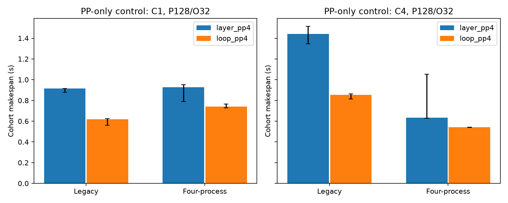

# Benchmark status and bounded PP controls

The requested TP4-versus-PP serving comparison is **NOT_RUN**.
Full-model C2 numerical qualification failed before that comparison.
`primary_matrix_status.csv` lists all 21 frozen R4 rows and their status.
No TP latency, TPS, crossover, or serving-speedup value is available.

The following measurements are bounded PP-only replication and transport controls.
They are not a qualified three-way architecture benchmark.
All rows use R4, P128, O32, whole prompts, and physical GPUs 4–7.
Each cell summarizes three independent physical cohort repeats.

| C | Runtime | Arm | Makespan s, median [min,max] | Output tok/s | TTFT P50 ms | TPOT P50 ms | E2E P50 ms |
| --- | --- | --- | --- | --- | --- | --- | --- |
| 1 | legacy | layer_pp4 | 0.9162 [0.8792,0.9163] | 34.93 | 29.10 | 28.60 | 916.20 |
| 1 | legacy | loop_pp4 | 0.6191 [0.5616,0.6234] | 51.69 | 21.02 | 19.29 | 619.04 |
| 4 | legacy | layer_pp4 | 1.4412 [1.3451,1.5151] | 88.82 | 64.39 | 44.43 | 1422.48 |
| 4 | legacy | loop_pp4 | 0.8538 [0.8147,0.8620] | 149.91 | 51.65 | 25.32 | 847.77 |
| 1 | mp | layer_pp4 | 0.9284 [0.7904,0.9528] | 34.47 | 133.45 | 25.32 | 928.41 |
| 1 | mp | loop_pp4 | 0.7416 [0.7275,0.7655] | 43.15 | 115.73 | 20.19 | 741.60 |
| 4 | mp | layer_pp4 | 0.6326 [0.6289,1.0529] | 202.33 | 32.11 | 19.31 | 630.74 |
| 4 | mp | loop_pp4 | 0.5424 [0.5383,0.5425] | 235.99 | 30.89 | 16.28 | 536.39 |

| C | Runtime | Layer / Loop makespan | 95% paired bootstrap CI |
| --- | --- | --- | --- |
| 1 | legacy | 1.480× | [1.470,1.565]× |
| 4 | legacy | 1.688× | [1.575,1.860]× |
| 1 | mp | 1.252× | [1.066,1.276]× |
| 4 | mp | 1.166× | [1.159,1.956]× |

`pp_controls_raw.csv` retains all 24 cohort measurements.
`pp_controls_summary.csv` also reports P90 request metrics.
The bootstrap uses 5,000 resamples of paired cohort repeats, not ranks, tokens, or layers.
Three pairs provide weak interval coverage. They do not justify a broad significance claim.
The MP Layer-PP C4 measurements span 0.6289–1.0529 s. This dispersion limits interpretation.

The C4 legacy replication differs from the old 1.8765/1.0621 s comparison.
The new legacy medians are 1.4412/0.8538 s.
We report this drift instead of treating historical absolute latency as a matched baseline.
The old study remains unchanged.

## Memory

These are C4/P128/O32, repeat-0 allocator observations.
They are not a maximum-capacity sweep or an NVML peak measurement.

| Runtime | Arm | GPU | Weight GiB | Logical KV GiB | Allocated GiB | Reserved GiB | Peak allocated GiB |
| --- | --- | --- | --- | --- | --- | --- | --- |
| legacy | layer_pp4 | 4 | 0.9493 | 0.1165 | 1.9483 | 2.5918 | 1.9497 |
| legacy | layer_pp4 | 5 | 0.9493 | 0.1165 | 1.9483 | 2.5918 | 1.9497 |
| legacy | layer_pp4 | 6 | 0.9493 | 0.1165 | 1.9483 | 2.5918 | 1.9502 |
| legacy | layer_pp4 | 7 | 0.9493 | 0.1165 | 1.9483 | 2.5918 | 1.9493 |
| legacy | loop_pp4 | 4 | 2.6722 | 0.1165 | 3.6710 | 3.9922 | 3.6725 |
| legacy | loop_pp4 | 5 | 2.6722 | 0.1165 | 3.6710 | 3.9922 | 3.6725 |
| legacy | loop_pp4 | 6 | 2.6722 | 0.1165 | 3.6710 | 3.9922 | 3.6730 |
| legacy | loop_pp4 | 7 | 2.6722 | 0.1165 | 3.6711 | 3.9922 | 3.6721 |
| mp | layer_pp4 | 4 | 0.9493 | 0.1165 | 1.9523 | 2.5918 | 1.9523 |
| mp | layer_pp4 | 5 | 0.9493 | 0.1165 | 1.9523 | 2.5918 | 1.9523 |
| mp | layer_pp4 | 6 | 0.9493 | 0.1165 | 1.9523 | 2.5918 | 1.9523 |
| mp | layer_pp4 | 7 | 0.9493 | 0.1165 | 1.9524 | 2.5918 | 1.9525 |
| mp | loop_pp4 | 4 | 2.6722 | 0.1165 | 3.6751 | 3.9922 | 3.6756 |
| mp | loop_pp4 | 5 | 2.6722 | 0.1165 | 3.6751 | 3.9922 | 3.6751 |
| mp | loop_pp4 | 6 | 2.6722 | 0.1165 | 3.6751 | 3.9922 | 3.6751 |
| mp | loop_pp4 | 7 | 2.6722 | 0.1165 | 3.6752 | 3.9922 | 3.6753 |

The custom TP weight allocation is 1,019,617,282 bytes per rank.
This comes from loaded shard ownership, not a qualified serving run.
Its long-shape graph-workspace peak remains NOT_MEASURED.
Native vLLM reserved a 4 GiB KV pool per rank for the numerical probes.
That configurable pool is not a measured minimum KV requirement.

Logical KV, graph scratch, allocator reserve, and total driver memory are different quantities.
`memory_raw.csv` records scratch and IPC export storage separately where available.
The scratch sum does not include every CUDA Graph private allocation.
CUDA IPC can create peer contexts in several processes. NVML can therefore show more process entries than model owners.
We make no maximum-concurrency, OOM-boundary, or serving-capacity claim.
