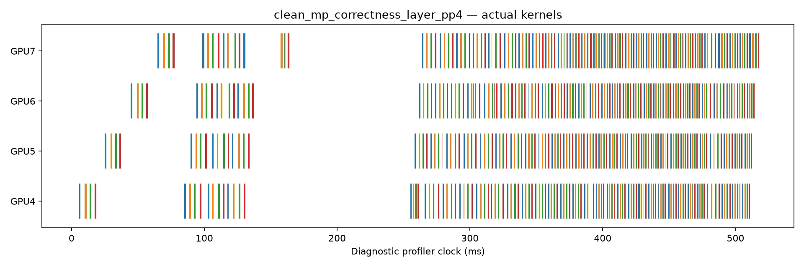
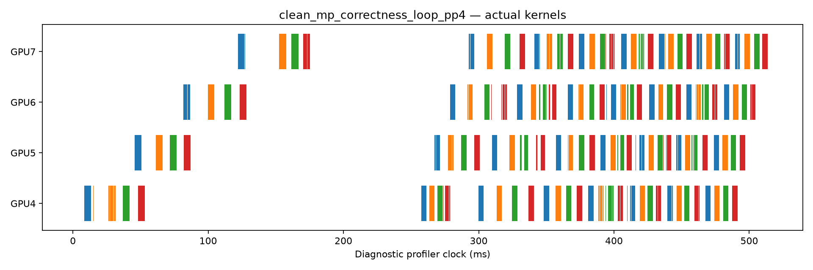

# Common PP transport control

The common control removes the central Python scheduler at intermediate boundaries.
Each GPU has an independent process, FIFO queue, stream, and reusable IPC buffer bank.
Both placements use this same path.
It does not remove local completion waits, graph KV staging, scalar token control, or pipeline dependencies.

At C4/P128/O32, the legacy Layer/Loop median ratio is 1.688×.
The four-process ratio is 1.166×.
The corresponding median makespans change from 1.4412/0.8538 s to 0.6326/0.5424 s.
At C1, the median ratio changes from 1.480× to 1.252×.
The MP implementation does not improve every absolute latency. C1 setup/publication effects remain visible.
Legacy warm-up executes a complete request. MP warm-up executes local graph stages before the first cohort.
The MP C1 clock can therefore include first-use queue or peer-copy effects.
C4 follows a complete C1 cohort in each MP process, but this is not an identical end-to-end warm-up protocol.
The control also changes position-constant preparation and buffer reuse.
These controls show an important implementation contribution to the old PP gap.
They do not isolate one exclusive host-cost component or prove an architecture advantage over TP4.

## Physical overlap and transport

These separate heavy runs use C4/P128/O8 and correctness observers.
They do not supply clean serving latency.

| Arm | Heavy window ms | Different-request kernel overlap ms | P2P copies | P2P MiB | P2P service sum ms |
| --- | --- | --- | --- | --- | --- |
| layer_pp4 | 590.028 | 143.852 | 508 | 31.640839 | 2.138 |
| loop_pp4 | 586.493 | 127.547 | 124 | 6.328339 | 1.507 |

The P2P counts include 28 scalar token returns in each arm.
Hidden transfers account for 480 versus 96 copies.
Their hidden payloads are 33,177,600 versus 6,635,520 bytes.
Scalar token returns add 224 bytes in each arm.
All payloads match runtime receive counters.
The observer also copies final hidden/logit values to CPU for comparison.
Those D2H copies are diagnostics, not intermediate hidden-state transport.

The hidden byte count is `C * (P + O - 1) * 2048 * 2 * handoffs`.
The handoff count is 15 for Layer PP and three for Loop PP.
This exact accounting does not convert byte reduction into latency reduction.
P2P kernel-service sums cannot establish exposed E2E communication cost.

| Arm | GPU | Kernel service ms | Kernel/copy union ms | No recorded activity % |
| --- | --- | --- | --- | --- |
| layer_pp4 | 4 | 125.607 | 126.842 | 78.50 |
| layer_pp4 | 5 | 125.570 | 126.644 | 78.54 |
| layer_pp4 | 6 | 124.684 | 125.753 | 78.69 |
| layer_pp4 | 7 | 132.640 | 133.874 | 77.31 |
| loop_pp4 | 4 | 125.431 | 125.919 | 78.53 |
| loop_pp4 | 5 | 125.335 | 125.835 | 78.54 |
| loop_pp4 | 6 | 124.570 | 125.088 | 78.67 |
| loop_pp4 | 7 | 130.094 | 130.731 | 77.71 |

The last column is the complement of recorded kernel/copy intervals in the heavy window.
It mixes pipeline dependencies, host gaps, waiting, and observer effects.
It is not clean GPU utilization or a measured architectural bubble fraction.
Stage readiness, dispatch, safe publication, and CUDA event brackets remain in each traced rank JSON.
These local brackets do not establish an exclusive E2E critical-path decomposition.

| Profile | CUDA API | Count | Host service sum ms |
| --- | --- | --- | --- |
| layer_pp4 | cudaMemcpyAsync_v3020 | 1704 | 28.805 |
| layer_pp4 | cudaGraphLaunch_v10000 | 512 | 366.374 |
| layer_pp4 | cudaEventSynchronize_v3020 | 512 | 437.580 |
| layer_pp4 | cudaStreamSynchronize_v3020 | 40 | 26.465 |
| loop_pp4 | cudaMemcpyAsync_v3020 | 456 | 11.811 |
| loop_pp4 | cudaGraphLaunch_v10000 | 128 | 404.911 |
| loop_pp4 | cudaEventSynchronize_v3020 | 128 | 354.388 |
| loop_pp4 | cudaStreamSynchronize_v3020 | 40 | 114.866 |

These API times are cumulative host service, not additive E2E shares.
The heavy lane has extra correctness copies and events.
It is not shape-matched to the O32 clean control. A quantitative observer-overhead ratio remains NOT_AVAILABLE.
Both unprofiled and profiled C4/O8 correctness runs pass the same token and full-owner-KV checks.

