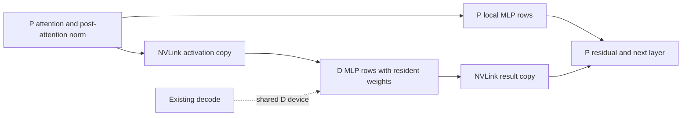

# Resource-complementary parallelism for prefill-heavy PD

The primary setting uses Qwen/Qwen3-8B revision b968826d9c46dd6066d109eabc6255188de91218, original BF16 weights, exact causal attention, deterministic greedy generation, the non-thinking Qwen3 chat template, and APC disabled. Each fixed end-to-end test generates at least 16 tokens. An internal one-token P service request isolates prefill for calibration. It is excluded from end-to-end claims.

Compare 1P/1D and two-replica colocated serving with the same pair of physical H200s. QPS selection starts from the independently overloaded P service witness. Cohort drains remain finite measurements. Native heterogeneous placements use the same P/D topology and per-device cache budget for direct speed comparisons, with GPU-normalized goodput across different budgets.

The fixed joint SLO uses TTFT ≤5,000 ms, TPOT ≤33 ms and every client ITL ≤34 ms. The physical screen seeks at least 10% incremental critical-path savings and a decode p95 slowdown of at most 5%. A promotion also needs exact model semantics, tensor/greedy controls, and evidence against the strongest applicable generic mechanism. The final serving target is a 15% TTFT/goodput/capacity gain or a 10% E2E p95 gain, with at most 5% TPOT p95/ITL p99 regression and quality protection. Use independent starts and retain unsuccessful requests in the denominator.

## Frozen geometry and evidence

- Use exact-token controlled LongBench texts with one seed and fixed Poisson offsets. Report truncation and corpus extension. Score natural responses separately where a committed task contract exists.
- Require P queue and same-window P execution, 80% kernel busy and at least 85% of the independent P witness for the strict Prefill-heavy gate. Distinguish GPM sampled compute activity and an exact CUDA activity interval union. For resource measurements use read-only NVML GPM on H200. Kernel timeline claims require a clean/profile/clean comparison with 5% bounds.
- A pairs real BF16 operators, compares ordinary and higher-priority CUDA streams, tests allocated Green Context resources, and measures P→D→P activation round trips with the D actor present.
- B compares normalized hidden forwarding and destination KV projection with direct physical KV payload, pinned host and the native NIXL counters. Charge P's original prefill projection in both designs.
- C uses original Qwen3-30B-A3B expert tensors with physical distinct expert ownership across GPUs, records Dispatch, Grouped GEMM and Combine, and compares with shared execution.
- D compares two-P-GPU partition approaches on identical real activations and measures all layout transitions. Its gate requires a stronger result than similarly resourced uniform TP or balanced CP.

Resource measurements, timeline-derived statistics, physical operators and active online requests have distinct evidence levels. Reserve MEASURED_ONLINE for real client request/response. Analytic throughput or infinite-bandwidth bounds provide the corresponding ceiling.

The batch-dependent BF16 tolerance for the physical operator and reconstructed state probes is relative L2 ≤0.02. An exact mathematical dependency uses all original rows, weights, residuals and keys. Record numerical mismatches and keep Native A/A separate from matched fixed-geometry correctness.

## Execution dependency

