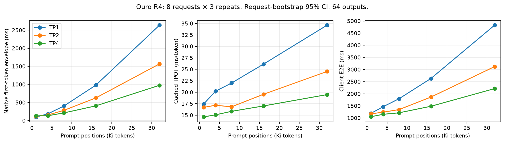
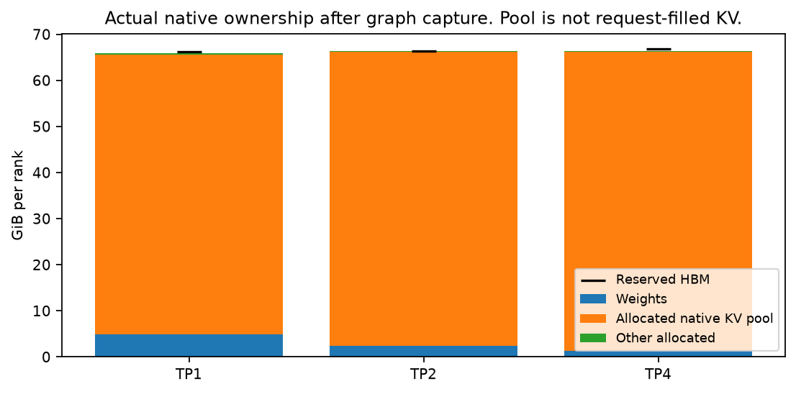
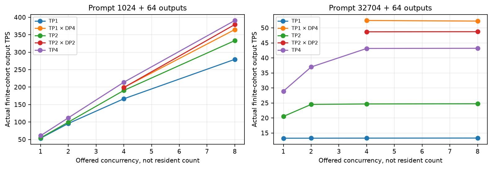
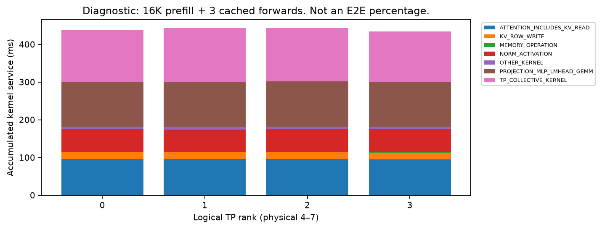
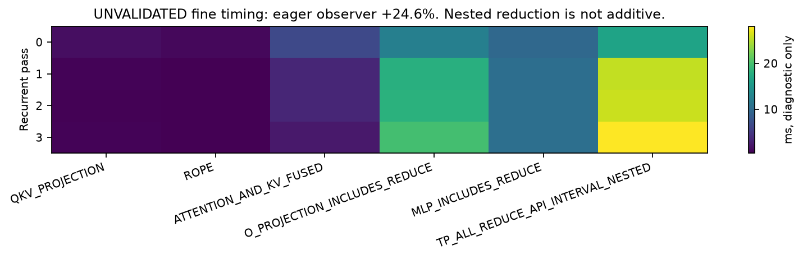
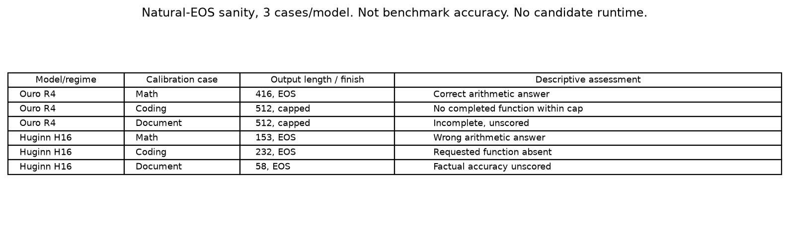

# Looped Transformer KV placement: physical discovery

## Decision and scope

**Method decision: NO_GO_NATIVE_TP_SUFFICIENT, within the tested Ouro regime.**

Native TP4 improves both latency and capacity for the real pretrained Ouro model.
No alternative placement demonstrates additional physical latency or throughput gain.
This campaign does not prove that native TP is globally optimal.
It provides no measured reason to build a new placement engine.

Coverage flags: **MODEL_B_TP_BLOCKED** and **PARTIAL_MODEL_COVERAGE**.
Huginn runs with real pretrained weights on one GPU.
Its official plugin does not provide a valid TP2/TP4 partition for 55 heads.
The findings do not establish a two-family physical multi-GPU result.
Branch: `flashvep/looped-multigpu-kv-placement-poc`.
The delivered commit is the repository revision that contains this report.

Stage C, a candidate attention microbenchmark, and the conditional 24-request held-out expansion are **NOT_RUN**.
Two legal candidate layouts receive an ownership and transfer screen only.
Their unmeasured latency remains **UNKNOWN**, not zero.

## Contract, hardware, and runtime

The unmodified [specification snapshot](authoritative_spec.md) controls this experiment.
The parent revision is `36a737230b7cf412993ce9f7fb40c9974b660867`.
Only physical GPUs 4, 5, 6, and 7 execute this PoC.
All four devices are H100 80 GB GPUs on the NV18/NVSwitch fabric.
The full visible-device order maps logical ranks 0, 1, 2, and 3 to physical GPUs 4, 5, 6, and 7.

| Physical GPU | UUID suffix |
|---|---|
| 4 | `6076e2f2-5b63-3761-5586-56ceb7df8139` |
| 5 | `a1a1cfcf-93a1-3544-9a5e-e58144b68730` |
| 6 | `e3f3998e-0f1a-e94a-b97c-4abb0e8c2c28` |
| 7 | `4cc26b88-19fc-1988-f9e0-17858aa7a99b` |

Ouro uses native vLLM `0.26.0+cu129`, PyTorch `2.11.0+cu129`, and Transformers `5.16.1`.
The native backend is FlashAttention 3 with compilation and decode CUDA Graphs.
Graphs cover batch sizes 1, 2, 4, and 8.
The main native cache policy reserves 85% of GPU HBM for the engine.
Prefix caching, chunked prefill, and asynchronous scheduling are disabled.
The primary fixed recurrence is four.

Huginn uses its official Hugging Face code, PyTorch `2.8.0+cu128`, and Transformers `4.57.1`.
The primary reference has 16 recurrent steps and full `HuginnDynamicCache`.
It preserves the official stochastic initial state and resets seed 41015 per request.
Fixed recurrence removes adaptive depth sampling.
Its single-GPU reference is not an optimized multi-GPU serving baseline.

The existing environments were read without package upgrades.
The [environment record](results/env_and_revisions.json) contains topology, driver, runtime pins, and initial worktree hashes.
The [source pin](results/runtime_source_pin.json) identifies the installed implementation and official Huginn plugin revision.
No clock or power policy changed.
Other users remained active on GPUs 0–3. Their processes were not modified.
Unused assigned GPUs retained burners under the requested policy.
This is not a globally idle-machine experiment.

## Actual model and cache geometry

| Field | Ouro | Huginn |
|---|---|---|
| Checkpoint | `ByteDance/Ouro-2.6B-Thinking` | `tomg-group-umd/huginn-0125` |
| Revision | `f1edd81e7ac41355db670500ceaf204e0f73af68` | `bb6621b65e90b6a4b9b29ef88dc83866d450470c` |
| Stored physical layers | 48 | 2 prelude + 4 shared core + 2 coda |
| Primary recurrence | 4 | 16, from the documented bounded example |
| Logical attention depth | 192 | 68 |
| Q/KV heads and dimension | 16/16, dimension 128 | 55/55, dimension 96 |
| Actual unique BF16 weights | 5,335,949,314 bytes at TP1 | 7,129,953,600 bytes |
| Full-cache index | `loop * 48 + layer`, then token position | `step_index`, then token position |
| Primary distinct cache slots | 192 | 68 |
| Logical KV bytes/token | 1,572,864 total | 1,436,160 total |
| Native physical TP | TP1, TP2, TP4 | TP2/TP4 unsupported in the audited stack |

The Ouro card says 24 layers. The actual pinned tensors and loaded modules show 48 independent layers.
Those modules execute four times. The 192 cache regions have distinct storage pointers.
Weight sharing does not imply shared KV values.
The official reference records the loop/layer/cache progression for four real forwards.

Ouro's configuration permits 65,536 positions. Its Thinking documentation describes 32K SFT.
This campaign limits total positions to 32,768.
Performance prompts contain 1024, 4096, 8192, 16384, or 32704 tokens.
The largest point adds 64 output tokens. It is a **32K-capacity request**, not a 32,768-token prompt.

Ouro's native TP1/TP2/TP4 caches own 16/8/4 KV heads per slot.
Logical bytes per token per rank are 1,572,864 / 786,432 / 393,216.
The aggregate logical payload remains constant.
The 8 GiB-per-rank smoke deliberately allocates similar pool memory at different TP degrees.
TP4 instead increases that pool's token capacity by approximately four times.
This does not indicate failed head sharding.

Huginn supports 4096 positions in the pinned configuration.
Its performance prompts contain 1024 or 4032 tokens, followed by 64 outputs.
The separate real H32 probe has 132 full-cache slots.
For 35 cached positions, H32 holds 97,574,400 logical KV bytes and 243,936,000 unique backing bytes.
The H16 full-cache probe holds 50,265,600 logical bytes and 125,664,000 unique backing bytes.
Both retain 2.5 times the logical payload through tensor views.
K views retain rotated Q/K backing. V views retain combined Q/K/V backing.
This is an implementation allocation finding, not measured HBM traffic or a universal loop-model property.

The official `compress-s16` policy uses 20 cache indices at H16 and H32.
The 16 denotes recurrent cache indices, not 16 full recurrent stacks.
The H16 probe reduces unique backing to 36,960,000 bytes.
Its continuation changes from `[8553, 295, 12992, 46]` to `[8553, 38127, 11219, 46]`.
It is a semantics-changing secondary baseline, not an exact placement method.

The [architecture contract](architecture_contract.md), [cache contract](cache_contract.md), and raw ownership records contain tensor shapes, strides, offsets, and storage identities.

The fallback audit also inspects the [official xLLM-Loop release](https://github.com/ifm-ai/xllm-loop).
Its pinned `IFM/LoopedLM-P1-dense-huginn-336b` checkpoint has 24 Q heads, six KV heads, and 2,998,060,032 stored tensor bytes.
Its metadata declares Apache 2.0. The [audit](results/fallback_audit.json) records the exact revisions and source hashes.
The release uses a native xLLM loader, not the installed serving executors.
Six KV heads also prevent an ordinary equal-head TP4 partition.
We do not port that executor or count this metadata audit as physical second-model evidence.

## Workload and statistical units

The frozen calibration cohort has eight requests per model: three coding, three math, and two document requests.
Selection preceded GPU outputs.
Inputs use pinned public source material and tokenizer-specific contiguous corpus ranges.
These ranges are not guaranteed to be file-, article-, or question-disjoint from prior source assets.
They are calibration data, not a fresh held-out evaluation.

Each native performance request returns exactly 64 deterministic tokens with EOS ignored.
The final returned token does not receive another forward.
The filled cache therefore contains prompt length plus 63 positions.
Natural-EOS sanity runs are separate.

Each configuration has three warmups and three technical repeats.
Reported B1 means average repeats within each request.
Confidence intervals use 2000 request-bootstrap resamples.
Neither layers, loops, tokens, nor technical repeats count as independent requests.
Native TP layouts execute sequentially because their large cache pools cannot coexist.
Their order is not counterbalanced across engine instances.
Temporal machine variation remains a limitation.

The clean wall boundary is the client `LLM.generate` call after model loading, capture, and warmup.
Input IDs are already prepared. Standard output handling remains inside that boundary.
Engine first-token and cached-decode intervals use native scheduler timestamps.
Those intervals are not kernel service measurements.
The TP4 4096-token point includes a retained client/engine gap. Its cause remains unresolved.

## Measured native B1 performance

Values are request means. All points generate 64 tokens.
The first-token column is the engine prefill envelope, not attention-only GPU time.

| Prompt tokens | Layout | First-token envelope ms | Cached TPOT ms/token | Client E2E ms |
|---:|---|---:|---:|---:|
| 1024 | TP1 | 96.840 | 17.398 | 1195.277 |
| 1024 | TP2 | 119.791 | 16.687 | 1173.537 |
| 1024 | TP4 | 131.226 | 14.612 | 1054.293 |
| 4096 | TP1 | 187.872 | 20.217 | 1464.856 |
| 4096 | TP2 | 155.285 | 17.161 | 1239.654 |
| 4096 | TP4 | 134.956 | 15.066 | 1151.832 |
| 8192 | TP1 | 404.092 | 22.003 | 1794.663 |
| 8192 | TP2 | 283.236 | 16.816 | 1346.744 |
| 8192 | TP4 | 212.775 | 15.830 | 1214.190 |
| 16384 | TP1 | 980.175 | 26.124 | 2632.074 |
| 16384 | TP2 | 627.080 | 19.548 | 1864.645 |
| 16384 | TP4 | 407.685 | 17.005 | 1484.930 |
| 32704 | TP1 | 2638.904 | 34.631 | 4830.185 |
| 32704 | TP2 | 1568.244 | 24.531 | 3120.965 |
| 32704 | TP4 | 976.125 | 19.485 | 2213.117 |

At the largest prompt, TP4 reduces paired B1 E2E by **54.18%**, 95% CI **[54.03%, 54.28%]**, versus TP1.
TP2 reduces it by **35.39%**, 95% CI **[35.32%, 35.44%]**.
This is a measured benefit of existing native TP, not a new method.
TP4 is not merely a capacity enabler.

The official Huginn H16 single-GPU reference measures:

| Prompt tokens | Prefill ms | Cached TPOT ms/token | E2E ms | Peak allocated GiB | Peak reserved GiB |
|---:|---:|---:|---:|---:|---:|
| 1024 | 415.91 | 108.73 | 7266.05 | 10.51 | 11.31 |
| 4032 | 1361.69 | 254.89 | 17419.49 | 21.79 | 26.91 |

These numbers do not compare model architectures at equal depth or equal engine optimization.
The main Huginn run uses physical GPU 5 because GPU 4 was occupied by the Ouro campaign.
Its natural-EOS and H32 diagnostic probes use GPU 6.
All devices remain within the allowed set.

## Capacity, throughput, and actual HBM

Native Ouro pools contain 2585 / 5433 / 11081 pages at TP1/TP2/TP4.
Each page holds 16 token positions across its rank-owned heads.
The main pool bytes per rank are 65,053,655,040 / 68,362,960,896 / 69,715,623,936.
These are actual allocated cache tensors, not request-filled KV.
Weights per rank are 5,335,949,314 / 2,668,369,922 / 1,334,580,226 bytes.
The [memory table](results/memory_per_rank.csv) records allocated, reserved, and peak PyTorch memory after each measured wave.
CUDA context and non-PyTorch allocations are not inferred from those counters.

The largest completed request fills 32,767 positions, nearly 48 GiB of aggregate logical KV.
Native TP4 logs five running requests and three waiting requests at offered concurrency eight.
That is **five resident requests**, not eight.
Native TP1 has capacity for one such request. Excess requests queue rather than proving additional residency.
Short-context concurrency eight is only the tested ceiling. It is not a measured physical maximum.

The optional controls execute four independent native TP1 engines or two independent native TP2 engines.
Each uses the same checkpoint, recurrence, native backend, and per-device HBM policy.
These are actual concurrent engines, not a sum of isolated TPS estimates.
Controller wall includes the release gate and result IPC.
Aggregate TPS divides all output tokens by actual finite-cohort wall time.
The three repeats do not provide independent cohort-level confidence intervals.

| Four-GPU layout | Prompt tokens | Offered concurrency | Mean aggregate TPS | Three-repeat TPS range | Mean per-repeat engine request P95 ms |
|---|---:|---:|---:|---:|---:|
| TP4 | 1024 | 8 | 390.840 | 390.434–391.372 | 1255.67 |
| TP2 × DP2 | 1024 | 8 | 379.228 | 372.344–383.270 | 1312.83 |
| TP1 × DP4 | 1024 | 8 | 364.771 | 360.237–367.407 | 1374.30 |
| TP4 | 32704 | 8 | 43.196 | 43.056–43.366 | 10851.95 |
| TP2 × DP2 | 32704 | 8 | 48.723 | 48.714–48.730 | 8928.11 |
| TP1 × DP4 | 32704 | 8 | 52.258 | 52.246–52.267 | 7697.60 |

Each point completes the same eight-request cohort with 64 outputs per request.
Engine request P95 starts at the native queue timestamp, not the controller's wall boundary.
It is descriptive, not a population P95 estimate.
TP4 wins this short-context throughput comparison. TP1 × DP4 wins the long-context comparison.
This is a native serving-layout tradeoff, not a new recurrent-KV method.

See [cohort throughput](results/cohort_throughput.csv), [capacity frontier](results/capacity_frontier.csv), and [replica throughput](results/replica_throughput.csv).
Request latency quantiles are descriptive within this small cohort.
Throughput gain is not B1 latency gain.

## Physical profiling and attribution limits

The optimized TP4 profile uses one frozen 16K request with four output tokens.
It measures one prefill and three actual cached forwards.
Its clean wall mean is 463.54 ms. The profiled wall is 485.21 ms.
Observer overhead is 4.67%. Output tokens match.
This is a diagnostic profile, not the 64-token headline.

Rank 0 prefill kernel service includes:

| Kernel category | Service ms |
|---|---:|
| TP collective kernels | 126.557 |
| Attention, including KV reads | 81.755 |
| Fresh KV row writes | 16.341 |

The three cached forwards average approximately 4.764 ms of attention kernel service on rank 0.
Each adds approximately 0.455 ms of KV row-write service.
Collective kernel service varies across those forwards.
Kernel duration includes protocol execution and possible rank readiness effects.
Pure data movement, rank waiting, and KV bandwidth remain **UNRESOLVED**.

The trace records 385 large-prefill NCCL All-Reduce kernels and 1155 cached custom reduction kernels per rank.
The model executes 384 layer reductions plus one embedding reduction per forward.
It also gathers distributed output logits.
Small cached forwards use native `cross_device_reduce_1stage` kernels.
Not every TP collective is NCCL.
These dense models have no MoE EP Dispatch/Combine All-to-All.
FlashAttention's internal combine kernel is not an EP Combine collective.

Kernel service, GPU busy union, GPU execution span, and client wall remain separate accounts.
Their sums do not establish a non-overlapped E2E percentage.
Per-rank profiler clocks are not cross-rank aligned.
No critical-rank waiting claim follows from subtracting those clocks.

The outer CUDA-event lane measures every model and sampler call over all 64 outputs.
Its paired observer increase is **0.536%**, 95% request-bootstrap CI **[0.429%, 0.641%]**.
Same-configuration output parity passes.
The events can contain host gaps inside an API interval.
They do not isolate attention or all-reduce critical-path shares.

An eager source diagnostic provides loop/layer labels separately.
Its first attempt exhausted its event pool because shared RoPE modules received repeated hooks.
The observer now installs one hook per object and method.
The failed evidence remains preserved. It contributes no latency result.
The [observer validity record](results/observer_validity.json) controls interpretation of the separate retry.
Any observer increase above 10% makes quantitative fine attribution **UNVALIDATED**.
The revised eager observer adds 24.624% wall time and preserves output.
Its loop heatmap is **UNVALIDATED for quantitative attribution**.
It does not support a latency headroom claim.

## Candidate placement screen

The [ownership and transfer ledger](results/oracle_costs.json) screens two exact layouts.
It does not assign latency to unmeasured transfers.

**TP2 compute with CP2 KV ownership.**
Physical GPUs 4/5 own TP2 weights and compute.
GPUs 6/7 own the remaining sequence shards for those head groups.
Each owner ideally stores one-quarter of total KV.
The two compute ranks retain one-half of the weights each.
Each layer needs query delivery, partial attention results, exact softmax statistics, and fresh KV publication.
The logical extra query/result/LSE payload is 1,585,152 bytes per cached forward.
Fresh remote KV updates add 1,572,864 logical bytes per cached forward.
Protocol bytes, layout conversion, kernel submission latency, and contention are not measured.
This layout does not reduce aggregate exact KV or weight storage.
It gives only two GPUs the projection/MLP work that native TP4 distributes across four.
Its achievable latency is **UNKNOWN**.

**One recurrent pass per GPU.**
Each owner retains one-quarter of the loop-indexed KV but needs the full shared core weights.
B1 recurrence remains sequential across the four owners.
The layout adds three hidden-state boundaries and final-token feedback.
It replicates the core instead of reducing aggregate KV.
Independent requests could fill a pipeline, but native DP controls already test that resource alternative.
No measured throughput advantage supports this candidate.

At the largest workload, a 25% improvement over five resident requests requires seven requests.
Their exact KV alone exceeds total HBM across all four GPUs, even with zero weights and workspace.
This bound applies only to that uncompressed workload.
Six resident requests could require different native allocator policy and would improve capacity by only 20%.
Neither statement proves global latency optimality.

No candidate passes the physical latency, throughput, or generality gate.
We do not build an unmeasured placement engine to rescue the premise.

## Correctness and quality

The official Ouro reference and native TP1/TP4 smoke return `[198, 198, 19, 21745]`.
The official reference confirms 192 separate cache slots and the expected cache growth.
BF16 top-token log probabilities differ slightly across implementations.
Full-vocabulary numerical equivalence is **NOT_RUN**.

All main same-configuration technical repeats preserve their 64 output tokens.
The outer-event observer also preserves all output tokens.
Different TP accumulation can change greedy continuations.
At the largest prompt, TP1/TP2 match all 64 tokens on six of eight requests.
TP1/TP4 match on five of eight requests.
This native numerical variation is not hidden as exact cross-TP parity.
No candidate placement changes routing, precision, or cache semantics.

Natural-EOS sanity uses three metadata-selected calibration prompts per model and a 512-token cap.
It is not official benchmark accuracy.
Ouro answers the arithmetic case correctly with 416 tokens and EOS.
Its coding and document cases reach the 512-token cap without a completed final response.
Huginn H16 ends all three cases with EOS.
It answers the arithmetic case incorrectly and does not deliver the requested coding function.
The document answer is not scored for factual accuracy.
These limitations prevent a broad quality claim.
No HumanEval code executes. No benchmark accuracy or candidate accuracy PASS is claimed.

The Huginn full-cache clean/event smoke preserves output with a fixed seed.
Its cold/warm smoke pair is not an observer-overhead experiment.
H32 is a separate cache-geometry probe, not a quality rescue or primary-depth change.

## Prior boundary and next action

[Prior overlap](prior_overlap.md) covers Ouro, Huginn, FlashLoop, MELT, latent attention, dynamic depth, depth batching, WaveFront, LoopSpec, and generic TP/CP.
No prior method is reproduced as a performance baseline.
Cross-loop KV compression, learned sharing, speculative execution, and distributed softmax are not new contributions here.
Huginn's retained backing allocations are a generic reference-layout issue.
Native TP's head sharding and extra aggregate capacity are existing mechanisms.
Model-agnostic placement value remains **NOT_ESTABLISHED**.
The ownership ledger is general, but two-family physical performance evidence is absent.

Do not start a new loop-aware placement framework from this evidence.
If this direction resumes, first require a second pretrained recurrent model with valid native physical TP.
Any later candidate must beat the best measured native TP/DP layout at matched quality and tail latency.

Reproduction commands are in [reproduce.md](reproduce.md).
Machine-readable gates and final audit accompany this report.
All failed runs remain available. No unrelated worktree change was reset or cleaned.

## Gate summary

| Gate | Outcome | Evidence boundary |
|---|---|---|
| Runtime feasibility | PASS for Ouro TP1/TP2/TP4 | Actual weights, cache owners, UUIDs, and physical reductions |
| Novel capacity benefit | NOT_DEMONSTRATED | Native TP already shards full KV. Largest-workload seven-request KV exceeds total HBM |
| Novel B1 latency benefit | NOT_DEMONSTRATED | No candidate runtime. TP4 is the fastest tested native B1 layout |
| Novel four-GPU throughput benefit | NOT_DEMONSTRATED | Actual TP4, TP1 × DP4, and TP2 × DP2 controls exist |
| Independent-family physical generality | BLOCKED | Huginn has 55 heads. The fallback needs another executor and a different KV partition |
| Native bounded correctness | PASS within stated scope | Reference smoke, repeat parity, observer parity, and distinct cache storage |
| Official benchmark quality | NOT_RUN | Six natural-EOS sanity cases are not benchmark accuracy |
| Candidate quality/E2E | NOT_RUN | No Stage C implementation |
| Final method decision | NO_GO_NATIVE_TP_SUFFICIENT | Bounded to tested Ouro regimes, not a universal optimality proof |
