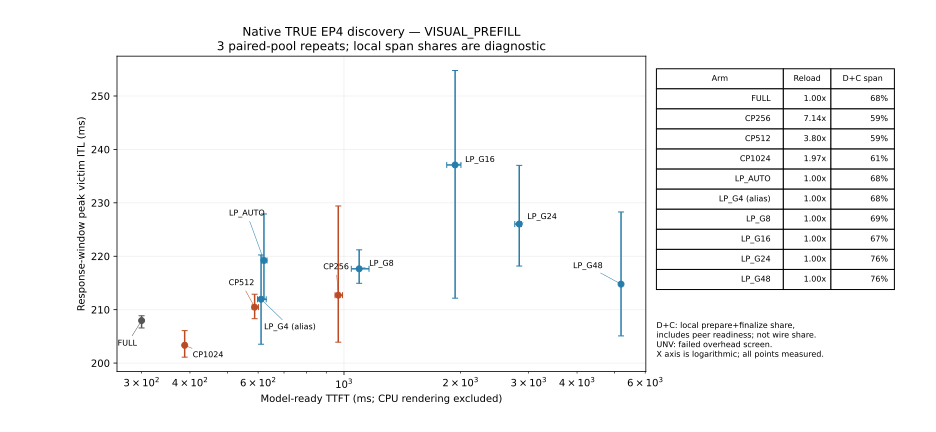
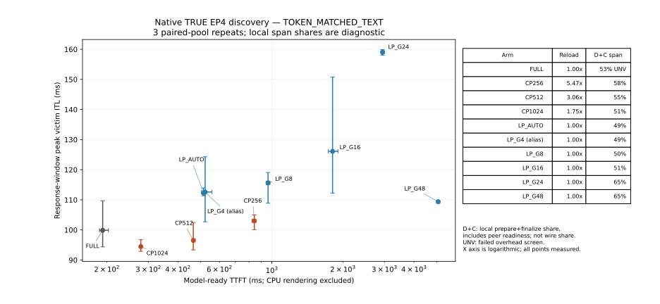

# Falsification / Pareto analysis

The plots include every completed discovery point, not only the fastest samples: CP256/512/1024, LP_AUTO/G4/G8/G16/G24/G48 and Full. They show actual measured TTFT versus response-window peak ITL with wave-bootstrap intervals. ReloadAmp and local prepare+finalize span shares are annotated where measured; these shares are not isolated network service fractions.

Frozen best LP: **LP_G8**; eligibility at discovery: **False**. The final ten-repeat set is confirmation, not data for selecting another group count. A remaining endpoint trade-off is not automatically an EP-specific research gap. Producer preparation, row gathers/scatters, stage rescheduling and intermediate discarded sampling are included prototype costs and must not be misreported as an intrinsic EP lower bound.

## What is and is not falsified

Native LP solves the **CP-specific expert reload** problem: every LP group count
has ReloadAmp 1.000x and Full-like active mixed expert execution. AUTO/G4 also
has substantially lower TTFT than finer LP groups. G8 was frozen from the noisy
three-repeat discovery minimum; final G8 is not better than AUTO, and we do not
reselect a winner or claim group count must monotonically improve peak TBT.

No tested visual point passes the complete response-window 1.5x decode-median
proxy, owing to the first producer iteration. Later stages alone generally do.
This leaves a **tested visual-input producer Pareto residual**, not a demonstrated
communication-only slicing opportunity. Native row gathers/scatters, intermediate
discarded sampling and repeated useful resident decode contribute to fine-group
TTFT. Their overhead cannot be generalized as an intrinsic LP or EP deficiency.

Thus retire the prior blanket claim that LP cannot maintain expert efficiency,
and do not promote communication-only chunking from this campaign. Investigate
lossless asynchronous multimodal input preparation/delivery first, and validate
outside this controlled harness before claiming a general serving bottleneck.
There is no new adaptive scheduler, communication slicing or model approximation.
